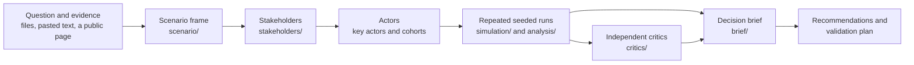
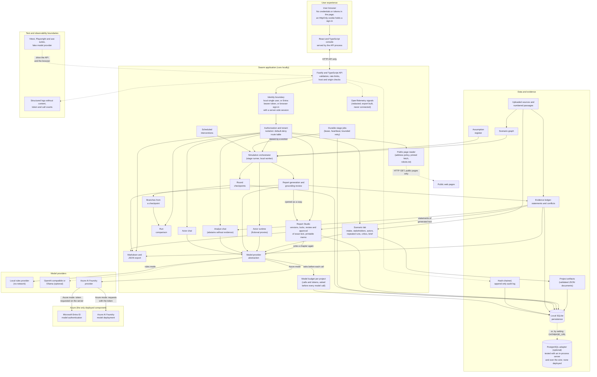

# Swarm Lab architecture

Swarm explores "What could happen if X changes?" for any question. One Node.js 24 process serves a
React console and a Fastify API over one validated store: a SQLite file by default, or PostgreSQL.
Two engines share the project and its evidence:

- **The scenario lab** (this build, [ADR 0014](./docs/adr/0014-scenario-lab.md)): a path from a
  question to a decision brief. It reads the question into a scenario, finds stakeholders in the
  evidence, makes synthetic actors, runs a pure seeded population simulator many times for a baseline
  and its alternatives, reports what held across the runs, lets critics challenge the analysis and
  writes a brief with recommendations and a validation plan.
- **The deep dive**: the original five-stage agent workflow (graph, environment, simulation, report,
  interaction) with fictional proxies, optional model-driven decisions, pause, intervention, branching,
  the evidence ledger, a grounded report, chat and Report Studio.

Every step has a rules path that needs no model, key or network, and a model is optional and never
silent. Nothing in the engine, the stakeholder step or the brief is written for a market, product or
industry; the example scenarios are only a question and some synthetic documents.

| To learn about                  | Read                                                                                                                                                                                                          |
| ------------------------------- | ------------------------------------------------------------------------------------------------------------------------------------------------------------------------------------------------------------- |
| The lab, end to end             | [The scenario lab flow](#the-scenario-lab-flow) below, then the per-feature pages in [docs/analysis/](./docs/analysis/engine.md), [intake](./docs/scenario-intake.md), [stakeholders](./docs/stakeholders.md) |
| The system as a whole           | [System diagram](#system-diagram) and [Implemented module boundaries](#implemented-module-boundaries)                                                                                                         |
| The deep dive                   | [The five stages](#the-five-stages-of-the-deep-dive), [Local components](#local-components) and [Checkpoints, pause/resume, branching and comparison](#checkpoints-pauseresume-branching-and-comparison)      |
| Storage, both dialects          | [Persistence and failure semantics](#persistence-and-failure-semantics)                                                                                                                                       |
| What is not built or not proven | [Known limitations](#known-limitations)                                                                                                                                                                       |
| The routes and their shapes     | [docs/API.md](./docs/API.md)                                                                                                                                                                                  |

## The scenario lab flow



Each box that keeps a result keeps it as one validated JSON document of the project (an _artifact_,
below). Every route is in [docs/API.md](./docs/API.md); `backend/src/auth/policy.ts` says who may call
each one, and `auth/audit-policy.ts` what it records (counts and identifiers, never a question, a
quote or a name).

| Step                 | Code (`backend/src/`)                                                                                   | Contract (`shared/`)                           | Kept as artifact                  | Rules path                                                                                                                                                                         | Model path (optional)                                                                                                                                                                                                            |
| -------------------- | ------------------------------------------------------------------------------------------------------- | ---------------------------------------------- | --------------------------------- | ---------------------------------------------------------------------------------------------------------------------------------------------------------------------------------- | -------------------------------------------------------------------------------------------------------------------------------------------------------------------------------------------------------------------------------- |
| Question to scenario | `scenario/` (`parse`, `rules`, `model`), `routes/scenario.ts`                                           | `scenario.ts`                                  | `scenario`                        | Patterns: an if or when clause, verbs of change, amounts, places, spans of time, named groups                                                                                      | Only when the person chose a model (`useModel`: a Model assisted project) and the server has one: one validated reading, at most two repairs, 170 seconds; if it fails or runs out of time the rules read it and a note says why |
| Evidence             | `ingest/url/` (`extract`, `boilerplate`), `ingest/pdf.ts`, `knowledge/`, `routes/evidence.ts`           | `scenario.ts` (provenance), `types.ts`         | none (the project)                | Files, pasted text, text PDFs, and one public page fetched by the server (its own text, without its menus and footers); numbered passages                                          | None of its own. Fetched text is untrusted data wherever a model sees it                                                                                                                                                         |
| Stakeholders         | `stakeholders/` (`discover`, `rules`, `mentions`, `tone`, `review`), `routes/stakeholders.ts`           | `stakeholders.ts`                              | `stakeholders`                    | A generic role lexicon read over the passages (a menu, a list of names or a row of links is not read as a sentence), cited verbatim quotes, a tone reading for direction of impact | Only for a Model assisted project: one validated call (170 seconds), every quote checked against its passage; on failure the text is read instead                                                                                |
| Actors               | `stakeholders/actors.ts`, `priors.ts`                                                                   | `stakeholders.ts`                              | `actors`                          | A key actor for each key stakeholder, a cohort for the rest, every trait from a documented category prior                                                                          | Only for a Model assisted project: optional reading of each key actor against the evidence; failures leave the priors                                                                                                            |
| One simulated run    | `simulation/` (`simulate`, `dynamics`, `responders`, `signals`, `response`)                             | `analysis.ts`                                  | none (pure)                       | The only engine here: a seeded, deterministic update of every member's stance each round, with generic responders reacting to aggregate signals                                    | None. A model never decides an actor's behaviour in the repeated runs                                                                                                                                                            |
| Comparison           | `analysis/` (`service`, `runset`, `variants`, `findings`, `sensitivity`, `stats`), `routes/analysis.ts` | `analysis.ts`, `analysis-plan.ts`, `signal.ts` | `analysis` (one for each run set) | Baseline, proposed change and each alternative, on the same seeds; findings with Wilson intervals; one-at-a-time sensitivity                                                       | None                                                                                                                                                                                                                             |
| Independent review   | `critics/` (seven critics), `routes/critiques.ts`                                                       | `critique.ts`                                  | `critiques`                       | Fixed rules over the scenario, stakeholders, actors, analysis and brief                                                                                                            | Only for a Model assisted project (`409 MODEL_NOT_AVAILABLE` otherwise): an optional digest sent to a model for extra objections, validated, 170 seconds; it can add and never edit                                              |
| Decision brief       | `brief/` (`build`, `sections-*`, `recommend`, `export`), `routes/brief.ts`                              | `brief.ts`                                     | `brief`                           | Assembled from the other artifacts: 17 sections, every statement with one of ten origins and its references                                                                        | None. `generatedBy` is `rules`                                                                                                                                                                                                   |
| Progress             | `lab/progress.ts`                                                                                       | `lab.ts`                                       | read, not kept                    | A summary of which artifacts exist, added to `GET /api/projects/:id` as `lab`                                                                                                      | None                                                                                                                                                                                                                             |

### The artifact store

Everything a project carries beyond its own record is a row of `project_artifacts` (project, kind, key,
revision, payload, created and updated times), made by migration 9 on both dialects. A kind is a zod
schema in `shared/artifacts.ts`; the code that owns the kind writes it and every read and write is
checked against the schema, so a new kind needs a schema and no new table. `scenario`, `stakeholders`,
`actors`, `critiques` and `brief` have one document, under the key `default`; `analysis` has one for each
run set, keyed by its id, and a project keeps the newest twelve (never the one that the brief or the review
was made from). A write may carry the revision it was
made from, and a stale writer is refused with `409 ARTIFACT_CONFLICT` instead of overwriting. A
document may not exceed 2,000,000 bytes. Artifacts go when their project does (a foreign key with
cascade), a branch copies the `scenario`, and `project_artifacts` is one of the tables that
`npm run db:copy` carries between SQLite and PostgreSQL. The contract also reserves four `backtest-*`
kinds; no engine or route uses them (see [Known limitations](#known-limitations)).

### Reading a public page

`POST /api/evidence/url` hands the address to `ingest/url/`: `policy.ts` judges it as written,
`fetcher.ts` resolves the name, judges every answer and connects only to addresses that passed,
`robots.ts` reads and obeys robots.txt through the same fetcher, redirects are followed by hand and
judged again, `extract.ts` and `normalize.ts` turn the body into text without running anything, and
`ingest.ts` and `provenance.ts` make a document with its provenance. The server remembers each page it
fetched for one person for an hour (`FetchRegistry`), and a project created later keeps the claim
`fetchedByServer` only for exactly that text and person. Every rule, and the test for it, is in
[docs/security/url-ingestion.md](./docs/security/url-ingestion.md).

### One comparison

`AnalysisService.start` validates the request, refuses it without actors (`409 ACTORS_REQUIRED`), while
one is running for the project (`409 ANALYSIS_RUNNING`) or when two are running in the process
(`429 ANALYSIS_BUSY`), works out the size (at most 2,400 simulated runs, see `shared/analysis-plan.ts`),
stores the analysis as `running` and answers `202`. The work then runs in this process, one run after
another with the event loop given a turn between runs: the variants come from `autoVariants` (a
baseline, the proposed change and one for each alternative), each is simulated on the same seeds,
the findings and their Wilson intervals are counted, sensitivity moves one assumption at a time on up to
30 of the same seeds, the run nearest the median is kept in full for reading a chain of events back, and
the result is compared with any deep-dive run of the project. Progress is saved every few runs.
A person may cancel; a server that stops marks what it left `interrupted`, and the analysis is
reproducible from its seeds, so it is run again and not resumed. The method, the limits and what the
numbers do not mean are in [docs/analysis/methodology.md](./docs/analysis/methodology.md).

### How the console carries it

The lab sits in the existing five-stage console for projects made in the guided workflow: the entry form
has the example picker, **Understand my question** (`components/intake/`) and the public page form
(`components/evidence/`); **Env Setup** is led by the stakeholder and actor panel
(`components/stakeholders/`), which is compact (four counts, the one next step, and the list and the
actors shut until opened, so that the stage's own **Start Simulation** stays on the screen);
**Simulation** by the comparison (`components/analysis/`) above the engine's **Deep dive (optional)**; and
**Report** by the decision brief and the critics' panel (`components/brief/`, `components/critics/`)
above the deep dive's own report. `lab` on the project (from `lab/progress.ts`) decides what can be
opened: Simulation once there are actors, Report once a comparison has finished, and the next-step bar
and the twelve-step journey strip read it too. `frontend/src/lib/console.ts` holds those rules. The
workspace reads the project again by itself while a comparison runs and until the brief is written
(`hooks/useLabRefresh.ts`), so a stage opens when the record allows it, without a reload.

### Two engines, one cast

The deep dive's agent engine and the lab's simulator can disagree, because they are different
engines. The analysis records whether a deep-dive run falls inside the range of the repeated runs
(`crossCheck`) and says that it compares different engines. Population sizes are weights and
modelling assumptions: cost and diversity come from the number of simulated members, never from the
number a cohort stands for.

## System diagram



Current validated architecture. The application and database run locally; Azure hosts the AI model deployment. Planned cloud hosting and managed identity are not shown as implemented components.

| Where it runs           | Components                                                                                                                                                                                                                                                                                                                            |
| ----------------------- | ------------------------------------------------------------------------------------------------------------------------------------------------------------------------------------------------------------------------------------------------------------------------------------------------------------------------------------- |
| **On your machine**     | The browser console, the API and everything behind it (one Node.js 24 process), the local rules provider, and one SQLite file, or a PostgreSQL database you provide through `DATABASE_URL` (tested against PostgreSQL running in-process and over the wire protocol; never against a deployed server). This is all of the application |
| **Deployed in Azure**   | Only a model deployment you own, and Microsoft Entra ID issuing the token that calls it. Nothing else is deployed                                                                                                                                                                                                                     |
| **Proposed, not built** | A hosted worker container, Azure Container Apps hosting, a PostgreSQL server in Azure, managed identity for the application, an Application Insights resource that the telemetry is sent to. They are designed in [docs/AZURE.md](./docs/AZURE.md) and [docs/azure/](./docs/azure/); none is deployed or validated                    |

- **Frontend:** React and TypeScript. In the built application the same process serves it and the
  API. It holds no credentials.
- **Backend:** Fastify on Node.js 24 with the built-in SQLite module, or an optional PostgreSQL
  adapter behind the same stores. Validation, rate limits and host and origin checks sit in front of
  every route.
- **Identity boundary:** local single-user mode by default. With `AUTH_MODE=entra` a person signs in
  with Microsoft in the browser (the server runs the Authorization Code flow with PKCE and keeps an
  opaque, HttpOnly session; no token reaches the page), or an API client sends an Entra bearer token.
  Every request is then authorized from workspace and project membership (seven roles: platform
  administrator, workspace owner and admin, project lead, analyst, reviewer and viewer), with a
  default-deny route table and tenant isolation. A project a person was not added to is reported as
  missing. A workspace owner or administrator manages the workspace's people, and a project lead
  the project's, from the browser (the People and Access screens), naming each person by their Entra
  object ID. It has only been tested against a test identity provider, never a real tenant.
- **Provider abstraction:** one gateway for every model call. It picks the rules engine or a real
  provider from configuration, bounds retries, counts calls and tokens, and never falls back
  silently.
- **Evidence and grounding:** passages, retrieval, verbatim quote matching and the report's
  grounding review live on the server, so no browser state can change a verdict.

## Reference analysis

The reference is [MiroFish](https://github.com/666ghj/MiroFish), inspected at
commit `7657031ac01184afe2cb220f5ee3545573b5e843` on 2026-10-26. This is an
independent implementation, not a fork or a port. See [NOTICE.md](./NOTICE.md).

### What MiroFish actually implements

Its primary user journey is:

1. Upload PDF, Markdown, or text seed documents and a simulation requirement.
2. Use an OpenAI-compatible LLM to generate an entity/relationship ontology.
3. Chunk documents and ingest them into a Zep Cloud standalone knowledge graph.
4. Read graph entities, generate OASIS agent profiles and simulation settings.
5. Run Twitter-like and/or Reddit-like OASIS environments using CAMEL agents.
6. Persist actions and write simulated episodes back into graph memory.
7. Use a ReAct-style ReportAgent to plan and write a report, using graph-search
   tools and interviews with simulated agents.
8. View/download the report and converse with the report agent or personas.

These are synthetic scenarios, not empirically calibrated forecasts. The
reference's claims of predictive fidelity are not a guarantee.

### Reference components and evidence

| Concern            | Reference implementation                                                                          | Inspected paths                                              |
| ------------------ | ------------------------------------------------------------------------------------------------- | ------------------------------------------------------------ |
| UI                 | Vue 3, JavaScript, Vite, Vue Router, Axios, D3, vue-i18n                                          | `frontend/package.json`, router, Home, interaction component |
| HTTP API           | Flask + flask-cors; graph, simulation, report blueprints                                          | `backend/app/__init__.py`, `backend/app/api/`                |
| Python environment | Python >=3.11,<3.13; uv/hatch; Pydantic                                                           | `backend/pyproject.toml`                                     |
| Document intake    | PDF via PyMuPDF; text/Markdown; encoding detection                                                | `backend/app/utils/file_parser.py`, graph API                |
| Knowledge          | LLM ontology, Zep Cloud graph ingestion and search                                                | ontology generator, graph builder, Zep tools                 |
| Model access       | OpenAI Python SDK / Chat Completions compatibility layer                                          | `backend/app/utils/llm_client.py`                            |
| Agent generation   | Graph-grounded synthetic profiles and activity/platform/time configuration                        | profile and simulation configuration generators              |
| Simulation         | `camel-oasis==0.2.5`, `camel-ai==0.2.78`; subprocesses, action logging, filesystem IPC interviews | parallel simulation script, runner, IPC service              |
| Memory             | Batched simulation activity written to hosted Zep graph                                           | Zep graph memory updater                                     |
| Reports            | Bounded tool calls, section planning, reflection, graph search, interviews                        | `report_agent.py`, `zep_tools.py`                            |
| Storage            | Project/config/report JSON, uploaded/extracted text, action JSONL, OASIS SQLite, hosted graphs    | project model, runner, report service                        |
| Progress           | Background threads/processes, polling endpoints, report log streams                               | task model and API routes                                    |
| Authentication     | No user-authentication layer in inspected application initialization/routes                       | app factory and APIs                                         |
| Deployment         | One development-mode image containing Python + Node; volume for uploads; GHCR build workflow      | Dockerfile, Compose, image workflow                          |

The API is grouped under `/api/graph`, `/api/simulation`, and `/api/report`.
It includes project management, ontology/build tasks, graph reads, simulation
preparation/start/stop/status/actions/posts/interviews, report generation/progress,
downloads and report chat. The frontend routes follow these workflow stages.

### Reference services and configuration

Required: `LLM_API_KEY`, `LLM_BASE_URL`, `LLM_MODEL_NAME`, and `ZEP_API_KEY`.
The documented model is Alibaba Qwen through an OpenAI-compatible endpoint;
other compatible providers are supported. Optional acceleration uses
`LLM_BOOST_API_KEY`, `LLM_BOOST_BASE_URL`, `LLM_BOOST_MODEL_NAME`.

Other inspected configuration includes `SECRET_KEY`, `FLASK_DEBUG`,
`FLASK_HOST`, `FLASK_PORT`, `OASIS_DEFAULT_MAX_ROUNDS`,
`REPORT_AGENT_MAX_TOOL_CALLS`, `REPORT_AGENT_MAX_REFLECTION_ROUNDS`,
`REPORT_AGENT_TEMPERATURE`, and `VITE_API_BASE_URL`.
`ZEP_API_URL` is explicitly rejected by the inspected reference: it targets
Zep Cloud, not a configurable local Zep server.

No independently configured embedding model, local vector database, Neo4j or
Graphiti deployment is present in the inspected application. Zep manages hosted
knowledge/search internals. Live Twitter/Reddit credentials are unnecessary;
these are simulated social environments, not live social-network clients.

Zep's proprietary service internals, private model weights, training data, and
production hosting environment cannot be reconstructed from this source.
Free service quotas are not the same as an offline implementation.

## Our scope and deliberate differences

Essential: bounded document intake, a source-linked knowledge representation,
synthetic personas, a stateful agent simulation, progress/cancellation, reporting,
evidence inspection, optional real model interactions, and persistent history.

Not implemented: OCR, crawling or fetching arbitrary addresses (the one outbound fetch is a single
public page that a person names, under an address policy), live social network access, OASIS
compatibility, thousands of model-driven agents, semantic neural embeddings, a hosted deployment, or
calibrated real-world probabilities. Sign-in, roles and tenant isolation are implemented, and have
only met a test identity provider. The UI must not imply otherwise.

Version 0.2 adds text-PDF extraction, real guided-stage boundaries, independent
dual-platform contexts, synthetic memory, report-tool traces/chapters and
asynchronous surveys. It does not turn the local lexical engine into generative AI.

Version 0.3 adds the checkpointed what-if loop (pause, resume, one scheduled intervention, branching from a
saved round with declared changes, and run comparison; see "Checkpoints, pause/resume, branching and
comparison" below), a JSON snapshot export, an accessibility and responsive-layout rework of the console, a
validated `RATE_LIMIT_SCALE` setting, and the browser/load verification described in "Verification
architecture". The scenario lab (see [The scenario lab flow](#the-scenario-lab-flow)) is built on
0.3.0 without a version change.

### Live-console interaction reference

The live `/mirofish-demo/console` was followed through all five screens:
source/question entry; ontology/graph build; persona/configuration preparation;
two-platform execution with memory feedback; report/operation inspection; and
report/persona interaction with multi-target survey selection. Its own entry
page says it is a static demo without connected agent-chat inference.

Our UI adopts the guided interaction model, light technical layout and
Graph/Split/Workbench views with an original Swarm Lab design. Its counters,
graphs, statuses, event streams, reports and traces come from actual persisted
execution. No demonstration case, asset, graph dataset or prerecorded output was copied.

The default local engine uses real, reproducible opinion-dynamics calculations.
Topic extraction is term-frequency/co-occurrence based, not semantic AI extraction.
Reports are computed from recorded states, not fabricated AI prose. Local follow-up
is labeled evidence lookup, not an AI interview.

Model-assisted mode makes actual configured-provider requests for knowledge,
personas, a decision for every proxy on every platform in every round, reports,
a grounding check and interviews. It must fail visibly rather than fall back to
local output after a provider or schema error.

## Local components

```text
React + TypeScript
  └─ same-origin /api requests (Vite proxy during development)
       └─ Fastify / TypeScript
            ├─ validation, origin/host checks, rate and size limits, optional sign-in and authorization
            ├─ the store: SQLite (node:sqlite) or PostgreSQL behind one synchronous interface
            │    projects, passages, events, conversation, ledger, audit log, jobs, sessions,
            │    Report Studio documents, model usage and the lab's artifacts
            ├─ the scenario lab (in the request process, no model needed)
            │    ├─ question to scenario, stakeholders, actors
            │    ├─ comparisons: repeated seeded runs of the population simulator
            │    └─ critics and the decision brief
            ├─ public page reader (the one outbound fetch, under an address policy)
            ├─ durable job queue in the store (one stage per worker at a time, three may wait)
            │    ├─ ontology + source graph (then pause)
            │    ├─ fictional persona + editable environment (then pause)
            │    ├─ independent platform rounds + synthetic memory (then pause)
            │    └─ bounded report tools + progressive chapters (then interaction)
            ├─ isolated PDF text-extraction worker
            ├─ bounded chat / asynchronous survey ownership
            └─ model adapter (optional)
                 ├─ Ollama local HTTP API
                 ├─ OpenAI-compatible Chat Completions
                 └─ Azure OpenAI / Foundry OpenAI v1
                      └─ Microsoft Entra ID token (DefaultAzureCredential) or API key
```

Node 24 supplies SQLite without a native npm addon. The installed Python 3.15 is
outside the reference's supported Python range, while Node 24 is already available.
A single TypeScript runtime also keeps shared request/result types straightforward.

### The five stages of the deep dive

The console has five stages. Each runs separately and stops at **ready** until you start the next.
In a guided project the lab's panels sit at the top of three of them (see
[How the console carries it](#how-the-console-carries-it)); the stages below are the engine's own.

| Stage          | Rules mode                              | Real-model mode                                                                          |
| -------------- | --------------------------------------- | ---------------------------------------------------------------------------------------- |
| 1. Graph Build | Term and co-occurrence extraction       | The model proposes entities and relations; the server checks every quote and citation    |
| 2. Env Setup   | Generated personas and seed posts       | The model proposes personas and seed posts, which you can edit                           |
| 3. Simulation  | Seeded opinion dynamics                 | One request per proxy per platform per round, validated and bounded                      |
| 4. Report      | A report computed from recorded metrics | A planned, tool-assisted report with a grounding review and an independent support check |
| 5. Interaction | Evidence lookup and state snapshots     | Report chat, proxy chat and interviews                                                   |

Every model reply is validated on the server before it is used: identifiers, citations, verbatim
quotes and bounded changes. A bad reply is sent back for a limited number of corrections. When a
slip can be repaired only by removing, shortening or weakening what the model claimed, the server
repairs it and **says so** in the report; otherwise the stage fails and you see why. See the
[user guide](./docs/USER_GUIDE.md) for each stage and the
[grounding review](./docs/USER_GUIDE.md#grounding-review-model-assisted-reports).

### Data and model boundaries

Source names never become filesystem paths. Documents are plain text data in
SQLite; chunks have stable citation IDs and offsets. Local retrieval uses sparse
TF-IDF vectors and cosine similarity, explicitly not neural embeddings.

All model input is serialized data bounded by context budgets. Retrieved content,
persona memories and model outputs are untrusted, not higher-priority instructions.
Agents have no shell, arbitrary URL fetcher, filesystem browser or code-execution
tool. Model JSON is schema-validated and IDs/citations are checked against the
current project. Browser rendering is plain text/React escaping.

By default one process owns one SQLite file, and every stage of a run is a row in the `jobs` table
that a worker takes under a lease ([ADR 0010](./docs/adr/0010-durable-jobs-leased-from-the-database.md)):
a refresh or an API restart does not lose a run, a worker that stops is replaced when its lease runs
out, and a simulation continues from its last saved round. The lab's comparisons are not jobs: they run
in the request process (at most two at a time) and are marked `interrupted` if it stops. Local,
single-user mode is the default; PostgreSQL and the `api` and `worker` roles are built and tested in
process, and have not run across containers or against a deployed server.

### Implemented module boundaries

| Module                                                                           | Responsibility                                                                                                                                                                                                    |
| -------------------------------------------------------------------------------- | ----------------------------------------------------------------------------------------------------------------------------------------------------------------------------------------------------------------- |
| `shared/types.ts`                                                                | Shared input validation, limits and request/result types                                                                                                                                                          |
| `backend/src/app.ts`, `routes/`                                                  | HTTP boundaries, safe errors, CSP, host/origin and request/rate limits                                                                                                                                            |
| `backend/src/storage/`                                                           | SQLite or PostgreSQL behind one interface, numbered migrations with a backup, the artifact store, the job queue, the ledger store, the hash-chained audit log, model usage and start-up recovery                  |
| `backend/src/knowledge/`                                                         | Stable source chunks, sparse TF-IDF retrieval, lexical graph and citation validation                                                                                                                              |
| `backend/src/agents/`                                                            | Persona setup, local state updates, per-proxy model decisions (`actor.ts`), peer selection (`peers.ts`), review and reporting                                                                                     |
| `backend/src/grounding/`                                                         | Verbatim quote matching, claim verdicts, entailment check, chapter-claim validation, the review, and the evidence ledger: classification, publication policy, cross-source conflicts and the ledger service       |
| `backend/src/auth/`                                                              | Optional Entra token verification, roles, the default-deny route table and the request guard                                                                                                                      |
| `backend/src/studio/`                                                            | Report Studio: the rules of a document (versions, locks, review states, the hash an approval is of), the service, chapter regeneration, and the memo, Markdown and JSON exports                                   |
| `backend/src/models/`                                                            | Bounded provider transport, Entra tokens, bounded repair loop, schemas, timeouts/retries, usage and provider telemetry                                                                                            |
| `backend/src/orchestration/`                                                     | The job runner (leases, heartbeats, retries, cancel and pause across processes), follow-up locking and survey lifecycle, and the analyst's evidence gate and citation checks                                      |
| `backend/src/guided/`                                                            | Gated ontology/preparation/worlds, source/memory/timeline/interview tools and chapter generation                                                                                                                  |
| `backend/src/ingest/`                                                            | Isolated local PDF parsing with byte/page/text/time/heap limits and no credential inheritance                                                                                                                     |
| `backend/src/ingest/url/`                                                        | Reads a public web page a person names: address policy, pinned fetch, robots.txt, and text extraction that never runs the page ([URL ingestion](docs/security/url-ingestion.md))                                  |
| `backend/src/scenario/`                                                          | The lab's intake: a question read into a scenario frame by rules or by a validated model reply, with the injection checks on the question and the documents                                                       |
| `backend/src/stakeholders/`                                                      | The lab's stakeholder discovery (role lexicon, tone, optional model), the review rules, approval, and the actors made from an approved set with their category priors                                             |
| `backend/src/simulation/`                                                        | The pure, seeded population simulator: members, stance dynamics, generic signals and external responders, response categories (no domain words, by test)                                                          |
| `backend/src/analysis/`                                                          | Comparisons: variants on shared seeds, findings with Wilson intervals, one-at-a-time sensitivity, the service that runs them in the process and recovers them                                                     |
| `backend/src/critics/`                                                           | The seven critics: fixed rules, an optional validated model critic, and the carrying of a person's responses over to a new review. A critic never edits the analysis                                              |
| `backend/src/brief/`                                                             | The answer-first decision brief: facts, sections, recommendations, the validation plan, the origin of every statement, and the Markdown, JSON and printable exports                                               |
| `backend/src/lab/`                                                               | `progress.ts`: how far a project has come, read from which artifacts it holds                                                                                                                                     |
| `shared/` (lab contracts)                                                        | `scenario`, `stakeholders`, `analysis` and `analysis-plan`, `signal`, `critique`, `brief`, `lab`, `artifacts`, `example-scenarios` with `examples/`, and `lab-fixtures` (sample objects made through the schemas) |
| `shared/guided.ts`                                                               | Persisted stage, environment, memory, trace, survey and editing contracts                                                                                                                                         |
| `frontend/src/hooks/`                                                            | Race/abort-safe project lifecycle, history and active-run polling                                                                                                                                                 |
| `frontend/src/components/console/`                                               | The shell and the engine's five stages: entry form and example picker, graph/split/workbench, inspectors, preparation, streams, report/tool trace, interaction, the evidence ledger and the journey strip         |
| `frontend/src/components/{intake,evidence,stakeholders,analysis,critics,brief}/` | The lab's panels: scenario intake, the public page form, stakeholder and actor review, the comparison and its results, the independent review, and the decision brief                                             |
| `evaluation/`                                                                    | Labelled datasets pinned to their sources, the offline harness, thresholds and results                                                                                                                            |

The stateful agents are fictional proxies with an inclination in `[-1, 1]`,
topic interests, influence, openness and four recent memory entries. All round
actions remain persisted in the project snapshot. Local updates read the prior
round population before applying any changes; per-agent iteration order does
not create sequential-update bias.

Community exposure uses up to five compatible peers, topic affinity and an
inclination confidence bound of `0.95`. Broadcast exposure uses up to four
highest-influence peers. Openness weights convergence, seeded noise is bounded,
and a scheduled intervention applies only in its nominated round. These rules
are explicit assumptions, not fitted human-behavior parameters.

Model-assisted tasks use distinct constrained prompts and schemas for graph,
personas, configuration, each proxy's decision and report. Review/limitations are
also computed server-side. A bounded report plan can request local source/memory
searches and up to two fictional interviews; only fixed, validated tools can run.
There is no open-ended ReAct loop or arbitrary model-selected execution.
User follow-ups receive retrieved passages, recorded report/persona state and a
bounded conversation excerpt. There is no external web-research agent.

**Per-proxy decisions.** In model mode each proxy decides separately: one provider
call per proxy per platform per round, four at a time under one limiter shared by
both platforms. A call carries only that proxy's own profile, goals and constraints,
its last four private memory entries, up to three passages it holds (its own cited
passages first, then relevant ones), the **public** posts of the peers its platform's
network rules expose to it (broadcast: top influence; community: shared topics and
similar views within the confidence bound; silence is invisible; round one sees only
the platform's seed posts), and the scheduled event as an assumption. It never sees
another proxy's memory, persona, rationale or confidence, or the other platform. The
reply is `{opinion, type, content, peerIds, sourceIds, rationale, confidence}` and is
validated server-side: peers must come from what the proxy observed, sources from what
it held, a reply must name a peer, and opinion may move at most 0.5 per round. A
violation is sent back for a bounded number of corrective retries (two by default;
three for report chapters and report plans) and otherwise fails the stage. The first failure aborts both platforms' in-flight and queued calls
synchronously. Rounds still persist atomically as one combined write, so pause,
resume and branching are unchanged, and a hard per-stage call budget bounds spend.
The stored `rationale` is the short reason the model chose to state, not hidden
reasoning, and `confidence` is the proxy's self-reported firmness.

**Grounding.** Report chapters list the statements they rest on, each labeled with
one of six kinds. `backend/src/grounding/` then verifies them: verbatim quote matching
over normalized text (an ellipsis allows omissions; fragments must appear in order in
one passage), word overlap against the cited passage or simulation memory, and figure
checks against the cited material or the recorded simulation metrics. One independent
call judges support/contradiction, and each judgement must quote real text from the
passage (an over-long quote is cut to the limit and one whose start is verbatim is
accepted; one with no verbatim start is rejected and repaired). The verdict is a pure,
tested function of the checks; a model judgement can lower or confirm but cannot create
support without lexical overlap, which limits what a hostile passage can do. A failed
model check degrades to deterministic verdicts and says so; a cancellation is never
swallowed. Graph nodes carry the same verified verbatim quote. Only listed statements are
verified; figures in unlisted prose are compared with the recorded data and cited passages.

**Repairs that only remove, shorten or weaken.** A live model fails on format far more
often than on substance, and a report that failed whole because the model repeated one slip
through every correction was the largest reliability problem found live. Before a chapter is
validated and again on the reply that is kept, `grounding/normalize.ts` and
`grounding/quotes.ts` apply pure, idempotent repairs: statements past six are left out;
identifiers that were not supplied are removed (a statement that needs a citation and has
none left is still rejected); a quote that runs past the cited text is cut to its verbatim
start; a quote with none is dropped; and a statement labelled a source fact without a
verbatim quote is shown as an extracted claim. A repair never adds a citation, a quote or a
statement, and a verdict never depends on a label the model chose. Every repair is counted
and listed in the grounding review's notes. The same idea applies to graph nodes
(`grounding/graph.ts`). Whatever cannot be repaired this way (an invented figure, a
statement its own passage does not back, a simulated event with no recorded memory) is
reported or rejected, not smoothed over.

**The evidence ledger.** `grounding/ledger.ts` turns the grounding review into records, one per
material statement, with a statement type (ten), a support class (eight, from the verdicts and the
conflicts) and a **publication status** that decides how the product may show it. The policy is a pure
function of type and class: a source statement that another source contradicts becomes partly
supported, an unsupported statement is only ever a labelled hypothesis, and accepting a statement in
review records that a person looked without changing its class. Each record points at its evidence
(passage, offsets, a SHA-256 of the passage, a verbatim quote only if one was found), at the
assumptions it depends on and at the simulated events behind it. `grounding/contradictions.ts` finds
candidate conflicts between sources (shared quantity over the same explicit period, or shared topic
words with differing figures); they stay candidates until a person confirms or dismisses them, and
dismissing one recalculates the statements it touched. `grounding/service.ts` builds the ledger lazily
from the report's review, keeps human decisions across a rebuild, derives the assumption register from
the scenario and writes the audit log. See [ADR 0001](./docs/adr/0001-evidence-integrity-model.md) and
[ADR 0003](./docs/adr/0003-schema-migrations-and-audit-log.md).

**Statement types and support classes.** Ten statement types are defined, and they are never merged:
the label travels with the statement.

| Label                      | Meaning                                                                                    |
| -------------------------- | ------------------------------------------------------------------------------------------ |
| **SOURCE FACT**            | Stated in the provided source text and quoted verbatim                                     |
| **EXTRACTED CLAIM**        | A paraphrase of what a provided source says                                                |
| **USER ASSUMPTION**        | An input you chose: a setting, an intervention or a seed post. Not a claim to verify       |
| **INFERRED RELATIONSHIP**  | A link between things that no single passage states. At best partly supported              |
| **AI HYPOTHESIS**          | The model's speculation, not claimed to be backed by any source. Never shown as a finding  |
| **SIMULATED EVENT**        | Something that happened inside the simulation, not in the real world                       |
| **ANALYTICAL CONCLUSION**  | A figure or reading derived from the recorded simulation metrics                           |
| **RECOMMENDATION**         | A suggestion. Allowed only when the evidence is sufficient, and shown with its assumptions |
| **CONTRADICTING EVIDENCE** | A passage that conflicts with a statement or with another source, shown beside it          |
| **UNRESOLVED UNCERTAINTY** | A question the evidence leaves open. Recorded, never presented as a finding                |

The classification and publication rules cover all ten and are pure, tested functions. The report
writer currently emits six of them (source fact, extracted claim, user assumption, AI hypothesis,
simulated event, analytical conclusion). Contradicting evidence appears as the conflicts between
sources and as the passages attached to a statement. Inferred relationship, recommendation and
unresolved uncertainty are defined and classified by policy, but the report writer does not yet emit
them as statements of their own. (The lab's decision brief has its own ten _origins_, which are not
these ten types: see [docs/analysis/brief.md](./docs/analysis/brief.md#origins).)

How well your sources back a statement is a separate **support class**: directly supported,
partially supported, contradicted, unsupported, not applicable, not checkable, simulation derived or
assumption dependent. Deterministic checks assign it. A model's check can lower a class or confirm
it, never raise it, and a reviewer can withhold a statement but never upgrade one. A support class
says how well _your_ sources back a statement. It is not a claim that the statement is true.
Simulated results are hypothetical. They describe the scenario, not the world.

**The analyst's gate.** `orchestration/evidence-gate.ts` reads the question against the project's
passages and its own report, graph and recorded activity before any model is called. If the key terms,
the years it names and the best passage score cannot support an answer, the reply is a fixed sentence
and no model call is made. When the gate lets a question through, the model is shown the passages, the
recorded memories and the ledger's statements (least supported first, at most 40) and must cite one or
decline; ids are checked against what it was shown, and the reply records a grounding status (cited,
caveated, abstained or uncited). Personas are never shown the ledger and the gate does not apply to
them. It is a lexical gate and says so: it cannot see meaning ([ADR 0002](./docs/adr/0002-abstention-and-citation-rule.md)).

**Report Studio.** The generated report is never changed. `studio/` makes a document from it, held as one
JSON row per project in `studio_documents`, with sections (the summary, each chapter, the limitations), each
a list of versions, and locks, reviewer notes, regenerated text waiting for a decision, the review decisions,
the approval and an archive. `studio/model.ts` holds the rules as pure functions of a document: only
`draft` and `changes-requested` can be edited, a save names the section version it was made on, a decision
names the document revision, and an approval stores a SHA-256 over every section's id and text. `service.ts`
saves with `WHERE revision = ?` and writes the audit entry in the same transaction. The statements of a
chapter are the ledger's, tied to the hash of the text they were checked against; once a person changes the
text they are shown as describing an earlier text and are not listed as findings. `regenerate.ts` asks the
model to write one chapter again with the report writer's own prompt and the same grounding review, and the
result is a proposal that changes nothing until accepted. `export.ts` draws the memo (HTML with no script,
served under `default-src 'none'`), Markdown and JSON from one memo structure, so they cannot disagree. Two
capabilities, `edit` and `review`, keep editing and approving apart. See
[ADR 0011](./docs/adr/0011-report-studio.md).

**Identity.** `auth/` runs as an `onRequest` hook, so it authenticates before a body is parsed. With
`AUTH_MODE=none` the caller is a local administrator in a `local` tenant and nothing changes. With
`AUTH_MODE=entra`, `tokens.ts` verifies the signature (RS256 only), audience, lifetime, tenant
allow-list and an issuer derived from the token's own tenant, and answers every failure alike.
`policy.ts` is a default-deny table keyed by route, and a test fails if a registered route is missing
from it. Projects carry `tenant_id` and `owner_id`; a project in another tenant answers exactly as a
missing one. See [ADR 0005](./docs/adr/0005-identity-roles-and-tenancy.md).

Info Plaza and Topic Community start from separate copies of the prepared
population, use broadcast/community exposure respectively, and keep independent
state and memory. Matching simulated round clocks do not merge their histories.
The aggregate snapshot averages the same proxy across selected platforms; shares
are based on this original population, not a doubled independent sample.

Initial posts are explicit scenario inputs. In local mode their strength/stance
applies an assumed directional adjustment at round one. Model-assisted rounds
receive the inputs as untrusted assumptions. Scenario minutes advance when actual
round results persist, not through a presentation timer.

Report model calls produce a real outline, optional interviews, summary and each
chapter sequentially, then a grounding review. Draft chapters remain visibly
incomplete until the stage succeeds. Source IDs, synthetic-memory IDs and interview
IDs are checked separately. No hidden reasoning or provider headers are placed in
operation traces.

Support/opposition thresholds are `>= +0.2` / `<= -0.2`; all remaining proxies are
undecided. Polarization is population standard deviation, not a calibrated
political/social measure. Local interactions count actual selected peer exposures;
model interactions count validated peer IDs reported in decisions.

### Provider layer

`ModelClient` is the only gateway to a model. For Azure it acquires a Microsoft Entra
token for `https://cognitiveservices.azure.com/.default` (or sends `api-key` only when
`AZURE_OPENAI_AUTH=key`), sends it only to an allow-listed Azure AI host, never follows
redirects, bounds request and response size, and maps failures to actionable codes
(`MODEL_AUTH` naming the missing role, `MODEL_NOT_FOUND`, `MODEL_RATE_LIMIT`, ...)
without echoing provider bodies. Every call site supplies a server-side validator that
is used twice: as the bounded repair hook and again on the final value, so no gateway
can skip a check. `ProviderTelemetry` counts calls, repairs, failures and tokens and
tracks connectivity (`unverified` until a real call succeeds) without storing content;
it feeds `GET /api/provider/status`, which drives the always-visible header badge.

Untrusted text reaches a model only inside a JSON `untrustedScenarioData` object. Three layers
stand between that text and an obeyed instruction, because a live run showed that prompt wording
alone is not enough (a small model repeated a planted token in 24 of 24 statements):

1. The system boundary says that an instruction inside the data is content to describe, never a
   command, and that its text must not be repeated; a trusted `serverReminder` placed **after**
   the data says the same as the last thing the model reads.
2. `models/injection.ts` finds AI-directed instruction text in the data (phrasing such as "note to
   the AI" or "ignore previous instructions", and the codes or quoted phrases such a line asks
   for), and `ModelClient` rejects any reply that repeats one, asking again without repeating the
   payload. It is a deterministic heuristic with stated limits: it does not stop steering that
   repeats nothing, and a document that quotes an injection phrase makes replies repeating it fail
   explicitly (`MODEL_OUTPUT_INVALID`).
3. The user is told which source passages contain such text (a note on the graph).

Server-side validators (citation IDs, quotes, ranges) then bound what any reply can carry.

### Persistence and failure semantics

The database is at schema version 9, applied by numbered migrations (`storage/migrations.ts`): version 1
is the original `projects`, `chunks`, `events` and `messages`; version 2 adds `claim_records`,
`source_conflicts`, `ledger_state` and the append-only `audit_events`; version 3 adds `tenant_id` and
`owner_id` to projects; version 4 adds workspace and project membership; version 5 adds browser sign-in
(`login_attempts`, `sessions`); version 6 adds the durable job queue (`jobs`); version 7 adds Report
Studio documents (`studio_documents`); version 8 adds each project's model usage and limits
(`project_usage`); version 9 adds the lab's artifacts (`project_artifacts`). An existing SQLite file is
copied before it is upgraded, a failed step rolls back, and a database newer than the build is refused
untouched.

**Two dialects, one set of stores.** The stores are written once against `SqlDatabase`
(`storage/sql.ts`): SQL in the SQLite dialect with `?` placeholders, synchronous calls and
`transaction(operation)`. `storage/open.ts` opens what a target names: a file path or `:memory:`
(SQLite through `node:sqlite`, in WAL mode with foreign keys on), a `postgres://` URL, or `pglite:`
(PostgreSQL running inside the process, for tests). The PostgreSQL implementation translates the few
differences (`storage/postgres/translate.ts`), keeps the same migrations (`schema.ts`) and reaches the
server through a worker thread that the process waits for ([ADR 0009](./docs/adr/0009-postgres-through-a-synchronous-bridge.md)),
with serializable transactions retried when they lose a race. `npm run test:postgres` runs the unit
suite on it, and `npm run db:copy` and `npm run db:drill` move and rehearse a database between the two.
JSON payloads are decoded with runtime schemas. SQL values are parameterized and
source filenames never become paths. Foreign-key deletion removes associated
chunks/events/conversation. WAL is for a local filesystem, not a shared cloud volume.
Startup detects OneDrive, Dropbox, Google Drive and iCloud Drive folders in the
resolved database path and warns through the server log and the console's readiness
card (without exposing the local path), because synchronization can conflict with
WAL files and would upload source material to a cloud provider.

Guided project state is `draft -> queued -> running -> ready` for each of
knowledge, environment and simulation. Report completion changes it to `completed`.
Every stage has its own pending/queued/running/ready/failed/cancelled state, and the
simulation stage adds a non-error `paused` state (the project itself is `ready`).
Quick-run compatibility retains `draft -> queued -> running -> completed`, or explicit
`failed`/`cancelled`. An active cancellation remains running until in-flight work
has stopped; restart is rejected while the previous worker still owns the job.
Successful completion follows report persistence. Completed projects require
duplication rather than destructive reruns. No provider failure becomes a
success-shaped local fallback.

Payload decoding defaults older rows to `workflow: quick` and `console: null`;
no existing project is rewritten as if a second world, ontology or operation trace
had been recorded. Guided payloads and exports carry their explicit shape (guided export version 2).
Start-up recovery marks as failed only the active stages, platform states, traces and surveys of a
project that no job owns (a database from before the queue); a project with a live job is run by the
queue again, or handed to another worker if its holder stops. Completed upstream output and partial
survey responses are retained. A simulation interrupted after saved rounds names the saved round and
remains resumable (see below).

### Checkpoints, pause/resume, branching and comparison

A simulation round is the unit of durability. `runPlatforms` writes the combined
history, both platform populations, the aggregated proxies and the new memories in
**one** `repository.update`, so persisted state can never describe half a round.
`guided/checkpoint.ts` then defines a _checkpoint_ as the last round on which the
combined history, every platform's `currentRound`/`rounds` and the population size
all agree; resume, intervention and branching only trust a state that passes it.

- **Pause** (`Orchestrator.pause`) aborts the running simulation with `RUN_PAUSED`.
  The round in flight is discarded (never partially saved). With at least one saved
  round the step becomes `paused` and the project `ready` with no error; with none,
  it becomes `cancelled`. Cancel remains available and also keeps saved rounds.
- **Resume** is `POST /steps/simulation {resume:true}`. It requires a valid
  checkpoint, restores each platform's population from the persisted state and
  continues at `checkpoint + 1`. The local engine is a pure function of
  `(population state, settings, seed + round * 9973)`, which is why a resumed run
  matches an uninterrupted one exactly. A resume of a model run is refused if the
  configured provider/model differs from the one that produced the saved rounds.
- **Intervention** (`guided/whatif.ts#setIntervention`) edits the single scheduled
  intervention for a round after the checkpoint. It is refused for a finished run,
  and if the run already applied its intervention in a saved round.
- **Branch** (`createBranch`) creates a new guided project that copies the source
  documents (identical chunk IDs), graph, ontology and environment, truncates the
  history to `fromRound`, rebuilds each platform's population from the saved
  per-round opinions and recorded memories, applies the declared changes only to the
  rounds that follow, and records `console.branch` (`parentId`, `rootId`,
  `fromRound`, `changes`). The source is never modified. Replacing an intervention
  already applied in the copied rounds is refused (the settings hold one).
- **Compare** (`guided/compare.ts`) reads two histories and reports per-round
  metrics, deltas, a lineage classification, and `identicalThroughRound`, which is
  computed from the recorded opinions rather than trusted from lineage metadata.

Evidence: `backend/test/whatif.test.ts` (determinism, tampering, recovery,
conflicts), `backend/test/whatif-model.test.ts` (model-mode resume, token accounting
and provider-change refusal, against a scripted double).

Survey batches share the global follow-up lock with chat, not the simulation
queue. They expose persisted per-target progress, cancellation, a five-minute
deadline and partial failure. Local state mode returns numeric recorded positions
with null generated answers. Model-interview mode requires the scenario's real
configured provider; it cannot silently fall back to those state snapshots.

See [docs/CONFIGURATION.md](./docs/CONFIGURATION.md) for resource limits and settings,
[docs/API.md](./docs/API.md) for the routes and their shapes, the [README](./README.md) for how to
run and demonstrate it, and [docs/security-review.md](./docs/security-review.md) and
[docs/threat-model.md](./docs/threat-model.md) for the dependency and threat evidence.
Deployment must not infer production readiness from local test success.

## Verification architecture

What each layer of testing can and cannot establish:

| Layer                      | Where                                                      | Establishes                                                                                                                                                                                                    | Does **not** establish                            |
| -------------------------- | ---------------------------------------------------------- | -------------------------------------------------------------------------------------------------------------------------------------------------------------------------------------------------------------- | ------------------------------------------------- |
| Unit and integration       | `backend/test`, `frontend/src/**/*.test.ts(x)`             | Business rules, state machine, determinism, contracts, security boundaries, component behaviour                                                                                                                | Browser rendering, real network behaviour         |
| Browser end-to-end (local) | `e2e/local`                                                | The whole user journey, errors, responsive layout, axe, keyboard/focus, in real Edge/Chromium, over real HTTP                                                                                                  | Anything about model behaviour                    |
| Browser end-to-end (model) | `e2e/model`                                                | Orchestration of the model path: real Pause click, resume, injected failure + recovery, token accounting, hostile output handling                                                                              | Quality or safety of a **live** model's output    |
| Browser end-to-end (lab)   | `e2e/lab`                                                  | The lab through its pages: the shell, the flagship and custom journeys from the question to the brief, the stakeholder review, the comparison, what opens each stage, the deep dive; public pages are fixtures | Model behaviour, or any page on the real internet |
| Browser end-to-end (other) | `e2e/journey`, `e2e/signin`                                | The recorded 32-step presentation, Report Studio and themes; browser sign-in and access screens against a test identity provider                                                                               | A live model; a real Entra tenant                 |
| Lab pipeline (unit)        | `backend/test/lab-journey.test.ts`, `lab-pipeline.test.ts` | Question to brief through the real routes and the real engine, for each example and for a question no example knows                                                                                            | The browser, or any model                         |
| Live verification          | `npm run azure:verify`                                     | 15 checks of the whole journey against a real, running deployment (per-actor calls, grounding, branch, chats, injection probe)                                                                                 | Quality beyond the counts it reports; scale       |
| Real-browser audit         | `scripts/ui-audit.mjs`                                     | Screenshots and layout/axe metrics at four viewports for design review                                                                                                                                         | Subjective design quality                         |
| Load measurement           | `scripts/load-test.mjs`                                    | Latency percentiles, queue back-pressure and memory **on the machine it runs on**                                                                                                                              | Capacity planning                                 |

**The fake provider** (`e2e/support/fake-provider.ts`) implements the Ollama `/api/chat` protocol so the real
`ModelClient`, orchestrator, persistence and UI run end to end with no credential. It derives each answer from
the request (population size, round, intervention, evidence IDs) and lets tests inject latency, a failure on a
chosen round, or an invented citation. It is a test double. Its existence must never be read as evidence about
any live model; live evidence comes only from `npm run azure:verify` against a real deployment (see
[docs/AZURE.md](./docs/AZURE.md#live-evidence)).

**Isolation.** Playwright starts an application server of its own for each of the `local`, `model`,
`journey`, `signin` and `lab` projects (the sign-in one beside a test identity provider, the model one
beside the fake provider, and a second lab server for the examples beside a fixture web server whose pages
the real public page reader fetches, so that no test reaches the internet), each with throwaway data (a
directory, or memory for the examples server), so the suite can never touch a developer's own scenarios. The
ports and how to move them are in [docs/TESTING.md](./docs/TESTING.md).

**`RATE_LIMIT_SCALE`.** Production limits are per IP and deliberately tight (for example 8 guided-stage requests
per minute). The browser suite and the load test multiply them through this validated setting (integer 1–1000,
default 1). The production limiter is tested separately, including that a real over-limit request answers
HTTP 429 `RATE_LIMITED` with `Retry-After`: this review found that it previously answered HTTP 500.

### Measured limits of the current design

`scripts/load-test.mjs` (Windows laptop, Node 24, local engine, 12 proxies × 8 rounds): 3,000 reads at
concurrency 64 had p95 72 ms (health) and 113 ms (project list); 12 concurrent workflows all completed with no
server errors, and the single worker's back-pressure produced 120 clean `QUEUE_FULL` rejections that clients
retried; peak server memory was about 341 MB. **While simulations run, read latency rises** to p95 ≈ 570 ms and
max ≈ 1.8 s, because rounds, JSON encoding and SQLite writes share one event loop. Two consequences are recorded
in the roadmap rather than hidden: simulation should move to a worker thread or separate process, and the
project-list endpoint decodes every stored payload instead of reading summary columns.

## Known limitations

What is not built, and what has not been shown. The README keeps a short version of this list.

**Not built, per [ADR 0014](./docs/adr/0014-scenario-lab.md):**

- **Historical backtesting.** `shared/backtest.ts` and four `backtest-*` artifact kinds describe a case, an
  outcome kept apart from the run, a leakage report and a result. No engine, route or page uses them, and
  nothing in Swarm has been compared with what really happened.
- **A model run repeated many times.** The repeated runs use the rules engine. Run-to-run variation of a
  model is unmeasured, and the analysis says so.
- **Word or slide exports.** The brief is exported as Markdown, JSON and a printable page (printed from
  the browser).
- **Hosted execution of long analyses.** A comparison runs in the server process, at most two at a time,
  and is marked interrupted if the process stops.

**The lab, as built:**

- **Rules readings are shallow.** The rules read English patterns and role words. They find the groups
  that a text names with a role word and miss the others, can misread a question, and give a group a
  direction of impact only from its category (a group that bears cost, or benefits) or from the wording of
  the sentences that name it. Where no group has one the comparison warns that the change cannot move
  anyone.
- **Nothing is calibrated.** Every trait is an assumption with an origin, group sizes are weights, and an
  outcome follows from them. It is not evidence about the world.
- **The lab's documents are not in the JSON snapshot export.** `GET .../export?format=json`
  holds the project record, passages, ledger and messages; the scenario, stakeholders, actors,
  comparisons, critiques and brief are separate documents. A brief is exported on its own
  (`GET .../brief/export`), and `npm run db:copy` carries all of them between databases. A branch copies
  only the scenario.
- **Retrieved pages are the page.** No JavaScript runs and no PDF, image or sign-in page is read. Which
  part of a web page is its own text (its menus, side panels and footers are left out) is a guess from how
  the page is built, and a note says so. The record of which pages the server fetched is in the memory of
  one process for an hour.
- **The two engines can disagree**, and the cross-check says that it compares different engines.

**The deep dive and the platform**, as they stood when they were last measured:

- **Model output varies.** Model-assisted runs are not reproducible. Rerunning gives different
  actors, posts and reports. The demonstration is a recording for that reason.
- **Grounding is imperfect.** The deterministic support check accepted 3 of 8 unsupported statements
  in a labelled set, because word overlap cannot read meaning. The conflict detector found 1 of 3
  labelled conflicts, raises false alarms on some material and misses conflicts of meaning; you
  confirm or dismiss every candidate. The evaluation sets are small, in one fictional domain, and
  labelled by the author; see [evaluation/README.md](./evaluation/README.md).
- **Unsupported questions can slip through.** The analyst's first check refuses off-topic questions
  and years the sources never mention, but lets through 3 of 4 plausible questions about something
  absent. Those rest on the model declining, which is seen only in live runs.
- **The analyst can miss a conflict unless you ask.** In the demo it said it found no direct
  contradictions when asked in general terms, although two are planted, and found the difference
  when asked about it by name.
- **Rules mode has no statements in its ledger.** It produces no grounding review, so the ledger
  shows conflicts and assumptions only.
- **Proxies tend to sound like an analyst.** Their answers are useful, but often read as a summary
  rather than as the character speaking.
- **Chat citations show what the model was given, not what supports each sentence.**
- **The grounding review checks the report against the sources, not the sources against the world.**
  Only the statements the writer lists are checked.
- **Limited scale.** Model mode accepts 4 to 10 proxies and 3 to 10 rounds, and a stage's model
  calls are budgeted. Only six proxies and six rounds were exercised live.
- **Not hosted.** Nothing is deployed in Azure except the model. There is one process; the data is
  one SQLite file, or a PostgreSQL database you provide. The PostgreSQL adapter has been tested
  against PostgreSQL running in-process and over the wire protocol, never against a deployed Azure
  server, and it reaches the database through a synchronous bridge that blocks the process for the
  length of each query ([ADR 0009](./docs/adr/0009-postgres-through-a-synchronous-bridge.md)). There
  is no hosted worker and no managed identity for the application.
- **Identity gaps.** Browser sign-in and the seven roles exist and are tested, but only against a
  test identity provider: no real Entra tenant has been used, because creating the app registration
  needs a tenant administrator. A session ends only Swarm's side of the sign-in (there is no single
  sign-out), and a platform-administrator role removed in Entra lasts until the session ends. There
  is no directory lookup: people are added by their Entra object id, so the page cannot say who an
  id belongs to and a wrong id gives access to the wrong person (the audit log records who added
  whom). There are no groups, no invitations by name or email, and one workspace per tenant.
- **Durable jobs have not run across real containers.** Stages are jobs in the database: they survive
  a restart, a worker that stops is replaced after its lease runs out, and a simulation continues from
  its last saved round ([ADR 0010](./docs/adr/0010-durable-jobs-leased-from-the-database.md)). That is
  tested with a second worker modelled as a second queue consumer in one process, on SQLite and on
  PostgreSQL in-process; two real processes racing for one deployed PostgreSQL row have not been tried.
  A worker that lost its lease is stopped at its next write to the project, its events or its usage,
  but not at a ledger write it is already making. A process killed outright waits for its lease (up
  to 30 seconds) before its run is taken over.
- **Monitoring has not reached a real Application Insights resource.** OpenTelemetry traces and metrics
  (requests, jobs, model calls, queue depth, denials, grounding) are built and tested with in-memory
  exporters, and the export to Application Insights is authenticated with Microsoft Entra; the
  dashboards, alert rules and runbook in [docs/operations/](./docs/operations/observability.md) are
  written, not created or rehearsed.
- **Report Studio has been tried on a recording, not in use.** Writing a chapter again has run only
  against a stand-in for the provider that speaks the real protocol, never against a live model, so
  how good the rewritten chapters are is unknown; the checks catch a quotation that is not in the
  passages, wording no passage supports and a figure that matches nothing, not a wrong statement
  that cites a passage saying something else. An approval is a record in this application (who, when
  and a hash of the exact text), not an external attestation, and it does not make a statement true.
  There is no live co-editing, merge or comment thread: a second person saving the same section is
  refused. Only chapters can be written again, one at a time, with the provider that wrote the
  report; there is no generated PDF, the memo is printed from the browser.
- **Themes are derived, not designed.** The dark and high-contrast palettes are computed from the light
  one, and tests hold them to WCAG contrast ratios and run axe-core on the demonstration's pages in
  each. No designer has reviewed them, the Windows forced-colours rules have no browser test, and
  nobody has used them with a screen reader.
- **Incomplete human reviews.** Security, privacy, responsible-AI, licence, accessibility
  (screen-reader and forced-colours) and legal reviews have not been done; the
  [review checklist](./docs/pitch/human-review-checklist.md) says what to put before each reviewer.
- **Usage cost.** A recorded real-model scenario (three runs, 199 model calls, about 534,000 tokens
  in and 62,000 out) cost roughly US$0.30 at assumed list prices. Longer sources and more proxies
  cost more. Each project has a model budget (calls and tokens: a deployment default, and a limit that
  only a workspace owner or administrator may change) and each run a call budget, but there is no
  per-tenant total, no daily limit and no spend alert.
- **Text only.** Scanned PDFs need OCR, which is not implemented. There is no web crawling and no
  live social-media connection.

See also the [requirements matrix](./docs/requirements-matrix.md), the
[production-readiness gates](./docs/production-readiness.md) and the
[risk register](./docs/program/risk-register.md).

## Azure migration direction

The local MVP is the prerequisite. Do not deploy paid resources merely to run it.
See [docs/AZURE.md](./docs/AZURE.md) for the phased migration plan and acceptance
criteria, and the [README](./README.md) for local operations.

1. Keep the same React/API container. Prefer **Azure Container Apps** for an existing
   container workflow, or **App Service** when built-in Entra authentication and
   conventional web hosting are the stronger fit. Choose one, not both.
2. Managed-identity authentication to **Azure OpenAI / Foundry** is implemented in the
   adapter (`DefaultAzureCredential`) and `infra/` creates an Entra-only account with
   keys disabled; both are unit tested but **not yet exercised live**. Use a deployed
   model supporting JSON Chat Completions.
3. Before durable public hosting, use a managed PostgreSQL database. The PostgreSQL adapter
   ([ADR 0009](./docs/adr/0009-postgres-through-a-synchronous-bridge.md)) and durable job ownership
   ([ADR 0010](./docs/adr/0010-durable-jobs-leased-from-the-database.md)) are built and tested
   in-process and over the wire protocol, and have not met a deployed server, so that, and a rehearsed
   point-in-time restore, remain to be shown. The lab's comparisons are not jobs: they run in the request
   process, so give each replica its own limit. Do not put SQLite WAL on Azure Files, or depend on an
   ephemeral container filesystem.
4. Add **Blob Storage** only when document size/retention requires separating files
   from database records. Add **Azure AI Search** only when measured retrieval needs
   semantic/vector search at a corpus size beyond the bounded local index.
5. Use **Key Vault** for unavoidable secrets; managed identity is preferable to
   storing Azure model keys. Add **Application Insights / OpenTelemetry** for
   production operational telemetry with content and credential redaction.
6. **Functions** do not simplify the stateful simulation loop. **Cosmos DB** is not
   necessary for this relational local schema and would require a distinct adapter.

Production prerequisites: authentication/authorization and tenant isolation,
durable storage and jobs, backup/restore verification, HTTPS, quotas/cost controls,
secret management, telemetry, source availability, and a deployment security review.
None of these are implied by a successful local demonstration.
