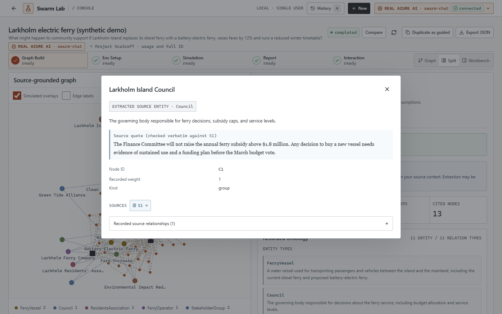
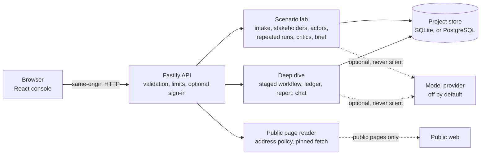

# Swarm

**What could happen if X changes?** Swarm is a general-purpose, evidence-grounded platform for
exploring strategic scenarios: a price change, a product integration, a policy, a launch, a process.
You bring a question and some evidence. Swarm walks them, step by step and in the open, to a
decision brief with recommendations and a plan for checking them in the real world.

> Swarm explores possible scenarios. It does not predict the future.

It runs on your machine, in a deterministic **rules mode that needs no model, no key and no network**,
or with an optional model provider. It is one generic engine. Microsoft Copilot in Teams, an AWS price
change and an online store are **demonstration packs**: a question plus a few synthetic documents, run
through the same pipeline as any question you type.

**Where it stands.** Swarm runs locally and its rules mode is complete end to end. It is not hosted,
its browser sign-in has only met a test identity provider, and it is not ready for production use.
[Honest limitations](#honest-limitations) and the
[production-readiness gates](./docs/production-readiness.md) say what that means.

**Judges and first-time readers:** run the [quick start](#quick-start) (rules mode, a few minutes),
pick **Copilot in Teams** in the example picker, and follow the [demo guide](./docs/demo/README.md),
which scripts a ten-minute walk-through of the four flagship demos.

## What Swarm is, and is not

| Swarm is                                                                                            | Swarm is not                                                                                                           |
| --------------------------------------------------------------------------------------------------- | ---------------------------------------------------------------------------------------------------------------------- |
| A way to **explore** what a set of stated assumptions could imply, with the evidence beside it      | A forecast. It never claims to predict, and its wording and exports say so                                             |
| Generic: the engine, the stakeholder step and the brief contain no market, product or industry code | An e-commerce tool, a Microsoft tool or an AWS tool. Those are demo packs, and tests keep domain words out of the code |
| Honest about numbers: results are **simulated counts under stated assumptions**                     | A source of real-world rates. A count is never a conversion, churn, share, adoption or sentiment rate                  |
| Built on **synthetic actors** that stand in for groups, with every trait labelled by its origin     | A panel of real people. Actors are not people, and a group's size in the model is an assumption, not a measurement     |
| Explicit about where each statement comes from: evidence, assumption, simulation or interpretation  | A black box. Nothing in a brief is unsourced, and an unsupported statement is shown as uncertainty                     |
| Useful without a model: every step has a rules path, and a model is optional and never silent       | Dependent on a model, or on any cloud service                                                                          |

## From a question to a decision

Every step is a real screen, backed by a stored, validated document and covered by tests. The
[user guide](./docs/USER_GUIDE.md) walks the screens; [ADR 0014](./docs/adr/0014-scenario-lab.md)
records why it is built this way.

| #   | Step                            | What Swarm does                                                                                                                                                                                                                          |
| --- | ------------------------------- | ---------------------------------------------------------------------------------------------------------------------------------------------------------------------------------------------------------------------------------------- |
| 1   | **Question**                    | You write a "What could happen if…?" question. **Understand my question** reads it into an editable scenario: the decision, what changes, the baseline, alternatives, assumptions, and at most three questions it needs answered         |
| 2   | **Evidence**                    | Uploaded files (text, Markdown, CSV, JSON, text PDF), pasted notes or a **public web page** that the server fetches. Text becomes numbered passages (S1, S2, …), each document keeps its provenance, and conflicting figures are flagged |
| 3   | **Scenario**                    | The frame you settled on is stored with the project. It defines the baseline and each alternative that the later runs compare                                                                                                            |
| 4   | **Stakeholders**                | Found in the evidence by reading the text, or with a model. Each has cited quotes and an uncertainty level. You accept, edit, merge, remove, add and prioritise, then approve. Missing kinds of stakeholder are listed as gaps           |
| 5   | **Synthetic actors**            | A key actor for each key stakeholder and a cohort of simulated members for the others. Every trait says where it came from (evidence, you, a system assumption or a model) and why, and you can change it                                |
| 6   | **Interactions**                | Each simulated member's stance is pulled, round by round, by how the change lands on it, by its own traits and by the actors it listens to, through typed relations (influences, competes with, supplies, and so on)                     |
| 7   | **Interventions**               | The change lands in a chosen round at a stated intensity, for the baseline and for each alternative. The optional deep dive adds pause, a scheduled intervention, branching from a checkpoint and run comparison                         |
| 8   | **Second-order effects**        | Competitors, substitutes, partners and regulators react after a lag to generic signals in the run. A chain of "because … then …" events is read back from one typical run. No reaction is scripted for any example                       |
| 9   | **Alternative outcomes**        | For every scenario, how many simulated members ended up going along, accepting with conditions, waiting, adapting, looking for an alternative or resisting, and how that spreads over the seeded runs                                    |
| 10  | **Uncertainty and sensitivity** | Each finding is "holds in k of n seeded runs" with a 95% interval and a stability class. Sensitivity moves one assumption at a time on the same seeds and compares the shift with the noise                                              |
| 11  | **Independent critique**        | Seven critics (evidence, assumption, methodology, stakeholder coverage, bias, recommendation, adversarial) challenge the analysis. They never edit it. You respond, accept or dispute, and the disagreement stays visible                |
| 12  | **Decision-ready analysis**     | An answer-first brief in 17 sections, assembled from data. Every statement carries one of ten origins and the ids it rests on                                                                                                            |
| 13  | **Recommendations**             | Each follows from at least one finding, with priority, impact, effort, reversibility, horizon, an owner function, leading indicators and how to check it                                                                                 |
| 14  | **Real-world validation plan**  | Experiments that would test what the result depends on most: the question, the method, the success signal, the effort and the duration                                                                                                   |

**Reading a result honestly.** Four rules cover most of it.

1. A number is a count of simulated members or of seeded runs, never a rate in a real population.
2. "Holds in k of n seeded runs" measures how repeatable the simulation is under its own
   assumptions. It is not the probability that the event happens.
3. An outcome is exactly as well founded as the assumptions it ran on. The sensitivity view shows
   which assumptions the result moves with, and which of those have no evidence behind them.
4. A critic that raises nothing does not show that the analysis is right. A critic checks only what
   it can see.

The ten origins a brief statement can carry are never merged: the label travels with the statement.

| Origin                        | What it means                                                                    |
| ----------------------------- | -------------------------------------------------------------------------------- |
| **Supplied evidence**         | A passage from a document that was uploaded or pasted                            |
| **Retrieved public evidence** | A passage from a page that this server fetched. Swarm has not checked it is true |
| **User assumption**           | A setting a person typed, edited or added                                        |
| **System assumption**         | A default Swarm filled in, or a property of the method. Open to edit             |
| **Inferred stakeholder**      | A stakeholder worked out from the sources                                        |
| **Actor behaviour**           | What a simulated actor did in the simulation                                     |
| **Simulation aggregation**    | A count or comparison over seeded runs                                           |
| **Model interpretation**      | A reading of a finding by a model                                                |
| **Historical comparison**     | A document whose provenance marks it as a record of what happened before (API)   |
| **Unresolved uncertainty**    | What is not known. It cites nothing, and names what is missing                   |



_The optional deep dive on the recorded fictional Larkholm demonstration: every graph entity carries
a quote that the server has checked, character for character, against the passage it cites._

## Quick start

You need **Node.js 24** (see `.nvmrc`; `engine-strict` makes npm refuse other major versions), npm and
Git. On Windows PowerShell, write `npm.cmd` for `npm`, which avoids the script-policy problem without
changing your policy. No `.env` file, key or model is needed: `AI_PROVIDER` defaults to `none`.

```bash
git clone https://github.com/snowjug/Swarm.git
cd Swarm
npm ci
npm run dev
```

Open <http://127.0.0.1:5173>. The development server proxies `/api` to the API on port 3001. The
header chip reads `LOCAL / RULES MODE`: nothing leaves your machine. To run the built application as
one process that serves both the UI and the API:

```bash
npm run build
npm start
```

Open <http://127.0.0.1:3001>. Data is kept in `./data` (a SQLite file; set `DATA_DIR` to move it, and
keep it out of OneDrive, Dropbox, Google Drive and iCloud folders). A `.env` is optional: copy
[`.env.example`](./.env.example) to `.env` only to change a setting.

**The first demo, a few minutes in rules mode.**

1. On the first screen, find **Not sure what to ask? Try an example** and choose **Use this example**
   on **Copilot in Teams**. It fills the question and five synthetic documents. Nothing is sent yet.
2. Choose **Understand my question**, read the scenario it made, then **Use this scenario**.
3. Choose **Build Graph**. When Graph Build reads `ready`, open **Env Setup**. The **Stakeholders and
   actors** panel starts small: choose **Find stakeholders by reading the text**. It shows four counts
   (found, need review, approved, actors), a note on how the stakeholders were found, and the list.
   Open a row to read the quotes it rests on, then choose **Approve stakeholders and create actors**
   below the list. Choose **Review the N actors** to read each actor's traits.
4. Open **Simulation** and choose **Compare scenarios**.
5. When the comparison has finished, choose **See the decision brief** (the Report stage unlocks by
   itself), then **Generate decision brief** and **Run independent review**.

The [demo guide](./docs/demo/README.md) says what to point at on each screen and what to say.

## The four flagship demos

Each is an input to the same pipeline. The example picker offers five worked examples; the four
below are the ones the demo guide scripts. **Nothing here says what a run will show.** Run it, read
the real screen and quote that.

| Demo                                                                               | Question                                                                                                                    | Evidence                                                 | Built in on purpose                                                                      |
| ---------------------------------------------------------------------------------- | --------------------------------------------------------------------------------------------------------------------------- | -------------------------------------------------------- | ---------------------------------------------------------------------------------------- |
| [**Copilot in Teams**](./docs/demo/scenarios/copilot-in-teams/README.md)           | What could happen if Microsoft integrates Copilot more deeply into Teams and enables additional AI capabilities by default? | 5 synthetic documents                                    | Two source conflicts, unknown licence terms, regulators and works councils silent        |
| [**Regional price change**](./docs/demo/scenarios/regional-price-change/README.md) | What could happen if AWS increases the price of a particular cloud service by $1 in a selected region?                      | 5 synthetic documents                                    | Two source conflicts, a notice with no billing unit, date or scope, and no price history |
| [**Online store**](./docs/demo/scenarios/ecommerce-experience/README.md)           | How might different users react if this online store changes its delivery fees, free-delivery threshold and checkout flow?  | 4 synthetic documents, plus an optional public page      | One source conflict, no cost per delivery, an untested checkout                          |
| **Your own question and a public URL**                                             | Anything that starts "What could happen if…?"                                                                               | A public web page, pasted notes or files that you supply | Nothing is planted: the evidence is whatever you bring                                   |

Microsoft, Copilot, Teams and AWS appear only because the question names them. The documents are
invented and say so in their first lines and in their provenance (`sample`, licence `Synthetic, CC0`).
They describe no real company, price or customer.

### The click path, once, for every demo

1. **Start.** On the first screen, choose **Use this example** on the card for your demo. For your own
   question, type it into **Your what-if question** instead. Choosing an example only fills the form.
2. **Add a public page (optional).** In **Add a public web page**, type an address, choose **Fetch
   page**, read the title, site, size, retrieval time and notes, then choose **Add as evidence**.
   The server fetches the page, not your browser. If it fails, the message says why and offers to
   let you paste the text. The online-store example suggests `https://books.toscrape.com/`, a public
   practice site whose prices and ratings are random, so it holds no real customer.
3. **Understand my question** (optional), then **Use this scenario**. Edit any field, answer the
   questions it raises, and add alternatives. Nothing runs until you build.
4. **Build Graph.** Graph Build reads the sources into numbered passages and a lexical graph.
5. **Env Setup:** in **Stakeholders and actors**, choose **Find stakeholders by reading the text** (or
   **with the model** in a Model assisted project). The list opens under four counts. Open a row to read
   its cited quotes and assumptions, and to **Accept**, **Edit**, **Merge** or **Remove** it; **Add a
   stakeholder** adds one the text did not name. Then **Approve stakeholders and create actors**
   (stakeholders you did not look at are accepted, and the list shuts) and **Review the N actors**: an
   actor opens to its traits, each with a slider, an origin badge and the reason for its value.
6. **Simulation:** **Compare scenarios** runs the baseline and the alternatives on the same seeds,
   and shows what held across the runs, which assumptions the result is sensitive to and a chain of
   second-order effects.
7. **Report:** when the comparison has finished, **See the decision brief** opens it (the stage
   unlocks by itself). Choose **Generate decision brief** and **Run independent review**, then export
   **Markdown**, **JSON** or the **Printable** page.

### What to check at each step

| Step               | Look at                                                                                                                                                                                                                                 | Read it as                                                                                                                                              |
| ------------------ | --------------------------------------------------------------------------------------------------------------------------------------------------------------------------------------------------------------------------------------- | ------------------------------------------------------------------------------------------------------------------------------------------------------- |
| Question           | The notes beside the scenario: "Read by rules, not a model", the assumptions and who made each one, and the questions back                                                                                                              | A starting point that you edit, not an answer. Rules read patterns and can misread a question                                                           |
| Evidence           | Each document's provenance: sample, pasted, uploaded or a public page, with when it was retrieved                                                                                                                                       | Evidence has a label. A fetched page records what the page said, not that it is true                                                                    |
| Stakeholders       | The four counts, the note on how they were found (it says how many have a direction of impact read from the wording), and in each row the cited quotes, the direction in words, the uncertainty, and "Perspectives that may be missing" | Roles found in text, not people. A direction is read only where a cited sentence shows one; a group stays unclear until you say who is helped or harmed |
| Actors             | Each trait's origin badge. Change one and watch the badge become yours                                                                                                                                                                  | Every number an actor runs on is an assumption you can see and edit. Group sizes are weights, not counts                                                |
| Compare scenarios  | The baseline and the change side by side, "holds in k of n seeded runs" with its interval and class, the sensitivity list, and the second-order chain                                                                                   | Repeatability under assumptions. A finding classed unstable is not to be relied on                                                                      |
| Independent review | The objections, what each rests on, and what it would do to the conclusion. Respond, accept or dispute                                                                                                                                  | A challenge, not a verdict. A critic never edits the analysis                                                                                           |
| Decision brief     | The executive answer and its caveat, then the origin chip on each statement, the assumptions, the uncertainty, the recommendations and the validation plan                                                                              | An exploration of a simulation. The validation plan is what you must still check in the real world                                                      |

If a pack was built to show a gap (an unknown licence term, a notice with no billing unit), check
whether your run's brief shows it, and say so if it does not. Do not fill the gap in by hand.

### Demo 1: Copilot in Teams

Choose **Use this example** on **Copilot in Teams**, then follow steps 3 to 7 above.

- **Check the intake.** The question does not say for whom "by default" applies, how deep "more
  deeply" goes, over what period or what a good outcome is. Check that **Understand my question**
  raises these as questions rather than filling them in.
- **Check the evidence.** Two pairs of sources give different figures for the same behaviour: a poll
  of administrators' intentions against a partner's observed tenants, and a pilot against a group of
  early adopters. Check that both quotes are shown and neither is picked.
- **Check the stakeholders.** Look at the cited quotes and the uncertainty of the groups found, at
  how many have a direction of impact and where each came from (the note says), and at the kinds that
  nobody was found for. Check that a group the evidence does not speak for (regulators, works
  councils) is not given a direction it did not earn.
- **Read it honestly.** The names are in the question only because the question names them. Nothing
  here describes a real plan, price or adoption figure.

### Demo 2: Regional cloud price change (AWS)

Choose **Use this example** on **Regional cloud price change**, then steps 3 to 7.

- **Check the intake.** The "$1" comes with no unit, date or scope, and the evidence says so. Check
  that these appear as open points, and that the brief carries the same gap as uncertainty.
- **Check the evidence.** Finance and sales operations give different shares of revenue under
  fixed-price contracts because they define "fixed" differently, and two estimates of the migration
  effort come from a team and from a consultancy that would earn fees. Check that Swarm shows both
  and picks neither.
- **Read it honestly.** The service, region, prices and company are invented. Sums you do by hand
  from the documents are your own check, not a Swarm result.

### Demo 3: Online store, with a public page

Choose **Use this example** on **Online store: delivery and checkout**. Before **Build Graph**, go to
**Add a public web page**, enter `https://books.toscrape.com/`, choose **Fetch page**, read the
title, site, size and retrieval time, then choose **Add as evidence**. Then steps 3 to 7.

- **Check the provenance.** The page should be listed as a public web page that the server
  retrieved, apart from the four synthetic documents, and the notes should say that Swarm has not
  checked it. In the brief, look for it among the sources with its own origin.
- **Check the evidence.** The survey and the exit pop-up measure the same thing by different methods
  in different groups. Check that both are shown.
- **Read it honestly.** The page is a catalogue sandbox whose prices and ratings are random. It says
  nothing about any shop's customers, and the "different users" in the pack are kinds of shopper
  paraphrased from an invented survey. Without network access, skip the page: the four documents
  are complete.

### Demo 4: Your own question and a public URL

Type your own question into **Your what-if question**. Add a page you may read (**Fetch page**, then
**Add as evidence**), and your own notes as pasted text or files if the page alone is thin: each
document needs at least 80 characters. Then **Understand my question** and steps 3 to 7.

- **Check the intake.** Rules read patterns in English and can misread a question. Check every field
  and answer or skip each question back.
- **Check the stakeholders.** They are only as good as the text: the rules find the roles that a text
  names with a role word. Read the "Perspectives that may be missing" list against your question and
  add the groups that matter yourself. A page that needs JavaScript is refused, with a message that
  offers to let you paste the text.
- **Read it honestly.** Nothing was planted: no conflict, no gap, no direction. Where the rules find
  no wording that shows a group being helped or harmed, that group has no direction of impact, and
  if no group has one the comparison warns that nobody has an expected direction of impact. Say who is affected,
  in the stakeholder review, only where your evidence supports it.

**Optional deep dive and the recorded run.** Each project also keeps the engine's five stages:
agent-by-agent runs with a stated reason for each decision, pause, intervention, branching and
comparison, an evidence ledger, a grounded report and an analyst that cites passages or declines.
**Interaction** opens once that report exists. `npm run demo:seed` restores a real-model recording
of one fictional scenario and two branches, with no model call. The
[presenter guide](./docs/demo/presentation.md) covers it.

## Evidence and public web pages

Evidence reaches Swarm as a file (text, Markdown, CSV, JSON or a text PDF), as pasted text or as a
public page. Limits: 1 to 10 documents, 80 to 40,000 characters each and 200,000 in all. Scanned
PDFs need OCR, which is not built. Everything in a document is **untrusted data**: it is read, never
obeyed, and text that addresses an AI is flagged.

Reading a page is the one place the server fetches an address it was given, so the rules are strict
([URL ingestion](./docs/security/url-ingestion.md) has every one, with the tests):

| Allowed                                                                                      | Refused, and why                                                                                                                                                                                                |
| -------------------------------------------------------------------------------------------- | --------------------------------------------------------------------------------------------------------------------------------------------------------------------------------------------------------------- |
| `http` and `https` pages on a public host, on ports 80 and 443 (a setting)                   | Other schemes, a user name or password in the address, a space, or an address over 2,048 characters                                                                                                             |
| Text, Markdown, CSV, JSON and HTML, up to 1.5 MB and 12 seconds, with at most five redirects | `localhost`, internal names, and private, loopback, link-local and cloud-metadata addresses, as written                                                                                                         |
| Pages that robots.txt allows. Each redirect is checked again and each connection is pinned   | A name that resolves to even one refused address (DNS rebinding). It is told "could not find it", like a name that does not exist                                                                               |
| One page that a person named, fetched once, with no cookie, credential or referrer           | Anything but the page's own text: no script runs, and frames, forms and hidden elements are dropped. Menus, side panels and footers are left out too, as a guess from how the page is built, and a note says so |

Every document made this way records its address (secret-looking query values removed), the final
address, when it was retrieved, its type and a hash. Only the server can claim that it fetched a
page. The audit log keeps the host that was asked for, and for a refused address the reason code,
and nothing else. `URL_INGESTION=off` turns the feature off, and
`URL_INGEST_ALLOWED_HOSTS` limits it to hosts you name. If the network is down, or the page needs
JavaScript, paste its text instead. Pasted text and uploaded files are **supplied evidence**; only
a page this server fetched is **retrieved public evidence**.

## Model modes

| Mode                        | How to get it                                            | What it does                                                                                               |
| --------------------------- | -------------------------------------------------------- | ---------------------------------------------------------------------------------------------------------- |
| **Rules** (the default)     | `AI_PROVIDER=none`, or choose **Local rules**            | Every step runs with no model, key or network. Deterministic: the same inputs and seed give the same run   |
| **Ollama**                  | `AI_PROVIDER=ollama`, `AI_MODEL`, `OLLAMA_BASE_URL`      | A local model you install yourself. No paid API                                                            |
| **OpenAI-compatible**       | `AI_PROVIDER=openai`, `AI_MODEL`, `OPENAI_API_KEY`       | A trusted v1 endpoint named by the administrator (`OPENAI_BASE_URL`)                                       |
| **Azure OpenAI or Foundry** | `AI_PROVIDER=azure`, `AI_MODEL`, `AZURE_OPENAI_ENDPOINT` | Microsoft Entra ID by default (`az login`), so no key exists. `AZURE_OPENAI_AUTH=key` is the legacy option |

`AI_MODEL` is the model name, or the deployment name on Azure. [`.env.example`](./.env.example) lists
every variable and [CONFIGURATION.md](./docs/CONFIGURATION.md) describes them, the Azure setup, the
per-project model budget and the limits. In your own, git-ignored `.env`:

```dotenv
AI_PROVIDER=azure
AI_MODEL=<your-deployment-name>
AZURE_OPENAI_ENDPOINT=<your-resource-endpoint>
AZURE_OPENAI_AUTH=entra
```

A provider is optional and never silent. **Model assisted** stays disabled until the server has one,
and the header chip names the provider and says `connected` only after a real request has succeeded.
A failure is shown as a failure, and Swarm never substitutes canned output. Where a step has a rules
path (reading the question, finding stakeholders), it may use that path after a model fails, and a
note says so.

What a model can do, only in a project made in **Model assisted** mode on a server that has a
provider: read your question when you choose **Understand my question** (the server sends the
question and each document's name and size, never its text; in a **Local rules** project the rules
on this server read it and it goes nowhere else); find stakeholders, refine the key actors on
request and add a deeper critique (a Local rules project is refused with `MODEL_NOT_AVAILABLE`); and,
in the deep dive, drive each actor's decisions. A model gets 170 seconds for one step of the lab;
after that the rules carry on, and a note says so. What it never does: decide an actor's behaviour in
the repeated runs, which always use the rules engine, or word the brief. In model mode, bounded
excerpts of your sources go to the provider you chose, so check its privacy terms first. Keyless
Azure access has been run end to end against one development deployment, and nothing else about
Azure is claimed.

## Architecture



Current validated architecture. The application and database run locally; the browser never talks to
a model or to the web. One Node.js process serves the UI and the API, and the lab's results are
validated JSON documents kept with each project. See [ARCHITECTURE.md](./ARCHITECTURE.md) for the
components, the data flow and the stage workflow, [ADR 0014](./docs/adr/0014-scenario-lab.md) for the
lab's decisions and [docs/analysis/](./docs/analysis/engine.md) for the simulator and the statistics.

| Where it runs           | Components                                                                                                                                                                                      |
| ----------------------- | ----------------------------------------------------------------------------------------------------------------------------------------------------------------------------------------------- |
| **On your machine**     | The browser console, the API and everything behind it (one Node.js 24 process), the rules engine, and one SQLite file or a PostgreSQL database you provide through `DATABASE_URL`               |
| **Deployed in Azure**   | Only a model deployment you own, and Microsoft Entra ID issuing the token that calls it, when you choose Azure. Nothing else is deployed                                                        |
| **Proposed, not built** | A hosted worker, Azure Container Apps hosting, a PostgreSQL server in Azure, a managed identity for the application, and an Application Insights resource. See [docs/AZURE.md](./docs/AZURE.md) |

## Security

Swarm is a **local, single-user application** by default. Read this before exposing it to anything.

- **Sign-in is off by default.** With `AUTH_MODE=none` there is no authentication or tenant isolation.
  It binds to loopback and checks host and origin, with a content-security policy and request and
  rate limits, and none of that replaces authentication: do not expose it to the internet. With
  `AUTH_MODE=entra` a person signs in with Microsoft in the browser (Authorization Code with PKCE, run
  on the server, with an opaque HttpOnly session and no token in the page), or an API client sends an
  Entra bearer token. Seven roles from workspace and project membership authorise every request, and
  routes with no policy are refused. That mode has only met a test identity provider, never a real
  tenant. See [ADR 0008](./docs/adr/0008-browser-sign-in.md) and
  [CONFIGURATION.md](./docs/CONFIGURATION.md#browser-sign-in).
- **Prompt injection is an active risk and cannot be considered completely solved.** Source text,
  fetched pages, retrieved passages and model output are untrusted data. Embedded instructions are
  flagged, a reply that repeats one is rejected, and no model has a shell, a filesystem, a browser or a
  URL fetcher. These reduce the risk. They do not prove immunity.
- **The one outbound fetch** is a public page that a person names, through the address policy above.
  It refuses private, local and metadata addresses however they are written, pins each connection to
  the addresses it checked, re-checks every redirect and obeys robots.txt.
- **Audit.** Every successful write, and every refused request from a signed-in caller, goes to an
  append-only, hash-chained log. The log records identifiers and counts, never document text,
  questions or prompts. A test fails if a route has no audit rule.
- **Secrets.** The default Azure mode has no key. No credential belongs in source, a `VITE_` variable
  or the database. `.env` is git-ignored and `npm run scan:secrets` scans every reachable commit.
- **Untrusted input.** Uploads are type- and size-checked, PDFs are parsed in an isolated worker, SQL
  is parameterized, source names never become paths and all text is rendered as text. Markdown and
  HTML exports escape untrusted content, and the printable brief is served with a policy that lets it
  load and run nothing.
- **Bounded consumption.** Documents, populations, rounds, runs per comparison, calls per stage and
  requests per minute are capped, and each project has a model budget.

Residual risks: prompt injection; a model can still produce a plausible unsupported statement that
the deterministic checks accept; tenant isolation lives in application code only; data at rest is
plain text in one SQLite file; and there has been no independent security review or penetration
test. Details: [security model](./docs/security-model.md), [threat model](./docs/threat-model.md),
[security review](./docs/security-review.md) and the
[risk register](./docs/program/risk-register.md). None of this claims that Swarm is hardened.

## Testing

```bash
npm run check          # typecheck of five projects, ESLint with no warnings, the Vitest suite, the build
npm run format:check   # Prettier over code and docs
npm run test:e2e       # real-browser tests of five projects against built servers (build first)
npm run test:postgres  # the unit suite again, on PostgreSQL running in the test process
npm run scan:secrets   # credentials in every reachable commit and the working tree
npm run demo:journey   # the 32-step Larkholm presentation, against a running server and a real model
```

| Command                 | What it covers                                                                                                                                                                                                                                                                                                                                                                                                                                                      |
| ----------------------- | ------------------------------------------------------------------------------------------------------------------------------------------------------------------------------------------------------------------------------------------------------------------------------------------------------------------------------------------------------------------------------------------------------------------------------------------------------------------- |
| `npm run check`         | Strict types for backend, frontend, e2e, scripts and evaluation; lint; every unit and integration test (backend, frontend, evaluation, scripts), including the lab pipeline on the real engine with no model; and the production build                                                                                                                                                                                                                              |
| `npm run test:e2e`      | The `local`, `model`, `journey`, `signin` and `lab` Playwright projects, each on a server of its own with throwaway data, axe-core on the states it visits. The `lab` project takes the flagship demos and a question of its own from the first screen to the exported brief through the pages, with public pages served from fixtures, so no test reaches the internet. `npm run build` first, and `npx playwright install chromium` once (or `PW_CHANNEL=msedge`) |
| `npm run test:postgres` | Every in-memory database in the unit tests becomes PostgreSQL (PGlite), so the SQLite stores and the PostgreSQL stores are held to the same tests                                                                                                                                                                                                                                                                                                                   |
| `npm run scan:secrets`  | Credential shapes in every commit and in the working tree. It prints the pattern and the location, never the match                                                                                                                                                                                                                                                                                                                                                  |
| `npm run demo:journey`  | The recorded presentation in a real browser against a server **you** started (`JOURNEY_URL`, default `http://127.0.0.1:3001`) that uses a real model. It refuses a rules-mode server unless `JOURNEY_ALLOW_LOCAL=1`. The `journey` project of `test:e2e` runs it without a model                                                                                                                                                                                    |

Also: `npm run eval` (the offline evaluation), `npm run mutation:security`, `npm run test:load`,
`npm run test:resilience`, `npm run audit:ui`, `npm run azure:verify` (your own Azure deployment) and
`npm run db:drill` (backs up a SQLite file and proves a restore from the backup alone; see the
[runbook](./docs/operations/runbook.md#restore-the-database)). The
[testing guide](./docs/TESTING.md) explains each layer, the Playwright ports (`E2E_*_PORT`), what a
passing run does not show, and the results recorded on earlier trees. Tests of the model path use
protocol-faithful fake providers, which is not evidence about any live model.

## Honest limitations

Not built, per [ADR 0014](./docs/adr/0014-scenario-lab.md): historical backtesting, a model run
repeated many times (a model's run-to-run variation is unmeasured, and said to be), Word or slide
exports (the brief prints from the browser), and hosted execution of long analyses (they run in the
server process and are marked interrupted if it stops). The wider picture is in the
[requirements matrix](./docs/requirements-matrix.md); the detailed list is in
[ARCHITECTURE.md](./ARCHITECTURE.md#known-limitations).

- **Nothing here is calibrated.** Rules-mode results follow from the declared assumptions and are not
  evidence about the world. No outcome has been compared with what really happened.
- **Rules readings are shallow.** The rules read English patterns and role words, so they find the
  groups that a text names with a role word and miss the rest, and they give a group a direction of
  impact only where the wording of the evidence shows one (or its category implies one). You set the
  direction in the review, and the change moves only groups that have one.
- **Grounding and conflict checks are heuristic.** On small sets labelled by their author, the
  conflict detector found 1 of 3 labelled conflicts (it finds figure conflicts stated in comparable
  words and misses conflicts of meaning), and on one older demonstration pack two of the four
  candidates it raised were false alarms. The deterministic support check accepted 3 of 8
  unsupported statements, because word overlap cannot read meaning. You confirm or dismiss every
  candidate conflict. [Evaluation](./evaluation/README.md) has the sets and the weak spots.
- **The engines can disagree.** The repeated runs use a simple, transparent rules engine. The deep
  dive can use a model for each actor's decisions. The analysis records whether the two agree and
  says that it compares different engines.
- **Limited scale.** A comparison is capped at 8 scenarios, 200 runs each and 2,400 runs in all. The
  deep dive takes 4 to 10 model-driven actors over 3 to 10 rounds, and only runs of up to six actors
  and six rounds were exercised live.
- **A public page is what it said.** No JavaScript runs, no PDFs, images or sign-in pages are read,
  and Swarm does not know whether a page is true, current or the same for everyone.
- **Not hosted, and unreviewed.** Sign-in has only met a test provider, PostgreSQL has not met a
  deployed server, telemetry has reached no real monitoring resource, and security, privacy,
  accessibility (screen reader) and legal reviews have not been done.

## Repository map

| Path                             | Contents                                                                                                                                                                              |
| -------------------------------- | ------------------------------------------------------------------------------------------------------------------------------------------------------------------------------------- |
| `shared/`                        | The zod contracts that both sides use: scenario, stakeholders, analysis, critique, brief, evidence, the example packs (`examples/`)                                                   |
| `backend/src/scenario/`          | Reading a question into a scenario frame, by rules or by a model                                                                                                                      |
| `backend/src/ingest/url/`        | Reading a public page: address policy, pinned fetch, robots.txt, text extraction                                                                                                      |
| `backend/src/stakeholders/`      | Stakeholder discovery, review and approval, and the actors made from them                                                                                                             |
| `backend/src/simulation/`        | The pure, seeded population simulator and its generic responders                                                                                                                      |
| `backend/src/analysis/`          | Repeated runs, findings, intervals and sensitivity                                                                                                                                    |
| `backend/src/critics/`           | The seven critics, by rules and optionally by a model                                                                                                                                 |
| `backend/src/brief/`             | The answer-first decision brief and its exports                                                                                                                                       |
| `backend/src/guided/` and others | The older five-stage deep dive: graph, environment, simulation, report, chat, branches, the evidence ledger (`grounding/`), Report Studio (`studio/`)                                 |
| `backend/src/routes/`            | The HTTP routes. `auth/` holds the default-deny policy and `storage/` the stores, migrations and audit log                                                                            |
| `frontend/src/`                  | The React console: `components/` by feature (`intake`, `evidence`, `stakeholders`, `analysis`, `critics`, `brief`, `console`), `hooks/`, `lib/`                                       |
| `e2e/`                           | Playwright projects `local`, `model`, `journey`, `signin` and `lab`, with shared helpers and a fake model provider; `backend/test/support/` holds the sign-in and lab fixture servers |
| `scripts/`                       | The demonstration seed and recorder, Azure provisioning and verification, the UI audit, the secret scan, load, resilience and mutation tests                                          |
| `evaluation/`                    | Labelled datasets, the offline harness, thresholds and results                                                                                                                        |
| `infra/`                         | Bicep for the Azure model account and, not deployed, a hosted pilot                                                                                                                   |
| `docs/`                          | Guides, references, architecture decisions, the demo guide and example packs, and the pitch package                                                                                   |

## More documentation

| Topic                | Where                                                                                                                                                                                                                |
| -------------------- | -------------------------------------------------------------------------------------------------------------------------------------------------------------------------------------------------------------------- |
| Using it             | [User guide](./docs/USER_GUIDE.md), [interface design](./docs/UX.md), [scenario intake](./docs/scenario-intake.md), [stakeholders and actors](./docs/stakeholders.md)                                                |
| How the numbers work | [Comparing scenarios](./docs/analysis/methodology.md), [the population simulator](./docs/analysis/engine.md), [the independent review](./docs/analysis/critics.md), [the decision brief](./docs/analysis/brief.md)   |
| Demonstrating it     | [Demo guide](./docs/demo/README.md), [example scenarios](./docs/demo/scenarios/README.md), [presenting the recorded Larkholm run](./docs/demo/presentation.md), [pitch package](./docs/pitch/README.md)              |
| Running it           | [Configuration](./docs/CONFIGURATION.md), [HTTP API](./docs/API.md), [testing](./docs/TESTING.md), [Docker](./docs/DOCKER.md), [troubleshooting](./docs/TROUBLESHOOTING.md), [Azure](./docs/AZURE.md)                |
| Architecture         | [ARCHITECTURE.md](./ARCHITECTURE.md), [architecture decisions](./docs/adr/README.md)                                                                                                                                 |
| Security             | [Security model](./docs/security-model.md), [threat model](./docs/threat-model.md), [security review](./docs/security-review.md), [reading web pages](./docs/security/url-ingestion.md)                              |
| Status and limits    | [Production-readiness gates](./docs/production-readiness.md), [requirements matrix](./docs/requirements-matrix.md), [risk register](./docs/program/risk-register.md), [roadmap](./docs/microsoft-product-roadmap.md) |
| Operations           | [Observability](./docs/operations/observability.md), [service levels and alerts](./docs/operations/slo-dashboards-alerts.md), [incident runbook](./docs/operations/runbook.md)                                       |
| Evaluation           | [Evaluation harness and datasets](./evaluation/README.md), [results](./docs/pitch/evaluation-results.md)                                                                                                             |
| Origins and parity   | [Parity matrix](./docs/parity-matrix.md), [attribution](./NOTICE.md)                                                                                                                                                 |

## Responsible use

Swarm supports human analysis. It must not make high-impact decisions on its own.

- Treat every result as a **hypothesis about a scenario**, never as a forecast or a recommendation.
- Synthetic actors are **not real people**. Their traits are assumptions, not survey results,
  testimony or evidence about any group.
- Do not use Swarm to make or justify decisions about real individuals, or anything that affects
  people's rights, safety, employment, health or access to services, without human review.
- A "supported" label means that a passage backs a statement, not that the passage is true.
- With a model, bounded excerpts of your sources go to your provider. With a public page, the site
  sees this server's address. Check both before using confidential material.
- Say that content is simulated when you share it. Exports carry that statement.

Swarm is an independent implementation inspired by a public idea: turn documents into a graph,
simulate many agents against it and report what happened. It contains none of that project's code or
brand assets. It differs on purpose: it is evidence-first, labels every claim, refuses to fake
results, compares repeated runs, and authenticates to Azure without a key.

## License

[AGPL-3.0](./LICENSE) (SPDX: `AGPL-3.0-only`). If you offer a modified version as a network service,
you must offer its corresponding source to its users; set `SOURCE_URL` accordingly. See
[NOTICE.md](./NOTICE.md). The licence needs a legal review before any hosted pilot.
