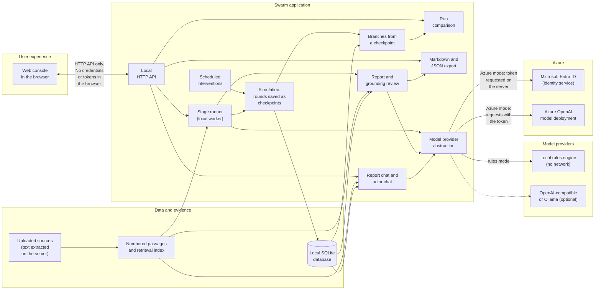
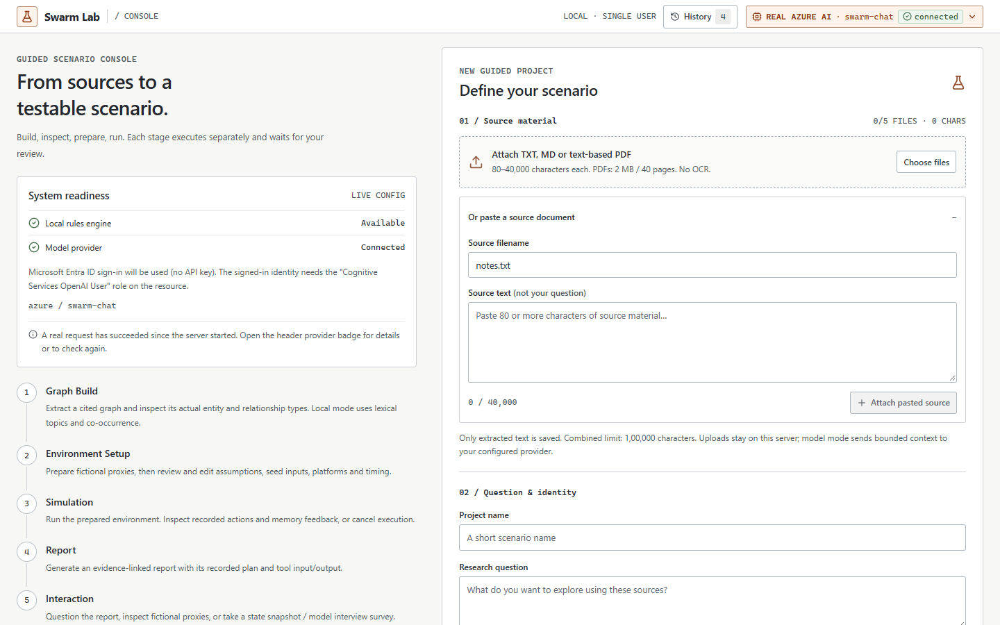

# Swarm

**Explore how a situation might unfold, and check every statement against your sources.**

> Swarm explores possible scenarios. It does not predict the future.

Swarm is a local-first scenario-exploration console. You give it source documents and a question.
It builds a source-grounded graph, prepares fictional proxy actors with assumptions you can edit,
simulates how they might respond over several rounds, lets you pause, intervene, branch and compare
what-ifs, and writes a report in which every listed statement is labelled and checked against the
sources. It runs entirely on your machine with a deterministic rules engine and no keys, or with a
real model, including **Azure AI authenticated by Microsoft Entra ID, with no API key**.

An **evidence ledger** sits beside the report. It gives every statement a type and a support class,
decided by deterministic rules and not by a model, shows where two of your sources disagree, and
records who reviewed what. The analyst chat declines, in fixed words and without calling a model,
when your sources cannot answer a question.


_Every screenshot in this repository shows a fictional scenario ([the Larkholm ferry demo](./docs/demo/larkholm-ferry/README.md))._

## What Swarm Does

1. **Reads your sources.** Text, Markdown and text-based PDFs are split into numbered passages
   (S1, S2, …). Source text is treated as data, never as instructions.
2. **Builds a graph.** Entities and relations are extracted from the passages. In model mode each
   entity carries a quote that the server has checked, character for character, against the passage
   it cites.
3. **Prepares fictional proxies.** Personas, starting inclinations, influence and openness, and
   seed posts are generated, labelled as assumptions, and open to your edits.
4. **Simulates.** On two platforms (a broadcast one and a community one) each proxy decides, round by
   round, whether to post or reply and how its inclination moves, and records why.
5. **Lets you ask "what if".** Pause after any round, schedule an intervention, branch from a saved
   checkpoint with declared changes, and compare the runs.
6. **Writes a report you can audit.** Each statement is labelled as a source fact, extracted claim,
   user assumption, AI hypothesis, simulated event or analytical conclusion, and checked against the
   cited passage or recorded run. The **evidence ledger** classifies how well your sources back each
   one, lists the conflicts between sources for you to confirm or dismiss, and shows the assumptions
   the simulated results rest on.
7. **Answers questions.** Ask the report an analyst question, or ask a fictional proxy. Answers cite
   what they were given. If the project's own evidence cannot answer, the analyst says so and makes
   no model call. Export the result as Markdown or JSON, ledger included.

## Why Swarm

- **Scenarios, not forecasts.** Output is conditional on your sources and assumptions, and the
  interface says so wherever a number appears.
- **Evidence you can inspect.** A citation opens the exact passage. A quote is either verbatim or it
  is not shown as one.
- **Assumptions are visible.** Source facts, extracted claims, your assumptions, the model's
  hypotheses, simulated events and analytical conclusions are never blended.
- **No fake results.** If a model call fails, you see the error. There is no silent fallback to
  canned output, and rules mode is labelled as rules mode.
- **Local-first.** Your documents and results stay in a SQLite file on your machine unless you
  choose a model provider, and then only bounded context is sent to it.
- **Real Azure AI without secrets.** The default Azure mode uses Microsoft Entra ID. No key exists
  to leak.

## Key Features

| Area          | What you get                                                                                                                                                     |
| ------------- | ---------------------------------------------------------------------------------------------------------------------------------------------------------------- |
| Graph         | Source-grounded entities and relations with verified quotes, an ontology, and an inspector for every node and edge                                               |
| Actors        | Editable fictional proxies. One model request per proxy per platform per round, each seeing only its own profile, private memory and the public posts it can see |
| Simulation    | Two platforms with different exposure rules, recorded rounds, stated reasons for every decision, and a live trajectory                                           |
| What-if loop  | Pause, resume, schedule an intervention, branch from a checkpoint with declared changes, and compare runs round by round                                         |
| Report        | A chapter-by-chapter report with a **grounding review**: verdicts, the checks that ran, and what the server repaired                                             |
| Chat          | Ask the report or any fictional proxy. Answers cite the passages and memories they were given                                                                    |
| Evidence      | An **evidence ledger**: statement types and support classes, conflicts between sources, assumptions, reviewer decisions and a hash-chained audit log             |
| Sign-in       | Optional Microsoft Entra token checks in the API, with four roles and tenant isolation (`AUTH_MODE=entra`; not yet used with a real tenant)                      |
| Export        | Markdown and JSON, with lineage for branches                                                                                                                     |
| Providers     | Local rules engine (no network), Azure OpenAI with Entra ID, any OpenAI-compatible endpoint, or local Ollama                                                     |
| Safety        | Prompt-injection screening, bounded resource use, host and origin allow-lists, a content-security policy, no keys in the browser                                 |
| Accessibility | Responsive from 390 to 1920 px, keyboard operable, checked with axe-core at several viewports                                                                    |

## How It Works

The console has five stages. Each runs separately and stops at **ready** until you start the next.

| Stage          | Rules mode                              | Real-model mode                                                                          |
| -------------- | --------------------------------------- | ---------------------------------------------------------------------------------------- |
| 1. Graph Build | Term and co-occurrence extraction       | The model proposes entities and relations; the server checks every quote and citation    |
| 2. Env Setup   | Generated personas and seed posts       | The model proposes personas and seed posts, which you can edit                           |
| 3. Simulation  | Seeded opinion dynamics                 | One request per proxy per platform per round, validated and bounded                      |
| 4. Report      | A report computed from recorded metrics | A planned, tool-assisted report with a grounding review and an independent support check |
| 5. Interaction | Evidence lookup and state snapshots     | Report chat, proxy chat and interviews                                                   |

Every model reply is validated on the server before it is used: identifiers, citations, verbatim
quotes and bounded changes. A bad reply is sent back for a limited number of corrections. When a
slip can be repaired only by removing, shortening or weakening what the model claimed, the server
repairs it and **says so** in the report; otherwise the stage fails and you see why. See the
[user guide](./docs/USER_GUIDE.md) for each stage and the [grounding review](./docs/USER_GUIDE.md#grounding-review-model-assisted-reports).

## Architecture



Current validated architecture. The application and database run locally; Azure hosts the AI model deployment. Planned cloud hosting and managed identity are not shown as implemented components.

- **Frontend:** React and TypeScript. In the built application the same process serves it and the
  API. It holds no credentials.
- **Backend:** Fastify on Node.js 24 with the built-in SQLite module. Validation, rate limits and host and
  origin checks sit in front of every route.
- **Provider abstraction:** one gateway for every model call. It picks the rules engine or a real
  provider from configuration, bounds retries, counts calls and tokens, and never falls back silently.
- **Evidence and grounding:** passages, retrieval, verbatim quote matching and the report's grounding
  review live on the server, so no browser state can change a verdict.

The full design, data flow, threat boundaries and the planned Azure hosting path are in
[ARCHITECTURE.md](./ARCHITECTURE.md) and [docs/AZURE.md](./docs/AZURE.md).

## Real Azure AI

Azure mode sends bounded source and persona context to a model deployment that you own, on Azure
OpenAI or Microsoft Foundry.

- **Microsoft Entra ID, no key.** The server asks Entra for an access token (`DefaultAzureCredential`;
  locally that is your `az login`) and sends it only to an allow-listed Azure AI host. The token
  never reaches the browser, the database, the logs or the repository.
- **One role.** Your identity needs **Cognitive Services OpenAI User** on the resource. A missing role
  produces an error that names it.
- **Azure hosts only the model deployment.** The application and its database run on your machine.
- **Honest status.** The header badge reads `REAL AZURE AI`, then `connected` only after a real
  request has succeeded, and `failing` after one has failed. **Verify connection** makes one real
  round trip.
- **End-to-end proof.** `npm run azure:verify` runs a real multi-agent scenario against your
  deployment (per-proxy calls, grounding, branching, both chats, an injection probe and a check that
  no credential appears anywhere) and exits `0` only if every check passes.
- **Provisioning.** `npm run azure:provision` can create a keyless account and a pay-as-you-go
  deployment from the Bicep in [`infra/`](./infra), after a read-only preflight that names any
  permission you lack. See [docs/AZURE.md](./docs/AZURE.md).

Not validated: a managed identity, hosting in Azure, multiple users, and any model other than the one
small development deployment the live checks ran against.

## Quick Start

You need Node.js 24 or newer, npm and Git. On Windows use `npm.cmd` where shown, which avoids the
PowerShell script-policy issue without changing your policy; elsewhere use `npm`.

### Local / Rules Mode

No keys, no cloud, no model download, no network calls.

```powershell
git clone https://github.com/snowjug/Swarm.git
cd Swarm
npm.cmd install
Copy-Item .env.example .env
npm.cmd run dev
```

Open <http://127.0.0.1:5173>. On macOS or Linux, use `npm install` and `cp .env.example .env`.

To run the built application as one process, serving both the UI and the API:

```powershell
npm.cmd run build
npm.cmd start
```

Open <http://127.0.0.1:3001>. The header reads `LOCAL / RULES MODE`. Load the fictional starter input
and press **Build Graph**, or use the [Larkholm demo sources](./docs/demo/larkholm-ferry/README.md).

### Real Azure AI Mode

You need an Azure OpenAI or Foundry resource with a chat-completions deployment, the Azure CLI, and
the role above. Model calls are billed by your subscription.

```powershell
az login
```

In your local, git-ignored `.env`, set placeholders to your own values (never put a key in a `VITE_`
variable or in source):

```dotenv
AI_PROVIDER=azure
AI_MODEL=<your-deployment-name>
AZURE_OPENAI_ENDPOINT=<your-resource-endpoint>
AZURE_OPENAI_AUTH=entra
```

Then restart the server and choose the real model when you create a project:

```powershell
npm.cmd run build
npm.cmd start
```

Check it with the **Verify connection** button, or run the whole journey:

```powershell
npm.cmd run azure:verify
```

To create the resource and deployment from this repository instead, start with the read-only
preflight: `npm run azure:provision -- --subscription <subscription-id> --preflight-only`.
Every variable is described in [docs/CONFIGURATION.md](./docs/CONFIGURATION.md).

## Demo Workflow

The repository includes a fictional scenario with five source files that disagree on purpose. It is
documented in [docs/demo/larkholm-ferry](./docs/demo/larkholm-ferry/README.md), together with the
question, the steps to reproduce it and the limits of what it shows. Five more small fictional packs
show what the evidence layer does with a clean conflict, with false alarms and a miss, and with too
little evidence; they are described in [docs/demo](./docs/demo/README.md).

|                                                                                               |                                                                                    |
| --------------------------------------------------------------------------------------------- | ---------------------------------------------------------------------------------- |
|                        |    |
| **1. Start.** The header and readiness card say which provider is active and whether it works | **2. Prepare.** Proxies and seed posts are labelled assumptions you can edit       |
|               |               |
| **3. Simulate.** Recorded rounds, a trajectory and a stated reason for every decision         | **4. Branch and compare.** Identical through the checkpoint, then divergent        |
|                              |  |
| **5. Report.** Every statement has a label, a verdict and a reason                            | **6. Ask.** The analyst contrasts the two ridership figures and names both sources |

The labels you will see on every statement:

| Label                 | Meaning                                                              |
| --------------------- | -------------------------------------------------------------------- |
| Source fact           | Stated in the provided source text and quoted verbatim               |
| Extracted claim       | A paraphrase of what a provided source says                          |
| User assumption       | An input you chose: a setting, an intervention or a seed post        |
| AI hypothesis         | The model's speculation, not claimed to be backed by any source      |
| Simulated event       | Something that happened inside the simulation, not in the real world |
| Analytical conclusion | A figure or reading derived from the recorded simulation metrics     |

Simulated results are hypothetical. They describe the scenario, not the world.

## Validation

These are the results of this milestone's runs on the development machine. Re-run them yourself; the
commands are in [Development](#development).

| Check                                                | Result                                                                                                                                                                                                                                                                                                                                                                                                                      |
| ---------------------------------------------------- | --------------------------------------------------------------------------------------------------------------------------------------------------------------------------------------------------------------------------------------------------------------------------------------------------------------------------------------------------------------------------------------------------------------------------- |
| `npm run check` (typecheck, lint, unit tests, build) | Passes. Strict typecheck of five projects, ESLint with 0 warnings, **1,182 unit and integration tests in 67 files**, production build                                                                                                                                                                                                                                                                                       |
| `npm run test:e2e` (real Edge, two isolated servers) | **92 passed** in 10.1 minutes (63 against the local engine, 29 model-assisted against a protocol-faithful fake provider)                                                                                                                                                                                                                                                                                                    |
| `npm run eval` (offline, no model)                   | Every floor in `evaluation/thresholds.json` holds. The analyst's gate refuses no answerable question and refuses 43% (dev) and 86% (test) of unanswerable ones; 1 of 3 labelled conflicts between sources is found; injection warnings catch 80% of 18 labelled samples (in-sample). Small, in-domain, author-labelled sets: see [evaluation/README.md](./evaluation/README.md)                                             |
| `npm run format:check`                               | All files pass                                                                                                                                                                                                                                                                                                                                                                                                              |
| `npm audit` (corporate registry mirror)              | 0 vulnerabilities, at every severity                                                                                                                                                                                                                                                                                                                                                                                        |
| `npm run scan:secrets` (every reachable commit)      | 0 findings in 698 history blobs and 383 working-tree files; no `.env` tracked                                                                                                                                                                                                                                                                                                                                               |
| `npm run audit:ui` (four viewports, axe-core)        | 44 states: 0 console errors, 0 axe violations, none of the layout findings it reports (overflow, small text, small targets, unnamed controls, label collisions), and a visible focus indicator on every Tab stop                                                                                                                                                                                                            |
| `npm run azure:verify` (real Azure AI, Entra only)   | **15 of 15 checks passed** in 362 s with 61 server round trips, against a real Azure deployment using Microsoft Entra only; the same result was recorded at the start of this program and after the analyst changes                                                                                                                                                                                                         |
| Live demo journey (real UI, real Azure model)        | Recorded at the previous milestone and not repeated on this tree. A five-source scenario built through the real UI against Azure: graph, six proxies on two platforms over six rounds (paused and resumed), an intervention, a branch and comparison, two reports with a grounding review, both chats and both exports. Audit of 40 states at four viewports: 0 console errors, 0 HTTP errors, 0 overflow, 0 axe violations |

What these do **not** show: that the model's output is correct, that any scenario predicts the real
world, that a manual screen-reader review has been done (it has not), that sign-in works against a
real Microsoft Entra tenant (it has only met a local test provider), or that the application is
ready for production. See [Known Limitations](#known-limitations),
[docs/requirements-matrix.md](./docs/requirements-matrix.md) and
[docs/program/requirement-matrix.md](./docs/program/requirement-matrix.md) for the
requirement-by-requirement status, including what is partial or missing, and
[docs/production-readiness.md](./docs/production-readiness.md) for the gates a production service
would have to meet.

## Security

Swarm is a **local, single-user prototype** by default. Read this before you expose it to anything.

- **Sign-in is off by default.** With `AUTH_MODE=none` there is no authentication and no tenant
  isolation: it binds to loopback, checks host and origin, applies a content-security policy, request
  limits and rate limits, and none of that replaces authentication. Do not expose it to the
  internet. With `AUTH_MODE=entra` the API verifies Microsoft Entra bearer tokens, applies a
  default-deny role table (reader, analyst, reviewer, admin) and separates tenants. That mode has
  only been tested against a local test identity provider, never a real tenant, and the browser has
  no sign-in screen, so treat it as a verified API and not as a finished feature.
- **Prompt injection is an active risk and cannot be considered completely solved.** Source text,
  retrieved passages, memories and model output are untrusted data. Embedded instructions are
  flagged, the model is told to treat them as content, a reply that repeats text an embedded
  instruction asked for is rejected, and no model has a shell, a filesystem, a browser or a URL
  fetcher. These reduce the risk; they do not prove immunity.
- **Secrets.** The default Azure mode has no key. No credential may be placed in source, in a `VITE_`
  variable or in the database. `.env` is git-ignored, and `npm run scan:secrets` scans every
  reachable commit and the working tree.
- **Untrusted files and input.** Uploads are type- and size-checked. PDFs are parsed in an isolated,
  resource-limited worker. Source names never become paths. SQL is parameterized. Text is rendered
  as text, and Markdown exports escape untrusted content.
- **Bounded consumption.** Documents, populations, rounds, calls per stage and requests per minute
  are capped.
- **Dependencies.** `npm audit` is part of CI. A clean result is a point-in-time check, not a
  guarantee.

Details are in [docs/security-model.md](./docs/security-model.md),
[docs/security-review.md](./docs/security-review.md) and [docs/threat-model.md](./docs/threat-model.md),
which now has an addendum for the evidence ledger, sign-in and tenancy. Nothing here says Swarm is
secure: the remaining risks are in [docs/program/risk-register.md](./docs/program/risk-register.md).

## Known Limitations

- **Model output varies.** Model-assisted runs are not reproducible. Rerunning gives different
  actors, posts and reports.
- **The analyst can miss a conflict unless you ask.** In the demo it said it found no direct
  contradictions when asked in general terms, although two are planted, and found the difference
  when asked about it by name.
- **The evidence layer is heuristic.** The deterministic support check accepted 3 of 8 unsupported
  statements in a labelled set. The conflict detector found 1 of 3 labelled conflicts, raises false
  alarms on some material and misses conflicts of meaning; you confirm or dismiss every candidate.
  The analyst's first check refuses off-topic questions and years the sources never mention, but
  lets through 3 of 4 plausible questions about something absent and questions that mix an unrelated
  topic with a word the project uses. Those rest on the model declining, which is seen only in live
  runs. The evaluation sets are small, in one fictional domain, and labelled by the author; see
  [evaluation/README.md](./evaluation/README.md).
- **Rules mode has no statements in its ledger.** It produces no grounding review, so the ledger
  shows conflicts and assumptions only.
- **Proxies tend to sound like an analyst.** Their answers are useful, but often read as a summary
  rather than as the character speaking.
- **Chat citations show what the model was given, not what supports each sentence.** They come from
  lexical retrieval against your question.
- **The grounding review checks the report against the sources, not the sources against the world.**
  Only the statements the writer lists are checked. The server repairs some format slips and says so;
  read the review's notes.
- **Small scale.** Model mode accepts 4 to 10 proxies and 3 to 10 rounds, and a stage's model calls
  are budgeted. Only six proxies and six rounds were exercised live.
- **Local by default, plain text at rest.** One SQLite file means one instance. No encryption of
  the database and no automatic import of exports. Sign-in exists in the API only (see Security),
  with one owner per project and no sharing. A PostgreSQL design is proposed in
  [ADR 0006](./docs/adr/0006-postgres-adapter-proposed.md) and is not built.
- **Operations are basic.** Structured logs and per-project token counts, with no distributed
  tracing, no per-tenant budget and no automatic resume of a run interrupted by a restart.
- **Text only.** Scanned PDFs need OCR, which is not implemented. There is no web crawling and no
  live social-media connection.
- **One development deployment.** Live Azure checks ran against one small model. Managed identity and
  Azure hosting have not been validated.
- **Accessibility is automated, not manual.** There has been no screen-reader or forced-colours
  review.

## Responsible Use

- Treat every result as a **hypothesis about a scenario**, never as a forecast or a recommendation.
- The proxies are **fictional**. They do not represent real people, and their opinions are not
  survey results, testimony or evidence about any group.
- Do not use Swarm to make or justify decisions about real individuals.
- Read the sources and the grounding review. A "supported" verdict means a passage backs a statement,
  not that the passage is true.
- In model mode, bounded excerpts of your sources go to the provider you configured. Check that
  provider's privacy terms and your data-handling rules before you use confidential material.
- Say that content is simulated when you share it. Exports carry that statement.

## Inspiration and Comparison

Swarm is an independent implementation inspired by a public idea: turn documents into a knowledge
graph, simulate many agents against it, and report what happened. It contains none of that
project's code or brand assets, and differs deliberately: it is evidence-first, labels every claim,
refuses to fake results, supports branching and comparison, and authenticates to Azure without a key.

[docs/parity-matrix.md](./docs/parity-matrix.md) compares the publicly documented behaviour
capability by capability, and states for each one whether Swarm is better, equivalent, partial, not
implemented or intentionally different, with evidence for every claim of equivalence or better.
[NOTICE.md](./NOTICE.md) records attribution.

## Development

```powershell
npm.cmd run check          # typecheck, lint, unit tests, build
npm.cmd run format:check   # Prettier
npm.cmd run test:e2e       # builds first: the E2E servers run dist/ (set PW_CHANNEL=msedge to reuse Edge)
npm.cmd run audit:ui       # screenshots and layout and axe metrics at four viewports
npm.cmd run scan:secrets   # credentials in every reachable commit and the working tree
npm.cmd run eval           # the offline evaluation: abstention gate, retrieval, conflicts, injection warnings
npm.cmd run azure:verify   # the real Azure AI journey (needs your own deployment)
```

| Script                                              | Purpose                                                                                  |
| --------------------------------------------------- | ---------------------------------------------------------------------------------------- |
| `dev`                                               | Backend and Vite frontend with reload                                                    |
| `build`, `start`                                    | Build `dist/`, then serve the UI and API from one process                                |
| `typecheck`, `lint`, `test`                         | Strict TypeScript, ESLint with zero warnings, Vitest                                     |
| `format`, `format:check`                            | Prettier                                                                                 |
| `smoke:console`                                     | A real HTTP smoke flow against a running local backend                                   |
| `azure:provision`, `azure:teardown`, `azure:verify` | Create, remove and verify the Azure model account (see [docs/AZURE.md](./docs/AZURE.md)) |

| Folder        | Contents                                                                                                                                                                                   |
| ------------- | ------------------------------------------------------------------------------------------------------------------------------------------------------------------------------------------ |
| `frontend/`   | React console                                                                                                                                                                              |
| `backend/`    | Fastify API, simulation, grounding, providers, storage, and their unit tests                                                                                                               |
| `shared/`     | Types and schemas used by both                                                                                                                                                             |
| `e2e/`        | Playwright journeys, error states, responsive and accessibility checks                                                                                                                     |
| `scripts/`    | Azure provisioning and verification, the UI audit, the secret scan, the load test                                                                                                          |
| `evaluation/` | Labelled datasets, the offline evaluation harness, thresholds and results                                                                                                                  |
| `infra/`      | Bicep for the Azure model account                                                                                                                                                          |
| `docs/`       | Guides, references, the parity and requirement matrices, architecture decisions (`adr/`), the program records (`program/`), demonstration packs (`demo/`) and the pitch package (`pitch/`) |

More: [user guide](./docs/USER_GUIDE.md), [configuration](./docs/CONFIGURATION.md),
[HTTP API](./docs/API.md), [testing](./docs/TESTING.md), [Docker](./docs/DOCKER.md),
[troubleshooting](./docs/TROUBLESHOOTING.md) and [ARCHITECTURE.md](./ARCHITECTURE.md).

## Roadmap

The work that remains, split into what a credible prototype, a strong internal demo, a
production-grade architecture and further research each need, is in
[docs/microsoft-product-roadmap.md](./docs/microsoft-product-roadmap.md). In short: browser sign-in
against a real tenant, a production database, automatic resume of interrupted jobs, hosting and
managed identity in Azure, tracing and per-tenant budgets, a report studio, and a manual
accessibility review. [docs/production-readiness.md](./docs/production-readiness.md) lists every
gate and says which are met (this is a prototype, not a production service), and the
[pitch package](./docs/pitch/README.md) holds the material for a pilot proposal.

## License

[AGPL-3.0](./LICENSE) (SPDX: `AGPL-3.0-only`). If you offer a modified version as a network service,
you must offer its corresponding source to its users; set `SOURCE_URL` accordingly. See
[NOTICE.md](./NOTICE.md).
