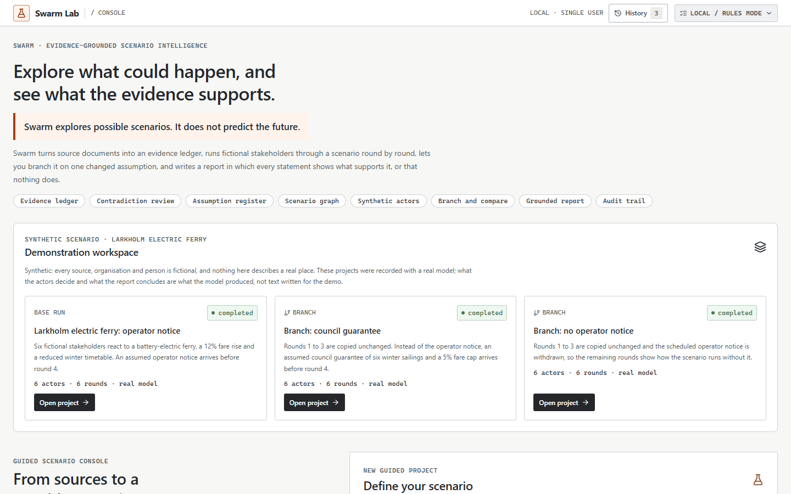
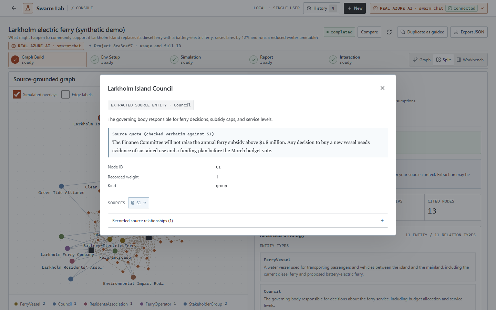
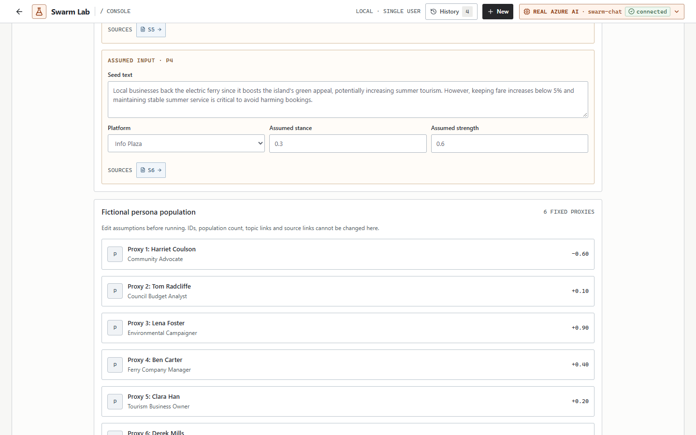
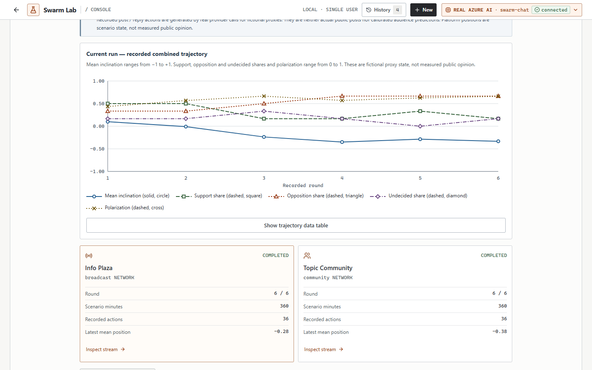
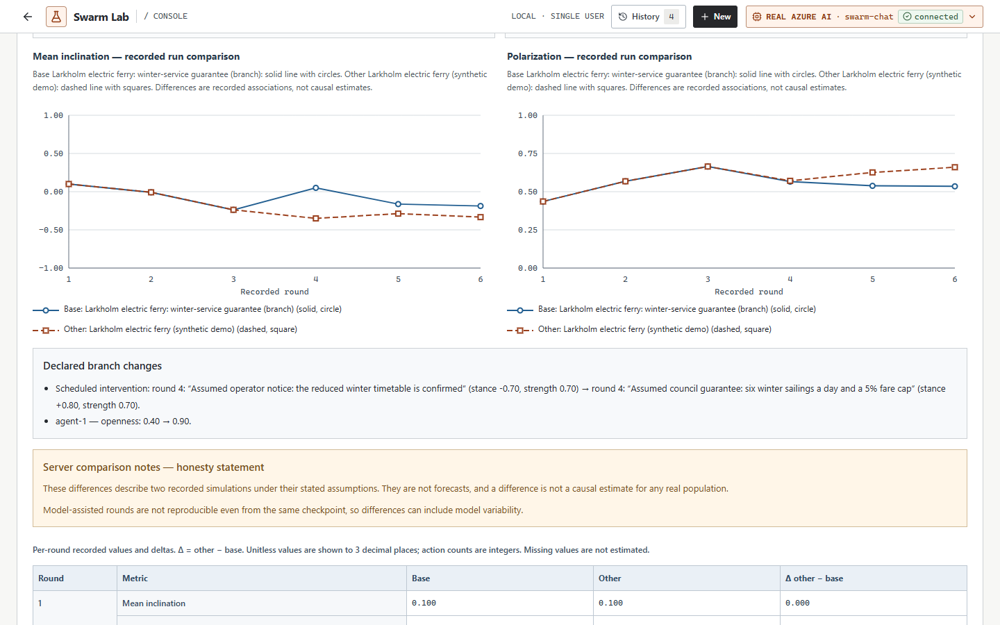
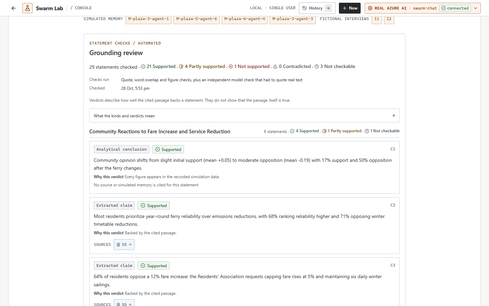
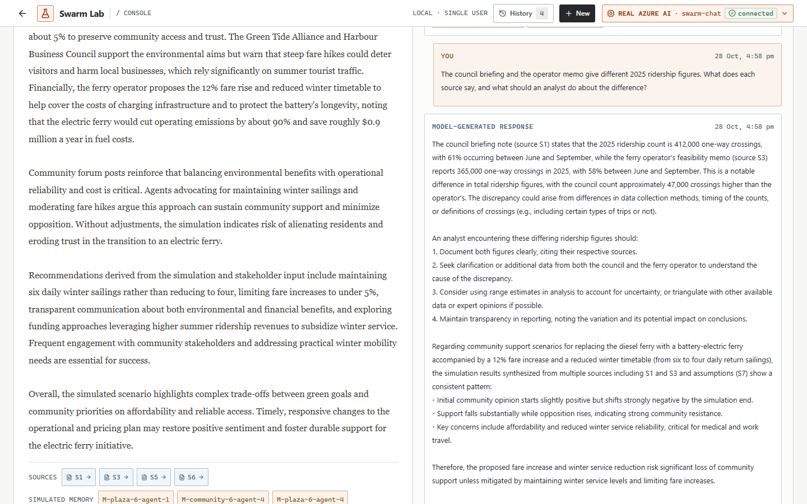
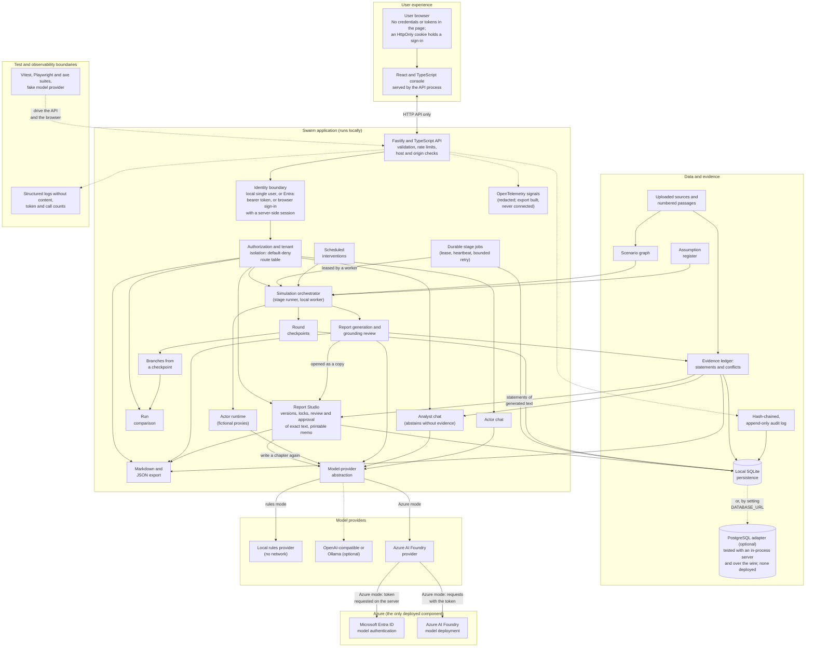

# Swarm

**Explore how a situation might unfold, and check every statement against your sources.**

> Swarm explores possible scenarios. It does not predict the future.

Swarm is an evidence-grounded scenario-intelligence and multi-agent simulation platform. You give it
source documents and a decision question. It builds an evidence ledger and a scenario graph from the
sources, prepares fictional proxy actors whose assumptions you can read, simulates how they might
respond over several rounds, lets you intervene, branch and compare what-ifs, and writes a report in
which every statement is labelled and checked against the sources. It runs on your machine with a
deterministic rules engine and no keys, or with a real model, including **Azure AI authenticated by
Microsoft Entra ID, with no API key**.

**Where it stands.** Swarm runs locally and has been run end to end against a real Azure model. It
is not hosted anywhere, its browser sign-in has only met a test identity provider, and it is not
ready for production use. Read
[Known Limitations](#known-limitations) and the [production-readiness gates](./docs/production-readiness.md)
before relying on it for anything.



_Every screenshot in this repository shows a fictional scenario ([the Larkholm ferry demo](./docs/demo/larkholm-ferry/README.md))._

## What Swarm Does

```text
Sources → Evidence extraction → Claims and contradictions → Assumptions → Scenario graph
→ Synthetic actors → Multi-round simulation → Intervention → Branching → Comparison
→ Grounded report → Actor and analyst conversations → Export
```

1. **Reads your sources.** Text, Markdown and text-based PDFs are split into numbered passages
   (S1, S2, …). Source text is treated as data, never as instructions.
2. **Extracts evidence, claims and contradictions.** Statements are checked against the passages they
   cite, and the **evidence ledger** shows where two of your sources disagree, so that you can
   confirm or dismiss each conflict. Neither passage is declared true.
3. **Records assumptions.** Every input you chose, and every proxy trait the model proposed, is
   listed as an assumption, with the statements that depend on it. Assumptions are inputs, not
   findings.
4. **Builds a scenario graph.** Entities and relations are extracted from the passages. In model
   mode each entity carries a quote that the server has checked, character for character, against
   the passage it cites. The graph has a keyboard-operable alternative.
5. **Prepares synthetic actors.** Fictional proxies with starting inclinations, influence and
   openness, and seed posts, labelled as assumptions.
6. **Simulates over several rounds.** On two platforms (a broadcast one and a community one) each
   proxy decides, round by round, whether to post or reply and how its inclination moves, and records
   why. Every round is saved as a checkpoint.
7. **Takes an intervention, branches and compares.** Pause after any round, schedule an assumed
   intervention, branch from a checkpoint with declared changes, and compare the runs round by round.
8. **Writes a grounded report.** Each statement is labelled with one of ten types and checked
   against the cited passage or recorded run. The evidence ledger classifies how well your sources
   back each one.
9. **Holds actor and analyst conversations.** Ask the report an analyst question, or ask a fictional
   proxy. Answers cite what they were given. If the project's own evidence cannot answer, the analyst
   says so and makes no model call.
10. **Exports.** Markdown or JSON, ledger and lineage included. Every write is recorded in a
    hash-chained audit log that the console can display and verify.

### A short tour

|                                                                                             |                                                                                         |
| ------------------------------------------------------------------------------------------- | --------------------------------------------------------------------------------------- |
|  |             |
| **1. Sources and graph.** Every entity carries a quote checked against its passage          | **2. Actors.** Proxies and seed posts are labelled assumptions                          |
|             |                    |
| **3. Simulate.** Recorded rounds, a trajectory and a stated reason for every decision       | **4. Branch and compare.** Identical through the checkpoint, then divergent             |
|                            |            |
| **5. Report.** Every statement has a label, a verdict and a reason                          | **6. Ask.** The analyst cites passages, or says the evidence does not support an answer |

## Why Swarm

- **Scenarios, not forecasts.** Output is conditional on your sources and assumptions, and the
  interface says so wherever a number appears.
- **Evidence you can inspect.** A citation opens the exact passage. A quote is either verbatim or it
  is not shown as one.
- **Assumptions are visible.** Source facts, extracted claims, your assumptions, the model's
  hypotheses, simulated events and analytical conclusions are never blended.
- **No fake results.** If a model call fails, you see the error. There is no silent fallback to
  canned output, and rules mode is labelled as rules mode.
- **Local-first.** Your documents and results stay in a SQLite file on your machine unless you
  choose a model provider, and then only bounded context is sent to it.
- **Real Azure AI without secrets.** The default Azure mode uses Microsoft Entra ID. No key exists
  to leak.

## Verified Capabilities

Each row is something a person can do in the console today, with the tests that exercise it. A
capability is listed only if a test drives it; what is missing is under
[Known Limitations](#known-limitations).

| Capability                      | What you can do                                                                                                                                                                                                                                                                                                                                                                                                                            | Exercised by                                                                                                                                                                                 |
| ------------------------------- | ------------------------------------------------------------------------------------------------------------------------------------------------------------------------------------------------------------------------------------------------------------------------------------------------------------------------------------------------------------------------------------------------------------------------------------------ | -------------------------------------------------------------------------------------------------------------------------------------------------------------------------------------------- |
| Source-grounded graph           | Read numbered passages, inspect every entity and relation, see its verified quote, browse and search the evidence                                                                                                                                                                                                                                                                                                                          | `knowledge.test.ts`, `grounding-quotes.test.ts`, `pdf.test.ts`, `e2e/local/journey.spec.ts`                                                                                                  |
| Evidence ledger                 | Filter statements by type and support class, open a statement's supporting and contradicting passages, confirm or dismiss conflicts, see the assumptions behind simulated results                                                                                                                                                                                                                                                          | `ledger.test.ts`, `ledger-service.test.ts`, `contradictions.test.ts`, `e2e/local/ledger.spec.ts`, `e2e/model/ledger-ui.spec.ts`                                                              |
| Fictional actors                | Read each proxy's profile and assumed traits; edit them before a run (or on a branch before it is resumed); records are read-only afterwards                                                                                                                                                                                                                                                                                               | `actor.test.ts`, `guided.test.ts`, `e2e/local/journey.spec.ts`                                                                                                                               |
| Multi-round simulation          | Configure rounds and platforms, replay a run, read each decision with its stated reason, filter by proxy and round, pause and resume                                                                                                                                                                                                                                                                                                       | `guided.test.ts`, `guided-model.test.ts`, `whatif.test.ts`, `e2e/local/whatif.spec.ts`                                                                                                       |
| Intervention, branches, compare | Schedule an assumed intervention, branch from a checkpoint with declared edits, compare a branch with its parent or sibling                                                                                                                                                                                                                                                                                                                | `whatif.test.ts`, `whatif-model.test.ts`, `e2e/local/whatif.spec.ts`                                                                                                                         |
| Grounded report                 | Read a chaptered report with a grounding review: verdicts, the checks that ran, and what the server repaired or withheld                                                                                                                                                                                                                                                                                                                   | `grounding-*.test.ts`, `report-plan.test.ts`, `e2e/model/grounding-ui.spec.ts`                                                                                                               |
| Report Studio                   | Open the generated report as a document and work on it: edit sections as versions (compare, restore), lock, leave reviewer notes, submit for review, approve or send back with a reason, reopen; write a chapter again and accept or reject it; export Markdown, JSON and a printable memo that says what was approved. The generated report is never changed, and an edited chapter's statements are shown as describing the earlier text | `studio-model.test.ts`, `studio.test.ts`, `studio-access.test.ts`, `studio-regenerate.test.ts`, `studio-store.test.ts`, `studio.test.tsx`, `e2e/journey/studio.spec.ts`, 25 studio mutations |
| Analyst chat with abstention    | Ask a question the sources answer (cited) and one they do not (exact refusal sentence, no model call)                                                                                                                                                                                                                                                                                                                                      | `evidence-gate.test.ts`, `model-workflow.test.ts`, `evaluation/test/evaluation.test.ts`, `e2e/model/model.spec.ts`                                                                           |
| Actor chat and survey           | Ask one fictional proxy a question, or survey all of them, against what that proxy was given                                                                                                                                                                                                                                                                                                                                               | `model-workflow.test.ts`, `e2e/model/model.spec.ts`                                                                                                                                          |
| Export and audit                | Export Markdown and JSON; read and verify the append-only, hash-chained audit log                                                                                                                                                                                                                                                                                                                                                          | `audit-trail.test.ts`, `storage.test.ts`, `snapshot.test.ts`, `e2e/journey/demo-journey.spec.ts`                                                                                             |
| Themes                          | Choose light, dark or high contrast in the header, or let the page follow the device's colour scheme and contrast setting; the choice is kept and applied before the page is drawn                                                                                                                                                                                                                                                         | `theme.test.ts`, `theme-contrast.test.ts`, `accessibility.test.ts`, `scripts/ui/themes.test.ts`, `e2e/journey/themes.spec.ts`                                                                |
| Identity and access             | Sign in with Microsoft in the browser (Authorization Code with PKCE, a server-side session, no token in the page) or call with an Entra bearer token; seven roles through workspace and project membership; default-deny routes; tenant isolation; access removed on the next request (tested against a test identity provider, not a real tenant)                                                                                         | `auth.test.ts`, `membership.test.ts`, `session.test.ts`, `e2e/signin/signin.spec.ts`, `security.test.ts`                                                                                     |
| Real Azure AI, no key           | Run every stage against an Azure model deployment with Entra authentication                                                                                                                                                                                                                                                                                                                                                                | `npm run azure:verify` (15 checks), `scripts/azure/lib/*.test.ts`                                                                                                                            |
| PostgreSQL storage (optional)   | Run the same stores on PostgreSQL (`DATABASE_URL`), with serializable transactions retried when they lose a race; copy a database between SQLite and PostgreSQL in either direction, checked, for migration and backup                                                                                                                                                                                                                     | `postgres.test.ts`, `postgres-driver.test.ts`, `copy.test.ts`, `npm run test:postgres` (the whole unit suite on PostgreSQL)                                                                  |
| Durable stage jobs              | A refresh or a restart does not lose a run: stages are queued in the database, taken by a worker under a lease, retried a bounded number of times, resumed from the last saved round, cancelled or paused from any process; asking twice with the same `Idempotency-Key` is one job                                                                                                                                                        | `jobs.test.ts`, `durable-jobs.test.ts` (each also on PostgreSQL), 19 job mutations                                                                                                           |
| Observability                   | Every answer carries a correlation id; OpenTelemetry spans and metrics for requests, jobs, model calls, the queue, denials and grounding, with a gate that keeps content, headers and credentials out; export to Application Insights signed by Entra (tested with in-memory exporters)                                                                                                                                                    | `telemetry.test.ts`, `telemetry-start.test.ts`, 9 telemetry mutations                                                                                                                        |
| Recorded demonstration          | Restore a real-model recording of one scenario and two branches, and walk the 32-step presentation in a real browser                                                                                                                                                                                                                                                                                                                       | `scripts/demo/lib/*.test.ts`, `e2e/journey/demo-journey.spec.ts`                                                                                                                             |
| Accessibility checks            | Use the console by keyboard; axe-core finds no violation on the audited screens at four viewport sizes                                                                                                                                                                                                                                                                                                                                     | `e2e/local/a11y.spec.ts`, `e2e/local/responsive.spec.ts`, `npm run audit:ui`                                                                                                                 |

## How It Works

The console has five stages. Each runs separately and stops at **ready** until you start the next.

| Stage          | Rules mode                              | Real-model mode                                                                          |
| -------------- | --------------------------------------- | ---------------------------------------------------------------------------------------- |
| 1. Graph Build | Term and co-occurrence extraction       | The model proposes entities and relations; the server checks every quote and citation    |
| 2. Env Setup   | Generated personas and seed posts       | The model proposes personas and seed posts, which you can edit                           |
| 3. Simulation  | Seeded opinion dynamics                 | One request per proxy per platform per round, validated and bounded                      |
| 4. Report      | A report computed from recorded metrics | A planned, tool-assisted report with a grounding review and an independent support check |
| 5. Interaction | Evidence lookup and state snapshots     | Report chat, proxy chat and interviews                                                   |

Every model reply is validated on the server before it is used: identifiers, citations, verbatim
quotes and bounded changes. A bad reply is sent back for a limited number of corrections. When a
slip can be repaired only by removing, shortening or weakening what the model claimed, the server
repairs it and **says so** in the report; otherwise the stage fails and you see why. See the
[user guide](./docs/USER_GUIDE.md) for each stage and the
[grounding review](./docs/USER_GUIDE.md#grounding-review-model-assisted-reports).

### What a statement can be

Swarm defines ten statement types. They are never merged: the label travels with the statement.

| Label                      | Meaning                                                                                    |
| -------------------------- | ------------------------------------------------------------------------------------------ |
| **SOURCE FACT**            | Stated in the provided source text and quoted verbatim                                     |
| **EXTRACTED CLAIM**        | A paraphrase of what a provided source says                                                |
| **USER ASSUMPTION**        | An input you chose: a setting, an intervention or a seed post. Not a claim to verify       |
| **INFERRED RELATIONSHIP**  | A link between things that no single passage states. At best partly supported              |
| **AI HYPOTHESIS**          | The model's speculation, not claimed to be backed by any source. Never shown as a finding  |
| **SIMULATED EVENT**        | Something that happened inside the simulation, not in the real world                       |
| **ANALYTICAL CONCLUSION**  | A figure or reading derived from the recorded simulation metrics                           |
| **RECOMMENDATION**         | A suggestion. Allowed only when the evidence is sufficient, and shown with its assumptions |
| **CONTRADICTING EVIDENCE** | A passage that conflicts with a statement or with another source, shown beside it          |
| **UNRESOLVED UNCERTAINTY** | A question the evidence leaves open. Recorded, never presented as a finding                |

The classification and publication rules cover all ten and are pure, tested functions. The report
writer currently emits six of them (source fact, extracted claim, user assumption, AI hypothesis,
simulated event, analytical conclusion). Contradicting evidence appears as the conflicts between
sources and as the passages attached to a statement. Inferred relationship, recommendation and
unresolved uncertainty are defined and classified by policy, but the report writer does not yet emit
them as statements of their own.

How well your sources back a statement is a separate **support class**: directly supported,
partially supported, contradicted, unsupported, not applicable, not checkable, simulation derived or
assumption dependent. Deterministic checks assign it. A model's check can lower a class or confirm
it, never raise it, and a reviewer can withhold a statement but never upgrade one. A support class
says how well _your_ sources back a statement. It is not a claim that the statement is true.

Simulated results are hypothetical. They describe the scenario, not the world.

## Architecture



Current validated architecture. The application and database run locally; Azure hosts the AI model deployment. Planned cloud hosting and managed identity are not shown as implemented components.

| Where it runs           | Components                                                                                                                                                                                                                                                                                                                              |
| ----------------------- | --------------------------------------------------------------------------------------------------------------------------------------------------------------------------------------------------------------------------------------------------------------------------------------------------------------------------------------- |
| **On your machine**     | The browser console, the API and everything behind it (one Node.js 24 process), the local rules provider, and one SQLite file, or a PostgreSQL database you provide through `DATABASE_URL` (tested against PostgreSQL running in-process and over the wire protocol; never against a deployed server). This is all of the application   |
| **Deployed in Azure**   | Only a model deployment you own, and Microsoft Entra ID issuing the token that calls it. Nothing else is deployed                                                                                                                                                                                                                       |
| **Proposed, not built** | A hosted worker container, Azure Container Apps hosting, a PostgreSQL server in Azure, managed identity for the application, an Application Insights resource that the telemetry is sent to, a membership screen. They are designed in [docs/AZURE.md](./docs/AZURE.md) and [docs/azure/](./docs/azure/); none is deployed or validated |

- **Frontend:** React and TypeScript. In the built application the same process serves it and the
  API. It holds no credentials.
- **Backend:** Fastify on Node.js 24 with the built-in SQLite module, or an optional PostgreSQL
  adapter behind the same stores. Validation, rate limits and host and origin checks sit in front of
  every route.
- **Identity boundary:** local single-user mode by default. With `AUTH_MODE=entra` a person signs in
  with Microsoft in the browser (the server runs the Authorization Code flow with PKCE and keeps an
  opaque, HttpOnly session; no token reaches the page), or an API client sends an Entra bearer token.
  Every request is then authorized from workspace and project membership (seven roles: platform
  administrator, workspace owner and admin, project lead, analyst, reviewer and viewer), with a
  default-deny route table and tenant isolation. A project a person was not added to is reported as
  missing. It has only been tested against a test identity provider, never a real tenant, and there
  is no screen for managing members yet.
- **Provider abstraction:** one gateway for every model call. It picks the rules engine or a real
  provider from configuration, bounds retries, counts calls and tokens, and never falls back
  silently.
- **Evidence and grounding:** passages, retrieval, verbatim quote matching and the report's
  grounding review live on the server, so no browser state can change a verdict.

The full design, data flow and threat boundaries are in [ARCHITECTURE.md](./ARCHITECTURE.md).

## Quick Start

You need Node.js 24 (the version in `.nvmrc`; npm refuses other major versions), npm and Git. On
Windows use `npm.cmd` where shown, which avoids the PowerShell script-policy issue without changing
your policy; elsewhere use `npm`. Every command below was run on Node.js 24, and CI runs the
checks on Linux for every push.

### Local / Rules Mode

No keys, no cloud, no model download, no network calls.

```powershell
git clone https://github.com/snowjug/Swarm.git
cd Swarm
npm.cmd ci
Copy-Item .env.example .env
npm.cmd run dev
```

Open <http://127.0.0.1:5173>. On macOS or Linux use `cp .env.example .env`.

### Production Build

To run the built application as one process, serving both the UI and the API:

```powershell
npm.cmd run build
npm.cmd start
```

Open <http://127.0.0.1:3001>. With no model configured the header reads `LOCAL / RULES MODE`. Load
the fictional starter input and press **Build Graph**, or use the
[Larkholm demo sources](./docs/demo/larkholm-ferry/README.md).

### Real Azure AI Mode

You need an Azure OpenAI or Foundry resource with a chat-completions deployment, the Azure CLI, and
the role described under [Real Azure AI](#real-azure-ai). Model calls are billed by your
subscription.

```powershell
az login
```

In your local, git-ignored `.env`, set placeholders to your own values (never put a key in a `VITE_`
variable or in source):

```dotenv
AI_PROVIDER=azure
AI_MODEL=<your-deployment-name>
AZURE_OPENAI_ENDPOINT=<your-resource-endpoint>
AZURE_OPENAI_AUTH=entra
```

Then rebuild, restart, and choose the real model when you create a project:

```powershell
npm.cmd run build
npm.cmd start
```

The header chip reads `REAL AZURE AI` and `connected` once a request has succeeded. **Verify
connection** makes one real round trip.

### Demonstration

The repository holds a real-model recording of one fictional scenario and two branches of it. This
restores it, without calling a model, and resets it after a rehearsal:

```powershell
npm.cmd run demo:seed
```

With the real-model server above running on port 3001, this walks the 32-step presentation in a real
browser (set `PW_CHANNEL=msedge` to reuse Edge), asking the analyst and one actor a question each:

```powershell
npm.cmd run demo:journey
```

The scripts, the speaking notes and the failure plan are in [Presenting Swarm](./docs/demo/presentation.md).

### Tests

```powershell
npm.cmd run check          # typecheck, lint, unit and integration tests, production build
npm.cmd run format:check   # Prettier
npm.cmd run eval           # the offline evaluation: abstention gate, retrieval, conflicts, injection warnings
npm.cmd run test:postgres  # the unit tests again, with every in-memory database made a PostgreSQL one
npm.cmd run mutation:security -- --list   # the access, sign-in and storage rules that are mutation-checked
```

### Browser Tests

```powershell
npm.cmd run build
npm.cmd run test:e2e       # builds first by hand: the E2E servers run dist/ (set PW_CHANNEL=msedge to reuse Edge)
npm.cmd run audit:ui       # starts its own local-mode server; screenshots and layout and axe metrics at four viewports
```

### Azure Verification

```powershell
npm.cmd run azure:verify   # the real Azure AI journey; needs your own deployment and az login
```

### Secret Scanning

```powershell
npm.cmd run scan:secrets   # credentials in every reachable commit and the working tree
```

Every variable is described in [docs/CONFIGURATION.md](./docs/CONFIGURATION.md).

## Real Azure AI

Azure mode sends bounded source and persona context to a model deployment that you own, on Azure
OpenAI or Microsoft Foundry.

- **Microsoft Entra ID, no key.** The server asks Entra for an access token (`DefaultAzureCredential`;
  locally that is your `az login`) and sends it only to an allow-listed Azure AI host. The token
  never reaches the browser, the database, the logs or the repository.
- **One role.** Your identity needs **Cognitive Services OpenAI User** on the resource. A missing role
  produces an error that names it.
- **Azure hosts only the model deployment.** The application and its database run on your machine.
- **Honest status.** The header badge reads `REAL AZURE AI`, then `connected` only after a real
  request has succeeded, and `failing` after one has failed.
- **End-to-end proof.** `npm run azure:verify` runs a real multi-agent scenario against your
  deployment (per-proxy calls, grounding, branching, both chats, an injection probe and a check that
  no credential appears anywhere) and exits `0` only if every check passes.
- **Provisioning.** `npm run azure:provision` can create a keyless account and a pay-as-you-go
  deployment from the Bicep in [`infra/`](./infra), after a read-only preflight that names any
  permission you lack. See [docs/AZURE.md](./docs/AZURE.md).

Not validated: a managed identity, hosting in Azure, multiple users, and any model other than the
one small development deployment the live checks ran against.

## Security

Swarm is a **local, single-user application** by default. Read this before you expose it to anything.

- **Sign-in is off by default.** With `AUTH_MODE=none` there is no authentication and no tenant
  isolation: it binds to loopback, checks host and origin, applies a content-security policy,
  request limits and rate limits, and none of that replaces authentication. Do not expose it to the
  internet. With `AUTH_MODE=entra` the server signs a person in with Microsoft (Authorization Code
  with PKCE, run on the server; an ID token is verified and then discarded, and the browser gets only
  an opaque HttpOnly session cookie that idles out after 30 minutes and ends after 8 hours), or
  verifies an Entra bearer token. It authorizes each request from workspace and project membership
  (seven roles, checked on every request, so removing someone takes effect at once), refuses any
  route that has no policy, requires an anti-forgery header on every change made with a cookie, and
  separates tenants. That mode has only been tested against a test identity provider, never a real
  tenant, so treat it as verified code and not as a validated deployment. Details are in
  [ADR 0008](./docs/adr/0008-browser-sign-in.md) and [CONFIGURATION.md](./docs/CONFIGURATION.md#browser-sign-in).
- **Prompt injection is an active risk and cannot be considered completely solved.** Source text,
  retrieved passages, memories and model output are untrusted data. Embedded instructions are
  flagged, the model is told to treat them as content, a reply that repeats text an embedded
  instruction asked for is rejected, and no model has a shell, a filesystem, a browser or a URL
  fetcher. These reduce the risk; they do not prove immunity.
- **Audit.** Every successful write, and every refused request from a signed-in caller, is recorded
  in an append-only, hash-chained log. A test enumerates every route and fails if one has no audit
  rule. The log records identifiers and counts, never document text or prompts.
- **Secrets.** The default Azure mode has no key. No credential may be placed in source, in a `VITE_`
  variable or in the database. `.env` is git-ignored, and `npm run scan:secrets` scans every
  reachable commit and the working tree.
- **Untrusted files and input.** Uploads are type- and size-checked. PDFs are parsed in an isolated,
  resource-limited worker. Source names never become paths. SQL is parameterized. Text is rendered
  as text, and Markdown exports escape untrusted content.
- **Bounded consumption.** Documents, populations, rounds, calls per stage and requests per minute
  are capped.
- **Dependencies.** `npm audit` is part of CI. A clean result is a point-in-time check, not a
  guarantee.

Residual risks: prompt injection (above); a model can still produce a plausible unsupported
statement that the deterministic checks accept; tenant isolation is enforced in application code
only; data at rest is unencrypted plain text in one SQLite file; there has been no independent
security review or penetration test.

Details are in [docs/security-model.md](./docs/security-model.md),
[docs/security-review.md](./docs/security-review.md) and [docs/threat-model.md](./docs/threat-model.md).
None of this is a claim that Swarm is hardened: the remaining risks are in
[docs/program/risk-register.md](./docs/program/risk-register.md).

## Validation

Totals from the checks run on this tree with Node.js 24. Re-run them yourself; the commands are in
[Quick Start](#quick-start). CI runs most of them on Linux for every push.

| Check                                                | Command                     | Result                                                                                                                                                                                                                                                                                                                                                                                                                                       |
| ---------------------------------------------------- | --------------------------- | -------------------------------------------------------------------------------------------------------------------------------------------------------------------------------------------------------------------------------------------------------------------------------------------------------------------------------------------------------------------------------------------------------------------------------------------- |
| Types, lint, unit and integration tests, build       | `npm run check`             | Passes. **1,423 tests in 85 files** (Vitest). Strict typecheck of five projects, ESLint with zero warnings                                                                                                                                                                                                                                                                                                                                   |
| Formatting                                           | `npm run format:check`      | Passes                                                                                                                                                                                                                                                                                                                                                                                                                                       |
| Browser end-to-end tests                             | `npm run test:e2e`          | **113 passed** (Edge on Windows, 34.6 minutes on a machine kept busy by other work; CI runs Chromium on Linux and its result is on the commit): the local engine, the model-assisted path against a protocol-faithful fake provider, the 32-step presentation on a server holding the recorded demonstration, and browser sign-in against a test identity provider. They include axe-core on every reachable state and the responsive checks |
| Unit tests on PostgreSQL                             | `npm run test:postgres`     | The same 1,423 tests with every in-memory database a PostgreSQL one (PGlite, PostgreSQL in-process): all pass. CI runs it as its own job. The real driver is also tested over the wire protocol; no deployed server has been used                                                                                                                                                                                                            |
| Mutation checks on access, sign-in and storage rules | `npm run mutation:security` | **52 of 52 mutations caught** by a failing test (15 access, 27 sign-in, 10 storage). A check of the tests, not proof of the rules; see [the test guide](./docs/TESTING.md#mutation-checks-on-security-code)                                                                                                                                                                                                                                  |
| Presentation against a real model                    | `npm run demo:journey`      | Passed twice against the live server with the real Azure model (7.6 minutes each): once reading the recorded conversation, and once asking the analyst and an actor new questions while checking that five private values, which are never written to the repository, appear on no page. A negative control made it fail as intended                                                                                                         |
| Real Azure AI, Microsoft Entra only                  | `npm run azure:verify`      | **15 of 15 checks passed** in 467 s with 59 round trips: every stage, per-proxy decisions, verbatim quotes, grounding, branching, both chats, an injection probe and a scan for credentials                                                                                                                                                                                                                                                  |
| Dependency audit                                     | `npm audit`                 | 0 vulnerabilities at every severity (corporate registry mirror); CI runs `npm audit --audit-level=high`                                                                                                                                                                                                                                                                                                                                      |
| Secret scan, every reachable commit                  | `npm run scan:secrets`      | 0 findings (933 history blobs and 483 working-tree files at the last run); no `.env` tracked. One history blob that holds only fake credentials made up for a redaction test is accepted by its hash (the scanner says which and why), because history is not rewritten                                                                                                                                                                      |
| Offline evaluation                                   | `npm run eval`              | Every floor in `evaluation/thresholds.json` holds. The analyst's gate refuses no answerable question and refuses 43% (dev) and 86% (test) of unanswerable ones; 1 of 3 labelled conflicts between sources is found; injection warnings catch 80% of 18 labelled samples (in-sample). Small, author-labelled sets: see [evaluation/README.md](./evaluation/README.md)                                                                         |
| UI audit at four viewports                           | `npm run audit:ui`          | 44 states: 0 console errors, 0 axe violations, no overflow, small text, small targets, unnamed controls or label collisions, and a visible focus indicator on every Tab stop. It reports 9 status lines that are deliberately truncated at 390 px, each with its full text as a tooltip                                                                                                                                                      |
| Container build and health                           | CI                          | Builds, answers its health check and serves the UI; the console smoke flow passes inside it                                                                                                                                                                                                                                                                                                                                                  |

What these do **not** show: that the model's output is correct, that any scenario predicts the real
world, that a manual screen-reader review has been done (it has not), that sign-in works against a
real Microsoft Entra tenant (it has only met a local test provider), or that the application is
ready for production use. See [Known Limitations](#known-limitations),
[docs/production-readiness.md](./docs/production-readiness.md) and the
[requirement matrix](./docs/program/requirement-matrix.md) for what is partial or missing.

## Known Limitations

- **Model output varies.** Model-assisted runs are not reproducible. Rerunning gives different
  actors, posts and reports. The demonstration is a recording for that reason.
- **Grounding is imperfect.** The deterministic support check accepted 3 of 8 unsupported statements
  in a labelled set, because word overlap cannot read meaning. The conflict detector found 1 of 3
  labelled conflicts, raises false alarms on some material and misses conflicts of meaning; you
  confirm or dismiss every candidate. The evaluation sets are small, in one fictional domain, and
  labelled by the author; see [evaluation/README.md](./evaluation/README.md).
- **Unsupported questions can slip through.** The analyst's first check refuses off-topic questions
  and years the sources never mention, but lets through 3 of 4 plausible questions about something
  absent. Those rest on the model declining, which is seen only in live runs.
- **The analyst can miss a conflict unless you ask.** In the demo it said it found no direct
  contradictions when asked in general terms, although two are planted, and found the difference
  when asked about it by name.
- **Rules mode has no statements in its ledger.** It produces no grounding review, so the ledger
  shows conflicts and assumptions only.
- **Proxies tend to sound like an analyst.** Their answers are useful, but often read as a summary
  rather than as the character speaking.
- **Chat citations show what the model was given, not what supports each sentence.**
- **The grounding review checks the report against the sources, not the sources against the world.**
  Only the statements the writer lists are checked.
- **Limited scale.** Model mode accepts 4 to 10 proxies and 3 to 10 rounds, and a stage's model
  calls are budgeted. Only six proxies and six rounds were exercised live.
- **Not hosted.** Nothing is deployed in Azure except the model. There is one process; the data is
  one SQLite file, or a PostgreSQL database you provide. The PostgreSQL adapter has been tested
  against PostgreSQL running in-process and over the wire protocol, never against a deployed Azure
  server, and it reaches the database through a synchronous bridge that blocks the process for the
  length of each query ([ADR 0009](./docs/adr/0009-postgres-through-a-synchronous-bridge.md)). There
  is no hosted worker and no managed identity for the application.
- **Identity gaps.** Browser sign-in and the seven roles exist and are tested, but only against a
  test identity provider: no real Entra tenant has been used, because creating the app registration
  needs a tenant administrator. A session ends only Swarm's side of the sign-in (there is no single
  sign-out), and a platform-administrator role removed in Entra lasts until the session ends. There
  is no screen for sharing a project; members are managed through the API. People are identified by
  their Entra object id: there are no groups, no invitations by name or email, and one workspace
  per tenant.
- **Durable jobs have not run across real containers.** Stages are jobs in the database: they survive
  a restart, a worker that stops is replaced after its lease runs out, and a simulation continues from
  its last saved round ([ADR 0010](./docs/adr/0010-durable-jobs-leased-from-the-database.md)). That is
  tested with a second worker modelled as a second queue consumer in one process, on SQLite and on
  PostgreSQL in-process; two real processes racing for one deployed PostgreSQL row have not been tried.
  A worker that lost its lease is stopped at its next write to the project, its events or its usage,
  but not at a ledger write it is already making. A process killed outright waits for its lease (up
  to 30 seconds) before its run is taken over.
- **Monitoring has not reached a real Application Insights resource.** OpenTelemetry traces and metrics
  (requests, jobs, model calls, queue depth, denials, grounding) are built and tested with in-memory
  exporters, and the export to Application Insights is authenticated with Microsoft Entra; the
  dashboards, alert rules and runbook in [docs/operations/](./docs/operations/observability.md) are
  written, not created or rehearsed. There is no per-tenant budget.
- **Report Studio has been tried on a recording, not in use.** Writing a chapter again has run only
  against a stand-in for the provider that speaks the real protocol, never against a live model, so
  how good the rewritten chapters are is unknown; the checks catch a quotation that is not in the
  passages, wording no passage supports and a figure that matches nothing, not a wrong statement
  that cites a passage saying something else. An approval is a record in this application (who, when
  and a hash of the exact text), not an external attestation, and it does not make a statement true.
  There is no live co-editing, merge or comment thread: a second person saving the same section is
  refused. Only chapters can be written again, one at a time, with the provider that wrote the
  report; there is no generated PDF, the memo is printed from the browser.
- **Themes are derived, not designed.** The dark and high-contrast palettes are computed from the light
  one, and tests hold them to WCAG contrast ratios and run axe-core on the demonstration's pages in
  each. No designer has reviewed them, the Windows forced-colours rules have no browser test, and
  nobody has used them with a screen reader.
- **Incomplete human reviews.** Security, privacy, responsible-AI, licence, accessibility
  (screen-reader and forced-colours) and legal reviews have not been done; the
  [review checklist](./docs/pitch/human-review-checklist.md) says what to put before each reviewer.
- **Usage cost.** A recorded real-model scenario (three runs, 199 model calls, about 534,000 tokens
  in and 62,000 out) cost roughly US$0.30 at assumed list prices. Longer sources and more proxies
  cost more; there is a per-run budget but no per-tenant budget or alert.
- **Text only.** Scanned PDFs need OCR, which is not implemented. There is no web crawling and no
  live social-media connection.

## Responsible Use

Swarm supports human analysis. It must not make high-impact decisions on its own.

- Treat every result as a **hypothesis about a scenario**, never as a forecast or a recommendation.
- The proxies are **fictional**. They do not represent real people, and their opinions are not
  survey results, testimony or evidence about any group.
- Do not use Swarm to make or justify decisions about real individuals, or to decide anything that
  affects people's rights, safety, employment, health or access to services without human review.
- Read the sources and the grounding review. A "supported" verdict means a passage backs a statement,
  not that the passage is true.
- In model mode, bounded excerpts of your sources go to the provider you configured. Check that
  provider's privacy terms and your data-handling rules before you use confidential material.
- Say that content is simulated when you share it. Exports carry that statement.

## Documentation

| Topic                 | Where                                                                                                                                                                                                                                                |
| --------------------- | ---------------------------------------------------------------------------------------------------------------------------------------------------------------------------------------------------------------------------------------------------- |
| Architecture          | [ARCHITECTURE.md](./ARCHITECTURE.md), [architecture decisions](./docs/adr/README.md), [pitch architecture](./docs/pitch/architecture.md)                                                                                                             |
| Production readiness  | [Gates and their status](./docs/production-readiness.md)                                                                                                                                                                                             |
| Security review       | [Security model](./docs/security-model.md), [security review](./docs/security-review.md)                                                                                                                                                             |
| Threat model          | [Threat model](./docs/threat-model.md)                                                                                                                                                                                                               |
| Evaluation            | [Evaluation harness and datasets](./evaluation/README.md), [results](./docs/pitch/evaluation-results.md)                                                                                                                                             |
| Pitch package         | [Executive summary, cost model, pilot plan and more](./docs/pitch/README.md)                                                                                                                                                                         |
| Parity matrix         | [Comparison with the publicly documented reference idea](./docs/parity-matrix.md), [attribution](./NOTICE.md)                                                                                                                                        |
| Roadmap               | [Product roadmap](./docs/microsoft-product-roadmap.md), [pitch roadmap](./docs/pitch/roadmap.md)                                                                                                                                                     |
| Limitations and risks | [Risks and limitations](./docs/pitch/risks-and-limitations.md), [risk register](./docs/program/risk-register.md), [requirement matrix](./docs/program/requirement-matrix.md)                                                                         |
| Demonstration         | [Demonstration workspace and packs](./docs/demo/README.md), [Presenting Swarm](./docs/demo/presentation.md)                                                                                                                                          |
| Operations            | [Observability](./docs/operations/observability.md), [service levels, dashboards and alerts](./docs/operations/slo-dashboards-alerts.md), [incident runbook](./docs/operations/runbook.md), [hosted pilot plan and cost](./docs/azure/pilot-plan.md) |
| Using and running it  | [User guide](./docs/USER_GUIDE.md), [configuration](./docs/CONFIGURATION.md), [HTTP API](./docs/API.md), [testing](./docs/TESTING.md), [Docker](./docs/DOCKER.md), [troubleshooting](./docs/TROUBLESHOOTING.md), [Azure](./docs/AZURE.md)            |

Swarm is an independent implementation inspired by a public idea: turn documents into a knowledge
graph, simulate many agents against it, and report what happened. It contains none of that project's
code or brand assets, and differs deliberately: it is evidence-first, labels every claim, refuses to
fake results, supports branching and comparison, and authenticates to Azure without a key.

| Folder        | Contents                                                                                                               |
| ------------- | ---------------------------------------------------------------------------------------------------------------------- |
| `frontend/`   | React console                                                                                                          |
| `backend/`    | Fastify API, simulation, grounding, providers, storage, and their unit tests                                           |
| `shared/`     | Types and schemas used by both                                                                                         |
| `e2e/`        | Playwright journeys, error states, responsive and accessibility checks, and the presentation walk                      |
| `scripts/`    | Azure provisioning and verification, the demonstration recorder and seed, the UI audit, the secret scan, the load test |
| `evaluation/` | Labelled datasets, the offline evaluation harness, thresholds and results                                              |
| `infra/`      | Bicep for the Azure model account and, not deployed, the hosted pilot                                                  |
| `docs/`       | Guides, references, matrices, architecture decisions, program records, demonstration material and the pitch package    |

## License

[AGPL-3.0](./LICENSE) (SPDX: `AGPL-3.0-only`). If you offer a modified version as a network service,
you must offer its corresponding source to its users; set `SOURCE_URL` accordingly. See
[NOTICE.md](./NOTICE.md). The licence needs a legal review before any hosted pilot.
