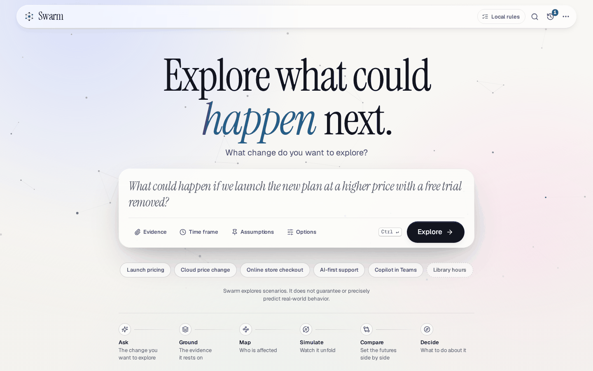
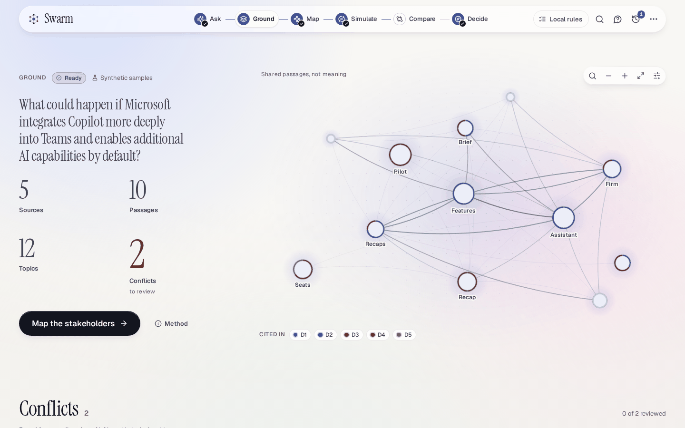
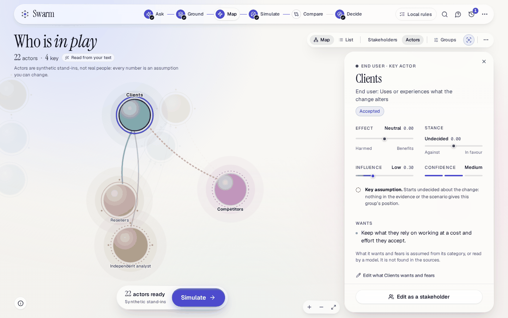
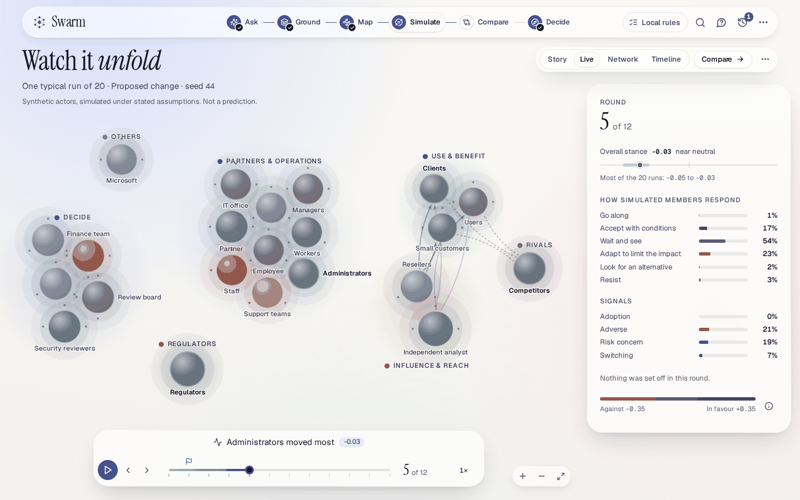
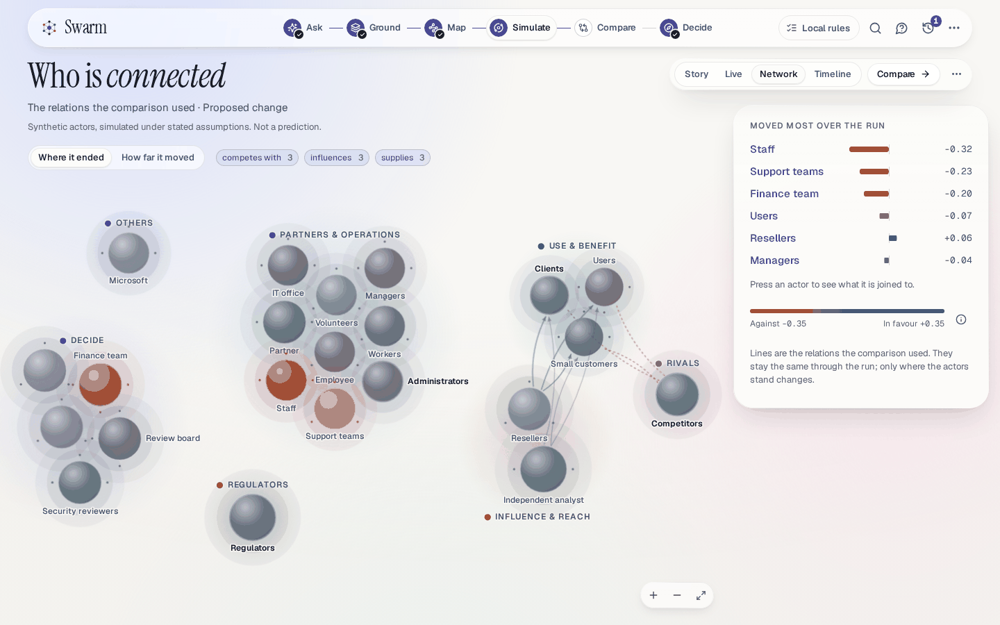
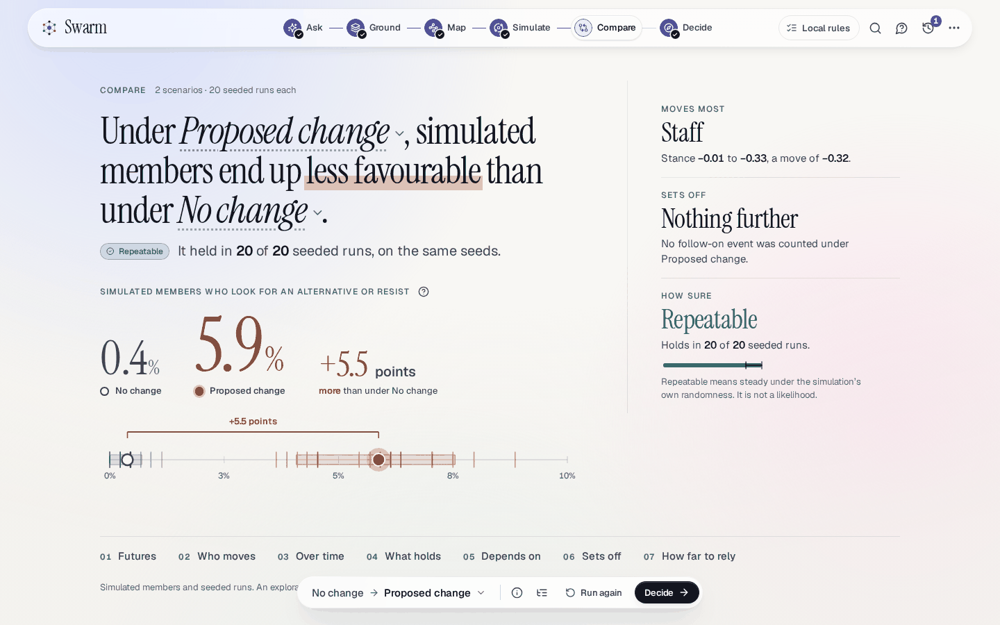
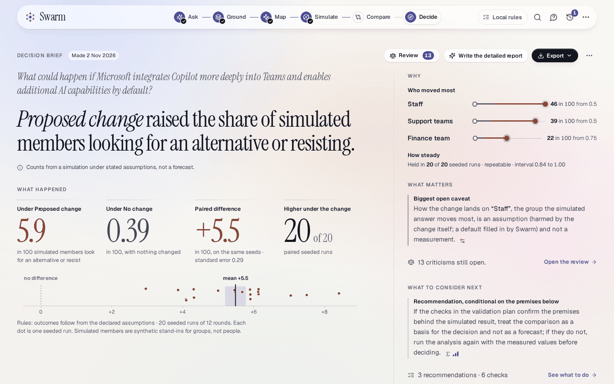
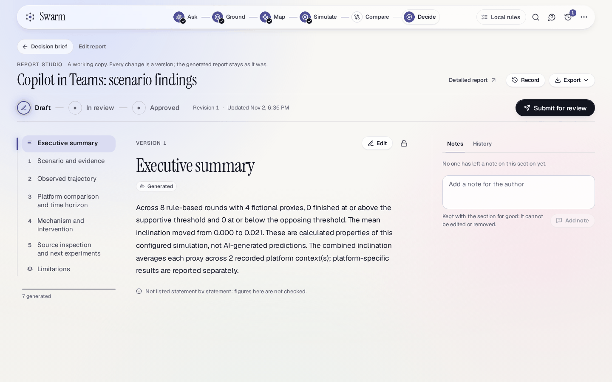
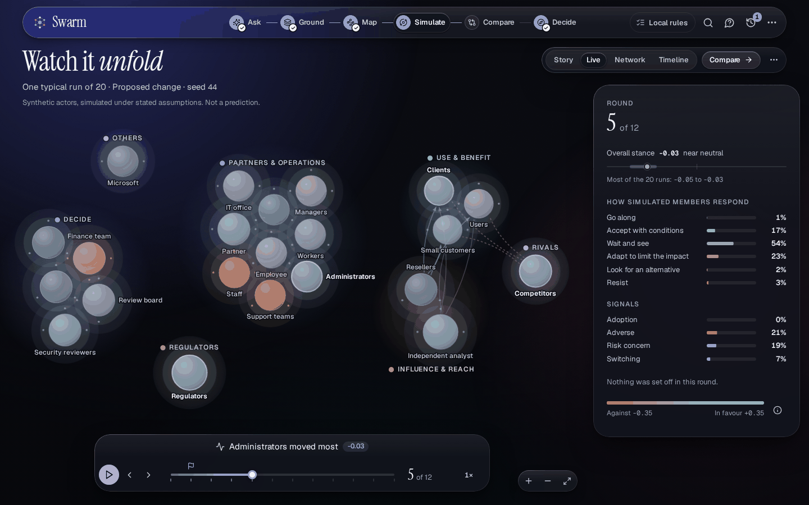
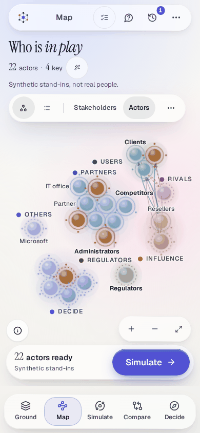

# Using Swarm

This guide walks the interface from a question to a decision brief, one scene at a time: what each scene
shows and does, what opens it and why a scene is sometimes locked, how to read the results, the optional
deep dive and its what-if loop, the analyst and the actors, the grounding review, Report Studio, the model
budget and who has access. Back to the [README](../README.md). How the interface is built, and how a
feature adds to it, is in [UX.md](./UX.md).

Swarm explores what could happen if something changes. It does not guarantee or precisely predict
real-world behavior: everything it shows is a simulation of synthetic actors under assumptions that are
stated, and none of it is a measurement of real people.

## The journey

The work is six **scenes** along one journey: **Ask → Ground → Map → Simulate → Compare → Decide**. It is
not a one-click replay. Nothing runs until you say so, and no example results, actors or counters are
preloaded: a sample case only fills in a question and its invented evidence, and the scenario, the
participants and the results are made the same way as for a question of your own.

| Scene        | What you do there                                                                                                                  | Opens when                                                           |
| ------------ | ---------------------------------------------------------------------------------------------------------------------------------- | -------------------------------------------------------------------- |
| **Ask**      | Write the question, say whether Swarm researches for it or the evidence is yours, and review the scenario that Swarm reads from it | Always                                                               |
| **Ground**   | Follow the research where there is some, read what the evidence says and settle where sources disagree                             | There is a project                                                   |
| **Map**      | Find who is affected, check the participants and approve them, read the actors made from them, and review what limits the decision | The evidence has been read, or stakeholders already exist            |
| **Simulate** | Set the futures side by side, run them and watch one typical run                                                                   | There are simulated actors (or the deep dive's environment is ready) |
| **Compare**  | Read the answer, who moves, what held across the runs and what it depends on                                                       | A comparison has finished                                            |
| **Decide**   | Read the decision view, then the decision brief; review it and export it; edit the detailed report in the studio                   | A comparison has finished                                            |

### Finding your way

- **The top bar** floats over the page. From the left: the **Swarm** mark (it starts a new question; on a narrow
  screen, 44rem and below, it stands alone and the word goes), the journey, a chip for the engine, **Search and
  commands**, **Ask about this**, **History** and **Settings and tools**. The chip says as much as the bar has room
  for: on a narrow bar only its lamp, then **Local rules** or **REAL AZURE AI** (or **REAL MODEL**), and, on a wide
  screen, the provider's name and how the connection is, as in **REAL AZURE AI · connected**. Press it for the rest.
  On a phone the journey moves to a dock along the bottom edge, and the mark is the way back to the first screen.
- **Search and commands** (press Ctrl or ⌘ with K, from anywhere, also while you type; on a phone it is the first
  item of Settings and tools) goes to any scene or view of one, opens History, the audit log and the other panels,
  changes the theme, the motion and the detail level, and opens another exploration by its name. A scene that is not
  open yet is listed with what opens it. Everything it does can also be done from the page: it is only quicker.
- **The journey** shows each scene as done, current, ready, working, needing attention or locked, and ticks
  a scene only when the project's own record shows it. Proposed stakeholders do not tick Map, and a stopped
  comparison does not tick Simulate. A scene's tooltip says what it is for, or what opens it.
- **A scene that cannot be opened yet** shows a lock and a quieter ink, not a faded name, and says what it needs:
  "Ground it first" (Map), "Needs actors" (Simulate) and "Run a simulation first" (Compare and Decide). It does
  not open from a click or from the keyboard: a note says why. It opens by itself once the record allows it, with
  no reload and without choosing **Refresh**: the page looks for a comparison that has finished, was stopped or
  failed, and for a brief that has been written, and shows them within a few seconds. A comparison that was
  stopped or failed leaves Compare and Decide locked, unless an earlier one finished: a finished comparison is not
  forgotten because a later one was cancelled.
- **A run the engine made on its own**, such as the recorded Larkholm demonstration, has nothing from the scenario
  lab: no scenario, stakeholders, actors, comparison or brief. It is read through its own run, so with saved
  rounds and a written report nothing is locked for it. It opens on Simulate, in the deep dive; Compare opens on
  its recorded runs, side by side; and Decide says "Nothing to decide from yet" and offers **Open Simulate** and
  **Detailed report**, the recorded report, which has **Edit in the studio**. With rounds and no report, Compare
  is open and Decide stays locked.
- **A project opens where the work has got to**: on Decide once a comparison has finished, on Simulate while
  one runs or once there are actors (or, for a run the engine made on its own, once it has saved rounds), on
  Map once the evidence has been read, and otherwise on Ground. Each scene's main button leads to the next.
- **The address holds where you are**: `?project=<id>&scene=<scene>`, and for a part of a scene `&view=<name>`
  (for example `view=deep` for the deep dive). Copy it to come back to the same place, or to give it to
  someone who has access.
- **A record that the guided flow did not make**, such as a quick run saved before the staged engine, keeps
  its results readable. Map and Compare say "Not in this record", and the other scenes show what the record
  holds without inventing what it did not record. See [History](#history-and-keeping-a-record).
- **A run the engine made on its own**, such as the recorded demonstration, has nothing in the scenario lab
  (no scenario, stakeholders, actors, comparison or brief) and is read through its own run. It opens on
  Simulate, which shows its deep dive. **Compare** opens once it has rounds, on the comparison of two
  recorded runs, and **Decide** opens once it has a detailed report, to say "Nothing to decide from yet"
  (there is no brief) with **Open Simulate** and **Detailed report**.

## Ask: the question and the evidence

The first screen, and the only one before there is a project. Its heading is "See how a decision could
unfold.", and what it asks of you is one question.

1. **Write the question.** Type a what-if question, one or two sentences, into **Your what-if question**. While
   the box is empty a line above it shows, in turn, what a question could be (a bus route, a subscription
   price, support moved to an AI-first model, video check-ups, a second site, a shorter school week); none of
   them is filled in. Or choose **Start from a template**: **AI adoption**, **Pricing change**, **Product
   launch**, **Policy change**, **Market entry** or **Operating-model change** puts a sentence with blanks in
   square brackets into the box and selects the first blank, so that your next words replace it, and **Custom**
   starts from nothing. A question that still has a blank in it is not read ("Replace [a team] with your own
   words."). The question holds up to 2,000 characters: a longer text pasted into it is cut, and from 1,700
   characters a counter ("1,750 / 2,000") says how much room is left.
2. **Say where research starts and over what time, if you want to.** Under the question, **Website or domain**
   takes a site (`example.org`) or the address of one page, and a tag says which it read it as, **Site** or
   **Page**; an entry that does not look like either is said not to ("That does not look like a website yet.
   Try example.org, or the address of one page."). It is optional, and it is where automatic research
   starts: Swarm has no search provider, so without a website (and without a source of your own) research has
   nothing to read, and a website matters only when research runs, which is for a question with no source of
   your own, or one that names a site or a page, beside any sources you add. **Time horizon** asks over what time the effects should be judged: **Not sure**, **Next quarter**,
   **6 months**, **1 year**, **3 years** or **Custom**, which takes your own words ("For example, the next two
   quarters").
3. **Choose whether Swarm researches.** **Research automatically** is on by default where the server does
   research. What the line beside it says is what the server does: "Reads the website you name. With none, it
   asks you for a source." where no search provider is behind the server, as in this build, and "Swarm finds and
   reads public sources for you." only where there is one. With it on, a question that has no source of your own
   is researched first, and so is one that names a site or a page, beside any sources you add: after you
   continue, Swarm reads the site or page you named and what it links to
   ([what that does and does not do](../README.md#automatic-research)). With no website and no source of your
   own there is nothing for research to read, and Ground says **Needs a source**. Attach a source of your own
   and name no site, and the project is read from your sources, as it always was, and research does not start.
   Turned off it says "Manual sources only:
   Swarm reads what you add.", and the website field is greyed out and says it is used by automatic research.
   Where the server does not research, the switch is off and cannot be turned on ("Off on this server. Attach
   your own sources.").
4. **Add evidence, if you want to.** **Evidence** opens a panel with three ways to add it: **Files** (drop them, or choose
   them: TXT, MD, CSV, JSON or a text-based PDF, where the server reads PDFs), **Paste** (a name and the
   text, then **Attach**) and **Web page**, which is offered only when the server allows it. For a page,
   type an address, choose **Fetch**, read the title, site, size and time of retrieval, then choose **Add as
   evidence** (or **Discard**). Or name the page in your question: a button that names the site ("Read
   example.org as evidence") appears under the field, and the page is fetched only when you choose it, and
   still previewed before you add it. The
   server fetches the page, not your browser: it runs no scripts, signs in nowhere, does not read private
   networks, and does not check that the page is true. If the page cannot be read, the message says why and
   you can paste its text instead. A project takes up to ten documents of 80 to 40,000 characters each.
   Everything attached sits in a row of pills, and a pill opens the text that Swarm will work from, to read
   and correct. If you change the text of a page that was fetched, it is kept as pasted text and no longer
   called a retrieved page (put the words back and it is the page again). Every document keeps where it came
   from.
5. **Say what to take as given, if you want to.** **Advanced** opens three more fields, and a number on the
   button says how many of them hold something. **Geography** is where it applies, if that matters (a country,
   region or city). **Research guidance** is used to rank what research reads and never as an instruction to it
   ("For example, official sources only"). **Assumptions** is what Swarm should take as given, up to six lines.
   The time horizon, the geography and the assumptions are applied after your question is read, as yours: the
   horizon and the place answer the questions about the period and the place, and each assumption is marked
   **Yours**. They are not part of what is read, so nothing that reads the question, a model included, sees
   them. If you change any of them, the question is read again.
6. **Choose the engine, if you want to.** **Options** (the sliders button) holds the engine (**Local rules**,
   or **Model assisted**, which stays off until the server has a provider), an optional name, and the settings
   of the deep dive (proxies, rounds and seed), under **Deep dive**. A line there says whether the question goes
   anywhere: "Rules run on this machine. Nothing is sent anywhere.", or which provider a model would send it
   to.
7. **Explore.** Choose **Explore** (or press Ctrl or ⌘ with Enter, which the button's hint shows for your
   device). It needs a sentence, and says so if it is missing. With **Research automatically** off it also needs
   a source ("Add a source to ground it: a file, pasted notes or a public page."); with it on it does not.
   Swarm reads the question into a scenario: rules on the server read it and it goes nowhere else, unless you
   chose **Model assisted**. Then it is sent to the model provider, and if that fails or takes more than 170
   seconds the rules read it and a note says so. A reading that takes a moment shows the question while it is
   read, with focus on **Stop** (Escape does the same), which puts you back at the question with everything you
   wrote.
8. **Review the scenario.** The heading becomes "Your scenario", and what Swarm read is laid out to read and
   correct, not as a form to fill. Everything is editable where it stands: the decision, what it affects,
   where and over what time, **What changes** (each with a from and a to), **If nothing changes**, **Ways to
   do it** (the alternatives to compare; **Add a way**), **Who is affected** and **Assumed**. Each assumption
   is marked **Yours** or **System assumption**, and you can add or remove them. **Swarm asks** lists at most
   three questions that it needs answered: **Answer** or **Skip** each. **Evidence** lists what was
   attached. Where research will run, a line there says what it will do, by what the server can do ("Automatic
   research is on. After you continue, Swarm reads example.org and the pages it links to, and lists every page it
   reads." for a site you named; "This server cannot look for sources from a question alone. After you continue,
   Swarm asks you to name a website or add a source." for a question alone, where no search provider is behind
   the server). It says so whether or not you attached a source when you named a site, and says nothing when
   your own sources are what is used: research starts only for a question that has none, or that names a site or
   a page, and it reads only the site or page you named.
   **Add evidence** adds your own. **How it was read** says how the question was read. A chip says whether it was read by rules, by a
   model, or edited by you. **Question** goes back to the first screen with everything you wrote.
9. **Ground it.** **Ground it** creates the project and starts reading the evidence, or researching for it.
   Nothing ran before this: "Nothing runs until you continue." sits beside the button. For a question with no
   source of its own, or one that names a site or a page, and research on, the research run is started as the
   project is made (the sources you added are kept: the run reads first and then grounds the project with all of
   them), and Ground opens on it; if the project is saved and the run could not be started, the page says "The
   exploration was saved, but Swarm could not start researching" with the reason, and Ground offers **Start
   research**. A project that already holds ten sources, the most it can, has no room for what research would
   read, so the page says that the website you named was not read, and **Ground it** in Ground reads the sources
   you added. If the reading of the
   question fails, the page says so and offers **Try again** (focus is already on it) or **Continue without
   reading**, which starts without a scenario, and so without the time frame, place and assumptions you gave.

**Under the composer** there is more to read before you write. **Start from a template** is the row of
templates above. **How Swarm works** is a row of five steps that you can open (press one, or rest the pointer
on it), saying what Swarm does and what you decide at each: **Question**,
**Research**, **People** (**People and constraints** on a server that keeps constraints), **Possible futures**
and **Decision**. They are the path in plain words, and the six scenes of the journey carry it out: the
question is Ask, research is Ground, the people and constraints are Map, the possible futures are Simulate
and Compare, and the decision is Decide. What the second step says follows what the server does: where
research is off it says that Swarm reads the files and pages you add and nothing else; where research is on and
no search provider is behind the server (as in this build) it says that Swarm reads the website you name and the
files you add; only where there is a provider does it say that Swarm finds and reads public sources. A line of short words says what every exploration includes: **Evidence linked**, **Assumptions
visible**, **Alternatives compared**, **Constraints considered** (only where the server has them) and **Human
approval before simulation**, and **What this means** says what each is. These describe what Swarm does, not
how good a result is.

At the foot of the screen, **Try a sample case** (it reads **Try a recorded demonstration** where the workspace
holds the recorded ferry run, which then has its own **Open the recording**) opens the sample cases: **Launch
pricing**, **Cloud price change**, **Online store checkout**, **AI-first support**, **Copilot in Teams**, and
the fictional starter **Library hours**, which is there to learn the workflow. A sample case is a question
with invented evidence, and none of it describes a real case. Choosing one fills in the question and its
evidence, clears whatever you had said beside the question and turns **Research automatically** off, since
the sources it brings are the point of it. A note then names it and says how many documents it brought
("5 documents · sample evidence"), and pressing the note brings the templates back. Beside the link stand
"Explore scenarios, not predictions." and, below it, the sentence "Swarm explores scenarios. It does not
guarantee or precisely predict real-world behavior."

Under the question, **Continue** lists your newest explorations (and the recorded demonstration, when the
workspace has it), and **All explorations** opens History. **Duplicate as a new question**, under Settings
and tools, brings an exploration's question, evidence and settings back to this screen. "Only the question,
evidence and settings were copied. Nothing that was run."

## Ground: what the evidence says

Ground is where the evidence is read, before anything is simulated. Its heading is your question. A status
chip says where the reading stands (Not started, Queued, Reading, Extracting, Checking, Ready, Failed,
Stopped, or Saved record; Checking is the moment the sources are compared for conflicts), and four figures,
**Sources**, **Passages**, **Topics** (**Entities** in a project made in Model assisted mode) and
**Conflicts**, are also the way into the rest of the page: Sources goes to the list of sources, Passages
opens a search of the numbered passages (by number or by a word), Topics goes to the graph and Conflicts to
the conflicts. The one main button changes as you go: **Ground it** before reading has started, **Stop**
while it runs, **Try again** or **Start again** after a failure or a stop, and **Map the stakeholders** once
the evidence is read. It waits at the bottom of the screen once it has scrolled away. Until there is a graph,
the sources fill the first screen.

- **The graph** draws what the sources talk about, and says under it what a line means: "Shared passages, not
  meaning" in rules mode. Its points are topics, the words the sources lean on most, and a line joins two that
  share a passage: co-occurrence, not meaning. In a model-assisted project ("Extracted by a model · may be
  incomplete") a model proposed the entities and links, each with a quote that the server checked word for
  word against the passage it cites, and it may be incomplete. A ring shows which documents cite a topic. The
  heaviest topics are named; the rest are named when you point at them. Choose a topic to read its passages.
  **Find a topic** searches, and **Zoom in**, **Zoom out**, **Fit to view** and **Graph options** (which
  types to show, how weak a link may be and whether to name the links) are beside it. With the keyboard, `[`
  and `]` step between topics, Enter or Space opens one, the arrow keys move the view, `+` and `-` zoom, `R`
  fits everything and Esc closes the panel.
- **Method** says how the evidence was read, with the engine's notes and the types it looked for. The local
  schema is a topic and co-occurrence schema, not AI extraction. In model mode a quote that runs past the
  source is shortened to its verbatim start, and a relation whose type is not in the scenario's ontology is
  left out; the notes say how many of each. An invented citation, an unknown entity type or a duplicate id is
  still rejected.
- **Sources** are a tray, one row for each document, with its numbered passages (S1, S2, …) laid along a
  thread as long as the document. A tag says where each came from: "Upload", "Pasted", "Synthetic sample" (an
  example's invented documents, which say they are not real information), or the site that a fetched page
  came from. Under **Sources** a row also names the topics that came from it, the heaviest first. Each row
  says where its source stands: Queued, Reading, Extracting or Checking while the engine works, and Ready
  when it is done. **Needs attention** marks a source that is in a conflict nobody has settled, with a flag
  for each such conflict that takes you to it. Choose a source to read the document with its passages
  marked, or a passage to read it on its own; pointing at either lights what it is tied to in the graph and
  in the conflicts. A page's sheet says "Retrieved by Swarm on" a date and "Retrieved, not verified."
- **Conflicts** come first when any is unsettled, ahead of the sources they are between. Each puts two
  sources that give different figures ("Different figures") or say opposite things ("Opposite statements")
  side by side, with the words each stands in. Swarm found them from wording alone, and "Neither side is
  declared true."; **How it was found** says which words the passages share. Each is a **Possible conflict**
  until a person settles it: **Confirm**, **Not a conflict** or **Mark resolved**, with an optional note
  (**Add a note**), and **Change decision** if you change your mind; settled ones wait under **Reviewed**. A
  conflict that you dismiss or resolve no longer weighs on the statements it touched. Nothing requires you
  to settle them.
- **Statements** lists what a report written by a model says and how well the sources back each statement,
  not whether they are true: a bar counts the verdicts and filters the list, and each statement is tagged
  with what kind of thing it is, a **Fact** (a source says it), an **Assumption**, a **Simulation
  observation** or an **Interpretation**, with a filter by kind when the list holds more than one. A
  statement opens in a sheet with its passages, where you can **Accept**, mark **Needs revision** or
  **Reject** it. The section appears only once a report has been checked and lists some; when the check
  found none, a line says so, and until then there is no empty section. See the
  [grounding review](#grounding-review-model-assisted-reports).
- **Research** is there where the server researches. A question with no sources of its own, or one that names a
  site or a page, is researched first: the status chip, the four figures (**Pages read**, **Sources used**, **Sites**, **Conflicts**) and the
  one main button (**Start research**, **Pause**, **Resume**, **Finish early**, **Cancel**, **Try again**) are
  the run's, and the six stages (Planning, Finding sources, Reading, Extracting evidence, Checking conflicts,
  Ready) light as it reaches them. Under them is every page it looked at: its title, its site, what kind of
  site it is, an **authority estimate** ("An estimate from the kind of site it is. It says nothing about
  whether a page is right."), what became of it (Used, Read, Quarantined, Blocked, Failed, Duplicate or
  Skipped, with the reason of each that was set aside), and **Provenance**: where it was fetched from, when,
  what its content hashes to, whether the site's robots.txt allowed it, and how its text was taken. **Cancel**
  asks first. **Suggestions** are the kinds of source the plan says to look for, and the sites it names, which
  Swarm reads only when you press **Add this site**.
  Where no search provider is set up, a question alone is not an error: the status says **Needs a source**, and
  Swarm says that it cannot find sources from a question alone and does not search the web. **Add a site or
  page** starts from a site or page you name; **Paste or attach**, under "Use sources of your own", takes text you
  paste or files you attach as the sources of the project, with nothing fetched, and Swarm goes on to read
  them. Where the project cannot take sources there, **Open the question to add sources** takes the question back
  to the first screen. **What the research looks for**
  and **Limits for this run** open on the plan and the limits, and cost is an estimate, never a bill.
- **Operations**, the engine's recorded operations and events, is shown in Advanced detail only.

## Map: who is affected, and the actors

Map opens once the evidence has been read. Swarm proposes who is affected by the change, with the sources it
found for each; you review the list and approve it, and Swarm makes **simulated actors** from it. The same
list is called the participants of the decision in the **Review** view below, and every one of them is a
synthetic role, not a person. Every trait of an actor says where it came from (an assumption of the category,
the evidence, a model, or you) and can be changed. The method is in [stakeholders](./stakeholders.md). This is
what you meet, in order:

1. **Before anything is found** the page asks "Who is in play?", says that actors are synthetic stand-ins,
   not real people, and offers **Find who is affected** and **Add one yourself**. With no model,
   **Find who is affected** reads the text for roles. In a project made in **Model assisted** mode on a
   server with a provider it asks the model (which sends your source text, and the page says so beside the
   button), and **Read the text instead** reads the text with no model. **How stakeholders are found** says
   what each way costs and cannot do. A group that the model proposes without a quote that can be checked is
   kept (marked inferred) only if your question or scenario names it; otherwise it is dropped and the note
   says so.
2. **After finding**, the stakeholders are drawn as a map, in clusters by kind: Decide, Use & benefit, Bear
   cost & risk, Influence & reach, Rivals, Partners & operations, Regulators and Others. A key party is drawn
   larger, with its name in bold (**How to read this map** says so). Under the heading, counts say how many
   parties there are, how many are key and how many are **to review**, and a chip says how they were found
   ("Read from your text", "Found by a model" or "Built by you"). Press the chip for the note, which says how
   many have a direction of impact read from the wording. Point at a party to see, before you open it,
   whether it is key or a cohort, its influence (for an actor), its effect and how many quotes it rests on.
   In the toolbar, **Map** and **List** switch between the map and the same parties as text (in groups, the
   weightiest first, each row saying its own facts in words), **Review** and **Constraints** open the two
   views described below, **Stakeholders** and **Actors** switch what is drawn, **Groups** shows or hides a
   kind, and the focus control (`F`) dims all but what is connected to the
   party you have open. With the keyboard, the arrow keys move to the nearest party in that direction,
   Enter or Space opens it, Esc lets go, Ctrl or ⌘ with the wheel zooms, a drag pans, and **Zoom in**, **Zoom
   out** and **Fit everything** sit beside the map.
3. **A party** is a button on the map. Choose it to read it in the inspector, a floating panel (on a narrow
   screen a strip with **Details**, which opens a sheet): its direction of impact in words, with what that
   was read from ("read from the wording", "assumption", "model’s reading" or "set by you"), how directly it
   is affected, how it is modelled (**Key**, **Cohort** or **Small**), how sure Swarm is, what it wants and
   worries about (assumed from its category, or read by a model; not found in the sources), the quotes it
   rests on under **Evidence**, word for word with the passage and the document each comes from, and **Why
   they are here**. **Accept** is a button of its own, and beside it are icon buttons to edit, duplicate,
   merge (into another stakeholder) and remove it, each named for the party ("Edit <name>"). A duplicate is
   your own: its name ends in "(copy)", it cites no evidence and says so. Quotations cannot be
   changed here, and the server refuses an altered or invented one. Nothing is deleted: a removed or merged
   stakeholder moves to **Removed**, where **Restore** or **Undo the merge** brings it back. **Add a
   stakeholder** adds one of your own; it carries no evidence, says so and is marked "Added by you". The
   places marked "Nobody found for" (on the map, and under **List**) are the kinds of stakeholder that
   nobody was found for: a prompt to look, not an error, and a press adds one there. A project holds at
   most 40. If nobody is left, the page says "Nobody drawn yet" and offers **Add one yourself**.
4. **Approving.** One pill at the foot of the map says the one thing to do next. While some stakeholders
   need review it says "N to review" (press it to open the next one) beside **Create actors**, which stays
   disabled, with the hint "Keep or add two or more", until at least two stakeholders are kept, and with the hint
   "Fix N things first" while a blocking check stands against the list (see **Review**, below). (A screen reader names that button "Approve & create actors", because it also accepts the stakeholders you did not
   look at; where you have changed actors it reads **Approve** and leaves your changes as they are.)
   Approving accepts the ones you did not look at and makes the actors: a key actor for each key stakeholder
   and a cohort of simulated members for each of the others. When a model is available, pressing the button
   opens a small panel with the switch **Let the model read the key actors** (it sends your source text to
   the model, whatever it sets is labelled as the model's, and if it fails the category priors stand) and a
   confirming button. Changing the list afterwards takes the approval away until you approve again, and
   **Find stakeholders again…** (under **More** in the toolbar) replaces a list you have reviewed only after
   you confirm ("Replace the list?").
5. **The actors.** Once they are made the pill says "N actors ready", "Synthetic stand-ins", and offers
   **Simulate**. **Actors** in the toolbar draws them. An actor opens to its **Key assumption** (where it
   starts), what it wants, worries about and is pressed by, and its traits, each on a slider with its origin
   (assumption, evidence, model or you) and the reason for its value. **Edit what _name_ wants and fears**
   opens its role, starting belief and those lines to change in your own words, and a cohort's size and
   number of simulated members are fields. Moving a slider marks the trait "Changed by you; not saved yet",
   and the pill offers **Save** and **Discard**; a saved actor is "Edited by you". Where the pill gives way to
   the strip of a party (below 64rem), the strip and the sheet that opens from it say "N actors changed, not
   saved yet" and carry the same two buttons. Leaving the Map with a change that is not saved, by the journey, the
   dock, Search and commands, another exploration or a new question, asks first ("Leave with unsaved changes?":
   **Keep editing** or **Leave anyway**), and the browser asks if you close the tab; a change you saved or
   discarded is not asked about. **Reset all actors…**
   (under **More**) makes every actor again from the approved list after you confirm. You cannot add,
   remove, rename or regroup an actor itself, because the actors are made from the stakeholders and the
   server refuses to change which they are: an actor offers **Edit as a stakeholder**, and there you
   duplicate, remove, rename or regroup the stakeholder. Then the page says "The actors are out of date" and
   offers **Make them again**, which asks before it replaces your changes. A simulation will not start on a
   list that is no longer approved or on actors that do not match it: the server answers in words, "approve
   them and make the actors again", and you do that here.

The rules read the groups that the text names with a role word, and read a direction of impact only where a
cited sentence has a word of concern or welcome. The others stay unclear until you say who is helped or
harmed, which is what the warning before a simulation means when it says that nobody has an expected
direction of impact.

### Review: the participants

When Swarm has proposed the list, the Map says so ("Swarm proposed these participants") and offers **Review
participants**; where a check stands in the way it says how many ("2 checks stand in the way of using these
participants"). The toolbar's **Review** view is the same list laid out to be checked before it is used, and a
number on the button says how many checks are left to fix. Its heading is "Review the proposed participants",
under "Synthetic roles, not real people", with counts: how many participants, how many are key, how many are
**quoted** and how many **assumed**, and how many are to review.

- **The checks come first.** Each participant is held to a catalogue of checks, and some of them block. While
  one stands the page says "Fix N things before these can be used" and lists each as **Fix first**, with a
  button that fixes it or takes you to the participant. "Simulation starts only from a list that passes these
  checks, so that no actor is generic, unsupported or about a real person." The checks that only suggest are
  under **Suggestions**. When none stands, the page says "Nothing blocks these participants", and when the
  actors have been made it says "Approved".
- **Who holds which role.** The list shows the roles in the decision that somebody holds, and the roles that
  nobody holds yet, each with **Add one** to add a participant for it. The roles that a decision like this does
  not need are folded under **Other roles nobody holds**.
- **A participant** is a card in the group of its role, with why it is here, its priority, its authority,
  influence and how directly the change reaches it. Chips say that it is a **Synthetic role, not a person**,
  what it rests on (a quotation, or "Assumed: …" where no passage is cited), how sure Swarm is, and whether it
  is proposed, accepted, edited or added. **Details and evidence** opens what is held for it and the passages it
  cites, word for word, or says that it is held as an assumption to test; a participant you added cites none.
  **Accept** keeps it, **Edit** opens its fields (its name, its role, why it matters, what it is trying to
  achieve, what drives and limits it, what it can see and could do, what is never asserted about it, its
  influence and priority, how the change lands on it, how sure you are and how many it stands for); **Ask
  why** says why it is on the list, and the icon buttons merge it into another, **propose it
  again** (from the text, or with the model where there is one) and remove it. A participant you removed or
  merged is under **Removed**, with **Restore** or **Undo the merge**.
- **The bar** above the list holds **Accept all**, **Accept selected**, **Merge duplicates**, **Add a missing
  participant** and **Propose the list again…**, which replaces the list only after you confirm. A role that
  may read the project but not change it is told so ("You can read this list but not change it").
- **What was left out, and how it was checked.** **Left out** lists what Swarm did not keep, each with the
  reason, so that nothing disappears without a trace. **How this list was checked** says whether a model
  proposed it and Swarm then compared every quotation with its passage, or the text was read for roles and no
  model was used; how many passages it read; whether research sources and your known constraints were part of
  what it read; and any name that was folded into another. If some of your sources carry text addressed to an
  AI system, a notice says that Swarm read it as text and did not follow it, and which passages.
- **Using it.** The pill at the foot of the Review says how many checks stand and how many are to review, and
  **Use these actors** is the way on: it approves the list and makes the actors. It is shut while a blocking
  check stands ("Fix N things first").

### Constraints: what limits the decision

The toolbar has a third view, **Constraints**. A constraint is a limit on the decision: money, time, a rule,
capacity, who has to agree. **Read my sources for constraints** reads your question, your scenario, your sources and
who is involved for them (with a model too, if the project has one and you ask for it). Nothing it finds is
validated, reviewed or used by being found. Each constraint says where it came from: **You**, **From evidence**
(with the quote, word for word, under **Evidence**) or **Inferred** (a suggestion from who is involved, which no
source says), whether anyone has validated it, whether it is **Hard** or **Soft**, and whether the simulation
runs under it (**Applied in the simulation**) or only reads it (**Read, not modelled**). Hard or soft is Swarm's
proposal, not a finding: under **Evidence** (or **Where from**) it says why, in the words of the source ("hard
because the source says ‘must’"; "soft: the source says ‘at least’, but as something someone asks for"), and you
can change it. A constraint you accept
stays not yet validated until you **Confirm** it; **Mark unknown** keeps it out of the runs without treating it as
true; **Use as an assumption** says so wherever the result is used.

Swarm asks up to three questions at a time about limits it could not find and that could change the result.
Each says what made it worth asking: a source that says the limit is not settled, who is involved, or what a
section of your sources is about. When you have dealt with some, read again and it asks the next ones.
You can **Answer**, **Mark unknown**, **Use an assumption** or **Exclude** each one. The coverage gate at the top
says whether a simulation may start: **Blocked** while a hard legal, regulatory or safety constraint is not
settled (or a hard constraint rules out every alternative), **Provisional** while anything is left that you have
not confirmed (the comparison then carries that label), **Clear** when everything is confirmed. A simulation
does not start on constraints nobody has been through ("Confirm the review"). A project with no constraints is
simulated as before. **What if one thing were different** runs the proposed change again with one thing
different, on the same seeds. These are results of the simulation, not forecasts.

## Simulate: watch it unfold

Simulate needs actors. Without them it says "No actors to simulate yet" and offers **Open the map**, where
you approve the stakeholders and create the actors first.

- **Setting it up.** "Set the futures side by side" lists the **scenarios to compare**: the baseline
  ("Nothing changes", which shows where the simulated members stand without the change), the proposed
  change and any alternatives, up to eight in all. Every scenario runs on the same seeds, so the only
  difference between them is the change. Each scenario but the baseline has a name you can change, **How
  strongly it lands** (a slider from 0 to 1), the round it lands **From** (earlier and later buttons) and an
  **About** button that says what it is and whether its strength is the system's assumption or "was set by
  you". **Add an alternative** adds one, and you can remove an alternative while another stays. If your
  question names one amount, Swarm also offers a smaller and a larger version, marked "(suggestion)", for
  you to keep, edit or delete. Choose how many seeded runs of each (10, 30 or 100) and whether to **Test
  which assumptions it leans on**, which moves one assumption at a time and runs the same seeds again. The
  page says how many simulated runs that is and about how long it takes, and **How long this takes, and what
  it costs** says what the estimate rests on. See [the method](./analysis/methodology.md).
- **Starting it.** **Run the simulation** stays in view at the foot of the panel however long the list is
  (on a touch screen it sits above the dock). A setup that is not allowed is listed above it, and the button
  stays disabled until it is mended: a scenario with no name, no alternative to set against the baseline, a
  strength outside 0 to 1, a round outside the run, or more than 2,400 simulated runs in all. The page also
  warns, with **Review stakeholders**, if no stakeholder has an expected direction yet or if nothing in the
  change can move anyone yet; you can still run it, and the warning says what the result then shows. If the
  server will not start it (for instance because a simulation is already running for this project), "The
  simulation did not start" says why, in a sentence. If your role may read simulations but not start one,
  the page says so.
- **While it runs**, the heading says the phase ("Waiting to start", "Running the scenarios", "Testing which
  assumptions it leans on", "Reading the results"). A ring for each scenario, and an outer one for the
  sensitivity runs, fill as the server saves runs, with "N of M simulated runs" and the time taken beneath,
  and the scenarios are listed with their counts. **Cancel** stops it after the run in progress. Nothing is
  shown before it ends, and nothing from a stopped run, because its scenarios would not yet all have the same
  seeds. If the progress cannot be read for a moment, the page says so and tries again by itself; a
  simulation that is running goes on running on the server.
- **When it stops short**, you are back at the setup with a notice: "This simulation was cancelled", "This
  simulation was interrupted" (the server stopped, and it can be reproduced exactly from its seeds) or "This
  simulation failed" (with the engine's sentence). **Run it again with the same settings** starts afresh on
  the same seeds. The notice is still there after a reload.
- **When it has finished**, the results are a theatre with four ways to look at the same run, chosen in the
  bar at the top: **Story**, **Live**, **Network** and **Timeline**. Live is where it opens when a run was
  kept in detail. Only Story and Timeline are offered when none was, and the story says so.
- **Story** is a headline written from the numbers ("With the change, N% of simulated members look for an
  alternative or resist: X points more than with no change"), with the spread of the runs under it. If the
  change cannot move anyone it says that instead, and offers **Review stakeholders**. **Watch it unfold**
  goes to Live and **Compare the scenarios** to the next scene. Below are **Who moves most** (five actors;
  press one to see it in Live), **What it sets off** (the first events of one typical run, "one run, not the
  answer"), **How steady it is**, **How far to rely on this** and **Go deeper**, which opens the deep dive.
- **Live** plays one typical run, round by round. The actors sit on the map, coloured by where each stands
  in the round shown (a key, "How to read the colours", says what the colours mean), and the ones that set
  something off in that round are named and ringed. Press an actor to see where it stands, how its stance
  went round by round, how far it moved and where the simulated members it stands for end up. A card for the
  round says what was set off, where the run stands among the other seeded runs, how simulated members
  respond (in words, not only colour), the signals, and how many related pairs lean together or pull apart;
  on a small screen the card is one line above the controls that opens in place. Above the controls a line
  says what the round is about: where each actor starts, that the change lands, who set something off, or
  who moved most.
- **Network** shows the relations the comparison used. Colour the actors by **Where it ended** or **How far
  it moved**, and choose which kinds of relation to show. The card beside it says who moved most over the
  run; press an actor to see where it stands and what it is joined to, and whether the two lean together or
  apart. The lines do not change through the run; only where the actors stand does.
- **Timeline** shows, for each scenario, the middle run and the band most seeded runs fall in, round by
  round, with where the change lands and what the typical run set off. Choose which scenarios to show (one
  always stays), move the round by pointing, dragging or with the keys, or press **Play the rounds**. **The
  figures** gives the same numbers as a table.
- **The scrubber** plays the run, with **Play**, **Pause** and **Play again**, **Previous round** and **Next
  round**, a slider for the round (the arrow keys move it by one, Page Up and Page Down by three, Home and End
  to the ends, Space plays), a mark where the change lands and a point for each round in which something was
  set off, and a speed of 0.5, 1 or 2 times. Moving it yourself stops it where it is. It plays by itself the
  first time you open a finished run in a session, and when you watched it run, and never when you have asked
  for less motion: then the run opens on its last round and moves only when you move it.
- **Around it**, **Compare**, in the same bar, goes on to the next scene (on a phone, use the journey).
  Under **More**, **Run it again…** returns to the setup, **Deep dive** opens
  [the deep dive](#the-deep-dive-optional-pause-resume-intervene-branch-compare), and **Saved simulations**
  (when there is more than one) switches between them.

What is on the screen is one typical run of many, and it is said to be: "Synthetic actors, simulated under
stated assumptions. Not a prediction."

## Compare: the futures side by side

Compare reads the simulation as a document, from the top. Before anything has been compared it says "Nothing
has been compared yet" and offers **Simulate the scenarios**. While a comparison runs it shows its progress,
with **Watch it in Simulate** and **Cancel**. One that stopped says so ("This comparison was cancelled",
"interrupted" or "failed"), with **Run it again with the same settings**, **Change the scenarios** and, where
an earlier one finished, **Read the last finished one**.

- **The first screen is the answer.** A sentence says what happened ("Under _the proposed change_, simulated
  members end up _less favourable_ than under _no change_") and how sure it is: how often it held across the
  seeded runs, on the same seeds. Under it are the share of simulated members who look for an alternative or
  resist under each of the two scenarios and the gap between them in points, over a chart in which each tick
  is one seeded run, the bar spans the middle 80% of them and the dot is their average. If the change cannot
  move anyone, the page says so here, and that every difference below is noise; if no stakeholder has an
  expected direction it says "Read these differences with care". Either way **Review the stakeholders**
  takes you to the Map.
- **Why, and how sure** gives three short answers beside it, each a link to its part: who moves most, what
  the change sets off, and how steady the finding is.
- **A contents** lists seven parts: **Futures**, **Who moves**, **Over time**, **What holds**, **Depends on**
  (how the result moves when one assumption does), **Sets off** (a chain of second-order events from one
  typical run) and **How far to rely**. Each has its numbers as a table, one press away under **Data**.
- **Any two scenarios can be set against each other.** Press a scenario's name in the sentence to choose
  which is set against which (**Swap** reverses them), or press a name in **Futures**. The sentence, the
  figures, who moves, the lines of **Over time** and the findings follow the pair.
- **Futures** shows one bar for each scenario, split into the six responses (from "Go along" to "Resist"). Press
  a response in the key to bring it forward in every bar.
- **Who moves** ranks the actors by how far their stance moved between the two scenarios, each as a line
  from one to the other. Press one for its group, the simulated members it stands for and how their
  responses divide under each scenario. The same actors are on a map, coloured by the move; on a small
  screen a switch chooses **List** or **Map**.
- **Over time** shows the middle run and the band of the seeded runs, round by round, and where the change
  lands. Point at the chart to read a round, or use the slider "Round to read"; **Scale** zooms the chart in
  or shows the whole −1 to +1.
- **What holds** lists the findings, the steadiest first, each with how often it held ("k of n runs") and a
  95% interval; **What this means and how it was tested** says how a finding was tested. Eight are shown
  at first, and you can look at this pair's findings or every scenario's.
- **Depends on** moves one assumption at a time and shows how far the headline went, with where each
  assumption came from. A result that rests on assumptions nothing supports says so. If sensitivity was
  turned off, **Simulate again with sensitivity** is the way to test it.
- **Sets off** reads back one typical run event by event: what was set off, by whom, in which round and
  after what, and how often events like it occurred across all the runs.
- **How far to rely** says what drove the behaviour, the caveats, which seeds the scenarios shared, what the
  comparison cost and whether the strength of each change was set by you or is the system's assumption.
  **Method**, in the bar, says in plain words how the comparison was made.

A bar at the foot keeps in reach the pair being compared, **Method**, a menu of the parts of the page and the
saved comparisons, **Run again** (the setup, with **Back to the results**) and **Decide**. It steps aside at
the end of the page, where "What next" offers **Decide**, **Simulate again** and **Compare two recorded runs**.
On a phone the pair is one name and **Method** and **Run again** are in the menu. Beside the title, a chip
says when the comparison describes the project as it was ("Out of date": simulate again to bring it up to
date), when a newer one exists ("An older comparison", with **Read the newest**), or when it is not known
("Freshness unknown"). See [Reading the results](#reading-the-results).

**Compare two recorded runs**, from the bar's menu, the end of the page or the deep dive, lays two runs of the
deep dive side by side, round by round: how they are related, the round in which they part, one metric
across the rounds, what was declared changed and what each run is. It needs two runs with a saved round.
For a run the engine made on its own, Compare opens on this.

## Decide: the decision view, the brief and the independent review

Decide opens on the **Decision view**, the answer-first picture of the decision, and the decision brief is the
**Full report** beneath it (a **Full report** button in the view's header takes you there), with the
independent review beside the brief. The view is worked out from the newest finished comparison, the
constraints, the independent review and the evidence every time the page is read, by rules: no model writes any
of it and nothing in it is kept, so it is never older than what it describes. Its heading carries "Explore
scenarios, not predictions.", and every figure in it is a count or a share of simulated members or of seeded
runs. The method is in [the Decision Canvas](./analysis/decision-canvas.md).

- **A status, in words and an icon, never colour alone.** One of six: **Robust option**, **Conditional
  option**, **More than one plausible option**, **Needs a human decision**, **Blocked by a hard constraint**
  and **Insufficient evidence**. **Why this status** lists the rules in the order they are tried, and which one
  applied. A leading option is called robust only when nothing that Swarm tried could reverse it, its
  constraints are confirmed and the evidence is adequate; otherwise it is conditional, and the conditions are
  listed.
- **The first screen holds nine things, in the order a decision is read:** **Question**, **Current best
  answer**, **Most plausible futures**, **What drives them**, **Material constraints**, **Who moves**, **What
  could change the result**, **Recommended next move** and **What to validate before acting**. What does not
  fit is counted and one press away. On a narrow screen the question and the answer keep their place and the
  other seven fold to a line each.
- **Named lenses, and no score.** Swarm has no objective of its own, so it compares the options on four named
  readings of what the simulation measured (overall resistance, support among the key actors, resistance among
  the people who decide or approve, and the downside for the worst-affected group). They can disagree, and when
  they do the page shows it and does not average them. An option is called ahead on a lens only when the
  difference is clearly larger than the run-to-run noise, and the option that changes nothing is always one of
  the options.
- **What could change the result** names the counterfactual views and the assumptions that could reverse the
  answer, and says "could", never "would": the other options were not run again under them. A line says what was
  tried, and never that nothing reverses the answer when nothing was tried.
- **Every statement carries its kind**, as text: **Fact**, **Source claim**, **Assumption**, **Model
  inference**, **Simulation event**, **Scenario possibility**, **Recommendation** or **Validation
  requirement**. **Labels**, in the header, says what each means. Nothing inferred, assumed or simulated is
  ever called a fact.
- **A recommendation says what is missing from it.** Whenever one is shown it states what is recommended, for
  whom, under which assumptions and constraints, the evidence that supports it and the evidence that weakens
  it, what would invalidate it, what to test next, whether it can be undone (which Swarm says it does not know,
  and lists as missing) and what human approval is needed; a part with nothing to say is listed as missing, and
  the count ("7 of 9 parts stated") follows that list. **What to validate before
  acting** is a list of checks to do in the real world, which Swarm does not track. Swarm recommends and
  explains: it contacts no one, executes nothing and decides nothing.
- **What Swarm does not decide.** If the question, or what Swarm read from it, speaks of a person's employment,
  credit, legal, medical or safety situation, a note at the head of the view says so: "Swarm explores scenarios. It
  does not make or recommend decisions about a person's employment, credit, legal, medical or safety situation; a
  qualified person must decide.", with the matters it matched (**Employment**, **Credit**, **Legal**, **Medical**,
  **Safety**). It is a note and not a refusal: nothing is blocked, the picture is still there, and the note is
  there whatever the status is and before any comparison has been run. **Human approval**, under the nine, then
  says which kind of person reviews each matter (a qualified clinician, a qualified lawyer and so on) and the few
  words that the reading rested on, and that point stays open, since Swarm cannot know that anyone has done it. The
  same note is at the top of an export's Decision view (Markdown, the printable page and JSON) and appears again,
  with those words, just before the brief.
- **A decision about one person.** When such a matter is said of one person ("Should we fire this employee?",
  "Should the bank approve John Smith's mortgage application?"), the status is **Needs a human decision**, whether
  or not a comparison has been run, and whatever the simulation shows. No option is called preferred: the options
  read **Not ranked**, no view or assumption is said to reverse a choice that is not made, and the recommended next
  move is "A qualified person decides this; here is what the exploration can and cannot tell them.", with one thing
  it can tell them (how the simulated roles responded under the stated assumptions) and one it cannot (what is
  right, fair or lawful for this person) on the first screen, and the rest under **The recommendation in full**.
  The first check under **What to validate before acting** is to have the qualified person decide, and the first
  stop condition is that this view is being used in place of them. A question about a policy, a process or a group
  ("What happens if we change our hiring policy?") gets the note and nothing more, and one that only shares a word
  with such a matter ("the credit card market") gets nothing.
- **It reads words, and it is not complete.** The page says so ("The rules read words and are not complete: a
  matter they miss is still a matter for a person.") and the status says that it can be mistaken in either
  direction. A question put in other words ("Is he well enough to be discharged?", "Should I report my manager to
  HR?") or in another language is not noticed, and a single capitalised company after "hire" or "sue" may be read
  as a person. Nothing is said when you ask the question, because the check runs when the Decision view is read. The
  **Full report** under the view is the brief as it was written and may still carry its own conditional
  recommendation: the line under the **Full report** heading says that the note applies to everything below. Whether the note
  appears or not, treat a question about a person's situation as one for a qualified person.
- **Beneath the nine** are the details, each in a disclosure: why this status, how the options compare on each
  lens, the recommendation in full, everything that could change the result, the constraints and who moves in
  full, the validation plan and when to stop, what the answer rests on, what the independent review challenged,
  human approval, and what the labels mean. They are open on paper.
- **When there is nothing to show.** With no finished comparison the page says "Nothing to decide from yet",
  what is missing and which step supplies it ("Not ready yet" while one runs); for a question about one person
  it also says that a qualified person decides, in place of the lack of evidence. The note on what Swarm does not
  decide is there in these states too. A picture of a comparison that
  was run before the scenario, the participants, the actors or the constraints changed says "This picture
  describes the project as it was" and can never be a robust option; a newer comparison on its way is said too.

Below the Decision view, before there is a brief, Decide offers one action, **Write the brief**: it writes
the answer-first document from the comparison, by rules, with no model, and says "Writing the brief" while it
does. See [the brief](./analysis/brief.md) and [the critics](./analysis/critics.md).

- **The brief opens on its answer**: what happened (the verdict, in the simulation's own numbers), why (who
  moved most, and how steadily it held), what matters (the biggest open caveat, and how the review stands) and
  what to consider next, with a line under the verdict that these are counts from a simulation under stated
  assumptions, not a forecast. Below it is the story in four parts: **What happened**, **Why**, **What to do**
  and **On what ground**. Five chapters of reference stay closed until they are wanted: the assumptions, the
  evidence base, the sources, the limitations and the technical appendix. The contents (beside the page where
  there is room, or from **Contents** on a small screen) opens one, and **Open every chapter** opens them all
  (**Close the reference** shuts them again). A closed chapter is still in the page, so find in the page and
  a screen reader reach it, and an address ending `#brief-<chapter>` opens it (for example
  `#brief-recommendations` or `#brief-limitations`; `#brief-answer` is the answer). A long list of
  statements shows its first few, with **Show N more statements**. Press Ctrl+P (Cmd+P on a Mac), or choose
  **Print this page**: the page prints the whole brief, whatever is closed on the screen, and the review, in
  ink on white from any theme and without the application around it.
- **Every statement shows its origin.** Press the mark beside it to see what it rests on: one of ten origins
  (supplied or retrieved evidence, a user or system assumption, an inferred stakeholder, actor behaviour, a
  simulation aggregation, a model interpretation, a historical comparison, or unresolved uncertainty).
- **Tools for the brief** are at its head. **Review** opens the critics' objections and shows how many are
  open. What the detailed report offers depends on whether it has been written. Once it has, **Edit report**
  opens [Report Studio](#report-studio) and **Detailed report** opens the report itself. Until then **Write
  the detailed report** stands in their place (on a small screen, under **More**): it takes you to the
  report's page, which writes it from the deep dive, or says "The deep dive comes first" and takes you to the
  deep dive. While the report is being written, or if it stopped with part of it kept, **Detailed report**
  shows how far it got. A role that may not write the report is offered none of these. **Export** saves the
  brief as **Markdown**, as **JSON, with the data behind the charts**, or as a **Printable page** (opened in a
  tab of its own), or prints this page; a role that may read the brief but not export it has the three files
  switched off, with the reason, and can still print. Under **More**, **Write the brief again** and **Open
  every chapter**.
- **The independent review.** **Run the independent review** has the critics check the work, and the page
  shows each criticism with what it rests on and what it would do to the conclusion. A criticism that says
  the comparison cannot say anything about the change comes first, and you can filter the rest (open,
  answered, by severity). For each you write a response and say what it means: **Respond** (not settled),
  **Accept** (the objection stands, so its impact applies to the conclusion) or **Dispute** (the
  disagreement stays in view), then **Save response**. The
  switch **Also ask a model** adds a deeper reading, and is available only in a project made in **Model
  assisted** mode on a server with a provider. Your responses are kept for any criticism that comes back
  unchanged when you run the review again. If someone else has changed the review while you were writing, the
  page reads it again and keeps your words. Above the filters the sheet says how the review was made and, in a
  list with a sentence for each, what it could not check. Where it says that the conflicts between the
  sources were not checked, **Open the conflicts in Ground** takes you there: opening them in Ground makes
  the check, and then you run the review again.
- **When it is out of date.** "This brief may be out of date" says what changed since it was made. If the
  scenario, the stakeholders, the actors or the constraints changed after the comparison ran, choose **Re-run
  the comparison** and then write the brief again; if only the review changed, or a newer comparison exists,
  choose **Write the brief again**. "This review may be out of date" appears when the comparison the review
  reads was run before the scenario, the stakeholders, the actors or the constraints changed: run the
  comparison again, then the review again. Someone whose role may read the brief but not rewrite it is told to
  ask someone who can.

## Reading the results

A comparison does not say what will happen. It says what happened in a simulation of synthetic actors,
repeated over many seeds, under assumptions that the page lists.

- **Counts are synthetic, and the brief leads with a share.** Outcome counts are numbers of simulated
  members or of seeded runs; other figures are model scores, seeded-run proportions or stated
  assumptions. None is a conversion, churn, share, adoption or sentiment rate in a real population.
  The brief leads with the mean share of simulated members looking for an alternative or resisting,
  every group counting equally, written as members in every 100, because the number of simulated
  members depends on how many were sampled for each group. How many people a group stands for is an
  assumption, not a measurement.
- **Assumptions are labelled, and some are the system's.** Each trait and each scenario says where its
  value came from: the evidence (with a cited passage), you, the system's default for the category, a
  model, or the scenario. How strongly a change lands is a system assumption unless it says it was set
  by you. A result that moves with an assumption nothing supports is called out.
- **Uncertainty is shown, not hidden.** **What holds** says, for each finding, "holds in N of M seeded
  runs" with a 95% interval, and calls it **Repeatable**, **Mostly repeatable**, **Unstable** or **Rare**.
  These describe how stable the simulated result is. They are not probabilities and say nothing about the
  real world. **Over time** (and **Timeline** in Simulate) shows how results varied across runs. **Depends
  on** moves one assumption at a time and marks it **Sensitive**, **Robust** or **Inconclusive**.
- **Check what the comparison could tell.** If no stakeholder has a direction of impact (who is helped or
  harmed), the page says so first: either that the change cannot move anyone in the simulation (when
  nothing can land on anyone), or that nobody is set as helped or harmed, so what the comparison shows
  comes from how widely the members of a group are assumed to differ and not from a direction. Say who is
  helped or harmed on the Map, then simulate again.
- **How far to rely on it.** **How far to rely** states the fidelity of the comparison (it runs a
  rules engine: the outcome follows mechanically from the stated assumptions, and no model decided any
  actor's behaviour), its caveats, what it cost, and, when the optional deep-dive run exists, whether that
  run lies inside the range of the repeated runs (a plausibility check, not a validation). **Sets off**
  reads back a chain of events from the run nearest the middle; it is one run, not a forecast of the chain.
  An event is said to have happened because of the signal its responder watches; an earlier event is said to
  have been needed only where the run was replayed without it, and is otherwise said only to have come first.
- **The independent review is a second reader, not a verdict.** The critics check the evidence, the
  assumptions, the method, who is missing, bias, whether each recommendation follows from a finding, and
  what would have to be true for the conclusion to be wrong. Each criticism is **Blocking**, **Major**,
  **Minor** or a **Note**, and stays **Open** until someone answers it. You can mark an answer
  **responded** (not settled), **accepted** (the objection stands, so its impact applies to the
  conclusion) or **disputed** (the disagreement stays in view); an answer does not change the analysis or
  the criticism. The checks are rules and need no model. A deeper model review is optional (**Also ask a
  model**), is offered only for a project made in **Model assisted** mode on a server with a provider, is
  capped at Major so that it never blocks, and can only name things the review gave it; if the model fails
  or takes more than 170 seconds, the rules criticisms are shown with a note that says why, and a project
  that runs without a model says so beside the disabled switch. Neither is a measure of confidence, and
  neither can tell whether a source is true.
- **The decision brief puts the answer first, then what it rests on.** Its first section gives the
  decision, a recommendation that depends on conditions, the comparison of the change with no change in
  one measure (the paired difference, its standard error and how the paired runs divided: in how many the
  share was higher under the change, in how many lower, or the same in all), the groups it moves most, the
  three doubts that could change it and what would settle them. Its recommendations each name the findings,
  evidence or critiques they follow from, and its **validation plan** lists the real-world checks that would
  settle what the result depends on most, each saying what to observe, what to compare it with and who runs
  it, and leaving the decision threshold for you to set: run them before acting on any recommendation.
  Every statement in the brief carries one of ten origins (supplied or retrieved evidence, a user or system
  assumption, an inferred stakeholder, actor behaviour, a simulation aggregation, a model interpretation, a
  historical comparison, or unresolved uncertainty), and the limitations chapter says what the analysis
  cannot tell you. "No difference" is said only of the proposed change; another scenario is read on its own
  findings. A sensitivity row moves the value that governs the run (the scenario's own override or edit of an
  actor's trait when it has one, otherwise the actor's own), and says when that value is the scenario's.

## The deep dive (optional): pause, resume, intervene, branch, compare

The deep dive is the engine's older, slower run: fictional proxies act on two simulated platforms, round by
round, with a stated reason for each decision, and it can write a detailed report of its own, with an
evidence ledger. It is optional and apart from everything above: the comparison and the decision brief do not
wait for it, and it does not replace them. It opens from **More** and then **Deep dive** over a finished
simulation, from **Open the deep dive** at the end of the Story, and from **Open this run** when two recorded
runs are compared, at `?scene=simulate&view=deep`; **Simulation** at its head goes back. A run the engine
made on its own has no futures to go back to: Simulate shows its deep dive, and **Compare** opens on its
recorded runs. When the project has approved actors, **Prepare the environment** makes the proxies from them
(see [how the deep dive uses the actors](./stakeholders.md#how-the-deep-dive-uses-the-actors)); otherwise it
generates a small fictional population. The comparison does not need the deep dive either way. A quick run
saved before the staged engine appears there as "A quick run, saved before the staged engine", read-only,
with **Duplicate as a guided exploration**, and nothing invented for what it did not record.

A strip at the head says where the run stands (for example Not prepared, Preparing, Ready to start, Running,
Paused, Branch ready, Stopped, Cancelled or Finished), counts the rounds saved, says whether the engine is
**Local rules** or **Model-assisted**, and holds the one button that moves it on. The tabs are **Setup**,
**Run**, **Rounds**, **Memory** and, in Advanced detail, **Advanced** (the engine's records: traces, the log
and the raw state; in Guided detail these are one disclosure away).

1. **Prepare the environment** makes the fictional proxies and the platforms. In **Setup**, **How it runs**
   sets the rounds, the minutes per round and the platforms to run: **Info Plaza** (broadcast: influential
   voices reach every proxy) and **Topic Community** (proxies hear peers who share their topics and views).
   **Where they start** holds the assumed seed text, stance and strength of each input, and **The cast**
   lists the proxies; open one to read its persona or to edit its name, role, persona assumptions, initial
   inclination, influence and openness (its identity, the topics it is linked to and its sources cannot be
   changed). A bar says "N changes not saved": **Save the setup** keeps them (**Discard** drops them), and
   starting needs them saved. Leaving by the journey does not ask about them, so save or discard them first.
   Editing closes once the simulation starts, because the setup is what the run
   started from; branch a run to try another.
2. **Start the simulation** runs the platforms. Each has a separate population state, recorded rounds, clock
   and action stream, and they are never added together or averaged into one audience. **Run** shows where
   the run stands, with what you can do next. **Rounds** scrubs through each platform and shows who moved,
   and what they did; **The same numbers, as a table** is one step away. **Memory** lists what was recorded
   ("Recorded rule events", or "Recorded fictional activity" from a model), filtered by proxy, round and
   kind. Synthetic memory is persisted and shown separately from original source facts, and the local update
   events are numeric state transitions under deterministic rules, not fabricated social posts.
3. **Write the detailed report**, explicitly, after the simulation. Local reports calculate recorded
   results. Model-assisted reports plan bounded tool use, search sources and memory, inspect timelines,
   optionally interview fictional proxies, and write real chapters progressively; in Advanced detail the
   operations behind the report are listed with it, and hidden model reasoning is not exposed. **Open the
   detailed report** reads it. Until it is written, the tools of the brief in Decide offer **Write the
   detailed report** too. See [the grounding review](#grounding-review-model-assisted-reports).
4. **Ask** the report and the proxies: see [Asking the analyst and the actors](#asking-the-analyst-and-the-actors).

Each execution step stops at **ready** and waits for the next explicit action. Later steps cannot bypass
prerequisites. Cancellation stops owned work before retry is allowed. A failed step preserves upstream
outputs; retry re-executes that step, replacing its unfinished output. Export a snapshot before a retry if
partial data matters (**Export snapshot**, under Settings and tools). Interrupted steps and surveys are
marked failed after restart, never silently completed. A simulation interrupted after at least one saved
round keeps those rounds and offers **Resume** from the next one (an explicit action); everything else
restarts the step.

Simulation rounds are saved atomically: the combined history, both platform populations and the recorded
memories are written in one update, so a saved round is never half-written. This makes the following
possible, all with real, tested behavior:

- **Pause and resume.** **Pause at the last saved round** waits for a safe boundary: the round in flight is
  discarded and every saved round is kept, and the run is paused, not failed. With no saved round the run is
  cancelled instead. **Resume** continues from the next round without recomputing earlier ones. In the local
  deterministic engine a resumed run is identical to an uninterrupted run (asserted by
  `backend/test/whatif.test.ts`). Resume also recovers from a crash or model error once rounds exist.
  Model-assisted runs are not reproducible, and usage from a discarded in-flight round is still counted
  because it was really spent.
- **An assumed event.** While paused you can schedule or remove the single event for a _future_ round, from
  **An assumed event**: the round it is applied before, what happens, and its stance and strength.
  **Schedule the event**, **Replace the event** or **Remove it**. It is an assumption you add, and not a
  finding. "Live injection" is therefore pause, schedule, resume at the next round boundary; nothing mutates
  a round in progress.
- **Branch from a round.** From a paused or finished run, **Branch from a round** opens "Branch from a
  checkpoint": the last round to copy unchanged (any saved round, or round 0), what to do with the scheduled
  event, per-proxy changes, and an optional name. A line at the foot says what the branch would do ("Copies
  rounds 1 to 3 unchanged. Changes one proxy.") or what is missing, and **Create the branch and open it**
  works only when the request is allowed. It makes an independent run that copies rounds 1…N unchanged and
  applies your declared changes only to later rounds, and that opens waiting at its checkpoint ("Branch
  ready"); **Keep the source run unchanged** closes the sheet. The source run is never modified, and a
  branch's report and exports record its lineage. A branch says "A branch of" its parent, the round it left
  at and each declared change in words, with **Open the parent run** and **Compare with the parent**. Declared
  changes are assumptions, not proof of a cause.
- **Compare two recorded runs** lays one run beside its parent, a branch or another run, round by round,
  with the round through which they are identical derived from recorded data, and notes that these are
  simulated differences, not forecasts or causal estimates. It is in the deep dive's list of what you can do,
  and in Compare's menu. It is available once Compare is: after the project's scenarios have been compared,
  or for a run the engine made on its own. A branch goes through its parent's; until then the deep dive says
  so.
- **Restart from round 1** asks first ("Restart from round 1?"), discards the saved rounds and starts again
  with the saved environment. It is not a resume. **Keep the saved rounds** cancels it.

## Asking the analyst and the actors

**Ask about this**, in the top bar, opens a sheet called "Ask" on the exploration you have open. The deep
dive's detailed report has the same button. The analyst and the actors answer from the deep dive's written
report, so until there is one the sheet is not a dead end: it says "Ask opens after the deep dive", or where the
deep dive stands ("The deep dive is running", "is paused", "stopped"), and has a button to it, **Open the deep
dive** (**Watch it run** while it runs), which closes the sheet and goes there. Where the deep dive is itself shut,
because there are no actors yet, the sheet says that it opens once the actors are made and has no button. Once the
report is written the sheet has three tabs.

- **Analyst** takes questions about the report and its evidence. Its answers carry a grounding label; when
  the passage an answer cites is one half of a conflict between sources, the answer says so, and an answer
  that states only one side of a disputed figure is marked **Cited, with figures to check**, naming both
  documents and both figures ([ADR 0012](./adr/0012-answers-and-disputed-sources.md)).
- **Actors** holds a conversation with one of the deep dive's fictional proxies, chosen from a list. These
  are the proxies of the agent-by-agent run, made from the actors approved on the Map, so a large cohort is
  there through a few of its members and not as a whole. Replies are fictional role-play, not testimony or a
  forecast.
- **Survey** puts one question to several actors at once (up to five, and the exploration keeps up to five
  surveys). **Snapshot** records where each stands now: the numbers come back with no generated answer, and
  no one answers. **Interview**, offered only in a project made in **Model assisted** mode on a server with a
  provider, makes actual provider requests and shows progress, cancellation and partial failures as they
  happen. Neither is a survey of real people.

In a project run by rules, the analyst and the actors retrieve stored evidence and say so ("Evidence lookup ·
rules"): nothing is generated, no actor speaks, and no real person's thoughts are inferred.

## Grounding review (model-assisted reports)

A model-written report lists the statements each chapter rests on and labels every
one as a **source fact**, **extracted claim**, **user assumption**, **AI hypothesis**,
**simulated event** or **analytical conclusion**, so “the source says”, “the simulation
did”, “you assumed” and “the model guessed” are never blended. After the chapters are
written, each statement is checked:

- a quoted source fact must appear **verbatim** (ignoring case, spacing and
  quotation style) in a passage it cites, and a statement labelled a source fact
  that cannot meet this is shown as an extracted claim (see below); graph nodes
  carry the same verified quote;
- word overlap with the cited passage or simulation memory, and every figure compared
  with the cited material or the recorded simulation metrics;
- one independent model call judges support, contradiction or silence, and each
  judgement must **quote real text** from the passage or it is rejected.

Verdicts are `supported`, `partial`, `unsupported`, `contradicted` or `unchecked`
(hypotheses and assumptions are shown as such, not verified). A model judgement can
lower or confirm a verdict but cannot create support without word overlap. Figures
in chapter prose that match neither the cited material nor the recorded data are
listed as possible invented statistics. The review states which checks ran, and if
the independent check fails the report still completes with the deterministic
checks and says so.

You read the checks in the detailed report (**Statement checks**, and the sources and checks in each
chapter's margin), in Ground under **Statements**, and in Report Studio under **Statements**. A citation in
the detailed report opens the passage it points at; one that points at no passage the project stored says
"Not among this project's sources", and a citation that points at nothing is not evidence for the statement.

Limits: a citation proves provenance, not truth; only the statements the writer
lists are checked; the rules-based report has no model-written statements and gets
no review. This is a guard against unsupported claims, not a hallucination detector
or a substitute for reading the sources.

### What the review changes before it checks, and says so

A live model slips on format far more often than on substance: it rewords a quote it
meant to copy, joins two sentences that are not next to each other, cites a passage it
was never given, or lists a statement too many. Failing a whole report for that cost
a correction round trip each time, and in testing a report failed after the model
repeated the same slip through every correction. So the server repairs a slip when the
repair can only **remove, shorten or weaken** what the model claimed, and the review
lists every repair in its notes:

| Slip                                                    | What happens                                                                          |
| ------------------------------------------------------- | ------------------------------------------------------------------------------------- |
| A quote runs past the cited text                        | It is cut back to the longest start that is verbatim in a cited passage               |
| A quote on a paraphrase is not in the cited passages    | The quote is removed; the statement is judged on its wording                          |
| A "source fact" has no verbatim quote left              | It is shown as an **extracted claim** instead: the label promises a quote             |
| A citation names a passage or memory that was not given | It is removed (a statement that needs a citation and has none left is still rejected) |
| A chapter lists more than six statements                | The first six are reviewed and the rest are left out                                  |
| An empty or tiny quote                                  | It is read as "no quote"                                                              |

A repair never adds a citation, a quote or a statement, and a verdict never rests on
the label or on anything the model asserted: it comes from the cited passages and the
independent check. What is **not** repaired: an invented figure, a statement whose
cited passage does not back it (it is reported as unsupported), and a simulated event
that cites no recorded memory.

The independent check also accepts an evidence quote that runs past the passage when
its start is verbatim, and cuts one that is over its length limit, because one such
slip used to fail the whole batch of judgements. A quote with no verbatim start is
still sent back for correction.

Report and chapter titles must not claim a prediction (the words _predict_ and
_forecast_ are rejected and corrected), because Swarm explores possible scenarios and
does not predict the future.

## Report Studio

Report Studio is where a person works on the detailed report that was generated: it makes a copy, called the
_document_, and the generated report itself is never changed. The design and its limits are in
[ADR 0011](./adr/0011-report-studio.md). It opens from **Edit report** in Decide (or **Edit in the studio**
on the detailed report), at `?scene=decide&view=studio`. Because it works on the deep dive's detailed report,
it says "There is no report to work on yet" until one is written, and offers **Write the detailed report**
itself: the studio writes it from there, shows how far it has got with a **Stop** button, says when it is
done and opens on the result. If you may not write it, it says who can; if the deep dive has not been run,
it says so and takes you to the deep dive.

- **Opening it.** The first time, choose **Open in the studio**. Analysts and project leads can; everyone
  else can read it once it is open. A report computed from recorded results, with no model, can be opened
  too.
- **Sections.** The summary, each chapter and the limitations are listed in an outline. A chapter shows the
  statements the server checked against the sources under **Statements**, and each statement opens to the
  passages that support it, the passages that contradict it and the assumptions it rests on. **Record** (in
  the header, or under **More** on a narrow screen) opens the Review record: the decisions made, the open
  conflicts between sources, the assumptions behind the simulated results, and any earlier copies. It opens on
  the decisions every time.
- **Editing.** **Edit** a section, then **Save as version N**, with an optional reason. Every save is a new
  version. **History** compares any earlier version with the current text (added words are underlined,
  removed words are struck through, and a screen reader is told which is which) and **Restore** brings an
  earlier text back as a new version. A save that changes nothing is not offered. If someone else saved the
  section while you were writing, the page says "Version N was saved while you were writing", keeps your
  words and offers **See the differences** and **Drop mine**; saving then makes a new version on top of
  theirs, and theirs stays in the history. If you leave while words are unsaved you are asked first ("Leave
  with unsaved changes?": **Keep editing** or **Leave anyway**), whichever way you go: back to the brief or on
  to the detailed report, the journey, the dock, Search and commands, another exploration or a new question.
  **Keep editing** leaves you where you were, and **Leave anyway** goes where you were heading. Words that
  were saved are not asked about, and the browser asks if you close the tab.
- **What an edit does to the checks.** The server checked the statements against the text it generated. Once
  the text of a chapter has changed, those statements describe an earlier text: they are still shown,
  marked as such ("These statements describe an earlier text"), and nothing says they check the new words.
  Text a person wrote is not checked statement by statement. Bringing the exact earlier text back brings its
  statements back.
- **Locking.** A locked section cannot be edited, restored or written again until it is unlocked (**Lock
  this section as final wording**).
- **Writing a chapter again.** When the report was written by a model and the same provider and model are
  configured, **Rewrite** and **Write it again** ask the model to rewrite one chapter from the same sources,
  with an optional request about emphasis or wording (it cannot loosen a check). The server checks the new
  text the way the report was checked, then shows the changes against the text as it stands, what the checks
  found, and any figure that matches nothing in the cited material. Nothing changes until you **Accept the
  rewrite**; you can **Reject** it. It uses model calls (at most ten) that are counted in the project's
  usage. When it is not possible, the studio says why.
- **Notes.** A reviewer can leave a note on any section in any state; a note changes no text and does not
  disturb an approval.
- **Review.** **Submit for review** freezes the report so that a reviewer approves what they read. A
  reviewer (a reviewer or a project lead) chooses **Approve…** (and then **Approve this text**), or **Request
  changes…**, after which the author can edit and submit again. An approval records a hash of the exact text.
  **Withdraw…** takes a submission back and **Reopen…** takes an approval away, each with a reason. When the
  person who approves also wrote part of the text, the approval says so.
- **If the generated report is replaced** (the report was written again), the document can be read and
  exported but not changed. **Start again from the new report** makes a new document and keeps the old text
  in an archive.
- **Exports.** **Export** saves **Markdown** or **JSON, with the record**, which carry every section, its
  statements and the record. **Printable memo** opens a page to print or save as PDF with the browser's Print
  command. A memo says at the top whether it is approved, in review, a draft, or carries an approval that no
  longer matches its text; lists as findings only statements a source passage supports; shows hypotheses,
  simulation results and statements that are not verified under their own headings; and says which
  statements it left out because their text was changed. Ctrl+P on the studio itself prints the whole
  working copy, section by section, with where it stands in its review (and the fingerprint of the text once
  it is approved), and none of the editor; the memo remains the formal record.
- **Audit.** Each step is recorded in the [audit log](../README.md#security) with identifiers and counts,
  never with the text.

An approval means a person with the review capability read this text and accepted it. It does not mean
the statements are true, and it is not an external attestation. There is no live co-editing and no
merge: two people editing one section are told, and the later save is a new version on top of the first.

## Model budget

A project that calls a model has a budget for it: how many model calls, and how many tokens, it may use in
all. **Model budget**, under Settings and tools, shows how the project stands. A line above the work appears
when the project is running low or has used up its budget ("This project is running low on its model
budget", "This project has used its model budget"), with **Details** and a **Model budget** button. The
design and its limits are in [ADR 0013](./adr/0013-per-project-model-budget.md).

- **What it counts.** A call is counted when the provider answers, with its input and output tokens. It
  covers every use of the model: a run, an answer from the analyst or an actor, a generated interview, and a
  chapter written again in the studio. It does not start over when a run does.
- **Running low and used up.** From four fifths of a limit the project is **running low**; at the limit it is
  **used up**. The next call is then refused with a message that says so, and the operation fails like any
  other that does not pass: it is not repaired or retried. A simulation that stopped keeps its saved rounds
  and carries on from them once the limit is raised. Reading, editing and exporting never use the model and
  are not affected, and neither is the local rules engine.
- **Limits.** The deployment sets a default for every project. A workspace owner or administrator can give
  one project its own limits in the dialog: for the **Model call limit** and the **Token limit** choose
  **Default** (the deployment's), **Custom** with a whole number, or **No limit**, then **Save the limits**.
  A project lead cannot change them, so that the person who runs the work is not the one who lifts the
  limit on it. Everyone who can read the project can see them.
- **A few calls may go over.** Calls already in flight when a limit is reached may finish, and a token limit
  is checked between calls. It guards against a project that runs away; it is not a bill to the call.
- **Audit.** A change of limits and a refusal are in the project's [audit log](../README.md#security), with
  numbers and no content.

## Who has access

When sign-in is on (`AUTH_MODE=entra`), Settings and tools has two more items, **People** and **Who has
access**, which show who may use what. In the local single-user mode there is nobody to share with and they
do not appear. The rules are in [ADR 0007](./adr/0007-workspace-and-project-membership.md).

- **People** (under Settings and tools, for a workspace owner or administrator). Everyone in the workspace,
  with a role: owner, admin or member. A member can create projects and sees only the projects they were
  added to; an owner or admin sees every project. An administrator cannot make, change or remove an owner,
  and the page does not offer it. Taking someone out of the workspace takes them out of every project in it
  and ends their sign-ins. A workspace always keeps an owner.
- **Who has access** (under Settings and tools, on a project, for a project lead or a workspace owner or
  administrator). Who may use this project, as lead, analyst, reviewer or viewer. Anyone else who can read
  the project sees the list without the controls, and is told who changes it. A project always keeps a lead,
  and a person who is not listed cannot see the project at all. Adding someone to a project also makes them
  a member of the workspace.
- **Adding someone.** Under **Add a person**, paste their Microsoft Entra object ID (a UUID, on their page in
  the Entra admin centre), choose a **Role to give**, and choose **Add**; the dialog says what each role
  allows. There is no search by name or email, so the page cannot tell you whose ID it is: check it before
  you add it. Every change is in the [audit log](../README.md#security) with who made it, whom it was for,
  the role and the one before.
- **Changing or removing.** Choose another role in the row. Removing asks first. When the server refuses a
  change, for example the last owner or the last lead, the dialog shows its reason and nothing changes.
- **Closing.** Both dialogs close with **Done** or with Escape, and focus goes back to the **Settings and tools**
  button. They have no close mark of their own, as the sheets do.

## Settings, history and keeping a record

**Settings and tools** (the three dots at the right of the top bar) is one menu for everything that is not a
step of the journey. Every choice in Appearance, Motion and Detail has a glyph of its own, so that the three
groups line up and you find your place by shape.

- **Appearance** offers System, Light, Dark and High contrast. System, the default, follows the device: high
  contrast when the device asks for more contrast, otherwise dark when it prefers a dark colour scheme,
  otherwise light; it changes with the device while the page is open. A choice is kept in this browser (local
  storage, the key `swarm.theme`, holding only the theme's name) and is applied before the page is drawn, so
  there is no flash of the wrong theme. The menu opens with the keyboard, and its choices with the arrow keys.
- **Motion** offers Follow device, Reduced and Full. Follow device is the default and does what the device
  asks. Reduced leaves a short fade, so that a change is still shown, and stops movement and loops. Full keeps
  the motion on even when the device asks for less, apart from the map's own settling and one reveal effect,
  which still follow the device. The choice is kept under `swarm.motion`.
- **Detail** offers **Guided** ("Plain-language help under each step.") and **Advanced** ("Engine terms and
  diagnostics, open by default."). Advanced adds the engine's own names, identifiers and records, to read,
  where they are the subject (for example the operations of Ground, the identifiers in Compare, the engine
  records of the deep dive and every reference chapter of the brief open at once). It removes and hides
  nothing, and no control depends on it. The choice is kept under `swarm.mode`, holding only `guided` or
  `advanced`.
- **This exploration** (with a project open): **Refresh** reads it from the server again, **Duplicate as a new
  question** (see [Ask](#ask-the-question-and-the-evidence)), **Export snapshot** downloads the engine's record
  of the exploration as one JSON file (`swarm-lab-<id>.json`: the project as the server stores it, its evidence
  passages, its evidence ledger once there is a report, and every chat message, with the time it was made), which
  is not the decision brief (that is exported from Decide) and holds none of the scenario lab's work (the scenario,
  stakeholders, actors, comparison, review or brief) or the studio's drafts, **Audit log**, and, where they apply,
  **Model budget** and **Who has access**. The detailed report's **Export** menu has the same file as **Snapshot,
  as JSON**.
- **The account** shows "Local · single user" or "Signed in · Microsoft Entra", **People** and **Sign out**
  where they apply, and, last, the version, the licence and a link to the source.
- **The engine chip** opens "Model provider": the provider, the deployment, how it signs in, what the
  connection last did and **Verify connection**, which makes one real request. It never says `connected` of
  something that has only been configured. The bar shows as much of it as it has room for (see the top bar,
  above); the popover has all of it at any width.

On a phone the journey is a dock along the bottom edge, panels rise from the bottom as sheets, the map's
inspector is a strip that opens in a sheet, and every control is at least 44 pixels (2.75rem) high so that a
finger can reach it.

### History and keeping a record

**History** lists every exploration, newest first ("Your explorations"). Search by name or question, filter by
**All**, **Working**, **Done**, **Stopped** or **Branches**, and press a row to open it. On a phone a row's name
has two lines, since what it is called is how you find it again. For a guided project that has a saved round,
**Compare `<name>`** opens Compare's page for two recorded runs. **Delete `<name>`** asks first ("Delete this
exploration?": **Keep it** or **Delete permanently**), and the deletion cannot be undone. With nothing in it yet,
History says "Nothing yet" and offers **Ask a question**, which closes the sheet and puts you in the question
field.

A panel (History, Ask, the audit log, the budget or who has access) that cannot be opened, because its code did
not arrive, closes and says "That could not be opened" ("Check the connection and try again."); the page behind
it is as it was.

A record made by the earlier quick workflow is marked "Quick run". Its recorded results remain readable,
without invented ontology, operation traces or unrecorded second-platform results. Duplicate a historical
project to use the guided workflow. Completed scenarios are read-only apart from follow-up history;
duplicate inputs to run another scenario.

The **Audit log** ("Who did what, and when. Never your questions, answers or sources.") names every action in
plain words ("Stakeholders found", "Decision brief generated"), with the recorded code in its tooltip, who did
it and when. It can be searched and filtered, and **Verify integrity** recomputes its hash chain and says
"Chain intact" or "Chain broken".
