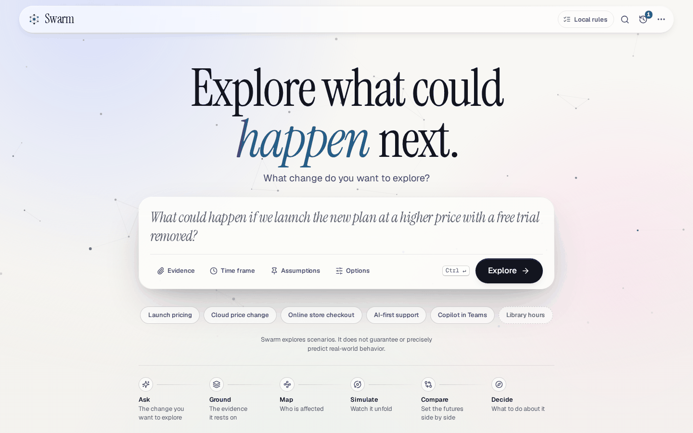
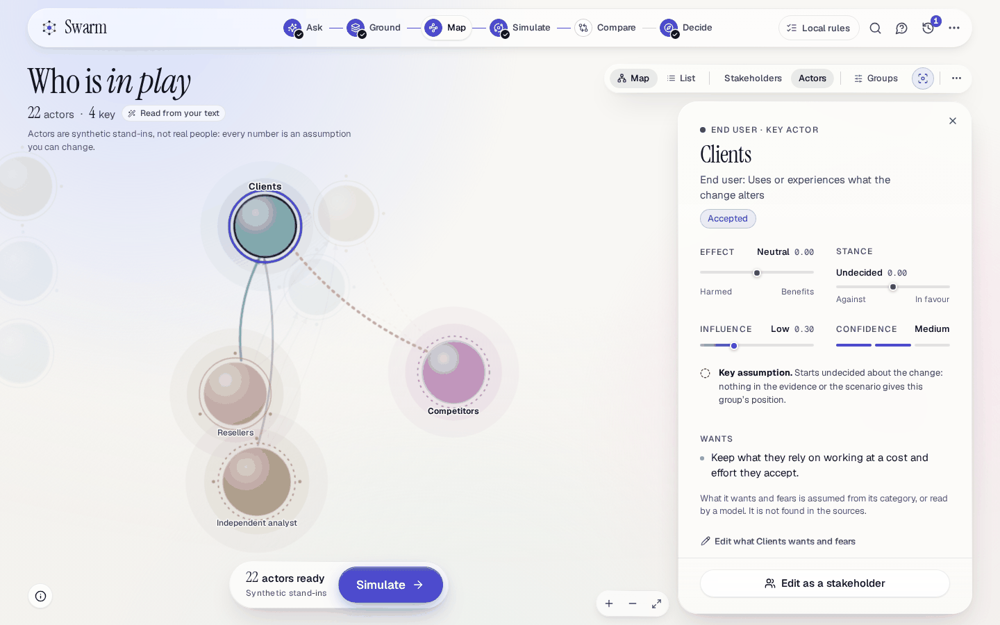
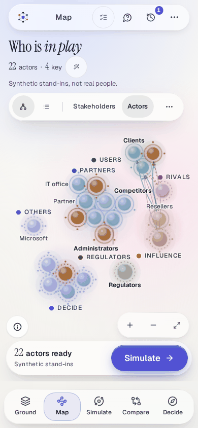
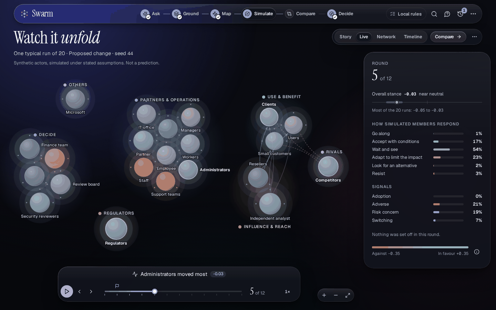

# Interface design and patterns

How the interface is built, and how a feature adds a scene or a panel to it without breaking what is
already there. This describes the code in `frontend/src` as it is; where something is not done, it
says so. Why it is built this way, and what was rejected, is
[ADR 0015](./adr/0015-premium-interface.md). The rules of the design system are also written beside
its code, in [`frontend/src/design/README.md`](../frontend/src/design/README.md).

## The shape of it

One page. `frontend/src/main.tsx` renders `app/Root.tsx`, which renders `app/Application.tsx`, inside
an error boundary. The work is in six **scenes** along a journey, **Ask → Ground → Map → Simulate →
Compare → Decide**. The engine, the API, the data model, the evidence provenance and the security
model are the ones the rest of the documents describe: only the browser interface is described here.

| Part                 | Where                           | What it is                                                                                                                                                                                                                                                                                        |
| -------------------- | ------------------------------- | ------------------------------------------------------------------------------------------------------------------------------------------------------------------------------------------------------------------------------------------------------------------------------------------------- |
| The shell            | `frontend/src/app/`             | The frame of the page (`AppShell`), the top bar with the journey, the dock on phones, the settings and tools menu, the scene host, the panel host, the error boundary, the address (`route.ts`), the rules of the scenes (`scenes.ts`) and the `Workspace` that every scene reads (`context.tsx`) |
| The scenes           | `frontend/src/scenes/<scene>/`  | One folder for each part of the journey: `ask`, `ground`, `map`, `simulate` (with `deep/`), `compare`, `decide`, and under Decide `studio` and `report`                                                                                                                                           |
| The design system    | `frontend/src/design/`          | Tokens and three themes, base styles, glass, the motion system, type, the primitives (`ui/`), the ambient background (`ambient/`) and a development gallery                                                                                                                                       |
| Shared visualisation | `frontend/src/viz/`             | The interactive ecosystem map (`ecosystem/`) and the colour scales (`palette.ts`)                                                                                                                                                                                                                 |
| Panels               | `frontend/src/panels/`          | The overlays any scene can ask for: History, Ask (the analyst and the actors), the audit log, who has access, the model budget, the provider status and the sign-in problem screen                                                                                                                |
| The data layer       | `frontend/src/{api,hooks,lib}/` | The API client, the hooks that read and poll a project, and the pure rules (what opens a scene, how a stakeholder is reviewed, how a number is worded). Their contracts did not change with the interface                                                                                         |

Everything a scene shows comes from the project's record: nothing is mocked, a figure the engine has
not yet given is a dash, and a run that holds no events says so. The sentence the product is never to be
read without, `Swarm explores scenarios. It does not guarantee or precisely predict real-world
behavior.`, lives in `lib/product.ts` (`POSITIONING_STATEMENT`), is on the first screen, while a
simulation runs, in the story of the simulation and at the foot of the brief, and tests assert its exact
words. Actors are called synthetic stand-ins, not real people, where they are introduced: on the map, in
the theatre, in the story and in the deep dive.

### The journey and the address

The address holds the state: `/?project=<id>&scene=<scene>&view=<view>`. `?project=` is read and written
by the engine hook (`hooks/useConsole.ts`); `scene` and `view` by `app/route.ts`, so that a link, a reload
and the browser's Back button all land where the person was.

| Scene    | Answers                        | Code              | `?view=`                                                | Opens when                                                                  |
| -------- | ------------------------------ | ----------------- | ------------------------------------------------------- | --------------------------------------------------------------------------- |
| Ask      | The change you want to explore | `scenes/ask`      | none                                                    | Always. It is the screen before there is a project                          |
| Ground   | The evidence it rests on       | `scenes/ground`   | `graph`, `sources`, `conflicts`, `statements`, `trace`  | Always, for an open project                                                 |
| Map      | Who is affected                | `scenes/map`      | `list`                                                  | The evidence has been read, or stakeholders have been found                 |
| Simulate | Watch it unfold                | `scenes/simulate` | `story`, `live`, `network`, `timeline`, `setup`, `deep` | There are actors (or the deep dive's own environment is ready)              |
| Compare  | Set the futures side by side   | `scenes/compare`  | `runs`                                                  | A simulation has finished, or a run the engine made on its own has rounds   |
| Decide   | What to do about it            | `scenes/decide`   | `review`, `studio`, `report`                            | A simulation has finished, or a run the engine made on its own has a report |

- **The words in the first column** are the only names the interface gives its parts. The second column
  is the line under each name on the first screen and in the tooltip of its point on the journey
  (`SCENE_PURPOSE` in `app/scenes.ts`).
- **`scene`** is one of the six names; anything else is ignored. **`view`** is one to twenty-four
  lowercase letters and hyphens, and what it means is the scene's own business. A scene's default view
  is never written into the address, an unknown view falls back to the default, and the view is dropped
  when the scene changes. Ground accepts a few older names for its parts (`evidence` and `documents` for
  `sources`, `ledger` and `claims` for `statements`, `log` for `trace`, `topics` for `graph`).
- **A project opens where its record has got to** (`frontierScene`): Decide once a simulation has
  finished, Simulate while one runs, once there are actors or when the run is one the engine made on
  its own, Map once the evidence is read, and otherwise Ground. A saved quick run opens on Decide when
  it holds a report, on Simulate when it holds rounds and otherwise on Ground. A project opened without
  a scene is given that one in the address, so that a reload and a shared link land in the same place.
  A scene named in the address that is not open yet is replaced by that one.
- **A scene that is locked says what opens it**: Ground it first (Map), Needs actors (Simulate), Run a
  simulation first (Compare and Decide). A record that the guided flow did not make, such as a quick
  run saved before the staged engine, locks Map and Compare ("Not in this record") and lets the other
  scenes show what it holds. Asking for a locked scene, from the journey or from a button, does not open it:
  a toast says why.
- **A record the engine made on its own is read through its own run.** The recorded demonstration is one:
  a guided run with its detailed report and recorded branches, for which the scenario lab holds nothing
  (`isEngineOnly` in `app/scenes.ts`: no scenario, stakeholders, actors, comparison, review or brief).
  Compare opens for it once it has rounds, so that two recorded runs can be read against each other
  (`?view=runs`). Decide opens for it once the engine has written a detailed report: with no brief to
  show it says "Nothing to decide from yet" and offers **Open Simulate** and **Detailed report**
  (`?view=report`). A record the lab has begun stays gated by the lab, as above.
- **The engine's own stage names are not part of this.** `console.steps` (`knowledge`, `environment`,
  `simulation`, `report`, `interaction`) still exists in the API and the engine, and the interface reads
  it to know what is ready. It names the stages only where the engine's record is the subject: the deep
  dive's engine records, the Advanced status line of Ground, one line in the deep dive that says what its
  environment waits for, and one error message.

## The shell

### The top bar and the dock

The top bar floats over the page as one piece of glass, a pill. From the left:

- **The mark** (named "Swarm: start a new question"), which goes to the first screen. It is disabled while
  an engine operation is in flight, so that a running request is never walked away from.
- **The journey** (`JourneyRail`, a navigation named "Journey"), once a project is open: six points
  joined by a line that fills as the work does. Each point is its step's own glyph (the one the dock and
  the palette use), so that a finished journey is six different shapes and not six ticks when the names
  go, and says its state with a mark and in words to a screen reader: done (a filled point with a small
  tick), current (the point that carries its name), ready, working (a ring turns while the engine is doing something
  for it), needs attention (a mark on a step that stopped) and locked (a lock; "Simulate, locked: Needs
  actors"). Below 78rem the names go, except the one in view; a point's tooltip says what the part is for
  or what opens it. A point that is locked is `aria-disabled` and answers a press with a toast.
- **The model chip** (`panels/ProviderStatus.tsx`). It says **Local rules** when no model is in use, and
  otherwise names the provider, the model and whether a real request has succeeded. It opens a popover
  ("Model provider") with the provider, the deployment, the authentication, what the connection last did and
  **Verify connection**, which makes one real request. A chip never claims a connection that has not been
  made.
- **Ask about this** (with a project open), **Search and commands** (below), **History** (with the number of
  explorations) and **Settings and tools**.

On a phone (40rem and below) the journey leaves the bar for a **dock** along the bottom edge, under the
thumb (`Dock`, also a navigation named "Journey": Ground, Map, Simulate, Compare and Decide, with the mark in
the bar as the way back to Ask), and the bar names the scene in view. The page leaves room above the dock.

**Settings and tools** is one menu for everything that is not a step of the journey:

| Section          | What it holds                                                                                                                                                                             |
| ---------------- | ----------------------------------------------------------------------------------------------------------------------------------------------------------------------------------------- |
| Appearance       | System, Light, Dark, High contrast. System follows the device: high contrast when the device asks for more contrast, otherwise dark when it prefers a dark colour scheme, otherwise light |
| Motion           | Follow device, Reduced, Full                                                                                                                                                              |
| Detail           | Guided (the default) and Advanced                                                                                                                                                         |
| This exploration | Refresh, Duplicate as a new question, Export snapshot (the project as JSON), Audit log, Model budget (a model-assisted project) and Who has access (when people sign in)                  |
| The account      | The mode ("Local · single user" or "Signed in · Microsoft Entra"), People (a workspace owner or administrator) and Sign out; and the version, the licence and a link to the source        |

The three choices are kept in this browser only, each under a key that holds nothing but its own value:
`swarm.theme` (`system`, `light`, `dark` or `high-contrast`), `swarm.motion` (`system`, `reduced` or
`full`) and `swarm.mode` (`guided` or `advanced`). The theme is applied before the page is drawn
(`frontend/public/theme-init.js`, a file of its own because the page's content-security policy allows
scripts from this origin only), so there is no flash of the wrong one.

**Guided and Advanced** change how much of the engine is shown, not what can be done. Guided is the
default. Advanced adds the engine's own names, identifiers and records, to read, where they are the
subject: the status line and the operations log in Ground, the identifiers and engine strings in Compare,
the engine records tab and the memory identifiers in the deep dive, the operations of the detailed report,
the analysis identifier in the brief's foot, and every reference chapter of the brief open at once. No
control depends on it, and the deep dive's engine records are one disclosure away in Guided too ("Engine
records: traces, the log and the raw state").

### What a scene is allowed to ask of the shell

Scenes take no props. A scene is a default export that calls `useWorkspace()` and gets:

- **`project`**, the open `ProjectDetail`, and `config`, `mode` (Guided or Advanced) and `sharing` (whether
  people sign in);
- **`busy`** and **`refreshing`**, and **`refresh()`**, which reads the project again;
- **the engine's operations**: `run(step)`, `cancel`, `pause`, `resume`, `setIntervention`, `branch`,
  `saveEnvironment` and `recordSurvey`, each of which resolves when the server has accepted it. Progress
  is read by polling, not awaited;
- **navigation**: `scene`, `view`, `go(scene, { view })` (a locked scene is refused with a toast),
  `setView(view)`, `openProject(id, { scene, view })`, `duplicate()`, the `journey` as the rail shows it and
  the list of `projects`;
- **`panels`**: `history()`, `ask({ target, message })`, `audit()`, `budget()`, `access()`, `provider()` and
  `snapshot()`, so that a scene opens an overlay without owning one;
- **unsaved work**, which is not on the workspace but beside it (`useUnsavedWork(sentence | null)` from
  `app/unsaved-context.ts`): while a scene holds words or edits that are not saved (the Map's changes to actors, the
  report studio's drafts) it says what they are, and the shell, which owns every exit (`go`, `openProject`, a new
  question from the mark or the palette), asks "Leave with unsaved changes?" before it leaves: **Keep editing**, which
  has focus, or **Leave anyway**. The browser warns as well when the tab is closed or the page reloaded. `setView` is
  not asked about: a change of view inside a scene is the scene's own business, and the scenes that hold work ask for
  their own routes back (the studio's back button, the brief's bar, the detailed report).

The shell owns the rest: the polling, the operations, the address, the focus and the page title. **Ask is
the one scene that is not like this**: it exists before there is a project, so the shell mounts it
directly and gives it a few props (the server's settings, the history, and what to do on submit). The five
project scenes are lazy modules (`app/loaders.ts`), each a chunk of its own that is fetched when the scene
is opened, and the next ones are fetched while the person is still in this one.

### Reading the project again

The shell reads the open project again by itself, so that a scene opens, and a result appears, without a
reload and without pressing Refresh:

- `hooks/useConsole.ts` reads an open project every 1.8 seconds while an engine stage or a survey is queued or
  running;
- `hooks/useAnalysis.ts` reads a simulation every second while it runs, which is what the rings of the
  running view fill from;
- `hooks/useLabRefresh.ts` reads the project every 2 seconds while a simulation runs and every 5 seconds
  where one could be started or a brief written and none has been yet (in Simulate while there are actors and
  no finished comparison, and in Decide while a finished comparison has no brief), which ends of itself. It
  also reads once when Simulate, Compare or Decide is opened;
- a refresh the person did not ask for is quiet: nothing spins and a screen reader is told nothing.

### Focus, scroll, title and failures

- **A skip link** ("Skip to content") is the first stop on every page, and the shell is one `main`
  landmark (`#main-content`). Scenes render sections, never another `main`, and one `h1` at a time names
  the screen.
- **When the scene or the project changes**, focus moves to the `main` element (it takes focus without being
  a tab stop) and the page scrolls to the top, so that focus is never left on something that has gone.
- **The title** is `<project name> · <Scene> | Swarm`, and `Swarm | Explore what could happen next` on the first
  screen.
- **An operation that was not confirmed** (the server refused or did not answer) is a toast, "That was not
  confirmed", with what the server said and a note that what is saved has been read again, and **Dismiss**.
- **A read that fails** leaves what is shown on the page and says so in a notice with **Retry**: "Could not
  refresh this exploration" in a project, "The server's settings could not be read" on the first screen.
- **A screen that cannot render** is caught by the error boundary: "Something didn’t render correctly.", with
  **Reload**, **Start over** and a disclosure of the technical detail. It sits outside every provider, so it is
  plain markup in the design's own classes. A sign-in that did not produce a session is explained on a screen
  of its own (`panels/SignInProblem.tsx`), not behind the shell.
- **A model-assisted project** shows a line above the work when its budget is nearly or wholly used
  (`panels/BudgetGuard.tsx`), with **Model budget** to open the dialog.

### The command palette

`Ctrl` or `⌘` with `K` opens one search over every place and setting, from anywhere on the page and also
while a person is typing (`app/CommandPalette.tsx`, the commands themselves in `app/commands.ts`). The top
bar has a button for it (**Search and commands**, on a screen wider than a phone) and the settings menu has
the same entry at its top, which is the way in on a phone. It is a shortcut and never the only way: each
command is also a control somewhere on the page.

- **Go to** a scene, or a view of one (Simulate: Story, Live, Network, Timeline; Map: List; Decide: Detailed
  report, Report studio). A step that is not open yet stays in the list, says what opens it ("Needs actors")
  and, when chosen, answers as the journey does, with a toast, instead of going.
- **Open** History, Ask about this, the audit log, the model budget and who has access (where they exist), Refresh,
  Duplicate as a new question, and the model status.
- **Look and feel**: the theme, the motion setting and the detail level, with the one that is on marked (in
  words to a screen reader: "Dark theme, on").
- **Recent**: the other explorations, by name.

The field is a combobox over a listbox: focus stays where the person types, the arrows (and Page Up and Page Down)
move a mark that glides from row to row, Enter does the marked one and Escape gives focus back to what had it.
The list is itself focusable, because it scrolls, and answers the same keys. Typing needs every word, in any
order, ignoring accents; a name that starts with what was typed comes first. Rows are 44px on a touch screen,
and there a **Close** button (44px, last in the tab order) stands in the field's corner in place of the Esc hint,
which a touch screen has no key for. The sheet is opaque in high contrast and under reduced transparency, and
`e2e/local/palette.spec.ts` holds all of this in a real browser, including axe in three themes and a phone.

### The overlays

Panels are overlays that the shell mounts only while they are open (`app/PanelHost.tsx`, one at a time, each
lazy). Each is told `open` and `onOpenChange` and leaves by itself (`panels/shared/usePanelLifecycle.ts`:
it closes first, plays its exit, then tells the shell, and gives focus back to where the person was).

| Panel           | Opens from                                             | What it is                                                                                                                                                                                             |
| --------------- | ------------------------------------------------------ | ------------------------------------------------------------------------------------------------------------------------------------------------------------------------------------------------------ |
| History         | History in the top bar; Continue on the first screen   | A sheet, "Your explorations": search, filters (All, Working, Done, Stopped, Branches), each exploration as a row that opens it, **Compare** for one with a saved run, and delete behind a confirmation |
| Ask             | "Ask about this"; a scene, with a target and a message | A sheet, "Ask", with tabs Analyst, Actors and Survey. It answers from the deep dive's written report: until there is one, it says so                                                                   |
| Audit log       | Settings and tools                                     | A sheet with the integrity of the hash chain, search and filters. Every action is named in plain words, and the recorded code is shown only when it differs                                            |
| Model budget    | Settings and tools; the budget line                    | A dialog: what the project has used and its two limits (calls and tokens). Only a workspace owner or administrator changes them                                                                        |
| Who has access  | Settings and tools (when people sign in)               | A dialog: the people on the project and their roles. **People** in the same menu is the workspace's list                                                                                               |
| Provider status | The chip in the top bar                                | A popover (see above)                                                                                                                                                                                  |

## The scenes

Each scene says, in the same order, what it is for, what it can be in, and what it must keep. The steps
are in the [user guide](./USER_GUIDE.md).

### Ask

The first screen, and the only one before there is a project. Its heading is "Explore what could
_happen_ next.", with "What change do you want to explore?" beneath it, and while a scenario is being
reviewed the heading is "Your scenario". The first view holds the whole composition on a laptop and on a
phone: the heading grows with the width and the height of the window, and the six steps of the journey
under the examples (a promise of their order, not a control) keep to their names where the screen is short
or a phone, with their purposes still said to a screen reader, and stand aside for the composer on a
laptop once something is written.

- **One composer** takes the question in the serif, on glass that lights at its edge while it is written
  in. `Ctrl` or `⌘` with Enter explores (Enter alone adds a line), and beside **Explore** stands the
  shortcut of the device (`⌘ ↵` on an Apple device, `Ctrl ↵` elsewhere), or "Add a source" once there is a
  question and no source; neither is shown on a phone. The question holds at most 2,000 characters, so a
  longer text pasted into it is cut, and from 1,700 a counter ("1,750 / 2,000") says how much room is left.
  A "Model assisted" marker stands beside the button when that engine is chosen. While the field is empty it
  suggests the questions of the examples in turn, never one that would be cut off in the middle of its
  sentence, and holds still for a person who asked for less motion.
- **Four tools sit under the field.** On a phone each opens from the foot of the screen as a sheet; there
  **Time frame**, **Assumptions** and **Options** show only an icon, their words kept in their accessible
  names (with the time frame or the number of assumptions once there is one), and **Evidence** keeps its
  word and the number of sources attached.
  - **Evidence** brings files (TXT, Markdown, CSV and JSON, and PDF only where the server reports that it
    reads PDFs), pasted text, or a public web page that the server fetches (offered only when the server
    reports URL ingestion). A page is fetched on a press of **Fetch**, shown as a preview that says where it
    is from, and added only on **Add as evidence**. Everything attached sits in a tray of pills (one row to
    swipe on a phone) that open the text Swarm will work from, to be read and corrected there. When the
    question names a web address, the page is offered under the field ("Read example.org as evidence"),
    fetched only when that is pressed, and the offer goes once it is a source. A fetched page that the
    person then edits becomes pasted text, as it does on the server (which keeps a page's provenance only
    for the text it fetched): the sheet says so at once, and says it is the page again if the words are
    put back.
  - **Time frame** (a few common spans, or the person's own words) and **Assumptions** (up to six) are said
    before the question is read. They are applied after the reading, as the person's own: the time frame
    answers the question about the period, and each assumption is marked as theirs and stands ahead of those
    the reading made. Neither is in the request that reads the question, so that reading, by rules or by a
    model, never sees them; once applied they are lines of the scenario like any other. They are part of
    what a reading is made from, so changing one reads the question again, and a reading that fails and is
    gone past with **Continue without reading** keeps neither (the notice says so).
  - **Options** is a popover: the engine (**Local rules**, or **Model assisted** once the server has a
    provider), a name, and a **Deep dive** disclosure with Proxies, Rounds and Seed.
- **The examples** are chips under the field, ordered so that no company leads: Launch pricing, Cloud price
  change, Online store checkout, AI-first support and Copilot in Teams, then the quiet fictional starter,
  Library hours. On a phone they are one row to swipe. They fill the question and its evidence and nothing
  else, and a note names what they brought ("5 documents · sample evidence"; its accessible name begins with
  its visible words, and pressing it brings the chips back).
- **Explore** reads the question into a scenario that the person reviews and corrects in place: the
  decision, what it affects, where and over what time, what changes, what is expected if nothing changes,
  ways to do it, who is affected, what is assumed (each marked as the person's or the system's), the
  questions Swarm asks, and the evidence. **Ground it** creates the project and starts reading the
  evidence; nothing runs before that. A reading that takes long enough to notice is a page of its own: the
  question stays, focus is on **Stop**, and Stop or Escape gives focus back to the question with all that was
  written. A reading that fails offers **Try again**, which has focus, and **Continue without reading**.
- **Continue** lists the newest explorations and, when the workspace has them, the recorded
  demonstration.
- **It must keep** the positioning statement in its exact words, the line in Options that says whether the
  question goes anywhere (rules on this machine read it unless **Model assisted** was chosen), the rule
  that nothing is run until the person says so, and the one `h1`.

### Ground

What the evidence says, before anything is simulated. The question is the heading, with a status (Not
started, Queued, Reading, Extracting, Checking, Ready, Failed, Stopped, or Saved record: Reading and
Extracting are the two things the engine does, as its own records say, and Checking is the time the
conflicts are being looked for), four figures that are also the way into the rest of the page (Sources,
Passages, Topics or Entities, Conflicts), the one primary action and a constellation graph of what the
sources talk about. Until there is a graph, the sources themselves fill its place.

- **The primary action** is **Ground it** until reading has started, **Stop** while it runs, **Try again** or
  **Start again** after a failure, and **Map the stakeholders** once the evidence is read. The same action
  waits at the bottom edge once the first one has scrolled away. The figures lead on: Sources to the tray,
  Passages to a search of the numbered passages, Topics or Entities to the graph, Conflicts to the conflicts.
- **Sources** are a tray, one row for each document: where it came from (Upload, Pasted, Synthetic sample, or
  the site of a page the server fetched), its size, and its numbered passages (S1, S2, …) laid along a thread
  as long as the document. In the list under the Sources heading a row also names the topics (or entities)
  that came from the source, the heaviest first. Each row says where its source stands: Queued, Reading,
  Extracting or Checking while the engine works, Ready when it is done, and **Needs attention** when a
  conflict that nobody has settled is between it and another source, with a flag for each, named by the
  conflict's id, that leads to it. A step that failed or was stopped says so once, above, with its reason, and
  not on every row. Pointing at a source or a passage lights what it is tied to in the graph and in the
  conflicts; a source opens in a sheet with its whole text and its passages marked, and a passage opens in a
  sheet of its own.
- **Conflicts come first** while any is unsettled, ahead of the sources they are between. Each puts two
  sources that give different figures or say opposite things side by side, with the figures and the words
  they stand in, quoted plain (without the list marker the source's line began with), to be settled by a
  person (**Confirm**, **Not a conflict**, **Mark resolved**, with an optional note, and **Change
  decision**); settled ones stay under **Reviewed**.
- **Statements** appear only when a checked, model-written report lists some, and say how well the sources
  back each, with a bar of verdicts that filters the list. Each carries a tag for its kind (Fact, Assumption,
  Simulation observation or Interpretation, from the ten types the ledger keeps), and where there is more
  than one kind a filter by kind. A statement opens in a sheet with its passages and **Accept**, **Needs
  revision** or **Reject**. A project whose report was checked and lists none says so in one quiet line; where
  nothing has been checked there is no Statements section, not an empty one.
- **The graph is calm.** Under it a caption says what a line means ("Shared passages, not meaning", or
  "Extracted by a model · may be incomplete"). A few of the heaviest topics are named at rest and the rest
  when pointed at, a line is named only on request, and **Graph options** narrows the links to the stronger
  ones. **Method** says how the sources were read. **Operations** (the engine's recorded operations and
  events, the Advanced log) is shown in Advanced detail only.
- **It must keep** the figures honest (a dash until the engine has said), the line "Found from wording alone.
  Neither side is declared true." beside the conflicts, and "How well the sources back each statement, not
  whether they are true." beside the statements.

### Map

Who is in play. Before anything is found, one invitation: **Find who is affected** (by a model when the
project has one, otherwise by reading the text), **Read the text instead**, and **Add one yourself**.

- **The map** (see below) draws the stakeholders as an ecosystem, under a heading that counts the parties,
  the key ones and those still to review, with a chip that says how they were found. A floating
  **inspector** shows the party in view (below 64rem, a strip with **Details**, which opens a sheet): where
  it stands, its evidence word for word, why it is here, how it is connected and, for an actor, its key
  assumption, what it wants and worries about, and every trait on a slider with where its value came from.
  A toolbar offers Map or List, Stakeholders or Actors, Groups, focus on what is connected (`F`), **Add a
  stakeholder** and, under More, **Find stakeholders again…** and **Reset all actors…**. Pointing at a party
  names it and says whether it is key or a cohort, its influence (for an actor), its effect, how many quotes
  stand behind it (or that it is assumed) and why it is here.
- **One pill says the one thing to do next:** "N to review" (it opens the next) beside **Create actors**.
  That button reads **Create actors** while the list still has to be approved, and its accessible name is
  "Approve & create actors", because it also accepts what nobody looked at; it reads **Approve** when actors
  the person changed are kept, which approving then leaves as they are. It waits, with the hint "Keep or add
  two or more", until at least two stakeholders are kept. With a model on offer it first asks whether the
  model may read the key actors. Then "N actors ready" with **Simulate**. Changes to an actor are held,
  with **Save** and **Discard**, until saved. When the stakeholders change after the actors were made, a
  notice says "The actors are out of date" and offers **Make them again**, which asks before it replaces
  what the person changed ("Reset all actors?").
- **A stakeholder is accepted, edited, duplicated, merged or removed** from the inspector. **Duplicate**
  opens the form with "<name> (copy)", the same kind, size and reasons; the copy is the person's own and
  cites no evidence, and says so. Nothing is deleted: a removed or merged party stays in the record, under
  Removed, with **Restore** or **Undo the merge**.
- **An actor's wording is editable in place.** **Edit what <name> wants and fears** opens its role, its
  starting belief and its wants, worries and pressures as lines to change, add or take away; a cohort's size
  and number of simulated members are fields, and each of the eleven traits is a slider with an origin chip
  (assumption, evidence, model or you) and the reason for its value. Everything is held until **Save**, and a
  saved actor is marked "Edited by you".
- **The actors themselves are fixed.** The API refuses to add or remove an actor (`ACTORS_CHANGED`) and to
  rename, regroup or re-kind one (`ACTOR_LOCKED`): an actor is made from its stakeholder. So an actor offers
  **Edit as a stakeholder**, which shows the stakeholders; there a party is duplicated, removed, renamed or
  regrouped, the actors become out of date, and **Make them again** makes them from the list as it now stands.
- **List** (`?view=list`) is the same parties as text, in groups, the weightiest first. A line that every
  row of a group would say alike is said once under the group's name, and each row says what is its own: its
  facts (direct or indirect, how many quotes or "Assumed", and for an actor whether it is one actor or a
  cohort and where it stands), an influence cue with its word, its effect and its review state, as words.
  The ones removed are under "Removed", and the places where nobody was found under "Nobody found for", each
  with **Add**.
- **Nobody drawn yet** is what the stage says when no party is left and there is no empty place on the picture to
  press (a phone draws none): two or more are needed to make actors, and **Add one yourself** adds one. The
  pill then says "0 to review", never that everyone was reviewed.
- **It sits on the page's grid.** The heading, the toolbar, the inspector and the zoom controls keep to the
  same edges as the bar above them, while the picture itself runs to the edges of the window (at 1920 wide it
  goes past them). What scrolls in the inspector fades at its lower edge, so that a panel that goes on does not
  look cut off by mistake.
- **It must keep** the line that says actors are synthetic stand-ins and every number an assumption, the
  rule that approving needs at least two stakeholders, and the model's privacy line before the source text
  is sent.

### Simulate

The hero of the product. It is in one of these states:

- **No actors**: "No actors to simulate yet", with **Open the map**.
- **Setup** (`?view=setup`): "Set the futures side by side". The scenarios (no change, the proposed change and
  any alternatives), how strongly the change lands in each and from which round, how many seeded runs of
  each (10, 30 or 100), whether to test which assumptions the result leans on, an estimate of the runs and
  the time, and **Run the simulation**. Every scenario runs on the same seeds.
- **Running**: one ring for each scenario, and one for the sensitivity runs, filled from the number of runs
  the server has saved ("N of M simulated runs"), and **Cancel**. Nothing is drawn that has not happened.
  Results are not shown until the run is done, because a stopped run would leave the scenarios on
  different seeds.
- **The theatre**, four ways to look at the same run: **Story** (`?view=story`, a headline written from the
  numbers, who moves most, what it sets off, how steady it is, how far to rely on it), **Live** (the default;
  the actors on the map coloured by where each stands in the round shown, a round card with the share of each
  response and the signals, and a scrubber), **Network** (`?view=network`, the relations the comparison used)
  and **Timeline** (`?view=timeline`, the spread of the runs over the rounds with the change and the events
  marked). When no run was kept in detail, only Story and Timeline are offered. The scrubber plays by itself
  the first time a finished run is opened in a session, and when the person watched it run, and never for a
  person who has asked for less motion.
- **The deep dive** (`?view=deep`, `scenes/simulate/deep/`): the older, slower engine, optional and apart from
  everything above. Setup, Run, Rounds, Memory and (in Advanced) the engine records; pause, an assumed event
  at a future round, branching from a checkpoint and the comparison of two recorded runs; the detailed report
  and a way to ask a proxy.
- **It must keep** "Synthetic actors, simulated under stated assumptions. Not a prediction." in the live and
  network views, the positioning statement in the running view and in the story, an honest empty state where
  a run has no events, and the rule that what the page shows is one run, not the answer.

### Compare

The scenarios side by side, as an editorial document. The first screen is the answer as a sentence ("Under
_Proposed change_, simulated members end up …"), the shares under each scenario and the gap between them
with its spread, how often it held across the seeded runs, and a table of contents of seven parts: Futures,
Who moves, Over time, What holds, Depends on (the sensitivity of the result to one assumption at a time),
Sets off (a chain of second-order events from one run) and How far to rely. A bar at the foot keeps the pair
being compared, **Method**, a jump menu, **Run again** and **Decide** in reach. A chip says when the comparison
describes the project as it was ("Out of date") or a newer one exists. **Compare two recorded runs**
(`?view=runs`) lays two deep-dive runs side by side, round by round.

**It must keep** the sentence that a result is a simulation under stated assumptions, "holds in k of n
seeded runs" worded as repeatability and never as a probability, and, next to the answer, the warning that
appears when no stakeholder has an expected direction of impact.

### Decide

The decision brief as a document, with the independent review beside it and in its place.

- **The answer comes first.** The first screen says what happened, why, what matters and what to consider
  next, in that order, with a line under the verdict that the figures are counts from a simulation under
  stated assumptions, not a forecast. **What happened** is the verdict written from the numbers and the
  figures it rests on (the share of simulated members under the change and under no change, their paired
  difference with its standard error, and in how many paired seeded runs it was higher). **Why** is who
  moved most and how steadily it held. **What matters** is the biggest open caveat and where the review
  stands. **What to consider next** is the first recommendation, with the way to the chapter that says what
  to do. Everything below is the same answer in more depth: the story in four parts (What happened, Why,
  What to do, On what ground), each made of chapters. A chapter of reference (the assumptions, the evidence
  base, the sources, the limitations and the technical appendix) is closed until it is wanted, and stays in
  the page. Once the first screen has gone by, a bar keeps the contents, the review and the export in reach.
- **Every part has an address.** `#brief-answer` is the answer and `#brief-<chapter>` a chapter, by the id the
  brief gives its section (`#brief-recommendations`, `#brief-assumptions`, `#brief-limitations`, and
  `#brief-review` for the independent review). The contents, the address and the tools open a closed chapter
  before they take the reader to it. `?view=review`, `?view=studio` and `?view=report` open the review, Report
  Studio and the detailed report.
- **Tools for the brief**: **Review** (the critics' objections, with **Run the independent review**),
  **Edit report** (Report Studio), **Detailed report** (the deep dive's report, when one exists), **Export**
  and, under More, **Write the brief again** and **Open every chapter**. **Export** is one menu: **Markdown**,
  **JSON, with the data behind the charts** and **Printable page** (a page the server makes for paper, opened in
  a tab of its own, which loads and runs nothing, so it uses the paper's own typefaces: it is set as a document,
  the question as its lede with the record's dates and identifiers in a small line, then the answer, each
  statement as its origin and reliance in words, then its text, with its identifier at the margin and what it rests on
  beside a hairline, and tables without grid lines; the caveat is its one box), and **Print this page** (`Ctrl P`). A
  role that may read the brief but not export it has the three files disabled, with the reason, and can still print.
- **Print and PDF are held.** The brief puts the whole of itself and the review on paper, whatever is closed on
  the screen, in ink on white from whichever theme the screen was in, and none of the application around it
  (the bars, the tools, the contents, the buttons that only move about the screen); no text is drawn over other
  text and every block fits the width of the paper (the `@media print` rules in the scene's stylesheets).
  `e2e/lab/report-export.spec.ts` makes a PDF of the page in print media, reads its text back and checks all
  of that, for every statement, from each theme and from a phone as from a desktop.
- **The review sheet** (`?view=review`, "Independent review: critics challenge the analysis and never change
  it") is opened from the tools, the contents or the note beside the statement a criticism is about. A
  criticism that says the comparison cannot say anything about the change leads it. The others can be
  filtered (Open, Answered, by severity), are grouped by critic, and each can be responded to, accepted or
  disputed, with what still stands; what a person typed is never lost. A review of an earlier comparison says
  so.
- **Before there is a brief** the scene offers one action, **Write the brief**; while it is written it says
  so. A brief that no longer matches what it was made from says what changed. With no comparison to write
  from, and for a record the engine made on its own, it says "Nothing to decide from yet" and offers
  **Open Simulate**, and **Detailed report** where there is one.
- **Report Studio** is where a person works on a copy of the generated report: sections, versions, notes, a
  review workflow (**Submit for review**, **Approve…**, **Request changes…**) and export. The generated
  report is never changed ([ADR 0011](./adr/0011-report-studio.md)). It works on the deep dive's detailed
  report, so until one is written it says "There is no report to work on yet" and points to it. A save
  made over a section that someone else has saved keeps the person's words and says so, and makes a new
  version on top of the other, which stays in the history. It has a level-one heading in each state once
  loaded; a dialog or a sheet gives focus back to the button that opened it; and a way back that would drop
  words that were not saved asks first ("Leave with unsaved changes?", with **Keep editing** and **Leave
  anyway**), whether it is the studio's own **Back to the brief** or the **Decision brief** link at the head
  of the page, and the browser asks before the tab is closed. **Ctrl+P** prints the whole working copy,
  with where it stands in its review and the fingerprint of an approved text, and not the editor; the
  printable memo is still the record. The **Record** sheet ("Review record") opens on **Decisions** every
  time, before Conflicts, Assumptions and any earlier copies.
- **The detailed report** says what a citation rests on. A citation that points at no passage the project
  stored says "Not among this project's sources" and that a citation that points at nothing is not evidence
  for the statement, instead of showing a blank.
- **A very long word** that a source or a person wrote, an address or a pasted string, wraps wherever it must,
  so that it never widens the brief, the review sheet or the detailed report.
- **It must keep** the positioning statement at the foot, the origin of every statement, the criticisms
  that stay visible beside a finding, and the rule that a critic never edits.

## The ecosystem map

`frontend/src/viz/ecosystem/` is one component, `Ecosystem`, used by the Map scene, by the live and
network views of Simulate and by the movers of Compare, so that a party looks the same wherever it
appears. It is SVG, not canvas (see [ADR 0015](./adr/0015-premium-interface.md)).

- **What it draws.** Parties gather in clusters by kind (eight groups, from the stakeholder categories: Decide,
  Use & benefit, Bear cost & risk, Influence & reach, Rivals, Partners & operations, Regulators, Others). A
  party's size is how much it weighs, its colour what it is expected to suffer (or, in a run, where it stands:
  against to in favour), a dashed ring marks an indirect effect, paler means less sure, dots around it mean a
  cohort of many, and lines are the relations between parties, an arrow where they run one way. A key party
  is larger than a cohort and stands out by more than its size: a firmer edge, and its name in a heavier
  weight in the full ink. Places where nobody was found are drawn as empty slots that a person can fill. The
  legend in the Map scene says all this ("How to read this map"), the key party included.
- **Names are placed, not piled.** Each group is named once, above or below it, where no party, no other name
  and nothing floating over the picture is in the way (and, where it can, no relation runs through it); a group
  name with no clear place is left out rather than written over a party, and on a narrow picture the names
  are the short ones. A party's own name is drawn where it fits (at most eight at rest on a narrow picture),
  and the rest when the party is pointed at, focused or chosen. A name is the same size at any zoom, so what
  fits is worked out where the camera has put the picture.
- **Meaning is never colour alone.** A party's accessible name says its kind, whether it is a key actor or a
  cohort, its effect, whether it is reached directly and how sure Swarm is; a dashed ring marks an indirect
  effect; and the stance scale follows the data (stance values are small, so the colour range is fitted to
  them), with the words ("against", "leaning in favour") beside it.
- **One loop writes everything.** Positions come from a layout that is the same every time (a seeded
  force simulation, so a map is recognisable from one visit to the next), and one animation loop writes every
  party, line and halo straight to its element with a spring, so that a line stays attached to a party as it
  moves. The loop stops while the map is off screen, and under reduced motion every party goes to its place
  at once.
- **It is a real group of buttons.** Each party is a button with a name; the arrow keys move to the nearest party
  in that direction, Enter or Space selects it, Escape lets go. Zoom with the buttons ("Zoom in", "Zoom out",
  "Fit everything") or with `Ctrl`/`⌘` and the wheel (a plain wheel scrolls the page, which a map must never take);
  a mouse or pen drags the background to pan, and a finger scrolls the page. A tooltip opens only on keyboard
  focus or a hover that is not touch.
- **The same parties are a list.** The Map scene offers them as text (`?view=list`) in place of the map: a
  region of groups with the facts of each row as words, which a keyboard walks one row at a time and a screen
  reader reads without the picture. The live view's information is in the round card and the story.

## The design system

`frontend/src/design/` is the one place the look is decided.

### The idea

- **Whitespace and type group things, not boxes.** Content that sits on the page (charts, lists, text) is not
  put in a container: use a hairline or space.
- **Glass is for things that float:** the top bar, the dock, popovers, menus, sheets, dialogs, toasts and the
  composer. Never nest glass in glass, and never put long text on glass that has not been checked for contrast
  over the ambient light.
- **The simulation is the hero.** Data is drawn straight onto the page, large, with light and motion.
- **Little English.** Default screens speak through hierarchy, numbers, state and direct manipulation.
  Method, provenance and caveats live in a disclosure, a tooltip, a popover or a sheet, one gesture away and
  never gone. Responsible-use wording that matters stays visible, short.
- **Nothing is faked.** Decorative motion (the ambient light, the swarm behind the question) never imitates
  data.

### Tokens and themes

Colour, space, radius, type, shadow, blur, duration and easing all come from `design/tokens.css`, which is
plain custom properties and holds nothing else. A raw colour or a magic duration anywhere else is a defect.

| Family     | Tokens                                                                                                                                                                                                                                 |
| ---------- | -------------------------------------------------------------------------------------------------------------------------------------------------------------------------------------------------------------------------------------- |
| Page       | `--bg`, `--bg-sunk`, `--bg-raised`                                                                                                                                                                                                     |
| Ink        | `--ink`, `--ink-2`, `--ink-3`, `--ink-inverse`, and the rules `--hairline` and `--hairline-strong`                                                                                                                                     |
| Glass      | `--glass`, `--glass-raised`, `--glass-overlay`, `--glass-edge`, `--glass-edge-hi`, `--glass-tint`, `--scrim`, with `--blur-sm`, `--blur-md`, `--blur-lg` and `--glass-saturate`                                                        |
| Accent     | `--accent`, `--accent-strong`, `--accent-ink`, `--accent-soft`, `--accent-line`, `--focus-ring`                                                                                                                                        |
| Meaning    | `--c-against` (ember), `--c-favor` (teal), `--c-neutral`, `--c-caution`, `--c-critical`, each with a `-soft` tint, and `--eco-quiet` for a party whose effect is not known                                                             |
| Categories | `--cat-1` to `--cat-8`, for groups and documents                                                                                                                                                                                       |
| Ambient    | `--aura-a`, `--aura-b`, `--aura-c`, `--aura-hue` (set by scene) and `--grain-opacity`                                                                                                                                                  |
| Elevation  | `--shadow-1` to `--shadow-4` and `--glow`                                                                                                                                                                                              |
| Type       | `--font-display` (Instrument Serif), `--font-ui` (Geist), `--font-mono` (Geist Mono), and `--fs-micro` (12px, the floor), `--fs-small`, `--fs-body`, `--fs-read`, `--fs-lead`, `--fs-h4`, `--fs-h3`, `--fs-h2`, `--fs-h1`, `--fs-hero` |
| Space      | `--s-1` to `--s-9`, on a 4px grid                                                                                                                                                                                                      |
| Shape      | `--r-xs`, `--r-sm`, `--r-md`, `--r-lg`, `--r-xl`, `--r-pill`                                                                                                                                                                           |
| Layout     | `--topbar-h`, `--dock-h`, `--w-prose`, `--w-content`, `--w-wide`, `--gutter` and the layers `--z-canvas` to `--z-tip`                                                                                                                  |
| Motion     | `--dur-instant`, `--dur-fast`, `--dur-base`, `--dur-slow`, `--dur-cinema` (90, 160, 260, 480 and 840 ms), `--ease-out`, `--ease-in`, `--ease-in-out` and the spring curves `--ease-spring-snappy`, `-smooth`, `-lively`                |

**Three themes** share one set of names: `light` (warm paper), `dark` (ink) and `high-contrast` (opaque, no
glass, no ambient light, outlined, a yellow focus ring that is three pixels wide). `data-theme` on `<html>`
picks one. System follows the device (`prefers-contrast: more` first, because it is a need and not a taste, then
dark, then light); the choice is made in Settings and tools and read by `hooks/useTheme.ts`, and the browser's
own chrome (the address bar on a phone) is painted from `THEME_COLOR` in `lib/theme.ts`, which is kept in step
with `public/theme-init.js` by a test. Each scene tints the ambient light a little, by `[data-scene]` on the
frame (ask 275, ground 235, map 305, simulate 35, compare 185, decide 85 in hue), as a slow crossfade. On
paper every theme prints as the light one: ink on white, no glass.

The values hold what the tests hold ([Guards](#guards)): text on the page and on every glass surface at
least 4.5:1 (7:1 in high contrast), the data colours at least 3:1 as graphics, and a chip's colour on its own
tint. A theme that is added or changed must define every token the others do.

### Layers, names and rules

- **Every rule is in a layer.** `design/index.css` fixes the order, `@layer tokens, base, components, scenes,
utilities`; a shared piece puts its rules in `components`, a scene in `scenes`, and `tokens.css` alone is
  outside, because it holds only custom properties. No rule wins by being later in the bundle or more
  specific than it needed to be, and `!important` appears only in `base.css`.
- **Names.** Every class is prefixed `sw-` and named for its component (`sw-ground__rail`); a state is a
  second class, `is-on` or `is-open`. `sr-only` and `num` are the two utilities without the prefix.
- **Type.** `.sw-hero`, `.sw-display` and `.sw-title` are the serif, for what is _said_: the question, the
  answer, a number that matters (`.sw-numeral`). The grotesque is for everything that is _done_. `.sw-eyebrow` is
  the small uppercase label, and `.sw-read` is long reading text (17px, at most 68 characters wide). Nothing is
  set smaller than `--fs-micro`.
- **Layout.** The document scrolls: there are no nested scrollers except sheets. A scene's content is
  `--w-content` wide, the simulation's stage `--w-wide`, with `--gutter` at the sides. The bar is `--topbar-h`
  tall and the dock `--dock-h`.

### Motion

Motion is a system with a vocabulary, not decoration (`design/motion/` and `design/motion.css`).

| Use                         | Curve                                                        | Time                        |
| --------------------------- | ------------------------------------------------------------ | --------------------------- |
| hover, press, focus         | `--ease-spring-snappy`                                       | 90–260 ms                   |
| content arriving            | `.sw-rise` (stagger `--i`)                                   | 480 ms                      |
| panels, sheets, popovers    | spring `smooth` or `snappy`                                  | 260–480 ms                  |
| a scene change              | a quick fade out, then a rise of 18px on the `gentle` spring | about 0.14 s, then a spring |
| a number the engine reports | `useTween`, an ease-out                                      | 700 ms                      |
| a thing that just happened  | `sw-pulse-ring`                                              | once                        |

The rules: an animation explains a cause; springs for things that are moved and short ease-outs for things
that appear; every animation can be interrupted (a new target redirects it, nothing queues); entrances take at
most about half a second, apart from the few that the person started; no keyframe animates a property that
costs layout. In script, the same numbers are `DURATION`, `EASE` and `SPRING` in `design/motion/tokens.ts`, and
`useSpotlight` and `useMagnetic` give a surface light and a pull that follow the pointer (never for touch).
Components use `m` from `motion/react`, not `motion`, because the page loads its features lazily and strictly.

**Reduced motion** is honoured at three levels, so that no part of the page can ignore it:

- the CSS reset in `base.css` makes every animation and transition about one millisecond, and the duration
  tokens become 1ms, both for `prefers-reduced-motion: reduce` and for **Reduced** in the menu
  (`html[data-motion='reduced']`);
- `useReducedMotion()` is for script and canvas: the person's choice if they made one, else the device's. The
  swarm behind the question draws one still frame, the map's parties go to their places at once, the
  scrubber never autoplays, and numbers are their target at once;
- `m` components follow the same setting through `MotionRoot` (`reducedMotion` is `always`, `never` or `user`):
  distance goes and a short fade stays, so that a change is still shown.

Ambient loops stop. **Reduced transparency** (`prefers-reduced-transparency`) turns every glass surface solid
and drops the blur, and so does the high-contrast theme. A browser that cannot blur what is behind a surface at
all gets the same solid surfaces (`@supports not (backdrop-filter: blur(1px))` in `tokens.css`), so that text on
glass never depends on a blur that is not there.

### Primitives

`design/ui/` holds what every scene is built from. A scene does not draw its own button, popover or dialog.

| Primitive                                                  | For                                                                                                                                                           |
| ---------------------------------------------------------- | ------------------------------------------------------------------------------------------------------------------------------------------------------------- |
| `Button` (`primary`, `accent`, `glass`, `ghost`, `danger`) | `primary` is the one action of a screen and `accent` the single "go" (run, start). `busy` disables it and says so, and never hides its label                  |
| `IconButton`                                               | An icon alone says nothing to a screen reader: it needs a `label`, which is its name and its tooltip                                                          |
| `Chip`, `ChipButton`                                       | A status, an origin or a count, text first; a toggle that is a filter or a choice                                                                             |
| `Segmented`, `Tabs`, `TabPanel`                            | One of a few, and the views of one thing                                                                                                                      |
| `Field`, `Input`, `Textarea`, `Select`, `Switch`, `Slider` | Forms. A field has a visible or hidden label, a hint and an error                                                                                             |
| `Popover`, `Menu`, `Tooltip`                               | Small floating things, from Radix: focus is managed, Escape closes                                                                                            |
| `Sheet`, `Dialog`                                          | Big floating things: a sheet comes from the side (from the bottom on a phone), the page behind is inert, and focus is trapped and returned                    |
| `Disclosure`                                               | Method, provenance or a table, one gesture away. It opens by growing, and what is shut is inert but still in the document, so print and find-in-page reach it |
| `Notice`, `Toast` (`useToast`), `EmptyState`               | A line of status; a message that leaves by itself (errors stay until dismissed); a state with nothing to show                                                 |
| `Meter`, `Ring`, `Stat`, `Skeleton`, `Orbit`, `Mark`       | A bar, a ring, a number with its label (it tweens), a shape while something loads, the loader and the logo                                                    |

`Aurora` (the ambient light) and `SwarmField` (the canvas of drifting points behind the question) are the
ambient layer: identity, not data. `/gallery.html` shows every primitive in every state, with switches for the
theme, the scene's tint and the motion setting, in development; no build includes it.

## Accessibility

- **Every interactive thing is a real button, link or input with a name.** Every chart has a text alternative
  (`role="img"` with a label that summarises it) or is a list or a table, and the map has its list.
- **A name holds the words that are seen**, for a person who speaks to the screen (WCAG 2.5.3). Where a control
  says more to assistive technology than it shows, the seen words come first or stay inside the name: the note
  of a loaded example is named by its title and summary and then what pressing it does, the Review button by
  "Review" and then how many criticisms are open, the Evidence button by "Evidence" and then how many sources
  are attached, and the Map's approving button shows **Create actors** and is named for what it also does,
  with the seen words inside the name (see the Map above).
- **Meaning is never colour alone.** `--c-against`, `--c-favor`, `--c-neutral`, `--c-caution` and `--c-critical`
  are paired with a word, an icon or a shape: a done step has a check, a stance has its words, an effect on the
  map has its name, and an assumption is called one in words.
- **Focus is visible** (`--focus-ring`, a two-pixel outline, three in high contrast, the system's highlight under
  forced colours) and is moved on purpose: to the main area when the scene changes, to a sheet when it opens,
  back to what opened it when it closes, to the row, its neighbour or the next step after a review action, to
  **Stop** while a question is being read slowly (Escape presses it) and to **Try again** after a reading that
  failed. A control that moves the person on is never left as the place focus was lost to.
- **Keyboard.** `Ctrl`/`⌘` + K opens the command palette from anywhere, and `/` asks about what is on the screen
  (never while typing, or over something that is already open). The composer explores on `Ctrl`/`⌘` + Enter. The
  map: arrows, Enter or Space, Escape, and `F` for
  focus on what is connected. The graph in Ground: `[` and `]` to move between topics, Enter or Space to open
  one, arrows to pan, `+` and `-` to zoom, `R` to fit, Escape to close. The playback: arrows for a round, Page Up
  and Page Down for three, Home and End, Space to play or pause. Dialogs, sheets, menus and popovers are Radix:
  Tab is trapped, Escape closes.
- **Live status** uses `role="status"` (polite) and `role="alert"` only for a failure that needs action. A
  change a person must hear about (stakeholders found, approved, a simulation finished) is said in a status
  region, and a progress ring says its value in tenths so that it is not read out every second.
- **Headings** run in order, with one `h1` at a time; the browser tests run axe-core with its default rules,
  which include heading order and colour contrast.
- **Touch targets** are at least 2.75rem on a coarse pointer, whatever the width; the primitives do this
  themselves.
- **Contrast** is held in every theme (see Guards); the high-contrast theme is opaque and outlined, and glass,
  blur and the ambient light go under `prefers-reduced-transparency` and under forced colours.
- **Print.** Ctrl+P on the decision brief or on the detailed report prints the content and leaves the
  application's own chrome (the bars, the tools, the ambient light) out, with every chapter open, in ink on
  white. On the report studio it prints the whole working copy and not the editor. The brief's printable page
  and the studio's memo are pages of their own that the server serves for printing.

## Responsive

The design is checked at five sizes: 390×844 (a phone), 768×1024, 1366×768, 1440×900 and 1920×1080, in light and
dark.

- **64rem (1024px) and above is wide.** The Map's inspector and the live view's round card float beside the
  picture, which moves its view to keep every party clear of them, and the next-action pill sits under it.
- **Below 64rem** (a tablet, a phone) a floating panel would cover the picture, so it becomes a strip: the
  Map's inspector is a short strip with **Details**, which opens the rest in a sheet, and the round card is one
  line that opens in place.
- **40rem (640px) and below is a phone.** The journey moves from the top bar to the dock, the bar names the
  scene, sheets come from the bottom, the page leaves room for the dock, and the first screen's composer, tray
  and tools share the width: the four tools open as sheets, the sources and the examples are each one row to
  swipe, and the question and **Explore** stay in the first view.
- **78rem (1248px) and below**: the journey in the top bar shows only the name of the scene in view; the
  other points are icons, with their names in a tooltip and in their accessible names.
- **On a coarse pointer** (a finger) controls are at least 2.75rem, whatever the width. `(hover: hover)`
  effects and `(pointer: coarse)` sizes are separate queries, so that a touch screen is never given a hover.
- No page scrolls sideways: `body` clips it, and the browser tests measure it.

## Guards

These hold the rules above. Each lists every offender it finds, not the first, so that one run is enough to fix
a stylesheet. The results of a run are not recorded here: see the [testing guide](./TESTING.md).

| Guard              | Where                                                                                                    | What it holds                                                                                                                                                                                                                                                                                                                                                                                                                                                                                                                                                                                                                                                                                                                                                                                                                                                  |
| ------------------ | -------------------------------------------------------------------------------------------------------- | -------------------------------------------------------------------------------------------------------------------------------------------------------------------------------------------------------------------------------------------------------------------------------------------------------------------------------------------------------------------------------------------------------------------------------------------------------------------------------------------------------------------------------------------------------------------------------------------------------------------------------------------------------------------------------------------------------------------------------------------------------------------------------------------------------------------------------------------------------------- |
| UI guards          | `frontend/src/test/ui-guards.test.ts`                                                                    | Reads every stylesheet and source under `frontend/src`. No text below 12px (and `--fs-micro` is `0.75rem`). Every rule of every stylesheet is in a layer, the tokens file declares nothing but custom properties, and `!important` is only in `base.css`. Every class is `sw-`, an `is-` state or one of two utilities. No keyframe animates a property that costs layout. The reduced-motion reset, the near-instant duration tokens and the solid glass under reduced transparency, in high contrast and in a browser that cannot blur what is behind a surface (`@supports not (backdrop-filter …)`) exist. The code imports nothing from the interface it replaced, has no raw-HTML or dynamic-code sink (`dangerouslySetInnerHTML`, `.innerHTML`, `insertAdjacentHTML`, `document.write`, `eval`, `new Function`) and loads no resource of another origin |
| Contrast           | `frontend/src/test/design-contrast.test.ts`, `design-palette.ts`                                         | Computed from `tokens.css` with the WCAG formula, in each theme, with every translucent surface laid over the page and over the lightest and darkest backdrop it can sit on: the three inks on every surface, the accent as text and as a fill, the colours of meaning as text, a chip's colour on its own tint, every data colour as a graphic (3:1), the edge of a surface; that the three themes define the same tokens; and that high contrast is opaque                                                                                                                                                                                                                                                                                                                                                                                                   |
| Colour literals    | `scripts/ui/colours.mjs` (run as `node scripts/ui/colours.mjs check`), with `scripts/ui/colours.test.ts` | No hex, `rgb()`, `hsl()`, `hwb()`, `lab()`, `lch()`, `oklab()` or `oklch()` in a stylesheet or source under `frontend/src` except `design/tokens.css` and the browser-chrome colours in `lib/theme.ts`. A named colour, `currentColor`, `var(--token)` and a `color-mix()` of them are fine. It runs on the real tree as part of the unit suite                                                                                                                                                                                                                                                                                                                                                                                                                                                                                                                |
| What opens a scene | `frontend/src/app/scenes.test.ts`, `frontend/src/lib/console.test.ts`                                    | The rules in this page: what opens each scene, what the journey says of it, where a project opens, and the engine's own gating                                                                                                                                                                                                                                                                                                                                                                                                                                                                                                                                                                                                                                                                                                                                 |
| Scene tests        | beside each scene (`scene.test.tsx`, `model.test.ts`)                                                    | The pure rules of the scene, and its states rendered to static markup inside a workspace made from fixtures (`frontend/src/test/`)                                                                                                                                                                                                                                                                                                                                                                                                                                                                                                                                                                                                                                                                                                                             |
| Interaction tests  | `*.interaction.test.tsx`, with `frontend/src/test/dom.ts`                                                | A person's actions on the real components in a simulated DOM (`// @vitest-environment jsdom`): the first screen, the map, the playback, the ecosystem and the primitives. Only the network is replaced                                                                                                                                                                                                                                                                                                                                                                                                                                                                                                                                                                                                                                                         |
| Neutrality         | `backend/test/stakeholders-neutrality.test.ts`, `backend/test/brief-neutrality.test.ts`                  | They read the sources of the scenes that show stakeholders (`scenes/map`, `lib/stakeholders`, `viz`) and the brief (`scenes/decide`, `report`, `studio`) and keep every market, product and industry word out of them                                                                                                                                                                                                                                                                                                                                                                                                                                                                                                                                                                                                                                          |
| Browser            | `e2e/`                                                                                                   | Real-browser projects that run axe-core in each theme and check reduced motion, the shell and the journey from the question to the brief, and that fail on a console error or warning, a failed request, an unprovoked API answer of 400 or more, or a control painted with the browser's own colours. [The testing guide](./TESTING.md) lists them                                                                                                                                                                                                                                                                                                                                                                                                                                                                                                            |
| The audit          | `npm run audit:ui`                                                                                       | Screenshots and layout and accessibility metrics of every scene at five viewports in light and dark. It asserts nothing, and reports findings for a person to read                                                                                                                                                                                                                                                                                                                                                                                                                                                                                                                                                                                                                                                                                             |

## Adding to the interface without breaking what is there

Most features add a section to a scene, a view inside one, or a panel. A new scene changes the journey, which
every person sees at the top of every screen: do it last.

### Before anything

1. **Show what the record holds.** Everything a screen shows is in `project`, in `project.lab` (what the
   scenario lab has done) or in the hook for the feature (`hooks/`, `api/`). The interface words and arranges
   what the engine reports and does not invent a number: a new fact is added to the engine first, with its
   contract in `shared/`, and shown second.
2. **Use the tokens and the primitives.** Do not write a colour, a duration, a button or a dialog of your own.
3. **Run the guards.** `npx vitest run frontend/src/test scripts/ui frontend/src/app` is the quick check; the
   offenders are named by file and line.

### A section in a scene

1. Render nothing when there is nothing to show, and make no request for a project that never used the
   feature. A scene opens for every project that unlocks it, and the browser tests fail on a console error or
   a failed request.
2. Put its styles in its own stylesheet, in `@layer scenes`, with `sw-` names, tokens only, and no text below
   `--fs-micro`.
3. Say where it comes from. Method, provenance and caveats go in a `Disclosure`, a popover or a sheet; wording
   the product must not be read without stays visible.
4. State every state: loading (a `Skeleton`, not a spinner in a void), empty (an `EmptyState` that says why and
   what to do), failed (a `Notice` with **Retry**) and not allowed (say which role may).
5. Give it a heading at the right level (the scene's `h1` is already taken), a name for every control, and a
   real place for focus when it appears and when it goes.
6. Test it the way the scene tests do: render it inside a `WorkspaceContext.Provider` with a project from
   `frontend/src/test/project.ts`, and test the pure rules apart from the markup. To click, type and tab,
   write a `*.interaction.test.tsx` and use `renderWithApp` from `frontend/src/test/dom.ts`.

### A view in a scene

A view is `?view=<word>`: the scene reads it from `useWorkspace().view` and changes it with `setView(view)` or
`go(scene, { view })`. Keep the default view out of the address (pass `null`), fall back to it for a name the
scene does not know, make no view the only way to something a person needs, and never make a view of one
scene depend on another's. A link into a locked scene lands on the scene the project has reached and drops the
view, so nothing may depend on a view being there.

### A panel

A panel is an overlay that no scene owns. Add it to `app/PanelHost.tsx` (a lazy import, one `PanelName`, mounted
only while open) and to `PanelControls` in `app/context.tsx` and to the `panels` object in
`app/Application.tsx`, so that any scene opens it with `useWorkspace().panels.<name>()`. Build it from `Sheet`
or `Dialog`, give it `open` and `onOpenChange`, and let `usePanelLifecycle` close it (it plays the exit and gives
focus back). Put its trigger in the top bar only if it is needed from every screen, and otherwise in Settings
and tools or in the scene that needs it. The shell mounts one panel at a time.

### A scene

A scene is a folder with a default export and no props. Add its name to `SCENE_IDS` and `PROJECT_SCENES` in
`app/scenes.ts`, and TypeScript lists most of the rest:

1. `SCENE_LABELS`, `SCENE_PURPOSE` and `LOCKS` in `app/scenes.ts`; `sceneAvailable` and `sceneInfos` (when it
   opens, and what the journey says of it); `frontierScene` if it can be where a project opens;
2. `SCENE_ICONS` in `app/icons.ts`, and `loaders` in `app/loaders.ts` and the component map in
   `app/SceneHost.tsx` (a chunk of its own);
3. `STEP_OF_SCENE` in `app/Application.tsx`, which says which engine step the shell watches while the scene is
   in view;
4. `[data-scene='<name>']` in `design/tokens.css`, a hue for the ambient light;
5. `app/scenes.test.ts`, for what opens it and what the journey says.

The rail and the dock are drawn for six places (five in the dock): check a seventh at 390px and at 1366px,
and that the names still fit.

### A token, a colour, a primitive

- **A token** goes in `design/tokens.css` for all three themes. A token that the contrast test reads must be a
  hex colour or `rgb(r g b / a)`, and a new text, meaning or graphic colour is added to the lists in
  `design-contrast.test.ts`.
- **A colour** is a `var(--token)`, or a `color-mix()` of tokens. A literal fails `scripts/ui/colours.mjs`.
- **A primitive** goes in `design/ui/` with a stylesheet in `@layer components`, an entry in `ui/index.ts` and a
  case in `design/design.test.tsx` for its name and its roles. Promote a piece to a primitive only when a
  second scene needs it.

### What the guards will not say

- That the screen is good. They say it is readable, labelled, layered and quiet, not that it is clear.
- That a number is right. Every figure is the engine's, and the tests that hold it are the engine's.
- That a screen reader reads it well. No screen reader has been used on it.

## Not done

- **No screen reader, real touch device or Windows high-contrast session** was used on this interface. The
  browser tests emulate forced colours and reduced motion; they do not replace them.
- **The themes are written, not designed by a person.** Their contrast is computed and held, and the browser
  tests run axe-core on every theme, but no designer has reviewed them.
- **Full motion is not honoured everywhere.** **Full** in the menu overrides the device's setting for the
  global reset, the duration tokens, the ambient light, `m` components and everything that calls
  `useReducedMotion()`. Two component rules (the map's entrance and pulse animations and the scroll-driven
  reveal) still follow the device.
- **The database-location warning is not shown.** The server detects a database in a synchronised folder and
  reports it as `storage.warning` in `GET /api/config`; this interface does not show it. It is logged at
  start-up.
- **No figure on this page is a measurement.** How many tests there are, how long a run takes and what a
  browser audit found are in the [testing guide](./TESTING.md), not here.
