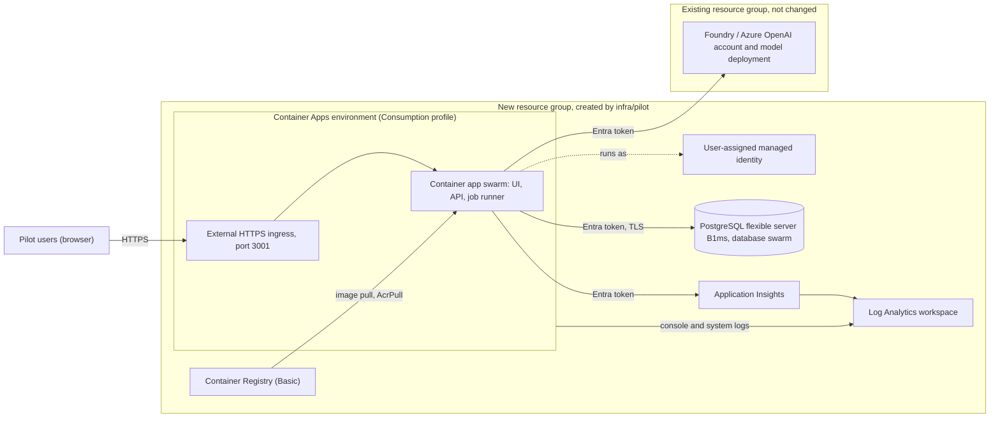

# Hosted pilot on Azure: plan

> **Status: planned, not deployed.** The Bicep in [`infra/pilot`](../../infra/pilot/main.bicep) compiles and
> lints, and the post-deployment check has unit tests. **No resource has been created, no deployment or
> what-if has been run, and nothing here has been seen working in Azure.** Read
> [What is not validated](#what-is-not-validated) before relying on any step. The cost of the plan is in
> [pilot-cost.md](./pilot-cost.md), which ends with the approval request for the chargeable resources.

This is the smallest hosted shape that can serve several people safely: **one container app** (the UI, the
API and the job runner in one process), **one PostgreSQL database**, and the identity, registry and logging
they need. It is the Option B of the [pilot plan](../pitch/pilot-plan.md), built from the decisions in
[ADR 0008](../adr/0008-browser-sign-in.md) (browser sign-in), [ADR 0009](../adr/0009-postgres-through-a-synchronous-bridge.md)
(PostgreSQL) and [ADR 0010](../adr/0010-durable-jobs-leased-from-the-database.md) (durable jobs). The existing
Azure AI resource is **referenced, not recreated**: its model deployment and quota are not touched.

## Architecture



Not drawn, because the template does not create it: **Microsoft Entra ID**. People sign in to the app, which
runs the Authorization Code flow with PKCE itself ([ADR 0008](../adr/0008-browser-sign-in.md)); the app
proves itself to Entra with a token from its managed identity instead of a client secret. Container Apps'
built-in authentication is deliberately **not** enabled: the app already runs and audits its own sign-in, and
a platform layer in front of it would duplicate that with a second session and a second set of rules.

The pitch deck's [architecture sketch](../pitch/architecture.md) draws the database behind a private
endpoint. This plan does not do that; see [Network and data protection](#network-and-data-protection) for
the reason and the way to get there.

## What is created

| Resource                                       | Type and API version                                          | Size                                                                    | Why it is here                                                                      |
| ---------------------------------------------- | ------------------------------------------------------------- | ----------------------------------------------------------------------- | ----------------------------------------------------------------------------------- |
| Managed identity `id-<env>`                    | `Microsoft.ManagedIdentity/userAssignedIdentities` 2024-11-30 | none                                                                    | The only credential holder: database, model, registry and telemetry all use it      |
| Log Analytics workspace `log-<env>`            | `Microsoft.OperationalInsights/workspaces` 2025-02-01         | Pay-as-you-go, 30 days, 0.5 GB/day cap                                  | Console and system logs of the app; Application Insights data                       |
| Application Insights `appi-<env>`              | `Microsoft.Insights/components` 2020-02-02                    | Workspace-based, **local auth disabled**                                | Traces and failures, ingested only with an Entra token                              |
| Container Registry `cr<env><hash>`             | `Microsoft.ContainerRegistry/registries` 2025-04-01           | Basic, admin user off                                                   | Holds the image; pulled with the identity's `AcrPull`                               |
| Container Apps environment `cae-<env>`         | `Microsoft.App/managedEnvironments` 2025-07-01                | Consumption profile only, no virtual network                            | Hosts the app; wired to the workspace for logs                                      |
| Container app `ca-<env>`                       | `Microsoft.App/containerApps` 2025-07-01                      | 0.5 vCPU, 1 GiB, **min 1 / max 1** replica, external HTTPS              | The application. Probes, environment variables and the identity are in the template |
| PostgreSQL flexible server `psql-<env>-<hash>` | `Microsoft.DBforPostgreSQL/flexibleServers` 2025-08-01        | Burstable B1ms, 32 GiB, version 16, 7-day backups, no HA/geo            | The one durable store: projects, ledger, audit chain, sessions and the job queue    |
| Database `swarm`, firewall rule, TLS setting   | child resources of the server                                 |                                                                         | `require_secure_transport = ON`; one network rule (see below)                       |
| Server administrator                           | `.../flexibleServers/administrators`                          | the managed identity                                                    | The app creates and migrates its own tables with it                                 |
| Three role assignments                         | `Microsoft.Authorization/roleAssignments` 2022-04-01          | one on the registry, one on Application Insights, one on the AI account | See the [role matrix](#identity-and-role-matrix)                                    |

Names carry a short hash of the resource group id where the name must be globally unique (registry,
database server). The resource group itself is **not** in the template: create a new one for the pilot (see
[Deploy](#deploy)) so that deleting it removes everything the pilot made and nothing else.

### What is left out, and why

| Left out                                              | Why                                                                                                                                                  | Add it when                                                                                                              |
| ----------------------------------------------------- | ---------------------------------------------------------------------------------------------------------------------------------------------------- | ------------------------------------------------------------------------------------------------------------------------ |
| **Key Vault**                                         | There is no secret to keep. The database, model, registry, telemetry and Entra token call all use the managed identity; there is no client secret    | The day a secret appears (for example a third-party key)                                                                 |
| **Blob Storage**                                      | Source PDFs are not retained: their text is stored in the database. Nothing else is a file                                                           | Original documents must be kept, with retention rules, or OCR is added                                                   |
| **Service Bus or any queue service**                  | The job queue is a PostgreSQL table with leases ([ADR 0010](../adr/0010-durable-jobs-leased-from-the-database.md))                                   | Measured throughput or fan-out that one table cannot serve                                                               |
| **A second (worker) container app**                   | With `SWARM_ROLE=all` the one process serves and runs jobs. A second always-on replica would double the compute cost for no benefit at this size     | The API must stay responsive during long runs; see [Splitting the API and the worker](#splitting-the-api-and-the-worker) |
| **Virtual network, private endpoints, NAT gateway**   | They add resources and an hourly charge, and the server's network mode cannot be changed in place. Entra-only authentication and TLS carry the pilot | Before production data, or if a policy requires private access                                                           |
| **Front Door, API Management, WAF**                   | The app already enforces sign-in, rate limits, a host allow-list and security headers. These add cost and a second place to configure it             | Public exposure beyond the pilot group, or a WAF requirement                                                             |
| **AI Search, Cosmos DB, Functions**                   | Not needed by anything the app does today ([AZURE.md](../AZURE.md#service-evaluation))                                                               | Measured need                                                                                                            |
| **Alert rules, action groups, budgets, Defender**     | They need an owner and an email list, which must not be in the repository. Free to add by hand                                                       | Someone is on call. Set a budget alert before approving the spend                                                        |
| **Diagnostic settings, backup vault, geo-redundancy** | Platform metrics are free in the portal; the server's own backups cover the data; a second region doubles the database cost                          | A recovery objective that a single-region restore cannot meet                                                            |

## Identity and role matrix

The application runs as **one user-assigned managed identity**. It is **not** Owner or Contributor on
anything. Every Azure role is assigned at the narrowest scope that works: the single resource.

| Principal                | Resource                                | Role or right                                                                       | Scope                  | Reason                                                             | When                             |
| ------------------------ | --------------------------------------- | ----------------------------------------------------------------------------------- | ---------------------- | ------------------------------------------------------------------ | -------------------------------- |
| Application identity     | Existing Foundry / Azure OpenAI account | **Cognitive Services OpenAI User**                                                  | The account only       | Call the model with an Entra token (the account has keys disabled) | Runtime; assigned at deploy      |
| Application identity     | Container Registry                      | **AcrPull**                                                                         | The registry only      | The platform pulls the image whenever a revision starts            | Runtime; assigned at deploy      |
| Application identity     | Application Insights                    | **Monitoring Metrics Publisher**                                                    | The component only     | Send telemetry; local (key) ingestion is disabled                  | Runtime; assigned at deploy      |
| Application identity     | PostgreSQL server                       | Microsoft Entra **administrator** (`azure_pg_admin`; not an Azure RBAC role)        | The server             | Create and migrate the schema, then read and write                 | Runtime; added at deploy         |
| Application identity     | Entra app registration                  | **Federated identity credential**, subject = the identity's principal ID            | The app registration   | Prove the app to Entra at the token endpoint without a secret      | Runtime; created by hand         |
| Person who deploys       | The new resource group                  | **Contributor**, plus **User Access Administrator** (or Owner)                      | The new resource group | Create resources and the registry and Application Insights roles   | Deployment only                  |
| Person who deploys       | The existing AI account                 | **Role Based Access Control Administrator**, **User Access Administrator** or Owner | The account only       | Write the one role assignment above                                | Deployment only                  |
| Person who deploys       | The registry                            | Contributor (inherited) or **AcrPush**                                              | The registry           | Build or push the image                                            | Each release                     |
| Person who sets Entra up | The app registration                    | Owner of it, or **Application Administrator**                                       | The app registration   | Define roles, redirect URI and the federated credential            | Setup                            |
| Tenant administrator     | The enterprise application              | Assign people to `Swarm.User`, `Swarm.Admin`, `Swarm.PlatformAdmin`                 | The enterprise app     | Decide who may sign in; see [Entra setup](#entra-app-registration) | Setup and whenever people change |

What the application identity does **not** have: Owner, Contributor or Reader on the subscription or the
group; any role on the AI resource group; Key Vault or Storage roles; and any password or key (the
PostgreSQL server has password authentication off, the AI account has keys off, the registry has the admin
user off).

**The one place this is not least privilege.** Inside the database the identity is the server's
administrator, because the app creates and migrates its own tables. It cannot change the server's
configuration (that is Azure RBAC), but it can do anything inside the databases. A later hardening is a
narrow runtime role with only the grants the app needs and a separate break-glass administrator group; that
needs SQL, which the template cannot run.

The AI account's role assignment lives in **that** account's resource group, not in the pilot group. When
the pilot group is deleted the identity disappears but the assignment stays behind as an orphan:
[Teardown](#teardown) removes it.

## What the container is given

Every setting is an ordinary environment variable. There is no secret and no secret reference in the
template; `APPLICATIONINSIGHTS_CONNECTION_STRING` is not a credential because the component refuses telemetry
without an Entra token.

| Variable                                                                             | Value                                                                                                 | Comes from                                   |
| ------------------------------------------------------------------------------------ | ----------------------------------------------------------------------------------------------------- | -------------------------------------------- |
| `PORT`, `HOST`                                                                       | `3001`, `0.0.0.0`                                                                                     | Fixed                                        |
| `AUTH_MODE`                                                                          | `entra`                                                                                               | Fixed                                        |
| `AUTH_ENTRA_TENANT_ID`                                                               | The tenant of the deployment                                                                          | `tenant().tenantId`                          |
| `AUTH_ENTRA_CLIENT_ID`, `AUTH_ENTRA_AUDIENCE`                                        | The app registration's client ID (the audience defaults to it)                                        | Parameters `authClientId`, `authAudience`    |
| `AUTH_ENTRA_REDIRECT_URI`                                                            | `https://<app fqdn>/auth/callback`                                                                    | Derived from the environment's domain        |
| `AUTH_ENTRA_CLIENT_ASSERTION`                                                        | `managed-identity`                                                                                    | Fixed: no client secret exists               |
| `ALLOWED_HOSTS`, `ALLOWED_ORIGINS`                                                   | `<app fqdn>`, `https://<app fqdn>`                                                                    | Derived                                      |
| `DATABASE_URL`, `DATABASE_AUTH`                                                      | `postgres://<identity name>@<server>.postgres.database.azure.com:5432/swarm?sslmode=require`, `entra` | The server's address and the identity's name |
| `AI_PROVIDER`, `AI_MODEL`, `AZURE_OPENAI_AUTH`                                       | `azure`, the deployment name, `entra`                                                                 | Parameter `aiDeploymentName`                 |
| `AZURE_OPENAI_ENDPOINT`                                                              | The existing account's endpoint                                                                       | Parameter `azureOpenAiEndpoint` or derived   |
| `AZURE_CLIENT_ID`                                                                    | The managed identity's client ID: selects it for `DefaultAzureCredential`                             | The identity                                 |
| `APPLICATIONINSIGHTS_CONNECTION_STRING`, `APPLICATIONINSIGHTS_AUTHENTICATION_STRING` | The component's connection string, `Authorization=AAD;ClientId=<client id>`                           | The component, the identity                  |
| `OTEL_SERVICE_NAME`, `LOG_LEVEL`                                                     | `swarm`, `info`                                                                                       | Fixed                                        |
| `TRUST_PROXY`, `RATE_LIMIT_SCALE`                                                    | `1`, `1`                                                                                              | Fixed: one proxy hop, the ingress            |
| `SWARM_ROLE`                                                                         | `all`: this process serves requests **and** runs jobs                                                 | Fixed                                        |
| `SOURCE_URL`                                                                         | The address of the exact source version (the licence is AGPL-3.0)                                     | Parameter `sourceUrl`; omitted when empty    |

Probes, all `GET` with the `Host` header set to the app's own address. The app answers the two health routes for any
host (a platform probe otherwise sends the replica's IP address, which no allow-list can name in advance), and every
other route with `403 HOST_NOT_ALLOWED` for a host that is not listed:

| Probe     | Path                | Period | Fails when                                                             | Effect                    |
| --------- | ------------------- | ------ | ---------------------------------------------------------------------- | ------------------------- |
| Startup   | `/api/health/live`  | 10 s   | Not listening for 15 s + 10 × 10 s (migrating, opening the connection) | The container restarts    |
| Liveness  | `/api/health/live`  | 30 s   | The database connection is lost for good (503), 3 times                | The container restarts    |
| Readiness | `/api/health/ready` | 15 s   | The database does not answer (503), 3 times                            | Traffic stops, no restart |

The `Dockerfile`'s `HEALTHCHECK` is not used by Container Apps. Its request carries `Host: 127.0.0.1`, which this
`ALLOWED_HOSTS` would refuse anyway.

## Network and data protection

- **Ingress** is external and HTTPS only (`allowInsecure: false`: plain HTTP is redirected). Every API route
  except the health probes needs sign-in; the app refuses an unknown `Host` or `Origin`.
- **The database is on a public endpoint** with one firewall rule, `AllowAllAzureServicesAndResourcesWithinAzureIps`
  (`0.0.0.0`). That admits connections from **any Azure-hosted client, including other customers**, and
  it is the weakest control in the plan. What stands behind it: only Entra principals can sign in, and
  the only one that exists on the server is the application identity (password authentication is off, so
  there is nothing to guess); every connection needs TLS (`require_secure_transport = ON`, TLS 1.2 or later is the service
  default); and the server accepts no key.

  | Option                                          | Verdict                                                                                                                                                                                                                                                                     |
  | ----------------------------------------------- | --------------------------------------------------------------------------------------------------------------------------------------------------------------------------------------------------------------------------------------------------------------------------- |
  | The "Azure services" rule (chosen)              | Works with no virtual network and survives re-provisioning. Broad at the network layer, narrow at the identity layer                                                                                                                                                        |
  | Firewall rules for the app's outbound addresses | Rejected: Microsoft states that a Container Apps environment's outbound addresses "might change over time", so the database would silently lock the app out                                                                                                                 |
  | A fixed address (NAT gateway) or private access | The right production answer. A NAT gateway has its own hourly charge; private access needs a virtual network, two subnets and a private DNS zone, and cannot be switched on for an existing server. Not built for a pilot, and it removes your laptop from the database too |

- **Application Insights** and **Container Registry** are also reachable on public endpoints, protected by
  Entra roles only (no key, no admin user, no anonymous pull).
- **What is logged.** The app writes structured logs without prompts, documents or provider bodies, and
  each request is logged, including the probes (about 9,000 a day, which is on the order of 100 to 300 MB of
  logs a month). Logs go to the workspace; the 0.5 GB/day cap is a spend ceiling, not a privacy control.
- **Data location.** Everything the template creates is in one region. The model deployment is wherever it
  already is, and a `GlobalStandard` deployment may process prompts in any Azure region
  ([AZURE.md](../AZURE.md#live-evidence)). Use synthetic or approved data only.

## Deploy

None of this has been run. Placeholders are in `<angle brackets>`; **do not commit values**. Everything
environment-specific is read from environment variables by
[`main.bicepparam`](../../infra/pilot/main.bicepparam), so no file needs editing.

### 0. Before you start

- **Approval** of the chargeable resources: [pilot-cost.md](./pilot-cost.md#approval-request).
- **Tools:** Azure CLI with Bicep (`az bicep version`), Node 24 for the smoke test, and optionally the Azure
  Developer CLI. Docker is not needed: the image is built in the registry. (Registry build tasks can be
  unavailable on some free or student subscriptions; then build with Docker locally, which azd does by itself
  when the remote build fails.)
- **Permissions:** see the role matrix. In short, Owner on the new group, a role-assignment right on the AI
  account, and the right to register an application in Entra.
- **Resource providers** registered in the subscription, which a new subscription often lacks (the first
  deployment otherwise fails with `MissingSubscriptionRegistration`):
  `Microsoft.App`, `Microsoft.OperationalInsights`, `Microsoft.ContainerRegistry`, `Microsoft.DBforPostgreSQL`,
  `Microsoft.Insights` and `Microsoft.ManagedIdentity`. Register each with `az provider register --namespace <name>`.
- **Region.** Use the region of the AI account unless the database is refused there. Provisioning a
  Burstable PostgreSQL server can fail with a "region restricted" offer error on some subscriptions; pick
  another region (the model call crosses regions without trouble, only slower). Prices for three regions are in the cost document.
- **The AI account's resource ID** and its **deployment name**:
  `az cognitiveservices account show --name <account> --resource-group <ai group> --query id -o tsv`.

### 1. A new resource group, and the Entra app registration

```powershell
az account set --subscription <subscription id>
az group create --name <pilot group> --location <region> --tags app=swarm-lab purpose=pilot
```

Create the app registration **before** provisioning, because the template needs its client ID. Its redirect
URI and federated credential come after, once the address exists. The full sequence is in
[Entra app registration](#entra-app-registration).

### 2. Provision

Set the values once per shell (PowerShell 5.1 syntax):

```powershell
$env:AZURE_ENV_NAME               = 'swarm-pilot'
$env:SWARM_AI_ACCOUNT_RESOURCE_ID = '<resource id of the existing AI account>'
$env:SWARM_AI_DEPLOYMENT_NAME     = '<model deployment name, for example swarm-chat>'
$env:SWARM_AUTH_CLIENT_ID         = '<application (client) id of the app registration>'
$env:SWARM_SOURCE_URL             = '<public https address of the exact source version>'
```

An unset required value stops the run **before anything is created** (the parameter file fails to compile).

Everything else has a default and is changed with `--parameters name=value` (for azd, add a `param name = value`
line to [`main.bicepparam`](../../infra/pilot/main.bicepparam)):

| Parameter                           | Default                                    | Effect                                                                            |
| ----------------------------------- | ------------------------------------------ | --------------------------------------------------------------------------------- |
| `location`                          | The resource group's region                | Region of everything created                                                      |
| `azureOpenAiEndpoint`               | `https://<account name>.openai.azure.com/` | Set it when the account uses another custom sub-domain                            |
| `authAudience`                      | The client ID                              | The audience tokens must carry                                                    |
| `cpu`                               | `0.5` (memory is twice that)               | `0.25`, `0.5`, `1` or `2` vCPU                                                    |
| `minReplicas`, `maxReplicas`        | `1`, `1`                                   | `0` stops the app, and its job runner, when idle; keep `maxReplicas` at 1 for now |
| `backupRetentionDays`               | `7`                                        | 7 to 35: how far back a restore can go                                            |
| `logRetentionDays`, `dailyLogCapGb` | `30`, `0.5`                                | Log retention, and the daily ingestion cap (`-1` removes it)                      |

**With plain `az`** (preview first; it changes nothing):

```powershell
az deployment group what-if --resource-group <pilot group> --parameters infra/pilot/main.bicepparam
az deployment group create  --name swarm-pilot --resource-group <pilot group> --parameters infra/pilot/main.bicepparam
az deployment group show    --name swarm-pilot --resource-group <pilot group> --query properties.outputs
```

**With `azd`** (it provisions the same template; `azure.yaml` is at the repository root):

```powershell
azd env new swarm-pilot
azd env set AZURE_SUBSCRIPTION_ID <subscription id>
azd env set AZURE_LOCATION <region>
azd env set AZURE_RESOURCE_GROUP <pilot group>
azd env set SWARM_AI_ACCOUNT_RESOURCE_ID <resource id>
azd env set SWARM_AI_DEPLOYMENT_NAME <deployment name>
azd env set SWARM_AUTH_CLIENT_ID <client id>
azd env set SWARM_SOURCE_URL <address>
azd provision --preview
azd provision
```

The first provision starts a **placeholder image** (it listens on port 80, not 3001), so the app shows as
unhealthy until the first real image is deployed. That is expected. Re-running a provision keeps the image
that is running: azd sets `SERVICE_SWARM_RESOURCE_EXISTS`, and with plain `az` pass `SWARM_CONTAINER_IMAGE`
or `appExists=true` ([`main.bicepparam`](../../infra/pilot/main.bicepparam)).

The outputs you need next: `AZURE_CONTAINER_APP_FQDN`, `ENTRA_REDIRECT_URI`,
`AZURE_USER_ASSIGNED_IDENTITY_PRINCIPAL_ID`, `AZURE_USER_ASSIGNED_IDENTITY_NAME`,
`AZURE_CONTAINER_REGISTRY_ENDPOINT`, `AZURE_CONTAINER_REGISTRY_NAME` and `AZURE_CONTAINER_APP_NAME`. (`az` may
return an output's name with a different case from the one in the template, so match names case-insensitively.)

### 3. Finish the Entra setup, then deploy the image

Do the [Entra steps that need the address](#entra-app-registration) now. Then:

```powershell
# azd
azd deploy

# plain az: build in the registry, tag with the commit, then point the app at it
$tag = git rev-parse --short HEAD
az acr build --registry <registry name> --image swarm:$tag --file Dockerfile .
az containerapp update --name <app name> --resource-group <pilot group> --image <registry login server>/swarm:$tag
```

azd's own image tag is a timestamp; for a release, prefer the commit tag so the running image can be matched to
the source in `SOURCE_URL`.

### 4. Check it

```powershell
npx tsx scripts/azure/pilot-smoke.ts https://<app fqdn>
```

Then sign in as the first administrator ([First owner](#first-owner)). The checks are in
[Smoke checks](#smoke-checks).

## Entra app registration

The app signs people in with the Authorization Code flow and PKCE and proves itself to Entra with a token
from its managed identity ([workload identity federation](https://learn.microsoft.com/entra/workload-id/workload-identity-federation)).
**No client secret is created.** Setup is in two parts because the redirect URI and the federated
credential need values that exist only after provisioning.

**Before provisioning** (gives the client ID the template needs):

```powershell
$app = az ad app create --display-name 'Swarm pilot' --sign-in-audience AzureADMyOrg `
         --enable-id-token-issuance false --enable-access-token-issuance false | ConvertFrom-Json
$app.appId   # the client ID: SWARM_AUTH_CLIENT_ID
$app.id      # the object ID, used below
```

`AzureADMyOrg` is the **tenant restriction**: only accounts of this tenant can sign in, and the server also
accepts only tokens of the tenant named in `AUTH_ENTRA_TENANT_ID`. The app is a **Web** application: do not
add a single-page-app or public-client platform, and leave the implicit-grant boxes unchecked.

Define the three app roles (new IDs are generated; write the file without a byte-order mark):

```powershell
$roles = @(
  @{ displayName = 'Swarm user';           value = 'Swarm.User';          description = 'May sign in to Swarm.' },
  @{ displayName = 'Swarm admin';          value = 'Swarm.Admin';         description = 'May become the first owner of an empty workspace.' },
  @{ displayName = 'Swarm platform admin'; value = 'Swarm.PlatformAdmin'; description = 'Runs the platform; sees no project content.' }
) | ForEach-Object { $_.id = [guid]::NewGuid().ToString(); $_.allowedMemberTypes = @('User'); $_.isEnabled = $true; $_ }
[IO.File]::WriteAllText("$PWD\roles.json", (ConvertTo-Json -InputObject $roles -Depth 4))
az ad app update --id $app.id --app-roles "@roles.json"
Remove-Item roles.json
```

**After provisioning** (uses the outputs):

```powershell
# 1. The redirect URI: the Web platform, exactly this address
az ad app update --id $app.id --web-redirect-uris "https://<app fqdn>/auth/callback"

# 2. The federated credential: the managed identity IS the client credential
$tenant = az account show --query tenantId -o tsv
$credential = @{
  name        = 'swarm-pilot-managed-identity'
  issuer      = "https://login.microsoftonline.com/$tenant/v2.0"
  subject     = '<AZURE_USER_ASSIGNED_IDENTITY_PRINCIPAL_ID>'
  audiences   = @('api://AzureADTokenExchange')
  description = 'The pilot container app proves itself with its managed identity; there is no client secret.'
}
[IO.File]::WriteAllText("$PWD\federated.json", (ConvertTo-Json -InputObject $credential))
az ad app federated-credential create --id $app.id --parameters "@federated.json"
Remove-Item federated.json

# 3. The enterprise application, and "assignment required" so that only assigned people can sign in
$sp = az ad sp create --id $app.appId | ConvertFrom-Json
az ad sp update --id $sp.id --set appRoleAssignmentRequired=true
```

The three federated-credential values are exact: **issuer** `https://login.microsoftonline.com/<tenant id>/v2.0`;
**subject** the managed identity's **principal (object) ID**, not its client ID; **audience**
`api://AzureADTokenExchange`.

**Assign people** in the Entra admin center under Enterprise applications, Swarm pilot, Users and groups:
`Swarm.User` for everyone who may sign in, `Swarm.Admin` for the first owner (next section) and
`Swarm.PlatformAdmin` for whoever runs the platform. A person with no Swarm role who signs in is sent to
`/?signin=norole`.

**What needs a tenant administrator**, if you are not one: registering an application (when users may not),
assigning people to the roles (the app's owner can, depending on the tenant), granting admin consent if the
tenant blocks user consent for the `openid profile` sign-in (the app asks for nothing else and holds no
refresh token), and any Conditional Access or multi-factor policy for the app. None of this has met a real
tenant yet ([ADR 0008](../adr/0008-browser-sign-in.md)).

## First owner

A new workspace has no owner, and nobody can appoint one. **The first person to call the API with the
`Swarm.Admin` role becomes the workspace owner** ([ADR 0007](../adr/0007-workspace-and-project-membership.md)),
in one transaction and audited. After that the role confers nothing, so an owner removed inside Swarm stays removed.

1. Assign `Swarm.Admin` to **one** named person first, and `Swarm.User` to nobody else yet.
2. That person signs in once. They are now the owner.
3. They add the others to the workspace and its projects (people are identified by their Entra object ID; the
   app has no invitation by name or email).
4. Assign `Swarm.User` to the rest.

## Backup, restore and rollback

### The database

The server takes automated backups and keeps the transaction log, so it can be restored to **any point in the
last 7 days** (`backupRetentionDays`, 7 to 35). Backup storage up to the size of the database is included.
Backups are in the same region and are deleted with the server. A restore **always creates a new server**; it
never overwrites the old one.

```powershell
# the earliest point you can go back to
az postgres flexible-server show --name <server> --resource-group <pilot group> --query backup.earliestRestoreDate
# restore to a new server (time in UTC)
az postgres flexible-server restore --resource-group <pilot group> --name <new server> --source-server <server> --restore-time "<yyyy-MM-ddTHH:mm:ssZ>"
```

A new server has none of the old server's network rules, and may not carry its Entra administrators. Before
pointing the app at it:

```powershell
az postgres flexible-server firewall-rule create --resource-group <pilot group> --name <new server> --rule-name AllowAllAzureServicesAndResourcesWithinAzureIps --start-ip-address 0.0.0.0 --end-ip-address 0.0.0.0
az postgres flexible-server microsoft-entra-admin list --resource-group <pilot group> --server-name <new server>
# if the identity is not listed:
az postgres flexible-server microsoft-entra-admin create --resource-group <pilot group> --server-name <new server> --display-name <identity name> --object-id <identity principal id> --type ServicePrincipal
az containerapp update --name <app name> --resource-group <pilot group> --set-env-vars "DATABASE_URL=postgres://<identity name>@<new server>.postgres.database.azure.com:5432/swarm?sslmode=require"
```

Then run the smoke test, check a project in the UI, and delete the old server when you are sure. The
template's server name is derived, so after a restore the template and the running system differ: treat the
restored server as the pilot's database from then on, and do not re-run the template without `appExists` and
a deliberate look at what it would change.

**Do a restore drill before putting real data in**: it has not been done (see [production readiness](../production-readiness.md)).

A logical copy is the other safety net: `npm run db:copy` writes the database to a SQLite file and back
([configuration guide](../CONFIGURATION.md#postgresql)). It needs the operator to be a database user, which
only the identity is by default, and a temporary firewall rule for the operator's address, so it is a manual,
optional step.

### The application

The app is in **single-revision** mode. A new revision takes traffic only after its readiness probe passes,
so an image that fails to start never replaces the one that works.

To go back to the previous image, start it as a new revision (every pushed tag stays in the registry):

```powershell
az containerapp revision list --name <app name> --resource-group <pilot group> -o table
az containerapp update --name <app name> --resource-group <pilot group> --image <registry login server>/swarm:<previous tag>
```

**A canary, if you want one.** Switch to multiple revisions, deploy the new image at 0% traffic, shift
traffic and, if it goes wrong, shift it back:

```powershell
az containerapp revision set-mode --name <app name> --resource-group <pilot group> --mode multiple
az containerapp ingress traffic set --name <app name> --resource-group <pilot group> --revision-weight <new revision>=10 <old revision>=90
```

Two cautions. The app refuses any host that is not its own address, so a revision's own address
(`<app>--<revision>...`) answers `403 HOST_NOT_ALLOWED`: test with weights, not that address. And **both
revisions keep running and both run jobs** (`SWARM_ROLE=all`), so do not use a canary for a release that
changes the schema. Return to `--mode single` afterwards; re-applying the template does so too.

### Schema migrations only go forward

The app applies its schema migrations when it **starts**, under a lock, and a database that is newer than the
build is refused untouched: the process stops with `STORAGE_VERSION: This database requires a newer
application version` before it listens. In practice:

- **Rolling back the application below the database's schema version does not work.** The older image starts, finds the
  newer schema, and exits. Its revision never becomes ready, so the platform leaves the newer revision serving
  and the rollback silently does not happen. Look for `STORAGE_VERSION` in the console logs.
- **The migration runs when the first new replica starts, before that replica has proved itself.** If a release carries one
  and turns out to be bad, going back means **restoring the database to a time before the migration** (a new server,
  as above) _and_ deploying the older image, or fixing forward.
- **So before a release that changes the schema**, compare the versions
  (`git diff <running commit> <new commit> -- backend/src/storage/migrations.ts`, the list of migrations) and note the
  UTC time you deploy. That time is your restore point.
- A release **without** a migration rolls back freely, as above.

## Smoke checks

`npx tsx scripts/azure/pilot-smoke.ts https://<app fqdn>` makes four read-only requests with no credential and
prints PASS or FAIL for each check, in this order. It exits `0` when all pass, `1` when any fails and `2` for
a bad address. It refuses an `http://` address, never follows a redirect, and never prints a cookie, a token or
a response body.

| Check            | Request                              | Expected                                                                                                                                                                                  |
| ---------------- | ------------------------------------ | ----------------------------------------------------------------------------------------------------------------------------------------------------------------------------------------- |
| HTTPS            | the address                          | `https://`; nothing is sent over plain HTTP                                                                                                                                               |
| Live             | `GET /api/health/live`               | `200`                                                                                                                                                                                     |
| Ready            | `GET /api/health/ready`              | `200`, body exactly `{"status":"ready","checks":{"database":"ok"}}`                                                                                                                       |
| Sign-in enforced | `GET /api/config` with no credential | `401`, error code `SIGN_IN_REQUIRED`                                                                                                                                                      |
| Redirect         | `GET /auth/login`                    | `302` to `https://login.microsoftonline.com/...` with `response_type=code`, `code_challenge_method=S256`, scope `openid profile`, a `redirect_uri` on this address and no `client_secret` |
| Login cookie     | the same response                    | `__Host-swarm_login` with `HttpOnly`, `Secure`, `SameSite=Lax`, `Path=/` and no `Domain`                                                                                                  |
| Policy header    | every response                       | a `Content-Security-Policy` with a `default-src`                                                                                                                                          |
| No leaks         | every response body                  | no GUID-shaped value (the per-request error id is set aside), no `endpoint` or `subscription`, no credential                                                                              |

What a failure usually means:

| Failure                                      | Likely cause                                                                                                      |
| -------------------------------------------- | ----------------------------------------------------------------------------------------------------------------- |
| Live is `404` or the page is the placeholder | The first image has not been deployed yet                                                                         |
| Live is `403 HOST_NOT_ALLOWED`               | `ALLOWED_HOSTS` does not contain the address you used (a custom domain, for instance)                             |
| Ready is `503`                               | The database does not answer: firewall rule, the identity is not a server administrator, or the server is stopped |
| `/api/config` answers `200`                  | `AUTH_MODE` is not `entra`                                                                                        |
| `/auth/login` is `404`                       | `AUTH_ENTRA_CLIENT_ID` or `AUTH_ENTRA_REDIRECT_URI` is missing                                                    |
| The cookie has no `__Host-` prefix           | The redirect URI is not `https`                                                                                   |

The script cannot prove that **sign-in works**: that needs a person, the redirect URI registered and the
federated credential in place. After the script passes, sign in once and create a small synthetic project. By hand,
print only the status codes so no cookie reaches the screen:

```powershell
curl.exe -sS -o NUL -w "%{http_code}`n" https://<app fqdn>/api/health/ready
curl.exe -sS -o NUL -w "%{http_code}`n" https://<app fqdn>/api/config
```

## Operating notes

- **Logs:** `az containerapp logs show --name <app name> --resource-group <pilot group> --type console --tail 100`,
  or in the workspace `ContainerAppConsoleLogs_CL` and `ContainerAppSystemLogs_CL` (filter on `ContainerAppName_s`).
- **Scale and stop:** `--min-replicas 0` stops the replica when idle, and with it the embedded job runner, so a queued run
  waits for the next request. The database can be stopped (`az postgres flexible-server stop`); Azure starts it
  again after seven days. Both are described, with their savings, in [pilot-cost.md](./pilot-cost.md).
- **More than one replica** is argued, not measured ([ADR 0009](../adr/0009-postgres-through-a-synchronous-bridge.md),
  [ADR 0010](../adr/0010-durable-jobs-leased-from-the-database.md)): keep `maxReplicas` at 1 until two replicas
  racing for one database have been shown to work.

### Splitting the API and the worker

`SWARM_ROLE` lets some processes only serve (`api`) and others only run jobs (`worker`), against the one
database. The template does not do this. When a long run makes the page slow, add a second container app in
the same environment with the same image, `SWARM_ROLE=worker` and no external ingress, and set the first to
`SWARM_ROLE=api`. A worker still serves the whole API and answers the probes ([configuration guide](../CONFIGURATION.md#jobs-and-workers)),
so keep user traffic away from it. This is a sketch, not a tested design, and it adds a second always-on replica to the bill.

## Teardown

Delete **only the pilot's resource group**. Never the resource group of the AI account.

```powershell
az group delete --name <pilot group> --yes --no-wait
```

That removes everything the template created, including the database and its backups. What it does **not** remove:

- **The role assignment on the AI account**, which now points at a deleted identity. List and delete it:
  `az role assignment list --scope <AI account resource id> --query "[?principalName==''].{id:id,role:roleDefinitionName}"`,
  then `az role assignment delete --ids <id>`. Do not touch any other assignment.
- **The Entra app registration, its roles and its federated credential**: `az ad app delete --id <object id>`.
- **The Log Analytics workspace's soft delete.** A deleted workspace can be recovered for 14 days, and the same
  name cannot be reused in that time. Use another `AZURE_ENV_NAME`, or delete the workspace with `--force` first.
- **Azure's usage-based charges to the end of the day** and the free grants, which are per subscription.

`azd down` also works; read what it lists before confirming.

## What is not validated

Nothing was deployed, so **everything that depends on Azure's behaviour is unverified**. What was checked is in
[the last section](#what-was-checked).

- **Any deployment at all:** property combinations the compiler cannot see, quotas, region offers, permissions, the order of the
  PostgreSQL server operations (chained on purpose), and `what-if`.
- **The first provision with a placeholder image** whose port does not match the ingress. Container Apps is
  expected to create the app without waiting for the replica to be ready. If it reports "Operation expired",
  provision once with `--parameters minReplicas=0`, deploy the image, then set it back to 1.
- **That Container Apps honours the `Host` header set on a probe.** It is a documented field and standard Kubernetes
  behaviour, but untested here. The deployment does not depend on it: the app answers `/api/health/live` and
  `/api/health/ready` for any host (`backend/test/health.test.ts`), so a probe that sends the replica's address still passes.
- **PostgreSQL with Entra only:** that the administrator resource is accepted for a managed identity in one
  deployment with the server; that the identity can create tables in `public` on version 16; that `pg` verifies
  the server's certificate with Node's built-in roots (the app requires it, `rejectUnauthorized: true`); that a
  B1ms survives the synchronous bridge under load; and what a restore keeps.
- **The managed identity's tokens** for PostgreSQL, the model and the client assertion
  (`api://AzureADTokenExchange`), all through `DefaultAzureCredential` with `AZURE_CLIENT_ID`.
- **A real Entra tenant**, Conditional Access, consent prompts and the app-role claims ([ADR 0008](../adr/0008-browser-sign-in.md)).
- **Telemetry.** The application's exporter (being added) authenticates to Application Insights with Entra, using the
  connection string and the identity's client ID (`AZURE_CLIENT_ID`). The template also sets
  `APPLICATIONINSIGHTS_AUTHENTICATION_STRING`, as specified, but that setting is documented for the .NET and Java agents
  and App Service auto-instrumentation and I found no documentation that a Node.js exporter reads it, so the code must
  not depend on it. With local authentication disabled, an exporter that sends no credential is refused and its telemetry
  dropped. None of this has run against a real Application Insights resource.
- **More than one replica**, a restore drill, a revision rollback, and the schema-version refusal on a real
  server.
- **azd:** resource-group-scoped provisioning with a `.bicepparam`, and the `SERVICE_SWARM_RESOURCE_EXISTS` convention.
- **Cost:** list prices on one date; no agreement price, no real usage.

## What was checked

| Check                                                                                        | Result                                                                                                                                                                                                                                                                                                                                   |
| -------------------------------------------------------------------------------------------- | ---------------------------------------------------------------------------------------------------------------------------------------------------------------------------------------------------------------------------------------------------------------------------------------------------------------------------------------- |
| `bicep build infra/pilot/main.bicep` (Bicep CLI 0.48.1)                                      | Succeeds; every API version above has type definitions                                                                                                                                                                                                                                                                                   |
| `bicep lint`, default rules                                                                  | No findings in `main.bicep` or any module                                                                                                                                                                                                                                                                                                |
| `bicep lint`, extra rules (API age, secrets in outputs and parameters, safe access, what-if) | One finding, kept: the administrator resource is **named by the identity's object ID**, which exists only after the identity does, so a `what-if` of the first deployment is less precise there                                                                                                                                          |
| `bicep build-params` with the environment unset                                              | Fails on the required values (resource ID, client ID) before anything could be created, as designed                                                                                                                                                                                                                                      |
| `bicep build-params` with placeholder values                                                 | Succeeds and yields only the nine environment-specific parameters                                                                                                                                                                                                                                                                        |
| Smoke checks against the real backend, in-process (a throwaway run, not kept)                | 8 of 8 pass with `AUTH_MODE=entra`. With `AUTH_MODE=none` the sign-in, redirect and cookie checks fail, as they should. Before the backend exempted the two health routes from the host check, a request whose `Host` was not in `ALLOWED_HOSTS` got `403 HOST_NOT_ALLOWED` on both; it now does not, and the probes still name the host |
| Smoke test: `vitest`, `tsc`, ESLint, Prettier                                                | Pass; the tests use in-memory fakes and a loopback server, no network                                                                                                                                                                                                                                                                    |

## Files

| File                                                               | Purpose                                                                                                           |
| ------------------------------------------------------------------ | ----------------------------------------------------------------------------------------------------------------- |
| `infra/pilot/main.bicep`                                           | Resource-group template: identity and wiring                                                                      |
| `infra/pilot/main.bicepparam`                                      | Environment-specific parameters, read from environment variables                                                  |
| `infra/pilot/modules/*.bicep`                                      | `monitoring`, `registry`, `postgres`, `container-app`, `ai-access` (the last deploys into the AI account's group) |
| `azure.yaml`                                                       | Azure Developer CLI: one `containerapp` service built from the `Dockerfile`                                       |
| `scripts/azure/pilot-smoke.ts`, `scripts/azure/lib/pilot-smoke.ts` | The post-deployment check and its logic                                                                           |
