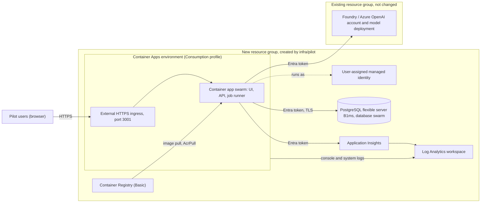

# Hosted pilot on Azure: plan

> **Status: deployed once, live, and corrected afterwards.** The pilot runs on Azure Container Apps in Central India. The
> first deployment needed several things done by hand (an environment created with `az`, a port and `PORT` fixed after the
> real image crashed, a release recorded by hand, a database tier and a model quota worked around, and the Entra steps);
> the template and the release tool were then changed so that none of them has to be repeated blindly, and the sequence
> that worked is in [The first live deployment, and what it taught](#the-first-live-deployment-and-what-it-taught).
> What is **checked offline**: `npm run iac:validate` (a pinned Bicep CLI builds every template and parameter file, a
> check refuses a resource declared twice, `bicep snapshot` predicts the resources, and a test asserts the security
> invariants on the compiled output), `az deployment group what-if` against the live group (read-only), and unit tests of
> the release and check tooling against fakes. What is **not** yet seen working: the template's own probes on the live app
> (it has none until the template is applied, see [Putting the probes on](#putting-the-probes-on-the-running-app)), a
> rollback drill, a restore drill, and a model call from the live app (its owner proves that with **Verify connection**,
> below). Read [What is not validated](#what-is-not-validated) before relying on any step. The cost of the plan is in
> [pilot-cost.md](./pilot-cost.md) and, with current list prices and the arithmetic, in
> [azure-preflight.md](../production/azure-preflight.md).

> **Since this plan was first written** the template gained: **multiple-revision mode** with blue/green releases
> and a one-command rollback ([release-process.md](../production/release-process.md)); an **action group, nine metric and
> nine log alert rules** and a **budget** ([observability.md](../production/observability.md)); an opt-in **Key Vault**;
> opt-in **private networking** and a NAT gateway; **parameters to reuse existing** workspace, Application Insights,
> registry, PostgreSQL server, Key Vault and Container Apps environment; a `production-shaped` parameter profile; and a
> `minReplicas` that **cannot be below 1**. Where a paragraph below still describes the earlier shape, it says so. The
> production-candidate pages are in [docs/production/](../production/): [runbook](../production/runbook.md),
> [threat model](../production/threat-model.md), [limitations](../production/LIMITATIONS.md).

This is the smallest hosted shape that can serve several people safely: **one container app** (the UI, the
API and the job runner in one process), **one PostgreSQL database**, and the identity, registry and logging
they need. It is the Option B of the [pilot plan](../pitch/pilot-plan.md), built from the decisions in
[ADR 0008](../adr/0008-browser-sign-in.md) (browser sign-in), [ADR 0009](../adr/0009-postgres-through-a-synchronous-bridge.md)
(PostgreSQL) and [ADR 0010](../adr/0010-durable-jobs-leased-from-the-database.md) (durable jobs). The existing
Azure AI resource is **referenced, not recreated**: its model deployment and quota are not touched.

## The first live deployment, and what it taught

The first real deployment (Central India, a Visual Studio subscription with a spending limit) worked, but only after
several steps were done by hand and one failed deployment was understood. The template and the release tool were changed
afterwards so that none of those steps has to be repeated blindly. This is the sequence that worked, with what is now in
the repository and what is still yours to do. Commands are for Azure Cloud Shell (bash); the PowerShell forms elsewhere in
this page do the same. Nothing here holds a subscription ID, a tenant ID or a secret: placeholders are in `<angle brackets>`.

**1. Register the resource providers, once per subscription** (a person with Contributor on the subscription; the
deploying identity usually cannot). A new subscription fails the first deployment with `MissingSubscriptionRegistration`:

```bash
PROVIDERS="Microsoft.App Microsoft.OperationalInsights Microsoft.ContainerRegistry Microsoft.DBforPostgreSQL Microsoft.Insights Microsoft.ManagedIdentity Microsoft.CognitiveServices Microsoft.Consumption"
for ns in $PROVIDERS; do az provider register --namespace "$ns"; done     # add Microsoft.KeyVault if you switch the vault on
for ns in $PROVIDERS; do echo "$ns $(az provider show --namespace "$ns" --query registrationState -o tsv)"; done
```

The second loop prints each provider's state; wait until every one says `Registered` (a minute or two). These are the
providers the live subscription had registered when the deployment succeeded (`Microsoft.Network` and
`Microsoft.Authorization` are registered by default).

**2. Give the deploying identity the roles it needs, at the narrowest scope that works.** On **the pilot resource group
only**: **Contributor** (create everything) and **User Access Administrator** (the template writes the application
identity's roles: AcrPull on the registry, Monitoring Metrics Publisher on Application Insights, and Cognitive Services
OpenAI User on the AI account). If the AI account is in another group, the role assignment on **that account** needs a
person who can write role assignments there. What a deploying identity still cannot do: register providers, edit the Entra
app registration, or read billing, so those stay with a person (steps 1, 7 and the cost section).

**3. The model: a quota workaround.** In this subscription the Standard deployment type (`DataZoneStandard`) had **0
quota** for `gpt-5-mini` in `eastus2`. A **Global Standard** deployment worked: account `<account>` (kind `AIServices`,
keys disabled, region `eastus2`) with deployment `swarm-chat` (model `gpt-5-mini` version `2025-08-07`, 50K tokens per
minute). It was made with the provisioning script, which reads live quota and lets you pick a candidate, and without the
role assignment (the template assigns it):

```bash
npm run azure:provision -- --subscription <subscription id> --preflight-only      # read-only: lists candidates and says what is missing
npm run azure:provision -- --subscription <subscription id> --pick 2 --skip-role-assignment
```

Pick the candidate whose deployment type has quota, read what it prints, and give the template the account's resource ID
(`SWARM_AI_ACCOUNT_RESOURCE_ID`) and the deployment name (`SWARM_AI_DEPLOYMENT_NAME`). A Global deployment may process
requests in any region: that is a data-residency decision, and it is yours.

**4. The database: a tier fallback, and a name that is busy for a while.** Burstable (`Standard_B1ms`, then
`Standard_B2s`) answered `SkuNotAvailable` in Central India for this subscription, although the SKU is listed. What worked
was General Purpose, which costs about **INR 17,800 a month** against about INR 2,100 for B1ms
([pilot-cost.md](./pilot-cost.md#what-exists-now-5-november-2026)), more than a Visual Studio credit of INR 11,000. To use it:

```bash
export SWARM_DATABASE_SKU_NAME=Standard_D2ds_v4
export SWARM_DATABASE_SKU_TIER=GeneralPurpose
```

A failed server keeps its name while it is **Dropping**; a retry in that time fails with `ServerNameAlreadyExists`. It
clears in a few minutes: check with `az postgres flexible-server list -g <pilot group> -o table`, wait until the failed one
is gone, and apply again. Do not rename anything. The two variables are **ignored** when `SWARM_EXISTING_POSTGRES_SERVER_ID`
is set, and they must **stay set on every later apply**: leaving them out would ask Azure to change the running server to
Burstable.

**5. The Container Apps environment.** The template declared it twice, which Azure refuses
(`The resource ... is defined multiple times`), and the environment was made by hand. It is now one module for a new
environment and one for an existing one, and `npm run iac:validate` fails on any resource declared twice. A fresh
deployment needs nothing by hand. To reuse an environment that exists, set `SWARM_EXISTING_CONTAINER_APPS_ENVIRONMENT_ID`
to its resource ID.

**6. The first real image goes on through the template, never through `az containerapp update`.** The placeholder listens
on port 80 and gets no `PORT` and no probes; the real image needs port 3001, `PORT=3001` and the three probes, and
`az containerapp update` has no flag for a probe and copies the port it finds. Three inputs decide what the app runs:

| `SERVICE_SWARM_RESOURCE_EXISTS` | `SWARM_CONTAINER_IMAGE`     | The app runs                                                          | Port, `PORT`, probes                     | `BUILD_SHA`                  |
| ------------------------------- | --------------------------- | --------------------------------------------------------------------- | ---------------------------------------- | ---------------------------- |
| `false` (first deployment)      | empty                       | The public placeholder                                                | 80, none, none (the app shows unhealthy) | none                         |
| `false`                         | `<registry>/swarm@sha256:…` | That image, from the start                                            | 3001, `PORT=3001`, all three probes      | `SWARM_BUILD_SHA`            |
| `true` (every later apply)      | empty                       | The image that runs now (Azure resolves it **during** the deployment) | Follow from that image                   | Kept from the running app    |
| `true`                          | `<registry>/swarm@sha256:…` | That image                                                            | 3001, `PORT=3001`, all three probes      | `SWARM_BUILD_SHA`, else kept |

The variable has no default: an unset one stops the deployment before anything is created (`BCP427`). `what-if` cannot
evaluate "keep what runs" and prints that part as an expression, so **name the running image too** to see a concrete diff.
`npm run azure:release -- build …` builds and locks the tag and prints the whole command; `npm run azure:release -- record …`
writes the release record for a revision that already exists. The lock on a tag means the same commit is **not rebuilt**:
the tool reuses the locked tag.

### Putting the probes on the running app

The live app was fixed by hand (ingress port 3001, `PORT=3001`) and has **no probes**; `npm run azure:release -- check …`
(and `status`) say so and exit 1. Applying the template adds them. This is the one change the repository could not make for
you, because it is a change to a live resource. Reading it first changes nothing:

```bash
export SERVICE_SWARM_RESOURCE_EXISTS=true
export SWARM_CONTAINER_IMAGE="$(az containerapp show -g <pilot group> -n <app> --query 'properties.template.containers[0].image' -o tsv)"
export SWARM_BUILD_SHA=<the commit that image was built from>
export SWARM_EXISTING_CONTAINER_APPS_ENVIRONMENT_ID="$(az containerapp env show -g <pilot group> -n <environment> --query id -o tsv)"
export SWARM_DATABASE_SKU_NAME=Standard_D2ds_v4 SWARM_DATABASE_SKU_TIER=GeneralPurpose     # as in step 4
# and the same values you gave the first deployment: SWARM_AI_ACCOUNT_RESOURCE_ID, SWARM_AI_DEPLOYMENT_NAME,
# SWARM_AUTH_CLIENT_ID, SWARM_ALERT_EMAIL, SWARM_SOURCE_URL, AZURE_ENV_NAME
az deployment group what-if -g <pilot group> --parameters infra/pilot/main.bicepparam
```

Read the output before you apply it. **Proceed only if** the image, `PORT` and the ingress port are unchanged, the three
probes are **added**, and the database, the registry and the identity show no change. A new revision is created: it takes
traffic once it is ready, because the ingress sends traffic to the latest revision. Then `az deployment group create`
with the same parameters (name it, for example, `swarm-pilot-d`), and prove it:

```bash
npm run azure:release -- check --subscription <subscription id> --resource-group <pilot group> --app <app>
npx tsx scripts/azure/pilot-smoke.ts https://<app fqdn>
```

### Deactivate the placeholder revision

The app is in multiple-revision mode, and the first (placeholder) revision stays **active** at 0% traffic, which costs
compute for nothing. Once the real revision serves 100%:

```bash
az containerapp revision list -g <pilot group> -n <app> --query "[].{name:name,active:properties.active,traffic:properties.trafficWeight}" -o table
az containerapp revision deactivate -g <pilot group> -n <app> --revision <placeholder revision name>
```

Deactivate only the one with 0 traffic that runs the placeholder; never the one that serves people.

### Entra, as it was done (Cloud Shell)

The same values as [Entra app registration](#entra-app-registration), in bash. The federated credential's **subject is the
identity's principal (object) ID**, the **issuer** is `https://login.microsoftonline.com/<tenant id>/v2.0`, and the
**audience** is `api://AzureADTokenExchange`:

```bash
APP_ID=<application (client) id>   # SWARM_AUTH_CLIENT_ID
OBJ_ID=$(az ad app show --id "$APP_ID" --query id -o tsv)
az ad app update --id "$APP_ID" --web-redirect-uris "https://<app fqdn>/auth/callback"
az ad app federated-credential create --id "$APP_ID" --parameters '{"name":"swarm-pilot-mi","issuer":"https://login.microsoftonline.com/<tenant id>/v2.0","subject":"<AZURE_USER_ASSIGNED_IDENTITY_PRINCIPAL_ID>","audiences":["api://AzureADTokenExchange"]}'
az ad sp create --id "$APP_ID"                                   # the enterprise application
SP_ID=$(az ad sp show --id "$APP_ID" --query id -o tsv)
az ad sp update --id "$SP_ID" --set appRoleAssignmentRequired=true     # only assigned people may sign in
# the three app roles (Swarm.User, Swarm.Admin, Swarm.PlatformAdmin) are defined as in the section below,
# then ONE person is assigned Swarm.Admin in Enterprise applications > Swarm pilot > Users and groups
```

### Verify the model connection (the owner's click)

The VM or pipeline that deploys cannot call the app's authenticated API, so the proof is a click. Everything short of the
call was checked read-only against the live resources:

- the account is `kind AIServices`, `Succeeded`, keys **disabled** (Entra only), and its deployment `swarm-chat` is `gpt-5-mini 2025-08-07`, `GlobalStandard`, `Succeeded`;
- the container's settings are `AI_PROVIDER=foundry`, `AI_MODEL=swarm-chat`, `FOUNDRY_AUTH=entra`, `FOUNDRY_ENDPOINT` the account's own `…openai.azure.com` address, and `AZURE_CLIENT_ID` the client ID of the identity attached to the app;
- that identity holds **Cognitive Services OpenAI User** on the account, **AcrPull** on the registry and **Monitoring Metrics Publisher** on Application Insights;
- the server's own configuration loader, given exactly that environment, reports the provider configured and routes all six task roles to `swarm-chat`.

Then, signed in as the workspace owner (the person assigned `Swarm.Admin`): open the engine chip at the right of the top bar
and choose **Verify connection**. One real request is sent. **`connected`** is the proof. If it fails, the popover says why:

| It says                                                   | It means, and what to do                                                                                                                           |
| --------------------------------------------------------- | -------------------------------------------------------------------------------------------------------------------------------------------------- |
| Azure denied access … Cognitive Services OpenAI User      | The identity named by `AZURE_CLIENT_ID` lacks the role on the account, or the assignment is minutes old. Wait ten minutes; check the role (above). |
| Microsoft Entra sign-in is unavailable                    | The container cannot get a token: `AZURE_CLIENT_ID` is not the attached identity, or the identity is not on the app.                               |
| The endpoint or the deployment "swarm-chat" was not found | The deployment name or `FOUNDRY_ENDPOINT` is wrong: compare with `az cognitiveservices account deployment list`.                                   |
| The provider is rate limiting requests                    | The quota of the deployment (50K tokens per minute) is spent; wait, or raise it.                                                                   |

Only a workspace owner or admin, or a platform administrator, may do this; a person with another role is told so.

### Choose the engine, and finding sources from a question alone

- **Model-assisted by default.** A new question starts on **rules**, which send nothing anywhere. A pilot meant to show the
  model preselects it: `SWARM_DEFAULT_ENGINE=model` (parameter `defaultEngine`) in the same apply. It is a preselection:
  every question shows "Rules only | Model-assisted" on its card and can be changed, and a model that is not set up is
  never preselected.
- **Question-only research** is off (`RESEARCH_SEARCH_PROVIDER=none`): a question that names no site ends "Swarm cannot find
  sources from a question alone". Two safe ways to turn it on, in the same apply:
  - **Wikipedia, no key:** `SWARM_RESEARCH_SEARCH_PROVIDER=wikipedia`. It finds encyclopedia background pages, not product documentation or primary sources, and it is sent the names and topics of the question. It is English only.
  - **Brave Search, a key:** the key is **never** an environment variable. It lives in a Key Vault secret the app reads by reference. (1) Create the vault with the template: `SWARM_ENABLE_KEY_VAULT=true` and apply (the vault has purge protection for 90 days, so it cannot be deleted early); (2) give your own account the role to write a secret into an RBAC vault (**Key Vault Secrets Officer** on the vault: `az role assignment create --role "Key Vault Secrets Officer" --assignee <you> --scope <vault resource id>`), then put your own key in, by hand, from a file rather than the command line: `az keyvault secret set --vault-name <vault> --name swarm-search-key --file <path to a file that holds only the key>` (the template gives the app identity **Key Vault Secrets User**, which can only read); (3) apply again with `SWARM_KEYVAULT_SECRET_REFERENCES='[{"envName":"RESEARCH_SEARCH_API_KEY","secretName":"swarm-search-key"}]'` and `SWARM_RESEARCH_SEARCH_PROVIDER=brave`. The key is a paid API key from Brave and a decision for you; a Key Vault is a billable resource ([pilot-cost.md](./pilot-cost.md)).
  - Search engines' result pages are never scraped.

## Architecture



Not drawn, because the template does not create it: **Microsoft Entra ID**. People sign in to the app, which
runs the Authorization Code flow with PKCE itself ([ADR 0008](../adr/0008-browser-sign-in.md)); the app
proves itself to Entra with a token from its managed identity instead of a client secret. Container Apps'
built-in authentication is deliberately **not** enabled: the app already runs and audits its own sign-in, and
a platform layer in front of it would duplicate that with a second session and a second set of rules.

The pitch deck's [architecture sketch](../pitch/architecture.md) draws the database behind a private
endpoint. This plan does not do that; see [Network and data protection](#network-and-data-protection) for
the reason and the way to get there.

## What is created

| Resource                                       | Type and API version                                                       | Size                                                                                   | Why it is here                                                                            |
| ---------------------------------------------- | -------------------------------------------------------------------------- | -------------------------------------------------------------------------------------- | ----------------------------------------------------------------------------------------- |
| Managed identity `id-<env>`                    | `Microsoft.ManagedIdentity/userAssignedIdentities` 2024-11-30              | none                                                                                   | The only credential holder: database, model, registry and telemetry all use it            |
| Log Analytics workspace `log-<env>`            | `Microsoft.OperationalInsights/workspaces` 2025-02-01                      | Pay-as-you-go, 30 days, 0.5 GB/day cap                                                 | Console and system logs of the app; Application Insights data                             |
| Application Insights `appi-<env>`              | `Microsoft.Insights/components` 2020-02-02                                 | Workspace-based, **local auth disabled**                                               | Traces and failures, ingested only with an Entra token                                    |
| Container Registry `cr<env><hash>`             | `Microsoft.ContainerRegistry/registries` 2025-04-01                        | Basic, admin user off                                                                  | Holds the image; pulled with the identity's `AcrPull`                                     |
| Container Apps environment `cae-<env>`         | `Microsoft.App/managedEnvironments` 2025-07-01                             | Consumption profile only, no virtual network                                           | Hosts the app; wired to the workspace for logs                                            |
| Container app `ca-<env>`                       | `Microsoft.App/containerApps` 2025-07-01                                   | 0.5 vCPU, 1 GiB, **min 1 / max 1** replica, **multiple-revision mode**, external HTTPS | The application. Probes, environment variables and the identity are in the template       |
| PostgreSQL flexible server `psql-<env>-<hash>` | `Microsoft.DBforPostgreSQL/flexibleServers` 2025-08-01                     | Burstable B1ms, 32 GiB, version 16, 7-day backups, no HA/geo                           | The one durable store: projects, ledger, audit chain, sessions and the job queue          |
| Database `swarm`, firewall rule, TLS setting   | child resources of the server                                              |                                                                                        | `require_secure_transport = ON`; one network rule (see below)                             |
| Server administrator                           | `.../flexibleServers/administrators`                                       | the managed identity                                                                   | The app creates and migrates its own tables with it                                       |
| Three role assignments                         | `Microsoft.Authorization/roleAssignments` 2022-04-01                       | one on the registry, one on Application Insights, one on the AI account                | See the [role matrix](#identity-and-role-matrix)                                          |
| Action group `ag-<env>` and 18 alert rules     | `Microsoft.Insights` `actionGroups`, `metricAlerts`, `scheduledQueryRules` | E-mail to `alertEmailAddress` (required); 9 platform-metric rules and 9 log rules      | The operator is told ([observability.md](../production/observability.md)); none has fired |
| Budget `budget-<env>`                          | `Microsoft.Consumption/budgets` 2024-08-01                                 | INR 4,500 by default; 50, 80 and 100% of actual and 100% of forecast                   | A notification, **not a cap**                                                             |

**Optional, off by default** (parameters): a **Key Vault** (RBAC, soft delete, purge protection; for a secret that cannot be
avoided), a **virtual network** with private PostgreSQL access and an integrated environment (`enablePrivateNetworking`),
and a **NAT gateway** with a static address for outbound traffic (`enableNatGateway`). Any of the resources above can instead
be **an existing one** (`existing…ResourceId` parameters), in which case it is referenced, not created.

Names carry a short hash of the resource group id where the name must be globally unique (registry,
database server). The resource group itself is **not** in the template: create a new one for the pilot (see
[Deploy](#deploy)) so that deleting it removes everything the pilot made and nothing else.

### What is left out, and why

| Left out                                              | Why                                                                                                                                                                                                                                                                                                                                              | Add it when                                                                                                                                   |
| ----------------------------------------------------- | ------------------------------------------------------------------------------------------------------------------------------------------------------------------------------------------------------------------------------------------------------------------------------------------------------------------------------------------------ | --------------------------------------------------------------------------------------------------------------------------------------------- |
| **Key Vault**                                         | **Off by default, available (`enableKeyVault`).** There is no secret to keep: the database, model, registry, telemetry and Entra token call all use the managed identity; there is no client secret                                                                                                                                              | The day a secret appears (for example a client secret or a third-party key); see [the runbook](../production/runbook.md#secrets-in-key-vault) |
| **Blob Storage**                                      | Source PDFs are not retained: their text is stored in the database. Nothing else is a file                                                                                                                                                                                                                                                       | Original documents must be kept, with retention rules, or OCR is added                                                                        |
| **Service Bus or any queue service**                  | The job queue is a PostgreSQL table with leases ([ADR 0010](../adr/0010-durable-jobs-leased-from-the-database.md))                                                                                                                                                                                                                               | Measured throughput or fan-out that one table cannot serve                                                                                    |
| **A second (worker) container app**                   | With `SWARM_ROLE=all` the one process serves and runs jobs. A second always-on replica would double the compute cost for no benefit at this size                                                                                                                                                                                                 | The API must stay responsive during long runs; see [Splitting the API and the worker](#splitting-the-api-and-the-worker)                      |
| **Virtual network, private endpoints, NAT gateway**   | **Off by default, available (`enablePrivateNetworking`, `enableNatGateway`).** They add resources and an hourly charge, and the server's network mode cannot be changed in place. Entra-only authentication and TLS carry the pilot. Priced in [azure-preflight.md](../production/azure-preflight.md#options-priced-and-left-off); compiled only | Before production data, or if a policy requires private access                                                                                |
| **Front Door, API Management, WAF**                   | The app already enforces sign-in, rate limits, a host allow-list and security headers. These add cost and a second place to configure it                                                                                                                                                                                                         | Public exposure beyond the pilot group, or a WAF requirement                                                                                  |
| **AI Search, Cosmos DB, Functions**                   | Not needed by anything the app does today ([AZURE.md](../AZURE.md#service-evaluation))                                                                                                                                                                                                                                                           | Measured need                                                                                                                                 |
| **Defender, dashboards, paging, a workbook**          | Alert rules, an action group and a budget **are** now in the template ([observability.md](../production/observability.md)); they need an e-mail address (`alertEmailAddress`), which is a parameter and not in the repository. Defender, a dashboard and paging are not created                                                                  | Someone is on call, or there are real users                                                                                                   |
| **Diagnostic settings, backup vault, geo-redundancy** | Platform metrics are free in the portal; the server's own backups cover the data; a second region doubles the database cost                                                                                                                                                                                                                      | A recovery objective that a single-region restore cannot meet                                                                                 |

## Identity and role matrix

The application runs as **one user-assigned managed identity**. It is **not** Owner or Contributor on
anything. Every Azure role is assigned at the narrowest scope that works: the single resource.

| Principal                | Resource                                | Role or right                                                                       | Scope                  | Reason                                                             | When                             |
| ------------------------ | --------------------------------------- | ----------------------------------------------------------------------------------- | ---------------------- | ------------------------------------------------------------------ | -------------------------------- |
| Application identity     | Existing Foundry / Azure OpenAI account | **Cognitive Services OpenAI User**                                                  | The account only       | Call the model with an Entra token (the account has keys disabled) | Runtime; assigned at deploy      |
| Application identity     | Container Registry                      | **AcrPull**                                                                         | The registry only      | The platform pulls the image whenever a revision starts            | Runtime; assigned at deploy      |
| Application identity     | Application Insights                    | **Monitoring Metrics Publisher**                                                    | The component only     | Send telemetry; local (key) ingestion is disabled                  | Runtime; assigned at deploy      |
| Application identity     | PostgreSQL server                       | Microsoft Entra **administrator** (`azure_pg_admin`; not an Azure RBAC role)        | The server             | Create and migrate the schema, then read and write                 | Runtime; added at deploy         |
| Application identity     | Entra app registration                  | **Federated identity credential**, subject = the identity's principal ID            | The app registration   | Prove the app to Entra at the token endpoint without a secret      | Runtime; created by hand         |
| Person who deploys       | The new resource group                  | **Contributor**, plus **User Access Administrator** (or Owner)                      | The new resource group | Create resources and the registry and Application Insights roles   | Deployment only                  |
| Person who deploys       | The existing AI account                 | **Role Based Access Control Administrator**, **User Access Administrator** or Owner | The account only       | Write the one role assignment above                                | Deployment only                  |
| Person who deploys       | The registry                            | Contributor (inherited) or **AcrPush**                                              | The registry           | Build or push the image                                            | Each release                     |
| Person who sets Entra up | The app registration                    | Owner of it, or **Application Administrator**                                       | The app registration   | Define roles, redirect URI and the federated credential            | Setup                            |
| Tenant administrator     | The enterprise application              | Assign people to `Swarm.User`, `Swarm.Admin`, `Swarm.PlatformAdmin`                 | The enterprise app     | Decide who may sign in; see [Entra setup](#entra-app-registration) | Setup and whenever people change |

What the application identity does **not** have: Owner, Contributor or Reader on the subscription or the
group; any role on the AI resource group; Key Vault or Storage roles; and any password or key (the
PostgreSQL server has password authentication off, the AI account has keys off, the registry has the admin
user off).

**The one place this is not least privilege.** Inside the database the identity is the server's
administrator, because the app creates and migrates its own tables. It cannot change the server's
configuration (that is Azure RBAC), but it can do anything inside the databases. A later hardening is a
narrow runtime role with only the grants the app needs and a separate break-glass administrator group (the template
now has the optional group, `breakGlassAdminGroupObjectId`); that needs SQL, which the template cannot run, **and an
application change**, because the app also runs `CREATE TABLE IF NOT EXISTS` on every start
([the runbook](../production/runbook.md#database-roles-what-the-application-needs-and-what-it-does-not-yet-allow)).

The AI account's role assignment lives in **that** account's resource group, not in the pilot group. When
the pilot group is deleted the identity disappears but the assignment stays behind as an orphan:
[Teardown](#teardown) removes it.

## What the container is given

Every setting is an ordinary environment variable. By default there is no secret and no secret reference in the
template (with the opt-in Key Vault, a setting can be a **reference** to a vault secret, never a value);
`APPLICATIONINSIGHTS_CONNECTION_STRING` is not a credential because the component refuses telemetry
without an Entra token.

| Variable                                                                             | Value                                                                                                 | Comes from                                   |
| ------------------------------------------------------------------------------------ | ----------------------------------------------------------------------------------------------------- | -------------------------------------------- |
| `PORT`, `HOST`                                                                       | `3001`, `0.0.0.0`                                                                                     | Fixed                                        |
| `AUTH_MODE`                                                                          | `entra`                                                                                               | Fixed                                        |
| `AUTH_ENTRA_TENANT_ID`                                                               | The tenant of the deployment                                                                          | `tenant().tenantId`                          |
| `AUTH_ENTRA_CLIENT_ID`, `AUTH_ENTRA_AUDIENCE`                                        | The app registration's client ID (the audience defaults to it)                                        | Parameters `authClientId`, `authAudience`    |
| `AUTH_ENTRA_REDIRECT_URI`                                                            | `https://<app fqdn>/auth/callback`                                                                    | Derived from the environment's domain        |
| `AUTH_ENTRA_CLIENT_ASSERTION`                                                        | `managed-identity`                                                                                    | Fixed: no client secret exists               |
| `ALLOWED_HOSTS`, `ALLOWED_ORIGINS`                                                   | `<app fqdn>`, `https://<app fqdn>`                                                                    | Derived                                      |
| `DATABASE_URL`, `DATABASE_AUTH`                                                      | `postgres://<identity name>@<server>.postgres.database.azure.com:5432/swarm?sslmode=require`, `entra` | The server's address and the identity's name |
| `AI_PROVIDER`, `AI_MODEL`, `FOUNDRY_AUTH`                                            | `foundry`, the deployment name, `entra`                                                               | Parameter `aiDeploymentName`                 |
| `FOUNDRY_ENDPOINT`                                                                   | The existing account's endpoint                                                                       | Parameter `azureOpenAiEndpoint` or derived   |
| `DEFAULT_ENGINE`                                                                     | `rules` or `model`: what a new question starts on (a preselection, never a requirement)               | Parameter `defaultEngine`                    |
| `RESEARCH_SEARCH_PROVIDER`                                                           | `none`, `wikipedia` or `brave`; a Brave key is a Key Vault reference, never a value                   | Parameter `researchSearchProvider`           |
| `PROJECT_MODEL_CALL_LIMIT`, `PROJECT_MODEL_TOKEN_LIMIT`                              | Most model calls and tokens one project may use in all                                                | Parameters `projectModel…Limit`              |
| `AZURE_CLIENT_ID`                                                                    | The managed identity's client ID: selects it for `DefaultAzureCredential`                             | The identity                                 |
| `APPLICATIONINSIGHTS_CONNECTION_STRING`, `APPLICATIONINSIGHTS_AUTHENTICATION_STRING` | The component's connection string, `Authorization=AAD;ClientId=<client id>`                           | The component, the identity                  |
| `OTEL_SERVICE_NAME`, `LOG_LEVEL`                                                     | `swarm`, `info`                                                                                       | Fixed                                        |
| `TRUST_PROXY`, `RATE_LIMIT_SCALE`                                                    | `1`, `1`                                                                                              | Fixed: one proxy hop, the ingress            |
| `SWARM_ROLE`                                                                         | `all`: this process serves requests **and** runs jobs                                                 | Fixed                                        |
| `SOURCE_URL`                                                                         | The address of the exact source version (the licence is AGPL-3.0)                                     | Parameter `sourceUrl`; omitted when empty    |

Probes, all `GET` with the `Host` header set to the app's own address. The app answers the two health routes for any
host (a platform probe otherwise sends the replica's IP address, which no allow-list can name in advance), and every
other route with `403 HOST_NOT_ALLOWED` for a host that is not listed:

| Probe     | Path                | Period | Fails when                                                             | Effect                    |
| --------- | ------------------- | ------ | ---------------------------------------------------------------------- | ------------------------- |
| Startup   | `/api/health/live`  | 10 s   | Not listening for 15 s + 10 × 10 s (migrating, opening the connection) | The container restarts    |
| Liveness  | `/api/health/live`  | 30 s   | The database connection is lost for good (503), 3 times                | The container restarts    |
| Readiness | `/api/health/ready` | 15 s   | The database does not answer (503), 3 times                            | Traffic stops, no restart |

The `Dockerfile`'s `HEALTHCHECK` is not used by Container Apps. Its request carries `Host: 127.0.0.1`, which this
`ALLOWED_HOSTS` would refuse anyway.

## Network and data protection

- **Ingress** is external and HTTPS only (`allowInsecure: false`: plain HTTP is redirected). Every API route
  except the health probes needs sign-in; the app refuses an unknown `Host` or `Origin`.
- **The database is on a public endpoint** with one firewall rule, `AllowAllAzureServicesAndResourcesWithinAzureIps`
  (`0.0.0.0`). That admits connections from **any Azure-hosted client, including other customers**, and
  it is the weakest control in the plan. What stands behind it: only Entra principals can sign in, and
  the only one that exists on the server is the application identity (password authentication is off, so
  there is nothing to guess); every connection needs TLS (`require_secure_transport = ON`, TLS 1.2 or later is the service
  default); and the server accepts no key.

  | Option                                          | Verdict                                                                                                                                                                                                                                                                                                                                                             |
  | ----------------------------------------------- | ------------------------------------------------------------------------------------------------------------------------------------------------------------------------------------------------------------------------------------------------------------------------------------------------------------------------------------------------------------------- |
  | The "Azure services" rule (chosen)              | Works with no virtual network and survives re-provisioning. Broad at the network layer, narrow at the identity layer                                                                                                                                                                                                                                                |
  | Firewall rules for the app's outbound addresses | Rejected: Microsoft states that a Container Apps environment's outbound addresses "might change over time", so the database would silently lock the app out                                                                                                                                                                                                         |
  | A fixed address (NAT gateway) or private access | The right production answer. A NAT gateway has its own hourly charge; private access needs a virtual network, two subnets and a private DNS zone, and cannot be switched on for an existing server. Available as options (`enablePrivateNetworking`, `enableNatGateway`), off by default, compiled but never deployed; it removes your laptop from the database too |

- **Application Insights** and **Container Registry** are also reachable on public endpoints, protected by
  Entra roles only (no key, no admin user, no anonymous pull).
- **What is logged.** The app writes structured logs without prompts, documents or provider bodies, and
  each request is logged, including the probes (about 9,000 a day, which is on the order of 100 to 300 MB of
  logs a month). Logs go to the workspace; the 0.5 GB/day cap is a spend ceiling, not a privacy control.
- **Data location.** Everything the template creates is in one region. The model deployment is wherever it
  already is, and a `GlobalStandard` deployment may process prompts in any Azure region
  ([AZURE.md](../AZURE.md#live-evidence)). Use synthetic or approved data only.

## Deploy

The first deployment is described in [The first live deployment](#the-first-live-deployment-and-what-it-taught); this section is the
reference sequence. Placeholders are in `<angle brackets>`; **do not commit values**. Everything
environment-specific is read from environment variables by
[`main.bicepparam`](../../infra/pilot/main.bicepparam), so no file needs editing.

### 0. Before you start

- **Approval** of the chargeable resources: [pilot-cost.md](./pilot-cost.md#approval-request).
- **Offline and read-only checks first:** `npm run iac:validate` (compiles, lints and evaluates every template with
  the pinned Bicep CLI), and `npm run azure:preflight -- --subscription <id>` (reads the subscription, refuses every
  mutating `az` verb, and prints the cost plan: [azure-preflight.md](../production/azure-preflight.md)). Read the credit
  and the spending limit in the portal: the pre-flight could not.
- **Tools:** Azure CLI with Bicep (`az bicep version`), Node 24 for the smoke test, and optionally the Azure
  Developer CLI. Docker is not needed: the image is built in the registry. (Registry build tasks can be
  unavailable on some free or student subscriptions; then build with Docker locally, which azd does by itself
  when the remote build fails.)
- **Permissions:** see the role matrix. In short, Owner on the new group, a role-assignment right on the AI
  account, and the right to register an application in Entra.
- **Resource providers** registered in the subscription, which a new subscription often lacks (the first
  deployment otherwise fails with `MissingSubscriptionRegistration`):
  `Microsoft.App`, `Microsoft.OperationalInsights`, `Microsoft.ContainerRegistry`, `Microsoft.DBforPostgreSQL`,
  `Microsoft.Insights` and `Microsoft.ManagedIdentity`. Register each with `az provider register --namespace <name>`.
- **Region.** Use the region of the AI account unless the database is refused there. Provisioning a
  Burstable PostgreSQL server can fail with a "region restricted" offer error on some subscriptions; pick
  another region (the model call crosses regions without trouble, only slower). Prices for three regions are in the cost document.
- **The AI account's resource ID** and its **deployment name**:
  `az cognitiveservices account show --name <account> --resource-group <ai group> --query id -o tsv`.

### 1. A new resource group, and the Entra app registration

```powershell
az account set --subscription <subscription id>
az group create --name <pilot group> --location <region> --tags app=swarm-lab purpose=pilot
```

Create the app registration **before** provisioning, because the template needs its client ID. Its redirect
URI and federated credential come after, once the address exists. The full sequence is in
[Entra app registration](#entra-app-registration).

### 2. Provision

Set the values once per shell (PowerShell 5.1 syntax):

```powershell
$env:AZURE_ENV_NAME               = 'swarm-pilot'
$env:SWARM_AI_ACCOUNT_RESOURCE_ID = '<resource id of the existing AI account>'
$env:SWARM_AI_DEPLOYMENT_NAME     = '<model deployment name, for example swarm-chat>'
$env:SWARM_AUTH_CLIENT_ID         = '<application (client) id of the app registration>'
$env:SWARM_SOURCE_URL             = '<public https address of the exact source version>'
$env:SWARM_ALERT_EMAIL            = '<address that receives the alerts and the budget notices>'
$env:SERVICE_SWARM_RESOURCE_EXISTS = 'false'   # REQUIRED. false: the first deployment. true: every later one (see below)
```

An unset required value (the AI account, the client ID, the alert address, **`SERVICE_SWARM_RESOURCE_EXISTS`**) stops the
run **before anything is created** (the parameter file fails to compile; for the last one with `BCP427, Environment
variable "SERVICE_SWARM_RESOURCE_EXISTS" does not exist`). `SWARM_ALERT_EMAIL` is required on purpose: a deployment with
nobody to tell is refused.

**Why `SERVICE_SWARM_RESOURCE_EXISTS` has no default.** A template cannot tell whether the container app exists. Answering
`false` for an app that runs the real image would reset it to the placeholder: port 80, no `PORT`, no probes. So the
question is asked every time. `false` is for the very first deployment only; **after it, set it to `true`**, which keeps
the image that runs, the traffic, and the `BUILD_SHA`, and gives the container the port, the `PORT` and the probes that
follow from that image. (azd sets this variable; with `az`, export it.)

Everything else has a default and is changed with `--parameters name=value` (for azd, add a `param name = value`
line to [`main.bicepparam`](../../infra/pilot/main.bicepparam)). A second parameter file,
[`production-shaped.bicepparam`](../../infra/pilot/production-shaped.bicepparam), is the same template with zone-redundant HA,
geo-redundant backups, private networking, a NAT gateway, a Premium registry and longer retention, for a **paid**
subscription (priced in [azure-preflight.md](../production/azure-preflight.md#the-production-shaped-profile)); it has not been
deployed either.

| Parameter                                                                                                                                                                                                    | Default                                    | Effect                                                                                                                                                    |
| ------------------------------------------------------------------------------------------------------------------------------------------------------------------------------------------------------------ | ------------------------------------------ | --------------------------------------------------------------------------------------------------------------------------------------------------------- |
| `location`                                                                                                                                                                                                   | The resource group's region                | Region of everything created                                                                                                                              |
| `azureOpenAiEndpoint`                                                                                                                                                                                        | `https://<account name>.openai.azure.com/` | Set it when the account uses another custom sub-domain                                                                                                    |
| `authAudience`                                                                                                                                                                                               | The client ID                              | The audience tokens must carry                                                                                                                            |
| `cpu`                                                                                                                                                                                                        | `0.5` (memory is twice that)               | `0.25`, `0.5`, `1` or `2` vCPU                                                                                                                            |
| `minReplicas`, `maxReplicas`                                                                                                                                                                                 | `1`, `1`                                   | `minReplicas` **cannot be below 1** (the job runner is embedded and stops with the replica); keep `maxReplicas` at 1 until more are validated             |
| `alertEmailAddress`, `additionalAlertEmailAddresses`                                                                                                                                                         | required, none                             | Who the action group and the budget e-mail                                                                                                                |
| `revisionSuffix`, `trafficMode`, `previousRevisionName`, `newRevisionTrafficPercent`, `maxInactiveRevisions`                                                                                                 | `''`, `preserve`, `''`, `100`, `5`         | How a deployment of the template treats revisions and traffic; releases normally go through [`azure:release`](../production/release-process.md) instead   |
| `ingressAllowedCidrs`                                                                                                                                                                                        | none                                       | When set, only these addresses reach the ingress (also the [emergency stop](../production/runbook.md#emergency-stop), tier 1)                             |
| `backupRetentionDays`                                                                                                                                                                                        | `7`                                        | 7 to 35: how far back a restore can go                                                                                                                    |
| `databaseSkuName`, `databaseStorageGb`, `databaseHighAvailability`, `databaseGeoRedundantBackup`, …                                                                                                          | B1ms, 32, off, off                         | The database shape; the production-shaped profile changes them                                                                                            |
| `projectModelCallLimit`, `projectModelTokenLimit`                                                                                                                                                            | `1500`, `4000000`                          | Most model calls, and most tokens, one project may use in all (0 is no limit); a workspace owner or administrator may give one project its own            |
| `logRetentionDays`, `dailyLogCapGb`                                                                                                                                                                          | `30`, `0.5`                                | Log retention, and the daily ingestion cap (`-1` removes it)                                                                                              |
| `enableBudget`, `budgetAmount`, `budgetCurrencyLabel`                                                                                                                                                        | on, `4500`, `INR`                          | The resource-group budget (notification only; the amount is in the **billing** currency, and the resource has no currency property)                       |
| `enableKeyVault`, `keyVaultSecretReferences`                                                                                                                                                                 | off, none                                  | The opt-in Key Vault and the secrets the app reads from it by reference                                                                                   |
| `enablePrivateNetworking`, `enableNatGateway`                                                                                                                                                                | off, off                                   | Private PostgreSQL and an integrated environment; a static outbound address                                                                               |
| `existingWorkspaceResourceId`, `existingAppInsightsResourceId`, `existingRegistryResourceId`, `existingPostgresServerResourceId`, `existingKeyVaultResourceId`, `existingContainerAppsEnvironmentResourceId` | none                                       | Reuse instead of create ([azure-preflight.md](../production/azure-preflight.md#reuse-do-not-duplicate))                                                   |
| `researchSignalsEmitted`                                                                                                                                                                                     | off                                        | Turns on the crawler alert once the application emits its signal ([observability.md](../production/observability.md#the-contract-the-crawler-rule-reads)) |

**With plain `az`** (preview first; it changes nothing):

```powershell
az deployment group what-if --resource-group <pilot group> --parameters infra/pilot/main.bicepparam
az deployment group create  --name swarm-pilot --resource-group <pilot group> --parameters infra/pilot/main.bicepparam
az deployment group show    --name swarm-pilot --resource-group <pilot group> --query properties.outputs
```

**With `azd`** (it provisions the same template; `azure.yaml` is at the repository root):

```powershell
azd env new swarm-pilot
azd env set AZURE_SUBSCRIPTION_ID <subscription id>
azd env set AZURE_LOCATION <region>
azd env set AZURE_RESOURCE_GROUP <pilot group>
azd env set SWARM_AI_ACCOUNT_RESOURCE_ID <resource id>
azd env set SWARM_AI_DEPLOYMENT_NAME <deployment name>
azd env set SWARM_AUTH_CLIENT_ID <client id>
azd env set SWARM_SOURCE_URL <address>
azd env set SWARM_ALERT_EMAIL <address>
azd provision --preview
azd provision
```

The first provision starts a **placeholder image** (it listens on port 80, not 3001, and is given no `PORT` and no
probes), so the app shows as unhealthy until the first real image is on it. That is expected. **Do not put the real
image on it with `az containerapp update`:** a revision copies the configuration it is made from, so the ingress would
stay on port 80 and `az containerapp update` has no flag for a probe. Put it on through the template, below. Re-applying
the template later (`SERVICE_SWARM_RESOURCE_EXISTS=true`) keeps the image that runs; name it as well
(`SWARM_CONTAINER_IMAGE`) so that `what-if` shows it unchanged, because Azure cannot evaluate "keep what runs" before it
deploys and prints that part as an expression.

The outputs you need next: `AZURE_CONTAINER_APP_FQDN`, `ENTRA_REDIRECT_URI`,
`AZURE_USER_ASSIGNED_IDENTITY_PRINCIPAL_ID`, `AZURE_USER_ASSIGNED_IDENTITY_NAME`,
`AZURE_CONTAINER_REGISTRY_ENDPOINT`, `AZURE_CONTAINER_REGISTRY_NAME` and `AZURE_CONTAINER_APP_NAME`. (`az` may
return an output's name with a different case from the one in the template, so match names case-insensitively.)

### 3. Finish the Entra setup, then put the first image on the app

Do the [Entra steps that need the address](#entra-app-registration) now. Then make the **first image**. The release tool
builds it in the registry from a clean checkout of one commit, tags it with the **full commit hash**, locks the tag, and
prints the template command that puts it on the app; the template sets port 3001, `PORT` and the probes; and the tool
then proves the revision and writes its release record ([release-process.md](../production/release-process.md#the-first-release)).
Each step is a dry run until `--execute` and the exact group name are given, and the tool refuses to run in CI:

```powershell
# 1. Build, lock, print the template command. Changes nothing in the app.
npm run azure:release -- build --subscription <subscription id> --resource-group <pilot group> --app <app name> --registry <registry name> --execute --confirm-resource-group <pilot group>

# 2. The command it printed: export SERVICE_SWARM_RESOURCE_EXISTS=true, SWARM_CONTAINER_IMAGE, SWARM_REVISION_SUFFIX and
#    SWARM_BUILD_SHA, then `az deployment group what-if ... --parameters infra/pilot/main.bicepparam`, read it, and
#    run the same with `create`.

# 3. Prove the revision, run the smoke test, write the release record.
npm run azure:release -- record --subscription <subscription id> --resource-group <pilot group> --app <app name> --registry <registry name> --commit <sha> --revision <app name>--r<12 hex of the sha> --digest sha256:<digest the build printed> --execute --confirm-resource-group <pilot group>
```

Every later version is `npm run azure:release -- release …` (a dry run first). `npm run azure:release -- check …` reads
the deployed configuration and fails when the container is not on port 3001 or has no probes.

`az containerapp update --image` by hand is **not** the way for the first image (see above), and `azd deploy` tags the
image with a timestamp, skips the lock and the record, and does not pin traffic first: neither is the release path for
anything that matters. The first deployment of the template leaves traffic on the newest revision; every later release
names its revisions and traffic explicitly.

### 4. Check it

```powershell
npx tsx scripts/azure/pilot-smoke.ts https://<app fqdn>
```

Then sign in as the first administrator ([First owner](#first-owner)). The checks are in
[Smoke checks](#smoke-checks).

## Entra app registration

The app signs people in with the Authorization Code flow and PKCE and proves itself to Entra with a token
from its managed identity ([workload identity federation](https://learn.microsoft.com/entra/workload-id/workload-identity-federation)).
**No client secret is created.** Setup is in two parts because the redirect URI and the federated
credential need values that exist only after provisioning.

**Before provisioning** (gives the client ID the template needs):

```powershell
$app = az ad app create --display-name 'Swarm pilot' --sign-in-audience AzureADMyOrg `
         --enable-id-token-issuance false --enable-access-token-issuance false | ConvertFrom-Json
$app.appId   # the client ID: SWARM_AUTH_CLIENT_ID
$app.id      # the object ID, used below
```

`AzureADMyOrg` is the **tenant restriction**: only accounts of this tenant can sign in, and the server also
accepts only tokens of the tenant named in `AUTH_ENTRA_TENANT_ID`. The app is a **Web** application: do not
add a single-page-app or public-client platform, and leave the implicit-grant boxes unchecked.

Define the three app roles (new IDs are generated; write the file without a byte-order mark):

```powershell
$roles = @(
  @{ displayName = 'Swarm user';           value = 'Swarm.User';          description = 'May sign in to Swarm.' },
  @{ displayName = 'Swarm admin';          value = 'Swarm.Admin';         description = 'May become the first owner of an empty workspace.' },
  @{ displayName = 'Swarm platform admin'; value = 'Swarm.PlatformAdmin'; description = 'Runs the platform; sees no project content.' }
) | ForEach-Object { $_.id = [guid]::NewGuid().ToString(); $_.allowedMemberTypes = @('User'); $_.isEnabled = $true; $_ }
[IO.File]::WriteAllText("$PWD\roles.json", (ConvertTo-Json -InputObject $roles -Depth 4))
az ad app update --id $app.id --app-roles "@roles.json"
Remove-Item roles.json
```

**After provisioning** (uses the outputs):

```powershell
# 1. The redirect URI: the Web platform, exactly this address
az ad app update --id $app.id --web-redirect-uris "https://<app fqdn>/auth/callback"

# 2. The federated credential: the managed identity IS the client credential
$tenant = az account show --query tenantId -o tsv
$credential = @{
  name        = 'swarm-pilot-managed-identity'
  issuer      = "https://login.microsoftonline.com/$tenant/v2.0"
  subject     = '<AZURE_USER_ASSIGNED_IDENTITY_PRINCIPAL_ID>'
  audiences   = @('api://AzureADTokenExchange')
  description = 'The pilot container app proves itself with its managed identity; there is no client secret.'
}
[IO.File]::WriteAllText("$PWD\federated.json", (ConvertTo-Json -InputObject $credential))
az ad app federated-credential create --id $app.id --parameters "@federated.json"
Remove-Item federated.json

# 3. The enterprise application, and "assignment required" so that only assigned people can sign in
$sp = az ad sp create --id $app.appId | ConvertFrom-Json
az ad sp update --id $sp.id --set appRoleAssignmentRequired=true
```

The three federated-credential values are exact: **issuer** `https://login.microsoftonline.com/<tenant id>/v2.0`;
**subject** the managed identity's **principal (object) ID**, not its client ID; **audience**
`api://AzureADTokenExchange`.

**Assign people** in the Entra admin center under Enterprise applications, Swarm pilot, Users and groups:
`Swarm.User` for everyone who may sign in, `Swarm.Admin` for the first owner (next section) and
`Swarm.PlatformAdmin` for whoever runs the platform. A person with no Swarm role who signs in is sent to
`/?signin=norole`.

**What needs a tenant administrator**, if you are not one: registering an application (when users may not),
assigning people to the roles (the app's owner can, depending on the tenant), granting admin consent if the
tenant blocks user consent for the `openid profile` sign-in (the app asks for nothing else and holds no
refresh token), and any Conditional Access or multi-factor policy for the app. None of this has met a real
tenant yet ([ADR 0008](../adr/0008-browser-sign-in.md)).

## First owner

A new workspace has no owner, and nobody can appoint one. **The first person to call the API with the
`Swarm.Admin` role becomes the workspace owner** ([ADR 0007](../adr/0007-workspace-and-project-membership.md)),
in one transaction and audited. After that the role confers nothing, so an owner removed inside Swarm stays removed.

1. Assign `Swarm.Admin` to **one** named person first, and `Swarm.User` to nobody else yet.
2. That person signs in once. They are now the owner.
3. They add the others to the workspace from **People** in the header, and to projects from **Access** on each
   project (people are identified by their Entra object ID, which is on the person's page in the Entra admin
   centre; the app has no invitation by name or email and cannot look an ID up, so check each one).
4. Assign `Swarm.User` to the rest.

## Backup, restore and rollback

### The database

The server takes automated backups and keeps the transaction log, so it can be restored to **any point in the
last 7 days** (`backupRetentionDays`, 7 to 35). Backup storage up to the size of the database is included.
Backups are in the same region and are deleted with the server. A restore **always creates a new server**; it
never overwrites the old one.

```powershell
# the earliest point you can go back to
az postgres flexible-server show --name <server> --resource-group <pilot group> --query backup.earliestRestoreDate
# restore to a new server (time in UTC)
az postgres flexible-server restore --resource-group <pilot group> --name <new server> --source-server <server> --restore-time "<yyyy-MM-ddTHH:mm:ssZ>"
```

A new server has none of the old server's network rules, and may not carry its Entra administrators. Before
pointing the app at it:

```powershell
az postgres flexible-server firewall-rule create --resource-group <pilot group> --name <new server> --rule-name AllowAllAzureServicesAndResourcesWithinAzureIps --start-ip-address 0.0.0.0 --end-ip-address 0.0.0.0
az postgres flexible-server microsoft-entra-admin list --resource-group <pilot group> --server-name <new server>
# if the identity is not listed:
az postgres flexible-server microsoft-entra-admin create --resource-group <pilot group> --server-name <new server> --display-name <identity name> --object-id <identity principal id> --type ServicePrincipal
az containerapp update --name <app name> --resource-group <pilot group> --set-env-vars "DATABASE_URL=postgres://<identity name>@<new server>.postgres.database.azure.com:5432/swarm?sslmode=require"
```

Then run the smoke test, check a project in the UI, and delete the old server when you are sure. The
template's server name is derived, so after a restore the template and the running system differ: treat the
restored server as the pilot's database from then on, and do not re-run the template without
`SERVICE_SWARM_RESOURCE_EXISTS=true` and a deliberate look at what it would change.

**Do a restore drill before putting real data in**: it has not been done. The full procedure (restore to a new server,
what to check on it, the verification queries, the cut-over, and the drill with its pass criteria) is in
[the runbook](../production/runbook.md#restore-the-database-to-a-new-server).

A logical copy is the other safety net: `npm run db:copy` writes the database to a SQLite file and back
([configuration guide](../CONFIGURATION.md#postgresql)). It needs the operator to be a database user, which
only the identity is by default, and a temporary firewall rule for the operator's address, so it is a manual,
optional step.

### The application

The app runs in **multiple-revision mode** (the template sets it). A release creates a **new revision beside the one
that serves**, proves it while it takes no traffic, and only then moves traffic to it; the previous revision stays
running (**warm**) for a window, so going back is a **traffic change**, not a start. The tool that does this, with the
release record, the canary, the one-command rollback, the schema rules and the rollback drill, is described in
[release-process.md](../production/release-process.md). **Rollback has not been exercised in Azure: do not rely on it
until the [drill](../production/release-process.md#the-rollback-drill) has been run.**

```powershell
npm run azure:release -- status   --subscription <subscription id> --resource-group <pilot group> --app <app name>   # read-only
npm run azure:release -- rollback --subscription <subscription id> --resource-group <pilot group> --app <app name>   # dry run; add --execute --confirm-resource-group <pilot group>
```

Three cautions. The app refuses any host that is not its own address for every route **except the two health routes**,
so a revision's own address (`<app>--<revision>...`) answers `403 HOST_NOT_ALLOWED` to everything else: the release tool
checks a new revision on `/api/health/ready` at that address and tests the rest with weights, on the public address.
**Every active revision runs the job runner** (`SWARM_ROLE=all`), so during the warm window two builds claim jobs
([release-process.md](../production/release-process.md#two-revisions-two-job-runners)). And re-applying the template
with the default `trafficMode` (`preserve`) is meant to keep the traffic split the platform has rather than undo a release
(**UNVERIFIED**: it reads the existing app's traffic at deployment time).

### Schema migrations only go forward

The app applies its schema migrations when it **starts**, under a lock, and a database that is newer than the
build is refused untouched: the process stops with `STORAGE_VERSION: This database requires a newer
application version` before it listens. In practice:

- **Rolling back the application below the database's schema version does not work.** The older image starts, finds the
  newer schema, and exits. Its revision never becomes ready, so the platform leaves the newer revision serving
  and the rollback silently does not happen. Look for `STORAGE_VERSION` in the console logs. (A previous revision that is
  **still running** from before the migration can be switched back to without restarting, which is the point of the warm
  window; it will not survive a restart. The release tool refuses a rollback across a migration until
  `--accept-schema-change` is given, and records a restore point when it releases one.)
- **The migration runs when the first new replica starts, before that replica has proved itself.** If a release carries one
  and turns out to be bad, going back means **restoring the database to a time before the migration** (a new server,
  as above) _and_ deploying the older image, or fixing forward.
- **So before a release that changes the schema**, compare the versions
  (`git diff <running commit> <new commit> -- backend/src/storage/migrations.ts`, the list of migrations) and note the
  UTC time you deploy. That time is your restore point.
- A release **without** a migration rolls back freely, as above.

## Smoke checks

`npx tsx scripts/azure/pilot-smoke.ts https://<app fqdn>` makes four read-only requests with no credential and
prints PASS or FAIL for each check, in this order. It exits `0` when all pass, `1` when any fails and `2` for
a bad address. It refuses an `http://` address, never follows a redirect, and never prints a cookie, a token or
a response body.

| Check            | Request                              | Expected                                                                                                                                                                                  |
| ---------------- | ------------------------------------ | ----------------------------------------------------------------------------------------------------------------------------------------------------------------------------------------- |
| HTTPS            | the address                          | `https://`; nothing is sent over plain HTTP                                                                                                                                               |
| Live             | `GET /api/health/live`               | `200`                                                                                                                                                                                     |
| Ready            | `GET /api/health/ready`              | `200`, body exactly `{"status":"ready","checks":{"database":"ok"}}`                                                                                                                       |
| Sign-in enforced | `GET /api/config` with no credential | `401`, error code `SIGN_IN_REQUIRED`                                                                                                                                                      |
| Redirect         | `GET /auth/login`                    | `302` to `https://login.microsoftonline.com/...` with `response_type=code`, `code_challenge_method=S256`, scope `openid profile`, a `redirect_uri` on this address and no `client_secret` |
| Login cookie     | the same response                    | `__Host-swarm_login` with `HttpOnly`, `Secure`, `SameSite=Lax`, `Path=/` and no `Domain`                                                                                                  |
| Policy header    | every response                       | a `Content-Security-Policy` with a `default-src`                                                                                                                                          |
| No leaks         | every response body                  | no GUID-shaped value (the per-request error id is set aside), no `endpoint` or `subscription`, no credential                                                                              |

What a failure usually means:

| Failure                                      | Likely cause                                                                                                      |
| -------------------------------------------- | ----------------------------------------------------------------------------------------------------------------- |
| Live is `404` or the page is the placeholder | The first image has not been deployed yet                                                                         |
| Live is `403 HOST_NOT_ALLOWED`               | `ALLOWED_HOSTS` does not contain the address you used (a custom domain, for instance)                             |
| Ready is `503`                               | The database does not answer: firewall rule, the identity is not a server administrator, or the server is stopped |
| `/api/config` answers `200`                  | `AUTH_MODE` is not `entra`                                                                                        |
| `/auth/login` is `404`                       | `AUTH_ENTRA_CLIENT_ID` or `AUTH_ENTRA_REDIRECT_URI` is missing                                                    |
| The cookie has no `__Host-` prefix           | The redirect URI is not `https`                                                                                   |

The script cannot prove that **sign-in works**: that needs a person, the redirect URI registered and the
federated credential in place. After the script passes, sign in once and create a small synthetic project. By hand,
print only the status codes so no cookie reaches the screen:

```powershell
curl.exe -sS -o NUL -w "%{http_code}`n" https://<app fqdn>/api/health/ready
curl.exe -sS -o NUL -w "%{http_code}`n" https://<app fqdn>/api/config
```

## Operating notes

- **Logs:** `az containerapp logs show --name <app name> --resource-group <pilot group> --type console --tail 100`,
  or in the workspace `ContainerAppConsoleLogs_CL` and `ContainerAppSystemLogs_CL` (filter on `ContainerAppName_s`).
- **Scale and stop:** the template **refuses `minReplicas` below 1**, because a replica scaled to zero stops the
  embedded job runner. To stop the app on purpose, deactivate its revisions or close the ingress: the
  [emergency stop](../production/runbook.md#emergency-stop). The database can be stopped
  (`az postgres flexible-server stop`); Azure starts it again after seven days. The savings are in
  [pilot-cost.md](./pilot-cost.md). (A `az containerapp update --min-replicas 0` outside the template is possible, and
  the next deployment of the template puts it back to 1.)
- **More than one replica** is argued, not measured ([ADR 0009](../adr/0009-postgres-through-a-synchronous-bridge.md),
  [ADR 0010](../adr/0010-durable-jobs-leased-from-the-database.md)): keep `maxReplicas` at 1 until two replicas
  racing for one database have been shown to work.

### Splitting the API and the worker

`SWARM_ROLE` lets some processes only serve (`api`) and others only run jobs (`worker`), against the one
database. The template does not do this. When a long run makes the page slow, add a second container app in
the same environment with the same image, `SWARM_ROLE=worker` and no external ingress, and set the first to
`SWARM_ROLE=api`. A worker still serves the whole API and answers the probes ([configuration guide](../CONFIGURATION.md#jobs-and-workers)),
so keep user traffic away from it. This is a sketch, not a tested design, and it adds a second always-on replica to the bill.

## Teardown

Delete **only the pilot's resource group**. Never the resource group of the AI account.

```powershell
az group delete --name <pilot group> --yes --no-wait
```

That removes everything the template created, including the database and its backups. What it does **not** remove:

- **The role assignment on the AI account**, which now points at a deleted identity. List and delete it:
  `az role assignment list --scope <AI account resource id> --query "[?principalName==''].{id:id,role:roleDefinitionName}"`,
  then `az role assignment delete --ids <id>`. Do not touch any other assignment.
- **The Entra app registration, its roles and its federated credential**: `az ad app delete --id <object id>`.
- **The Log Analytics workspace's soft delete.** A deleted workspace can be recovered for 14 days, and the same
  name cannot be reused in that time. Use another `AZURE_ENV_NAME`, or delete the workspace with `--force` first.
- **Azure's usage-based charges to the end of the day** and the free grants, which are per subscription.

`azd down` also works; read what it lists before confirming.

## What is not validated

The first deployment is live, so some of what this section used to list is now settled by what happened: Container Apps
created the app with the placeholder; the PostgreSQL server accepted the identity as its Entra administrator and the app
created its schema; a person signed in through Entra with the managed identity as the client credential and ran a scenario
end to end; the real image runs on port 3001 and answers `/api/health/ready`; and `what-if` against the live group works.
**Still unverified**, and to be read as such: whatever depends on a behaviour that has not been seen. What was checked is in
[the last section](#what-was-checked).

- **The template's probes on the live app**, because it has none until the template is applied
  ([Putting the probes on](#putting-the-probes-on-the-running-app)); and the revision stayed `Activating` for a while
  without them while `/api/health/ready` already answered 200.
- **A model call from the live app.** Everything short of it was read (the account, the deployment, the identity's role,
  the container's settings); **Verify connection**, clicked by the owner, is the proof
  ([above](#verify-the-model-connection-the-owners-click)). Nothing here says what the model will propose for a real question.
- **That Container Apps honours the `Host` header set on a probe.** It is a documented field and standard Kubernetes
  behaviour, but untested here. The deployment does not depend on it: the app answers `/api/health/live` and
  `/api/health/ready` for any host (`backend/test/health.test.ts`), so a probe that sends the replica's address still passes.
- **PostgreSQL with Entra only:** that the administrator resource is accepted for a managed identity in one
  deployment with the server; that the identity can create tables in `public` on version 16; that `pg` verifies
  the server's certificate with Node's built-in roots (the app requires it, `rejectUnauthorized: true`); that a
  B1ms survives the synchronous bridge under load; and what a restore keeps.
- **The managed identity's tokens** for PostgreSQL, the model and the client assertion
  (`api://AzureADTokenExchange`), all through `DefaultAzureCredential` with `AZURE_CLIENT_ID`.
- **A real Entra tenant**, Conditional Access, consent prompts and the app-role claims ([ADR 0008](../adr/0008-browser-sign-in.md)).
- **Telemetry.** The application's exporter (being added) authenticates to Application Insights with Entra, using the
  connection string and the identity's client ID (`AZURE_CLIENT_ID`). The template also sets
  `APPLICATIONINSIGHTS_AUTHENTICATION_STRING`, as specified, but that setting is documented for the .NET and Java agents
  and App Service auto-instrumentation and I found no documentation that a Node.js exporter reads it, so the code must
  not depend on it. With local authentication disabled, an exporter that sends no credential is refused and its telemetry
  dropped. None of this has run against a real Application Insights resource.
- **More than one replica**, the **rollback drill**, the **restore drill**, the schema-version refusal on a real
  server, every alert rule firing, the budget notices, and the release and drill tooling against the real `az` CLI
  ([release-process.md](../production/release-process.md#what-is-unverified),
  [observability.md](../production/observability.md#queries-to-run-once-after-the-first-deploy)). The full list is in
  [LIMITATIONS.md](../production/LIMITATIONS.md).
- **azd:** resource-group-scoped provisioning with a `.bicepparam`, and the `SERVICE_SWARM_RESOURCE_EXISTS` convention.
- **Cost:** list prices on one date; no agreement price, no real usage.

## What was checked

| Check                                                                                                                   | Result                                                                                                                                                                                                                                                                                                                                   |
| ----------------------------------------------------------------------------------------------------------------------- | ---------------------------------------------------------------------------------------------------------------------------------------------------------------------------------------------------------------------------------------------------------------------------------------------------------------------------------------- |
| `npm run iac:validate`: `bicep build` of `main.bicep` and every module (Bicep CLI 0.48.1, pinned and checksum-verified) | Succeeds for every template; every API version used has type definitions                                                                                                                                                                                                                                                                 |
| `bicep lint` with the strict rule set of `infra/bicepconfig.json`                                                       | No findings in any template (`use-recent-api-versions` is off on purpose: it would flag a version that is only newer)                                                                                                                                                                                                                    |
| What-if of the first deployment                                                                                         | Expected to be less precise for the PostgreSQL administrator, which is **named by the identity's object ID**, a value that exists only after the identity does (not run)                                                                                                                                                                 |
| `bicep build-params` with the environment unset                                                                         | Fails on the required values (resource ID, client ID, alert e-mail) before anything could be created, as designed                                                                                                                                                                                                                        |
| `bicep build-params` with placeholder values                                                                            | Succeeds for both parameter files (`main.bicepparam`, `production-shaped.bicepparam`) with placeholder values                                                                                                                                                                                                                            |
| `bicep snapshot` of both profiles (offline evaluation of the deployment)                                                | Succeeds; 34 resources predicted for the pilot profile and 40 for the production-shaped one                                                                                                                                                                                                                                              |
| `scripts/iac/infra-invariants.test.ts` on the compiled ARM and both snapshots                                           | Passes: Entra-only PostgreSQL, TLS required, no secret literal or secret output, role assignments from an allow-list and scoped to one resource, probes, multiple revisions, `minReplicas ≥ 1`, tags on everything that can carry them, the alert rules and the budget                                                                   |
| The release, rollback-drill and pre-flight tests against a fake `az`                                                    | Pass. They show the dry-run default, the refusals and the order of the steps: **not** that Azure behaves as the fake does                                                                                                                                                                                                                |
| Smoke checks against the real backend, in-process (a throwaway run, not kept)                                           | 8 of 8 pass with `AUTH_MODE=entra`. With `AUTH_MODE=none` the sign-in, redirect and cookie checks fail, as they should. Before the backend exempted the two health routes from the host check, a request whose `Host` was not in `ALLOWED_HOSTS` got `403 HOST_NOT_ALLOWED` on both; it now does not, and the probes still name the host |
| Smoke test: `vitest`, `tsc`, ESLint, Prettier                                                                           | Pass; the tests use in-memory fakes and a loopback server, no network                                                                                                                                                                                                                                                                    |

## Files

| File                                                               | Purpose                                                                                                                                                                             |
| ------------------------------------------------------------------ | ----------------------------------------------------------------------------------------------------------------------------------------------------------------------------------- |
| `infra/pilot/main.bicep`                                           | Resource-group template: identity and wiring                                                                                                                                        |
| `infra/pilot/main.bicepparam`                                      | Environment-specific parameters, read from environment variables                                                                                                                    |
| `infra/pilot/production-shaped.bicepparam`                         | The same template for a paid subscription: zone-redundant HA, geo-backup, private networking, Premium registry                                                                      |
| `infra/bicepconfig.json`                                           | The strict Bicep linter rules                                                                                                                                                       |
| `infra/pilot/modules/*.bicep`                                      | `monitoring`, `registry`, `postgres`, `container-app`, `key-vault`, `alerts`, `budget`, `network`, `appinsights-access`, `ai-access` (the last deploys into the AI account's group) |
| `scripts/iac/`                                                     | Offline validation (`npm run iac:validate`), the pinned Bicep CLI lock, and the invariant tests                                                                                     |
| `scripts/azure/preflight.ts`, `release.ts`, `rollback-drill.ts`    | Read-only pre-flight and cost plan; release, promote, rollback and finalize; the rollback drill (all dry-run by default)                                                            |
| `azure.yaml`                                                       | Azure Developer CLI: one `containerapp` service built from the `Dockerfile`                                                                                                         |
| `scripts/azure/pilot-smoke.ts`, `scripts/azure/lib/pilot-smoke.ts` | The post-deployment check and its logic                                                                                                                                             |
