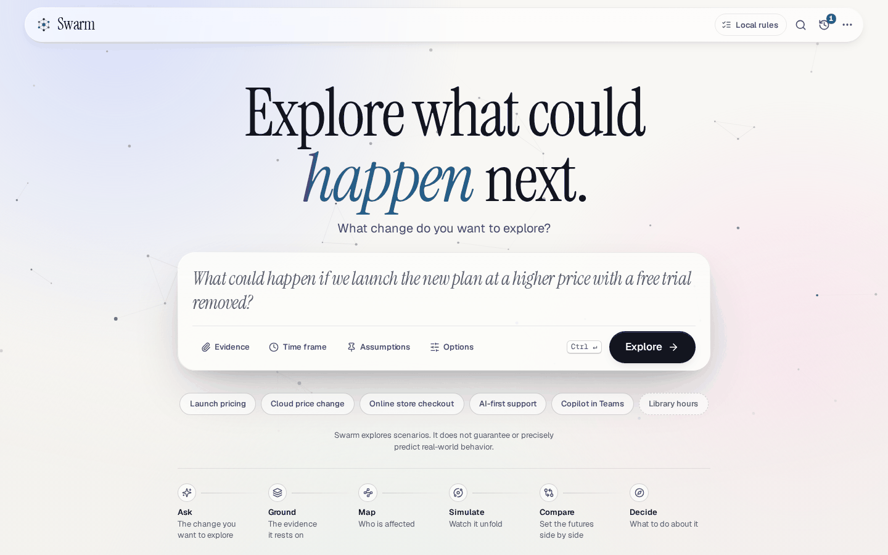
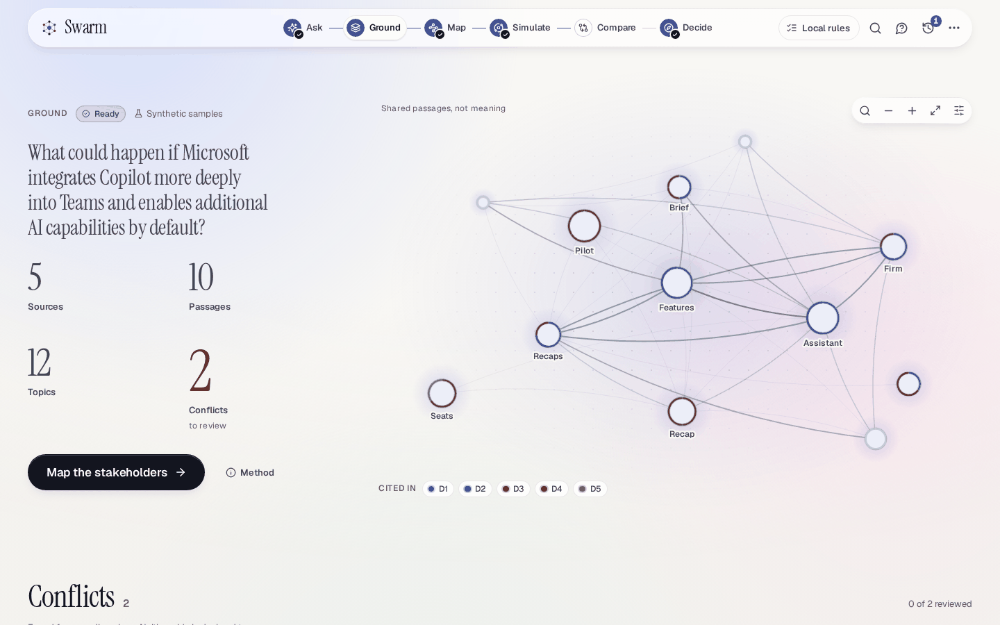
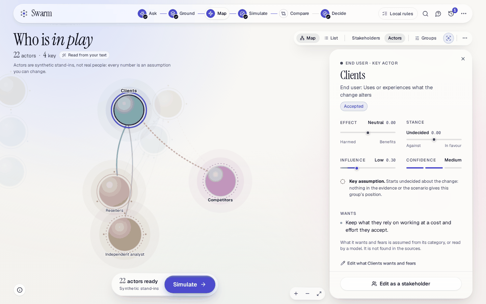
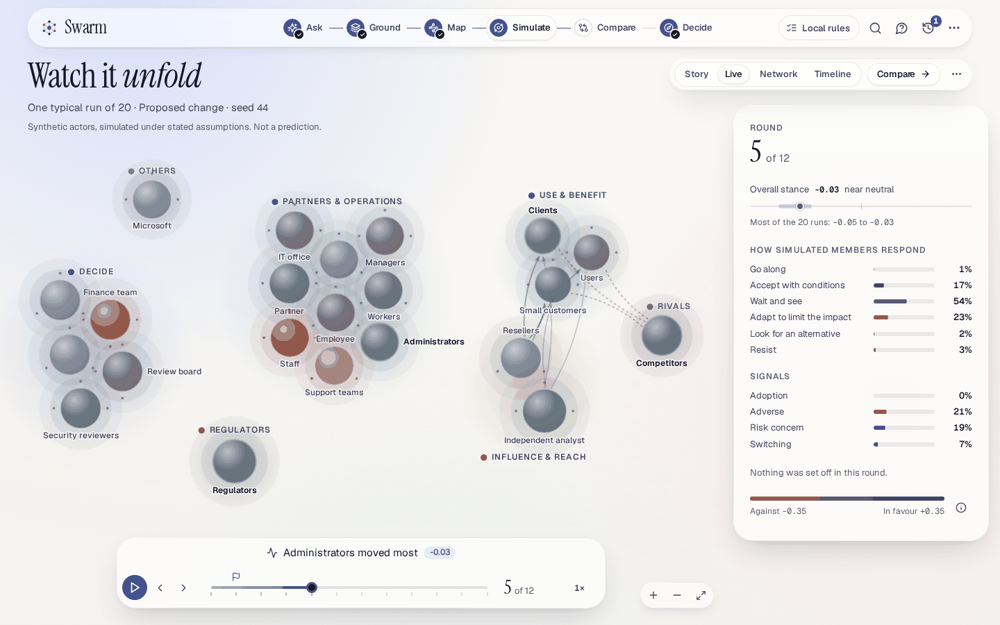
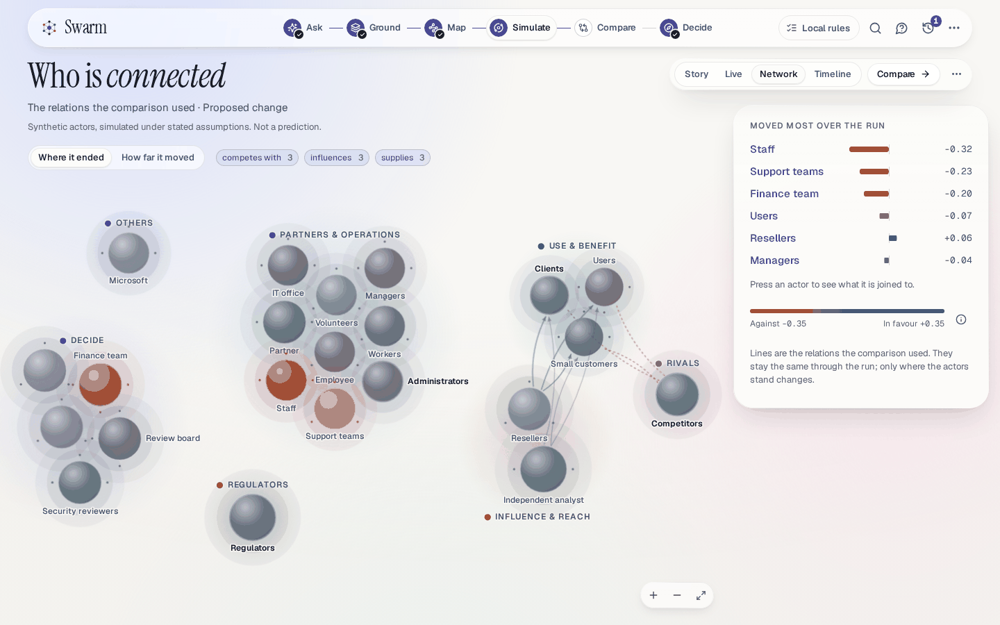
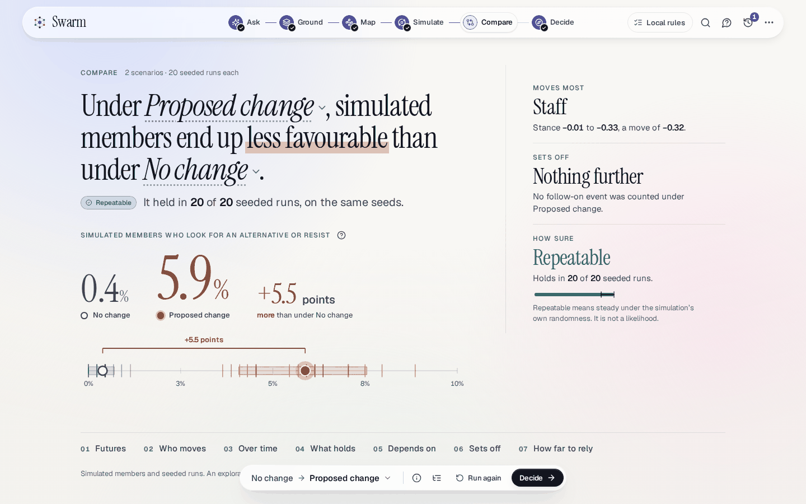
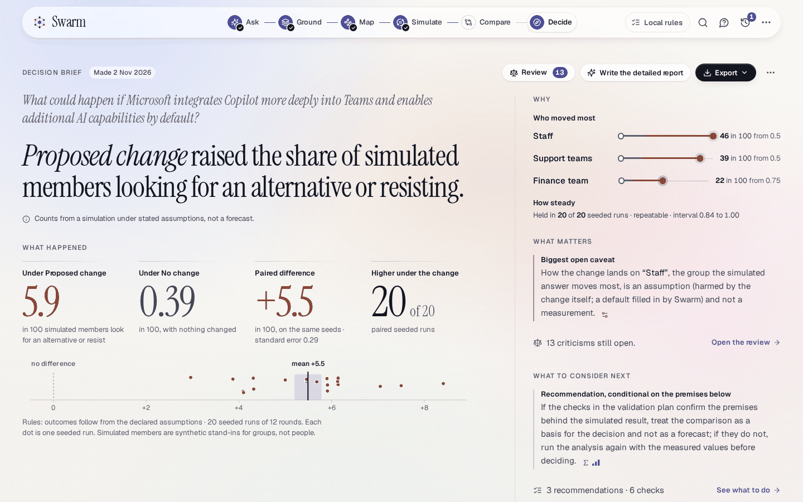
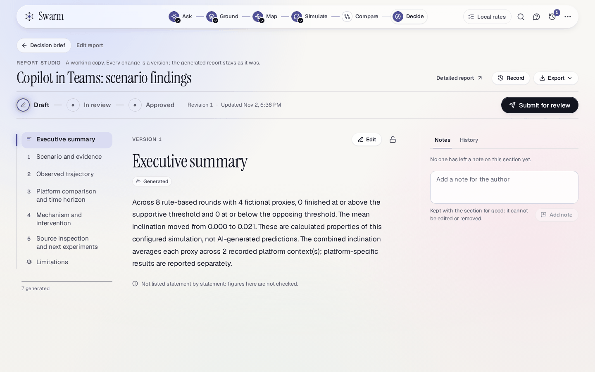

# Demo guide

This is the guide for showing Swarm to an audience, such as a hackathon jury: a ten-minute script for
the four flagship demos, what to point at, what to do when the network is down, and how to reset.

Swarm explores possible scenarios. It does not predict the future. Say so first and last.

The four flagship demos are not four features. They are **four inputs to one generic pipeline**: a
question and some evidence. Nothing in the engine, the stakeholder step or the brief knows about Teams,
AWS or an online shop, and a test fails if it learns. What the audience sees is what Swarm does with
evidence, not what an author wrote down.

| Demo                                                                          | Input                                                                                          | Why it is in the set                                                                    |
| ----------------------------------------------------------------------------- | ---------------------------------------------------------------------------------------------- | --------------------------------------------------------------------------------------- |
| 1. [Copilot in Teams](./scenarios/copilot-in-teams/README.md)                 | A question about a default-on assistant, and 5 synthetic documents                             | The full walk, with two source conflicts and gaps the brief should show as uncertainty  |
| 2. [Regional cloud price change](./scenarios/regional-price-change/README.md) | A question about a $1 price rise in one region, and 5 synthetic documents                      | The same pipeline on an unrelated subject, with a notice that leaves its own unit open  |
| 3. [Online store](./scenarios/ecommerce-experience/README.md)                 | A question about delivery fees and checkout, 4 synthetic documents and an optional public page | Customer behaviour, and retrieved public evidence labelled apart from invented evidence |
| 4. Your own question and a public URL                                         | Whatever the audience asks, and a public page you or they choose                               | Proof that nothing was prepared: the thin evidence shows up as thin output              |

Everything in demos 1 to 3 is **synthetic**. Microsoft, Copilot, Teams and AWS are in the questions only
because the questions name them. Each document says so in its first lines, and its provenance is
`sample` with the licence `Synthetic, CC0`, so the label travels with the evidence into the brief.

## The journey you will walk

One page, six scenes, always in this order: **Ask**, **Ground**, **Map**, **Simulate**, **Compare**,
**Decide**. The journey is the row of six points in the top bar (the dock along the bottom edge on a phone).
A point that cannot be opened yet is locked and says what opens it ("Ground it first", "Needs actors",
"Run a simulation first"), so the audience cannot be taken somewhere that has nothing to show. The address
holds where you are (`?project=<id>&scene=<scene>&view=<view>`), so a reload, the Back button and a link
all land in the same place.

| Scene        | What the audience sees                                                                       | Inside it                                                                                                      |
| ------------ | -------------------------------------------------------------------------------------------- | -------------------------------------------------------------------------------------------------------------- |
| **Ask**      | One question field, evidence attached to it, and the scenario Swarm read from it, to correct | **Evidence**, **Time frame**, **Assumptions**, **Options**, the example chips, **Continue** (earlier projects) |
| **Ground**   | What the evidence says: sources, what they talk about, where they disagree                   | The source graph, **Sources**, **Conflicts**, **Statements** (once a report exists)                            |
| **Map**      | Who is affected, as an ecosystem to look at, review and approve                              | The map and the **List** view, the inspector, **Create actors**                                                |
| **Simulate** | The scenarios set against each other on the same seeds, then replayed                        | **Run the simulation**, then **Story**, **Live**, **Network**, **Timeline**; the deep dive                     |
| **Compare**  | The futures side by side, as a document to read                                              | The gap chart, **Futures**, **Who moves**, **Depends on**, **How far to rely**                                 |
| **Decide**   | The decision brief, the independent review, and the report studio                            | **Review**, **Export**, **Edit report**, **Detailed report**                                                   |

Everything on these screens is read from the real engine. Nothing is mocked, and nothing in the script
below is a result: read the real screen and quote that.

## Before you present

Allow ten minutes.

1. **Start the server** with a fresh data directory, so that rehearsals do not mix with anything real:
   `npm run build`, then `DATA_DIR=./data/demo npm start` (on Windows PowerShell set `$env:DATA_DIR`
   first). Open <http://127.0.0.1:3001>.
2. **Say which mode you are in.** With no provider configured the chip at the right of the top bar reads
   **Local rules**: nothing leaves the machine and every step is deterministic. With a provider, the chip
   names it (for example `REAL AZURE AI`), shows the deployment, and reads `connected` only after a real
   request has succeeded (open the chip and choose **Verify connection**, which makes one). Rules mode is
   the one this script is written for: leave **Local rules** selected under **Options**, beside **Evidence**
   on the first screen, so that **Explore** reads the question by rules on this server and the question
   goes nowhere else. With **Model assisted** the question is sent to the provider.
3. **Rehearse each demo once end to end.** In rules mode every step takes seconds. The script contains
   no result, because results depend on the run: read the real screen and quote that.
4. **Decide about the network.** Only fetching a public page needs it, and the Swarm server does the
   fetching, not your browser. Test the address you plan to use. If it fails, use the
   [fallback](#if-the-network-is-down).
5. **Use a window of at least 1280 pixels, Guided detail (the default, under Settings and tools), zoom
   100%.** Close other tabs and turn off notifications. Keep the laptop awake and on power. The replay and
   the map move; a device that asks for reduced motion stops them (the replay then opens on its last
   round), and **Settings and tools** → **Motion** → **Full** turns the movement back on.
6. **Prepare demos 2 and 3 ahead of time** (see the script's second half): run them once so that their
   projects are under **Continue** on the first screen and in **History**, ready to open.

## The ten-minute script

Demo 1 is the full walk. Demos 2 to 4 show what changes when the input changes, and the pipeline does
not. The labels are the ones in the interface (**Explore**, **Ground it**, **Find who is affected**,
**Create actors**, **Run the simulation**, **Compare**, **Decide**, **Write the brief**,
**Review**, **Run the independent review**).

| Time          | Where                                 | Click                                                                                                                                                                                                             | Point at                                                                                                                                                                                                                                                                                                        |
| ------------- | ------------------------------------- | ----------------------------------------------------------------------------------------------------------------------------------------------------------------------------------------------------------------- | --------------------------------------------------------------------------------------------------------------------------------------------------------------------------------------------------------------------------------------------------------------------------------------------------------------- |
| 0:00 to 0:45  | First screen: Ask                     | Nothing                                                                                                                                                                                                           | "Explore what could happen next.", the sentence about not predicting, the six-step line under the question field (Ask, Ground, Map, Simulate, Compare, Decide)                                                                                                                                                  |
| 0:45 to 1:45  | Demo 1: the question and the evidence | The **Copilot in Teams** chip under **Start from an example** (it fills the question and the five documents, and the chips become one line, "Copilot in Teams · 5 documents · sample evidence"), then **Explore** | The count on **Evidence** and the five documents in the tray (open one: "Sample evidence: invented, describes no real case"); then **Your scenario**: what changes, if nothing changes, ways to do it, and **Assumed**, where a dot says who made each assumption; the open points under **Swarm asks**         |
| 1:45 to 2:15  | Demo 1: Ground                        | **Ground it**, then open one conflict under **Conflicts**                                                                                                                                                         | The four figures (**Sources**, **Passages**, **Entities** or **Topics**, **Conflicts**); the source graph; two quotations side by side, each with its document, and "Neither side is declared true"                                                                                                             |
| 2:15 to 3:30  | Demo 1: Map                           | **Map the stakeholders**, **Find who is affected**, select one party, then **Create actors**                                                                                                                      | The ecosystem: clusters of parties, the relations between them, a quiet tint where the effect is unclear; "N to review" and the **Read from your text** chip; a party opened to its quotes, **Why they are here** and its confidence; the dashed **Nobody found for** prompts; **Traits**, each with its origin |
| 3:30 to 4:45  | Demo 1: Simulate                      | **Simulate**, then **Run the simulation**. In the theatre: the scrubber's play button (it also plays by itself the first time), then **Network**, **Timeline** and **Story** in the **View** control              | Set the futures: the baseline and the alternatives on the same seeds, **Seeded runs of each**, the estimate. **Live**: one typical run on the map, the scrubber (a flag where the change lands, a dot where something was set off) and the round card. **Network**, **Timeline**, then **Story**                |
| 4:45 to 5:45  | Demo 1: Compare                       | **Compare**                                                                                                                                                                                                       | The sentence that answers the question; the gap chart (a tick for each seeded run, a bar for the middle 80%, a dot for the mean, a bracket for the difference); "It held in k of n seeded runs" and its class; **Depends on**; **Sets off**; **How far to rely on this**                                        |
| 5:45 to 6:45  | Demo 1: Decide                        | **Decide**, **Write the brief**, then **Review** and **Run the independent review**                                                                                                                               | The verdict and the four numbers under **What happened**; the origin mark on a statement and what it rests on; **Validation plan**, open just after the recommendations; one objection and its basis (the independent critic)                                                                                   |
| 6:45 to 7:30  | Demo 2: a different subject           | The prepared project under **Continue** (or in **History**); or the **Cloud price change** chip and **Explore**                                                                                                   | The open points the question leaves ($1 with no unit, date or scope); the different stakeholders; "nothing in the engine knows AWS"                                                                                                                                                                             |
| 7:30 to 8:45  | Demo 3: a public page                 | The **Online store checkout** chip; **Evidence** → **Web page**, the address, **Fetch**, **Add as evidence**                                                                                                      | The title, site, size and retrieval time; the document's own label as a retrieved page; then type a private address and read the refusal                                                                                                                                                                        |
| 8:45 to 9:30  | Demo 4: the audience's question       | Type it; add a public page; **Explore**; on the map keep or add at least two stakeholders before approving                                                                                                        | What the reading made of it; how thin evidence shows as gaps and a warning, not as confident output                                                                                                                                                                                                             |
| 9:30 to 10:00 | Close                                 | **Export** on the brief (**Markdown**, **JSON, with the data behind the charts** or **Printable page**; Ctrl+P prints the whole brief)                                                                            | The limitations chapter, closed until opened from the contents; "It supports a person's analysis. It does not make the decision."                                                                                                                                                                               |

Not in the ten minutes: **Edit report** on the brief opens the report studio, a working copy of the
detailed report with versions, notes and a review workflow. It needs the detailed report that the deep dive
writes (**Simulate** → **More** → **Deep dive**), so keep it for a longer slot.

### What to say, segment by segment

**0:00, the first screen.** "Swarm answers one question: what could happen if something changes. It
explores scenarios. It does not predict the future, and every figure you will see comes from simulated
members and seeded runs under stated assumptions, never from a real-world rate."



**0:45, the question and the evidence.** "These five documents are invented, and each says so. Every
document keeps where it came from. **Your scenario** is Swarm's reading of my question, made explicit so
that I can correct it before anything runs, and nothing runs until I press **Ground it**. Each assumption
says whether I wrote it or the system did." Point at what the question leaves open (for this one: for
whom 'by default' applies, how deep, over what period) and check that **Swarm asks** raises it, rather
than filling it in.

**1:45, Ground.** "This is what the evidence says before anyone simulates anything: what the sources are,
how they were cut into numbered passages, what they talk about, and where they disagree." Open one
conflict. "Two sources give different figures. Swarm shows both quotations and picks neither. **Confirm**
or **Not a conflict** is a person's decision. It is found from wording alone, so it can raise a false
alarm and can miss a disagreement that needs interpretation."



**2:15, Map.** "These are roles found in the evidence, with the passage shown. They are not people. Rules
mode reads for role words, so it finds the groups a text names that way, and the chip says how they were
found. Where it could not read a direction of impact, nobody is assumed to be helped or harmed in that
group, and I would set it here, with my reasons: **Edit** on the party." Open one party to show its quotes,
word for word, with the passage they come from, and what is assumed. A dashed **Nobody found for** prompt
is a kind of party that nothing in the evidence named. "Every number an actor runs on says where it came
from, and I can change it." **Create actors**: the map switches to the actors and the pill
changes to "N actors ready · Synthetic stand-ins". Open one actor and move one trait's slider under
**Traits**: its chip becomes **you** at once, and **Save** keeps it.



**3:30, Simulate.** "Every scenario runs on the same seeds, so the only difference between them is the
change." Run it. The first view is **Live**: "This is one typical run, the seeded run nearest the middle
under the proposed change. It is one run, not the answer." Press an actor on the map: its own course
through the rounds. Drag the scrubber, or press the space bar: the flag is the round the change lands in,
and a dot is a round in which something was set off, with the round card saying what. Then **Network**:
"who is connected, and where each ended up". Then **Timeline**: "the spread of every run over the rounds".
Then **Story**: "the answer, written from the numbers and nothing else". Leave the replay for last, because
it plays by itself the first time a finished run is opened in a tab; **Play again** repeats it.





**4:45, Compare.** "A single run is never the answer. The baseline and each alternative run many times on
the same seeds, and the difference is paired by seed, so it is the change and not the noise. 'It held in k
of n seeded runs' measures how repeatable this simulation is under its own assumptions. It is not the
probability of the event." Point at a finding with a weak class (**Unstable** or **Rare**) and say that it
is not to be relied on. Under **Depends on**, point at the assumptions with no evidence behind them: "this
is what we would test first". Read what **Sets off** says about one typical run, and say that competitor,
partner and regulator reactions come from generic rules, not from a script written for this example. Close
on **How far to rely on this**: "Swarm explores scenarios. It does not guarantee or precisely predict
real-world behavior."



**5:45, Decide.** "Every statement carries one of ten origins and the ids it rests on: supplied evidence,
retrieved public evidence, a user or system assumption, an inferred stakeholder, actor behaviour, a
simulation aggregation, a model's interpretation, a historical comparison or unresolved uncertainty.
Nothing is unsourced." Read the verdict first, then **What happened** (the share of simulated members
looking for an alternative or resisting under the change and under no change, every actor counting
equally, with the paired difference and in how many paired seeded runs it was higher), **Who moved most**,
**How steady** and **What matters**. Say what it is: "simulated members under stated assumptions, not a
rate in a population". **The answer in full** opens the executive answer, statement by statement. The
reference chapters (the assumptions, the evidence base, the sources, the limitations and the technical
appendix) are closed so that the page is a few screens: open one from the contents, or choose **Open every
chapter**. Point at where two sources disagree, if **Evidence base and quality** lists one: "Swarm shows
both and picks neither." Show **Validation plan**, which is open just after the recommendations: "this is
what we would check in the real world before acting: what to observe, what to compare it with, how, and who
runs it; the decision rule is left to me". Then choose **Review** and **Run the independent review**:
"seven critics challenge the analysis and never edit it". Read one objection with its basis, then
**Respond**, **Accept** or **Dispute** it: "the disagreement stays visible".



**6:45, a different subject.** "Same engine, different question. The notice here gives a dollar figure
with no billing unit, date or scope, and **Swarm asks** should raise that. Nothing in the engine knows
about AWS."

**7:30, a public page.** "The Swarm server fetched this page, not my browser, and it records what the
page said and when. It does not check that it is true. It is a practice site whose prices are random,
so it tells us what a catalogue page looks like, not what any shop's customers do." Then type
`http://127.0.0.1/` or `http://169.254.169.254/` into **Web address** and choose **Fetch**: "private,
local and cloud-metadata addresses are refused however they are written, and so is a name that resolves
to one". Read the message, which ends by offering to let you paste the text instead.

**8:45, the audience's question.** Type what they ask. "No one prepared this. Whatever the evidence
supports is what appears, and where it is thin, the gaps and the warnings say so." A page may name
fewer than two stakeholders. **Create actors** stays disabled until there
are two ("Keep or add two or more"), so add the missing group yourself with **Add a stakeholder…** and
label it as your assumption. If the setup warns that nobody has a direction of impact, say what that means:
no group is set as helped or harmed yet, so any difference it shows comes from how widely the members of a
group are assumed to differ.

**9:30, the close.** "Invented evidence, a repeatable method, assumptions on the table, independent
challenge, and a plan to check it in the real world. Swarm supports a person's analysis. A person
decides."



### The things to point at

| Point at                   | Where                                                                                                                                                                                                                      | Say                                                                                                       |
| -------------------------- | -------------------------------------------------------------------------------------------------------------------------------------------------------------------------------------------------------------------------- | --------------------------------------------------------------------------------------------------------- |
| **Provenance**             | **Sources** in Ground (a sample reads **Synthetic sample**), the quotes under **Evidence** on a party, the origin mark on a brief statement and its **What it rests on**, **Sources and provenance** (closed until opened) | "Every statement names where it came from, and invented evidence says so."                                |
| **Assumptions**            | **Assumed** in **Your scenario**, the origin chip on each of a party's **Traits**, **Important assumptions** (closed until opened)                                                                                         | "Every number an actor runs on is an assumption with an origin, and it is mine to edit."                  |
| **Uncertainty**            | The class and "It held in k of n seeded runs" on Compare, the confidence pips on a party, **Depends on**, **Uncertainty and sensitivity** (closed until opened)                                                            | "'Held in k of n runs' is repeatability under assumptions. This finding is unstable: do not rely on it."  |
| **The replay**             | The scrubber, the flag where the change lands, the dots where something was set off, and the round card (**Simulate** → **Live**)                                                                                          | "This is one run, round by round. The comparison is the many."                                            |
| **Second-order effects**   | **Sets off** on Compare, **Set off** on the replay's round card, **Second-order and competitor effects** in the brief                                                                                                      | "Competitors, partners and regulators react by generic rules after a lag, not by a script."               |
| **The independent critic** | **Review** on the brief (it carries the number still open), which opens the **Independent review**                                                                                                                         | "A critic challenges. It never edits the analysis, and its silence would not mean the analysis is right." |
| **The validation plan**    | **Validation plan** (open, right after the recommendations), the recommendations' own checks                                                                                                                               | "Swarm ends by saying what to measure in the real world, because a simulation cannot settle it."          |
| **How far to rely**        | **How far to rely on this**, on Story and on Compare                                                                                                                                                                       | "Swarm explores scenarios. It does not guarantee or precisely predict real-world behavior."               |

### Do not say

- That an example shows what Microsoft, AWS or any real company will do, or that any figure in it is real.
- That "k of n runs" is a probability, or that a count or a share of simulated members is a rate in a population.
- That the actors are people, or that their traits were measured.
- That rules mode is a language model. It is deterministic code, and it is labelled as such.
- That a critic's silence means the analysis is right, that a "supported" label means a statement is
  true, or that Swarm is production ready or secure. It is not claimed, and it has not been reviewed.

Do not state what a run will show. If a pack was built to show a gap, such as an unknown licence term,
check on your run that the brief shows it, and say so if it does not.

## If the network is down

Rules mode needs no network and no model. Only reading a public page does, and the demo is complete
without it: demos 1 and 2 need none, demo 3 has four bundled documents, and demo 4 can use notes that
you paste instead of a page.

- **Fetching fails.** The notice says "The page could not be read", says why (no network, the site did not
  answer, the site asks not to be fetched, a private address) and ends by offering to let you paste the
  text. Say what happened and move on. Do not hide a failure behind another mode.
- **Paste instead of fetching.** Open **Evidence**, choose **Paste**, give it a name ending in `.txt` or
  `.md` under **Source filename**, paste at least 80 characters of the page's text under **Source text**
  and choose **Attach**. Or save the page's text beforehand as a `.txt` or `.md` file and attach it with
  **Files** (**Drop files, or choose**), or drop it on the question field. Say that it is **pasted**
  evidence: it is labelled supplied evidence in the brief, not retrieved public evidence, because the
  server did not fetch it.
- **The refusal still works offline.** Typing `http://127.0.0.1/` into **Web address** is refused
  before the server looks anything up ("This address is not one that Swarm reads. Swarm reads only
  public web pages ..."), so the safety point can be shown with no network.
- **A model is unavailable.** Rules mode needs none. If you configured one and it fails, the error is
  shown with the rules result that was used instead, or you are asked to choose it. In the lab, a step
  that asks a model (reading the question, finding stakeholders, the review) is given 170 seconds; then
  the rules carry on and a note says so. The model is never replaced silently. If the question cannot be
  read, **Continue without reading** starts the exploration without a scenario, and **Try again** reads it
  again.

## Resetting

What is true, and nothing else:

- **The lab examples have nothing to restore.** They are part of the application (`shared/examples`),
  so choosing one always fills the same question and the same documents.
- **A rehearsal is an ordinary project.** Open **History** in the top bar, choose the trash-can button on
  its row (named **Delete** and the project's name), then **Delete permanently**; or leave it and start
  another with the Swarm mark at the top left, which starts a new question. A project that is queued or
  running cannot be deleted until it stops.
- **A replay plays by itself once for each simulation in a browser tab.** The tab remembers which it has
  shown (in its session storage), so to see one again press **Play again** at the end of the scrubber, or
  open a new tab.
- **A clean machine:** stop the server, then start it with an empty `DATA_DIR`. Stop the server before
  copying or deleting a data directory.
- **The audit log is append-only by design.** A rehearsal stays in it as ordinary entries with
  identifiers and counts and no document text.
- **The recorded Larkholm demonstration** (below) is reset with `npm run demo:seed`.

## The recorded Larkholm demonstration

A second asset, older than the lab and built on the engine's own stages (what the interface now calls the
deep dive). Three projects about one fictional decision, the Larkholm electric ferry, were run once against
a real Azure OpenAI model (Microsoft Entra sign-in, no keys) and stored in [seed/](./seed). They are the
base run, a branch where an assumed council guarantee replaces the operator notice, and a branch where the
notice is withdrawn. Restoring them takes seconds and makes no model call. The seed is the unedited export
of those runs: the sources, the assumed inputs that were given to them, and the recorded model output. The
[presenter guide](./presentation.md) says where the recording is weak, and has its own five- and
ten-minute scripts, objections and failure table.

```bash
npm run demo:seed                # restore, or reset after a rehearsal
npm run demo:seed -- --dry-run   # check the files and say what would change; write nothing
npm run demo:seed -- --remove    # delete the three demonstration projects
```

The seed touches only those three projects, which have fixed identifiers. Everything else in the
database is left as it is, and anything added to them during a rehearsal (a question, an edit) is
replaced. A branch made in a rehearsal is a project of its own, so the reset leaves it: delete it under
**History**. It writes to the SQLite file under `DATA_DIR`, and so not to a PostgreSQL database
named by `DATABASE_URL`. A server that signs people in (`AUTH_MODE=entra`) has no local workspace, so there
the target must be named: `--tenant <id> --owner <id>`. On the first screen the projects are offered under
**Continue**, in a **Recorded demonstration** group, only when they are really in the workspace; the screen
says nothing of them when they are not, so restore them first.

What they open to is decided by what they hold. They were made by the engine's own stages, not by the
scenario lab, so they hold no stakeholder list and no scenario comparison. The interface opens them on
**Map**, which has nothing found yet ("Who is in play?"; do not press **Find who is affected** on a
recording, because it adds a list to it until the next reset); **Simulate** says "No actors to simulate
yet" unless the address asks for the deep dive (`&scene=simulate&view=deep`); and **Compare** and **Decide**
stay locked ("Run a simulation first"), so the recorded detailed report, the report studio and the
comparison of two recorded runs cannot be opened from them. What does open: **Ground** (the sources, the
entities and relations, the conflicts and the statements of the recorded report), the deep dive, **Ask
about this** (the analyst, the fictional proxies and surveys, with the recorded conversation), **Audit log**
and **Export snapshot** under **Settings and tools**.

| Command                | What it does                                                                                                                                                                                                                                                                                           |
| ---------------------- | ------------------------------------------------------------------------------------------------------------------------------------------------------------------------------------------------------------------------------------------------------------------------------------------------------ |
| `npm run demo:seed`    | Restores the recorded workspace. No model calls.                                                                                                                                                                                                                                                       |
| `npm run demo:journey` | Walks the recorded presentation in a real browser against a running server (default `http://127.0.0.1:3001`) that uses a real model: a rehearsal that checks. It refuses a rules-mode server unless `JOURNEY_ALLOW_LOCAL=1`. See [TESTING.md](../TESTING.md) for what it covers and how long it takes. |
| `npm run demo:record`  | Re-records the three projects against a server that uses a real model. Spends about US$0.30 of model usage, so it is run on purpose only.                                                                                                                                                              |

## Example scenarios

[Example scenarios](./scenarios/README.md) holds the five worked examples that the first screen offers as
chips (the four flagship demos use three of them and your own question): each is a question and a few
synthetic documents with a five-minute and a ten-minute script, a readable copy of its documents, and what
it was built to contain. They carry no answer and no result.

## The older source packs

Six small, fictional scenarios for the engine's evidence layer. Each is a handful of short source
documents that you can paste into a new project. Everything in them is invented: no real place,
organisation, person or figure.

They are not a benchmark. They exist so that a reviewer can watch each behaviour of the evidence
layer on material small enough to read in two minutes. Each pack is also checked by
`backend/test/demos.test.ts` against the expectations in [demos.json](./demos.json), so a pack that
stops demonstrating its point fails a test instead of quietly going stale.

| Pack                                                           | Sources | What it demonstrates                                                                        |
| -------------------------------------------------------------- | ------- | ------------------------------------------------------------------------------------------- |
| [Larkholm electric ferry](./larkholm-ferry/README.md)          | 5       | The full walk-through: one figure conflict, one preference conflict, assumptions, branching |
| [Hartwell clinic booking](./hartwell-clinic-booking)           | 3       | Two figure conflicts between a clinic's report and an audit note                            |
| [Eastfield campus parking](./eastfield-campus-parking)         | 3       | Real conflicts **and two false alarms** that a person must dismiss                          |
| [Northgate bus redesign](./northgate-bus-redesign)             | 3       | Two conflicts between an authority and an operator over the same plan                       |
| [Docklands warehouse robotics](./docklands-warehouse-robotics) | 3       | A real conflict that the detector **does not find** (stated in different words)             |
| [Library hours: thin evidence](./library-hours-thin-evidence)  | 1       | Too little evidence: the analyst declines questions the single note cannot answer           |

### How to run one

1. Start Swarm and open it (see the [README](../../README.md#quick-start)).
2. On the first screen paste the pack's question from [demos.json](./demos.json) into the question field,
   attach the files in the pack's folder (**Evidence** → **Files**, or drop them on the question field),
   choose **Explore**, then **Ground it**.
3. Run it. Local rules mode needs nothing; in **Model assisted** mode (under **Options**) every engine step
   that has a model path calls the model.
4. **Ground** shows the sources, the graph, and the conflicts between the sources: confirm or dismiss them
   there. For the engine's own run and its report, open **Simulate** → **More** → **Deep dive**:
   **Prepare the environment**, **Start the simulation**, then **Write the detailed report**. Back in
   **Ground**, **Statements** lists every statement of the report with how well the sources back it, and
   **Assumptions** lists the assumptions the simulated results rest on.
5. Open **Ask about this** (the button in the top bar, or `/`) and, on the **Analyst** tab, ask the
   report one question from the pack's `answerable` list and one from its `unanswerable` list. **Ask**
   opens once the detailed report is written.

### What to expect in each

| Pack      | Conflicts the detector reports | Notes                                                                                                                                                                                |
| --------- | ------------------------------ | ------------------------------------------------------------------------------------------------------------------------------------------------------------------------------------ |
| Larkholm  | 1                              | The operator and the council give different annual crossings. The preference conflict ("overwhelmingly prefer" against "71% oppose") is not found; see K3 in `evaluation/README.md`. |
| Hartwell  | 2                              | Both are real.                                                                                                                                                                       |
| Eastfield | 4                              | **Two are real** (permit price, parking occupancy). **Two are not**: the students' survey and the staff survey differ because they ask different people. Dismiss them.               |
| Northgate | 2                              | Both are real.                                                                                                                                                                       |
| Docklands | 0                              | The vendor says "no roles would be lost"; the Union says "about 300 of the 1,400 roles ... are at risk". That is a real conflict. It is missed, and a person must see it.            |
| Library   | 0                              | One source. The analyst declines what the note does not cover. How the sufficiency pill reads for it in model mode has not been observed in a live run.                              |

The two false alarms in Eastfield and the miss in Docklands are **kept on purpose**. The detector
is deliberately conservative, and it is the person, not the detector, who decides that two figures
conflict. A demo that only showed it succeeding would overstate it.

### What the analyst does with a question

The chat analyst first checks, without calling a model, whether the project's own material can
answer. If it cannot, it declines in exactly these words and makes no model call:

> The available project evidence does not support a confident answer.

If it can, the model's answer must cite a source passage, a recorded memory or a statement in the
grounding review, or say that it cannot. Each pack lists two questions its sources answer, and two
they do not.

## Known limits of these demos

- **The first check is lexical.** It catches a question with nothing in common with the project
  ("Who won the football match last night?") and a year the sources never mention. It does not catch
  a question that mixes an unrelated topic with a word the project uses. For example, "What is the
  weather forecast for next Tuesday?" is let through, because "forecast" appears in the project's own
  report. Only the model's own refusal and its duty to cite can catch that, and that is measured
  in live runs, not in these tests.
- **A plausible question about something absent also passes the first check.** "Which councillors
  voted against?" shares its words with the sources. See `evaluation/README.md` for the measured
  rates (1 of 4).
- **The packs are tiny.** Detecting a conflict in a three-page pack says little about detecting
  one in a three-hundred-page report.
- **The checks run in rules mode.** `backend/test/demos.test.ts` exercises the deterministic path.
  Rules mode produces no grounding review, so the ledger holds no statements: Ground's **Statements**
  says so, and the sufficiency pill beside it (**Supports a recommendation**, **Limited: treat as
  tentative**, **Not enough yet**) appears only once there are statements to rate. The ledger's own
  sufficiency level reads "insufficient" for every pack in rules mode, and is informative only with a
  model, where the report's statements are classified. With a real model the same sources can produce
  different statements and different support classes; the live Azure run on the Larkholm pack is the only
  model evidence.
- **The lab's examples are tested through the pages, but on fixtures.** The browser tests (see
  [TESTING.md](../TESTING.md)) take the three flagship examples and a question that no example knows from
  the first screen to the exported brief in a real browser, and `backend/test/lab-journey.test.ts` does the
  same through the routes. Both run the rules engine with no model, and the public pages in them are served
  from this machine, so they say nothing about a real page or a real model. Rehearse the demo you will show
  before you rely on a script.
