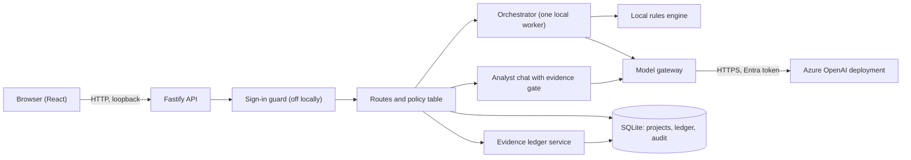
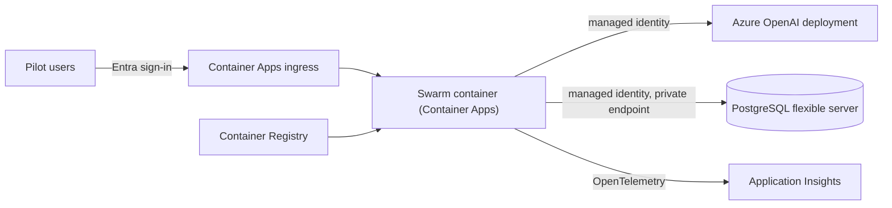

# Architecture

Two shapes: what runs today, and what is proposed for a hosted pilot. The second is **not built**.
For the long form see [ARCHITECTURE.md](../../ARCHITECTURE.md) and the
[architecture decisions](../adr/README.md).

## Today

One Node process serves a React single-page app and a Fastify API, and keeps its state in one SQLite
file. It calls a model only if one is configured.

- **The model has no tools.** It returns schema-checked JSON. Retrieval, memory search and the
  ledger are server functions called by deterministic code.
- **Local mode makes no network call.** Real model mode uses a Microsoft Entra token for the signed-in
  developer or a managed identity; there is no API key to store.
- **Where the evidence decisions are made:** `backend/src/grounding/` (classification, publication
  policy, conflicts, ledger service) and `backend/src/orchestration/evidence-gate.ts`. No model
  decides a support class or whether an answer is allowed.
- **Where identity is enforced:** `backend/src/auth/` (token verification, the default-deny route
  table, the guard).
- **State:** a project is one JSON document plus side tables for the ledger, conflicts and the
  audit log, under versioned migrations.

## Proposed for a hosted pilot (not built)

Chosen to be the smallest thing that serves several people safely. Each service is here because a
named need requires it; the last section lists what was left out on purpose.

| Service                                  | Needed because                                                                                                                        | Status                                                 |
| ---------------------------------------- | ------------------------------------------------------------------------------------------------------------------------------------- | ------------------------------------------------------ |
| Azure Container Apps                     | The app is already a container, and the CI builds and health-checks it                                                                | Not provisioned                                        |
| Azure Container Registry                 | Holds the image                                                                                                                       | Not provisioned                                        |
| Azure Database for PostgreSQL flexible   | More than one instance, transactions for the audit chain, Entra authentication ([ADR 0006](../adr/0006-postgres-adapter-proposed.md)) | Adapter not built; server not provisioned              |
| Azure OpenAI (the existing deployment)   | The model                                                                                                                             | Exists in a development subscription; not changed here |
| Application Insights (via OpenTelemetry) | A pilot needs traces, failures and cost signals                                                                                       | Not built                                              |
| Microsoft Entra app registration         | Sign-in and the app roles (`Swarm.User`, `Swarm.Admin`, `Swarm.PlatformAdmin`)                                                        | Needs a tenant administrator                           |

**Left out on purpose:** Azure AI Search (lexical retrieval is adequate for the small document sets
measured so far, and nothing shows semantic retrieval would help; revisit with a real corpus),
Cosmos DB (the audit chain and migrations want transactions), Azure Functions (there is no event-driven
work), Key Vault (there are no secrets to hold when both the model and the database use managed
identity; add it the day a secret appears), API Management, Front Door.

## Decisions this depends on

An asynchronous repository interface comes first, because the storage layer is synchronous today and
PostgreSQL's driver is not ([ADR 0006](../adr/0006-postgres-adapter-proposed.md)). Sign-in at the
edge in addition to the API's own check is recommended, so that the API is never reachable
unauthenticated.
