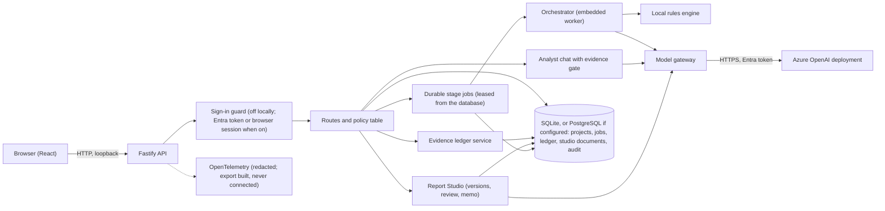
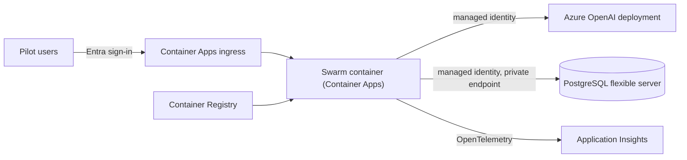

# Architecture

Two shapes: what runs today, and what is planned for a hosted pilot. The second is planned and costed, and its
Bicep compiles and lints, but **nothing is deployed**.
For the long form see [ARCHITECTURE.md](../../ARCHITECTURE.md) and the
[architecture decisions](../adr/README.md).

## Today

One Node process serves a React single-page app and a Fastify API, and keeps its state in one SQLite
file, or in a PostgreSQL database if one is configured. It calls a model only if one is configured.

- **The model has no tools.** It returns schema-checked JSON. Retrieval, memory search and the
  ledger are server functions called by deterministic code.
- **Local mode makes no network call.** Real model mode uses a Microsoft Entra token for the signed-in
  developer or a managed identity; there is no API key to store.
- **Where the evidence decisions are made:** `backend/src/grounding/` (classification, publication
  policy, conflicts, ledger service) and `backend/src/orchestration/evidence-gate.ts`. No model
  decides a support class or whether an answer is allowed.
- **Where identity is enforced:** `backend/src/auth/` (token verification, the default-deny route
  table, the guard).
- **State:** a project is one JSON document plus side tables for the ledger, conflicts, the job queue,
  Report Studio documents and the audit log, under versioned migrations (the same migrations exist for the
  PostgreSQL adapter).

## Planned for a hosted pilot (not deployed)

Chosen to be the smallest thing that serves several people safely. Each service is here because a
named need requires it; the last section lists what was left out on purpose.

| Service                                  | Needed because                                                                                                                                    | Status                                                                            |
| ---------------------------------------- | ------------------------------------------------------------------------------------------------------------------------------------------------- | --------------------------------------------------------------------------------- |
| Azure Container Apps                     | The app is already a container, and the CI builds and health-checks it                                                                            | Not provisioned                                                                   |
| Azure Container Registry                 | Holds the image                                                                                                                                   | Not provisioned                                                                   |
| Azure Database for PostgreSQL flexible   | More than one instance, transactions for the audit chain, Entra authentication ([ADR 0009](../adr/0009-postgres-through-a-synchronous-bridge.md)) | Adapter built and tested in-process; server not provisioned                       |
| Azure OpenAI (the existing deployment)   | The model                                                                                                                                         | Exists in a development subscription; not changed here                            |
| Application Insights (via OpenTelemetry) | A pilot needs traces, failures and cost signals                                                                                                   | Instrumentation and export built and tested with in-memory exporters; no resource |
| Microsoft Entra app registration         | Sign-in and the app roles (`Swarm.User`, `Swarm.Admin`, `Swarm.PlatformAdmin`)                                                                    | Needs a tenant administrator                                                      |

**Left out on purpose:** Azure AI Search (lexical retrieval is adequate for the small document sets
measured so far, and nothing shows semantic retrieval would help; revisit with a real corpus),
Cosmos DB (the audit chain and migrations want transactions), Azure Functions (there is no event-driven
work), Key Vault (there are no secrets to hold when both the model and the database use managed
identity; add it the day a secret appears), API Management, Front Door.

## Decisions this depends on

The storage layer stayed synchronous: the PostgreSQL adapter reaches the database through a worker-thread
bridge that blocks the process for the length of a query ([ADR 0009](../adr/0009-postgres-through-a-synchronous-bridge.md),
which supersedes the first plan in [ADR 0006](../adr/0006-postgres-adapter-proposed.md)). That is acceptable for
a pilot and is the first thing to revisit for more than a few users. Sign-in at the edge in addition to the
API's own check is recommended, so that the API is never reachable unauthenticated.
